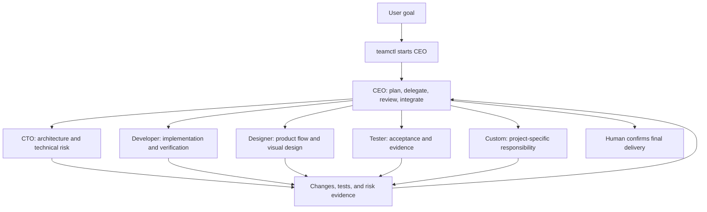

<p align="right"><a href="README.zh-CN.md">简体中文</a></p>

<h1 align="center"></h1>

<p align="center">
  <strong>Specialized AI agents, working as one delivery team.</strong>
</p>

TeamCraft is a stateful software team orchestration skill built on Herdr. It starts with a chief engineer acting as CEO. The CEO can then assemble CTO, developer, designer, tester, or custom specialists as the task requires. Each member runs in an independent pane and works toward delivery with an explicit role, file scope, and acceptance evidence.

The skill's technical name is `teamcraft`. It provides executable tools for managing a team's lifecycle rather than an unsupervised, fully autonomous delivery system. The CEO handles decomposition, delegation, and review; a human should still confirm final integration and release decisions.

## What it solves

Multi-agent development can easily lead to duplicate assignments, overlapping edits, repeated starts after failures, and uncertainty over whether a task was submitted. TeamCraft addresses these issues with:

- **On-demand staffing:** Only the CEO starts by default. The CEO decides whether the task needs a CTO, developer, designer, tester, or another specialist.
- **Separate harness and role choices:** The role defines responsibility, while `--kind` selects a Herdr-supported harness such as Codex or OpenCode.
- **Ownership coordination:** Every editing task must declare project-relative file or directory scopes. Overlapping scopes among active members are rejected.
- **Read-only members:** Reviews, research, and acceptance checks can use `--read-only` without reserving an edit scope.
- **Persistent state:** Members, pane identities, ownership scopes, and execution phases are stored in `.teamcraft/teamcraft.db` (SQLite).
- **Safe recovery:** `resume` checks the terminal and native agent session. When the outcome is ambiguous, it inspects by default instead of submitting a task again.
- **Live status checks:** `status` reports `blocked`, `working`, `idle`, `done`, `unknown`, or `missing` rather than treating cached state as live state.
- **Concurrency protection:** Runtime state changes commit in SQLite transactions under a project-level leader lease with epoch fencing, while per-member lifecycle operations additionally take flock guards to reduce conflicts during concurrent launches or recovery.

## Team structure



| Role | Primary responsibility |
| --- | --- |
| CEO | Understand requirements, plan, staff the team, delegate, review evidence, integrate, and assess delivery |
| CTO | Architecture, interfaces, technical tradeoffs, and risk |
| Developer | Implement and verify changes within an assigned scope |
| Designer | Product flow, interaction, visual rules, and design assets |
| Tester | Acceptance coverage, issue reproduction, and verification evidence |
| Custom | Define another responsibility, such as deployment, documentation, or security, with `--responsibility` |

## Requirements

- macOS or Linux. The current implementation uses Python's `fcntl` file locking and does not support native Windows.
- Python 3.10 or later.
- Herdr CLI installed and commands run from a Herdr pane, with `HERDR_ENV=1` and `HERDR_SOCKET_PATH` available.
- At least one Herdr-supported agent harness with its executable on `PATH`.
- OpenCode and a working model provider when using the bundled OpenCode role profiles.
- Optional: `fastapi` and `uvicorn` only if you want to run the local API (`teamcraft/api/` — the M3-01 security shell with the implemented M3-02 query, M3-03 SSE, M3-04 command routes, and the bundled M3-05 web console).

The example configuration in this repository uses a local oMLX service:

```text
provider: omlx
baseURL: http://127.0.0.1:8000/v1
model: omlx/Qwen3.8-Flash-Next-oQ4e-mtp
```

This is an example from the development environment, not a fixed TeamCraft dependency.

## Install into a project

Clone TeamCraft, then run the installer from the cloned repository:

```bash
git clone https://github.com/DiQiTech-AI/teamcraft.git
cd teamcraft
bash scripts/install.sh --target /path/to/project
```

If `--target` is omitted, the installer uses the current working directory:

```bash
bash scripts/install.sh
```

Preview the changes without writing files:

```bash
bash scripts/install.sh --target /path/to/project --dry-run
```

The installer copies the `teamcraft` runtime skill, the shared `teamcraft-ceo` protocol skill, six OpenCode role profiles, a thin OpenCode CEO entry, and the example model configuration. It creates `opencode.json` only when that file is missing. An existing `opencode.json` is always preserved. It also adds runtime ignore rules to the target project's `.gitignore` while retaining existing content. It never creates or changes `AGENTS.md` or `CLAUDE.md`.

By default, an existing managed file with different content causes an error and is not overwritten. A conflicting user-owned `.opencode/agents/teamcraft-ceo.md` is always preserved and causes a preflight error, including with `--force`. Use `--force` only when you intend to replace TeamCraft-managed skill, role, or template files; the CEO entry is replaceable only when it carries the TeamCraft managed marker:

```bash
bash scripts/install.sh --target /path/to/project --force
```

`--force` never overwrites an existing `opencode.json` or user-owned CEO entry. Reinstalling identical content is safe and idempotent. The installer does not install dependencies, access the network, or modify global configuration.

The `teamcraft-ceo` Skill is shared by Codex and OpenCode. Its single protocol is versioned in `references/CEO_PROTOCOL.md`; `references/protocol.manifest.json` pins the exact UTF-8 bytes by SHA-256. If the protocol cannot be verified against an active Attempt's pin, stop and request human recovery. Claude Code is not supported by this entry yet.

After installation:

1. If the installer created `opencode.json`, edit its provider, `baseURL`, and model for the target machine. If the project already had this file, review it manually; the installer leaves it untouched.
2. If you use another model, update `model` in the installed `.opencode/agents/herdr-*.md` profiles as well.
3. From the target project root, confirm that OpenCode can load the configuration:

```bash
opencode --standalone
```

Exit the trial run, open the target project root in Herdr, and check the current environment and local Herdr semantics:

```bash
test "$HERDR_ENV" = "1"
herdr --skill
```

## Quick start: create an OpenCode team

This example asks the CEO to deliver a plain HTML to-do page. `--agent-arg=--standalone` is passed through to OpenCode unchanged:

```bash
python3 .agents/skills/teamcraft/scripts/teamctl.py launch \
  --role ceo \
  --kind opencode \
  --name ceo \
  --task "Deliver a plain HTML to-do page. Create developer and read-only tester members as needed, define acceptance criteria for every assignment, and report after reviewing their results." \
  --agent-arg=--standalone
```

`teamctl` creates a sibling pane in the current Herdr tab, loads the `herdr-ceo` OpenCode profile, and submits the task. The CEO can then use the same `teamcraft` skill to create the workers it needs.

For example, the CEO can create a developer with:

```bash
python3 .agents/skills/teamcraft/scripts/teamctl.py launch \
  --role developer \
  --kind opencode \
  --name web_dev \
  --ownership 'examples/todo/**' \
  --task "Implement a dependency-free to-do page. Acceptance: users can add, complete, and delete items." \
  --agent-arg=--standalone
```

Then create a tester instructed not to modify files:

```bash
python3 .agents/skills/teamcraft/scripts/teamctl.py launch \
  --role tester \
  --kind opencode \
  --name acceptance \
  --read-only \
  --task "Verify the to-do page against the requirements and report evidence without changing project files." \
  --agent-arg=--standalone
```

## Ownership and read-only tasks

Every non-CEO member that edits files must declare at least one `--ownership` scope:

```bash
--ownership 'src/api/**'
--ownership 'tests/api/test_users.py'
```

- Paths must be relative to the project root.
- Exact files and directory scopes ending in `/**` are supported.
- Other wildcards, absolute paths, and `..` traversal are rejected.
- Equal, parent, or child scopes cannot overlap among active editing members.
- A `--read-only` member cannot also declare `--ownership`.

Ownership is coordination metadata that prevents conflicting assignments. It is not operating-system-level file isolation. The CEO and final reviewer should still inspect each member's actual changes.

## Inspect, recover, and archive

Inspect the team and each member's live state:

```bash
python3 .agents/skills/teamcraft/scripts/teamctl.py status
```

Resume an incomplete launch. The default action only inspects state and does not resubmit the task:

```bash
python3 .agents/skills/teamcraft/scripts/teamctl.py resume web_dev
```

After confirming the task never ran or must be sent again, choose that action explicitly:

```bash
python3 .agents/skills/teamcraft/scripts/teamctl.py resume web_dev --prompt-action send
```

If the task was already delivered, skip resubmission:

```bash
python3 .agents/skills/teamcraft/scripts/teamctl.py resume web_dev --prompt-action skip
```

When the result of a pane split is ambiguous, inspect the current layout first. Retry only after confirming that no pane was created:

```bash
python3 .agents/skills/teamcraft/scripts/teamctl.py resume web_dev --split-action retry
```

Archive a task and release its ownership after acceptance:

```bash
python3 .agents/skills/teamcraft/scripts/teamctl.py complete web_dev
```

Release the ownership without marking the task complete:

```bash
python3 .agents/skills/teamcraft/scripts/teamctl.py release web_dev
```

Neither `complete` nor `release` closes the pane or terminates the agent. They reject members in `working`, `blocked`, or `unknown` state. Use `--force` only after a human confirms that the member will not make further conflicting changes.

## Recovery, bounded attempts, and safe reset

Record explicit operator decisions on a stalled or ambiguous Task without resending anything:

```bash
python3 .agents/skills/teamcraft/scripts/teamctl.py recovery-request \
  --task-id TASK_ID --action wait --actor human --reason "waiting for worker" \
  --idempotency-key wait-TASK_ID-1
```

`--action` accepts `wait`, `cancel`, and `reconcile`. Escalate a no-progress or deadline event recorded by the watcher:

```bash
python3 .agents/skills/teamcraft/scripts/teamctl.py recovery-timeout \
  --attempt-id ATTEMPT_ID --trigger-event-id EVENT_ID
```

Request a verified cancel, settle an ambiguous command after inspecting Herdr facts, or request an approved bounded retry:

```bash
python3 .agents/skills/teamcraft/scripts/teamctl.py recovery-cancel web_dev \
  --actor human --reason "operator cancel" --idempotency-key cancel-web_dev-1
python3 .agents/skills/teamcraft/scripts/teamctl.py recovery-reconcile web_dev \
  --command-id COMMAND_ID --resolution finished \
  --actor human --reason "verified pane facts"
python3 .agents/skills/teamcraft/scripts/teamctl.py recovery-retry \
  --task-id TASK_ID --actor human --reason "approved retry" \
  --idempotency-key retry-TASK_ID-1
```

Timeouts never stop or restart agents by themselves. `UNKNOWN` attempts keep their slot, and a new attempt requires an approved retry within the Task's `max_attempts` (default 3).

To start from a clean runtime, `reset` archives the current database with an online SQLite backup into `.teamcraft/archive-*` and creates an empty database. It requires the exact resolved project root and never imports, moves, or deletes legacy JSON state:

```bash
python3 .agents/skills/teamcraft/scripts/teamctl.py reset \
  --confirm-project /absolute/path/to/project
```

## CEO bootstrap identity reconciliation

If the harness has not reported the CEO's native session within the bounded check after the bootstrap prompt, initialization stays `UNKNOWN` and dispatch stays blocked. Inspect first, then choose explicitly; nothing is resent automatically:

```bash
# confirm a Prompt whose durable delivery record already shows submitted
python3 .agents/skills/teamcraft/scripts/teamctl.py prompt-reconcile-submitted ceo \
  --command-id COMMAND_ID --actor human --reason "inspected delivery evidence"

# bind a native session that the harness reported late
python3 .agents/skills/teamcraft/scripts/teamctl.py ceo-reconcile-native-session ceo \
  --actor human --reason "native session now visible"

# last-resort, explicitly non-portable live-process binding: same pane/terminal,
# same PID start-time fingerprint, same Herdr socket; Scheduler and Wake stay blocked
python3 .agents/skills/teamcraft/scripts/teamctl.py ceo-reconcile-live-process ceo \
  --actor human --reason "operator verified live process in pane"
```

## Wake queue (manual operation)

Events are stored durably in SQLite and merged into Wake records; the prompt is only a signal. These commands operate the queue manually, and automatic CEO start is off by default:

```bash
python3 .agents/skills/teamcraft/scripts/teamctl.py wake-status --state pending
python3 .agents/skills/teamcraft/scripts/teamctl.py wake-dispatch
python3 .agents/skills/teamcraft/scripts/teamctl.py wake-ack \
  --wake-id WAKE_ID --through-seq SEQ --session-id NATIVE_SESSION_ID
python3 .agents/skills/teamcraft/scripts/teamctl.py wake-process --wake-id WAKE_ID
python3 .agents/skills/teamcraft/scripts/teamctl.py wake-reconcile --wake-id WAKE_ID \
  --resolution submitted --actor human --note "inspected pane transcript" \
  --evidence-json '{"observed": "..."}'
```

Ambiguous deliveries become `unknown` and are never resent automatically; `--resolution not-submitted` blocks the Wake instead of triggering a resend; acknowledgement requires the native CEO session id printed in the Wake prompt and moves the acknowledgement cursor forward monotonically. Real-Herdr delivery, restart recovery, and identity-drift verification are deferred and remain unverified — see [`doc/M2-09_WAKE_DISPATCH_STATUS.md`](doc/M2-09_WAKE_DISPATCH_STATUS.md).

## Report-only verification and approval

M2 Verification runs only a project-persisted argv explicitly approved by a human. Configure the argv as separate arguments (never as a shell command string), then run it against a finished scout Attempt:

```bash
python3 .agents/skills/teamcraft/scripts/teamctl.py verifier-configure \
  --executable python3 --arg=-m --arg pytest --arg=-q \
  --rules-version tests-v1 --actor human --idempotency-key verifier-v1
python3 .agents/skills/teamcraft/scripts/teamctl.py verify \
  --attempt-id ATTEMPT_ID --idempotency-key verify-ATTEMPT_ID-v1
python3 .agents/skills/teamcraft/scripts/teamctl.py verification-status --task-id TASK_ID
python3 .agents/skills/teamcraft/scripts/teamctl.py verification-artifact --verification-id VERIFICATION_ID
python3 .agents/skills/teamcraft/scripts/teamctl.py verification-approval \
  --verification-id VERIFICATION_ID --decision accept \
  --actor human --reason "Report accepted" --idempotency-key approve-VERIFICATION_ID
```

The verifier is launched with `shell=False`; its bounded stdout/stderr artifact and SHA-256 digest, exit status, argv, rules version, and verifier config version are stored immutably in SQLite. No configured verifier means no PASS. Brief and final WorkerReport retain their immutable dispatch-time Task version; Verification separately records the Task version after `worker_reported_done`, plus the Attempt identity, Brief digest, and final WorkerReport identity/digest. An Approval is bound to that complete evidence and is rechecked under the project Leader transaction before the scout Task can become DONE. Later Task, Brief, WorkerReport, artifact, or verifier-policy changes make the evidence stale; an already completed scout is reopened if its Task evidence or verifier policy changes. Repeated decisions with the same idempotency key return the recorded decision; a different decision requires a new Verification. Ship Tasks remain in VERIFYING/NEEDS_HUMAN until M4 Worktree/Commit/Diff evidence exists; M2 does not accept a report as ship delivery.

## Local-only Commit/Diff delivery (M4-04 — independently accepted 2026-11-14)

For a finished writable ship Attempt whose policy is `delivery=local_only`, M4-04 creates a local Commit only in that Attempt's registered `tc/<task>/<attempt>` worktree. Before the Git effect, Core persists a fenced Command and rechecks the worktree identity plus the complete ownership Diff Gate. Ship evidence then binds the Task/Attempt/Brief and final WorkerReport versions, exact Commit SHA and branch, base-to-Commit diff digest and bounded artifact, and the current passing M4-03 verifier profile/config evidence. Worker completion, verifier PASS, ship evidence, and human acceptance remain separate facts.

```bash
python3 .agents/skills/teamcraft/scripts/teamctl.py commit-create \
  --member DEV_MEMBER --idempotency-key commit-ATTEMPT-v1
python3 .agents/skills/teamcraft/scripts/teamctl.py ship-evidence \
  --member DEV_MEMBER --idempotency-key ship-ATTEMPT-v1
python3 .agents/skills/teamcraft/scripts/teamctl.py delivery-status \
  --member DEV_MEMBER
python3 .agents/skills/teamcraft/scripts/teamctl.py delivery-diff \
  --member DEV_MEMBER --ship-evidence-id SHIP_EVIDENCE_ID
python3 .agents/skills/teamcraft/scripts/teamctl.py delivery-accept \
  --member DEV_MEMBER --ship-evidence-id SHIP_EVIDENCE_ID \
  --commit-sha COMMIT_SHA --branch ATTEMPT_BRANCH \
  --actor human --reason "Accept exact local Commit" \
  --idempotency-key accept-SHIP_EVIDENCE_ID-v1
```

If Git completed but the Commit receipt was lost, `commit-reconcile --member DEV_MEMBER --command-id COMMAND_ID --actor human --reason "Reconcile observed Git facts"` adopts only an exact, unambiguous Commit proved by the registered worktree, native Session, and durable Event facts; it never creates a replacement Commit. `delivery-reject` records an explicit rejection without completing the Task. Any Commit/branch, Task version, policy, verifier profile/config, diff, or worktree identity drift makes prior evidence or Approval non-current. Only acceptance that echoes the exact bound Commit and branch can move a `local_only` Task from VERIFYING to DONE.

The authenticated API exposes the same Core operations at `POST /api/v1/attempts/{attempt_id}/delivery/commit`, `POST /api/v1/attempts/{attempt_id}/delivery/ship-evidence`, `POST /api/v1/commands/{command_id}/delivery/reconcile`, and `POST /api/v1/ship-evidence/{ship_evidence_id}/approval`; read views are `GET /api/v1/tasks/{task_id}/delivery`, `GET /api/v1/attempts/{attempt_id}/delivery`, `GET /api/v1/ship-evidence/{id}`, and `GET /api/v1/ship-evidence/{id}/diff`. Writes retain the existing bearer, Origin/CSRF, `Idempotency-Key`, applicable expected-version, and short Leader-lease gates. Request models accept only opaque ids, expected Task versions, exact Commit/branch echoes, and bounded text; clients cannot supply Git argv, paths, or shell fragments. Report-only/scout approval remains on `/api/v1/verifications/{id}/approvals`. Direct-PR is still gated on M4-05. M4-04 performs no push, merge, deployment, or worktree deletion.

## Use another harness

Roles and harnesses are independent. Replace `--kind opencode` with another type supported by the active Herdr installation. For example:

```bash
python3 .agents/skills/teamcraft/scripts/teamctl.py launch \
  --role tester \
  --kind codex \
  --name api_review \
  --read-only \
  --task "Run the API acceptance tests and report failure evidence without changing files."
```

`teamctl` first checks Herdr's supported kind list and the corresponding executable. OpenCode additionally loads the `.opencode/agents/herdr-*.md` profiles in the target project. Other harnesses receive their role, responsibility, and ownership through the task prompt.

## Repository layout

```text
.
├── .agents/skills/teamcraft/
│   ├── SKILL.md                 # Skill rules and operating guide
│   ├── scripts/teamctl.py       # Launch, status, recovery, and archival tool
│   └── tests/test_teamctl.py    # Regression tests
├── .opencode/agents/            # CEO, CTO, developer, designer, tester, and custom profiles
├── teamcraft/                    # Python core boundaries (storage, domain, scheduler, watcher, verification, wake)
│   └── api/                    # M3-01 security shell with M3-02 query, M3-03 SSE, and M3-04 command routes (+ bundled M3-05 web console in api/web/)
├── pyproject.toml                # Package metadata; Python 3.10+ boundary; API dependencies; packaged web-console assets
├── examples/team-demo/          # Live collaboration example
├── scripts/install.sh           # Project-local installer
├── opencode.example.json        # OpenCode/oMLX example configuration
└── PROGRESS.md                  # Implementation and live verification notes
```

`.teamcraft/` is a local runtime directory containing the SQLite database, locks, journals, reset archives, and the API session token. It is ignored by Git. Its state is bound to the Herdr socket session that created it and does not migrate automatically to another Herdr server session. If `.herdr-team/state.json` or a non-empty `.teamcraft/state.json` is present, the CLI stops before any Herdr call or new database write; it never migrates, moves, or deletes legacy JSON automatically.

## Local API security shell (M3-01 complete)

`teamcraft/api/` is the HTTP surface that the Query (M3-02), SSE (M3-03), and Command (M3-04) routers mount on, so every route inherits the same guards. The server binds `127.0.0.1:8765` by default and refuses any other bind unless you pass `--allow-non-loopback`:

```bash
pip install -e .
python3 -m teamcraft.api --project-root /path/to/project --print-token
```

On first start it writes a random session token to `.teamcraft/api/session-token` (directory `0700`, file `0600`). Requests outside the public health/static paths require `Authorization: Bearer <token>`, and write methods additionally require `X-CSRF-Token: <token>` plus a same-origin `Origin` (or one listed via repeatable `--origin`). `GET /api/v1/health`, `/api/v1/health/live`, and `/api/v1/health/ready` answer without a token, distinguishing process liveness from dependency readiness. Readiness returns `503` when any registered dependency is `down` or `unknown`; the aggregate reports `degraded` for down dependencies and preserves an explicit unknown state when no dependency is down but at least one remains unknown. `--rotate-token` replaces the active token (old tokens stop verifying immediately), and static assets — by default the bundled M3-05 console, or any directory you pass via `--static-root`; `--no-web-ui` disables the console — are confined to that directory (traversal, symlink escape, hidden files, and directory browsing are rejected).

## Command API and dispatch gates (M3-04 — implemented, automated-verified)

The authenticated write surface (`teamcraft/api/command.py`, mounted by `python3 -m teamcraft.api`) exposes Task lifecycle and control operations that execute exclusively through the existing Core services — the same transitions the CLI runs:

- **Applied operations** (`POST /api/v1/tasks`, `PATCH /api/v1/tasks/{id}`, dependency add/remove, `POST /api/v1/tasks/{id}/commands` with `pause`/`resume`/`cancel`(no live attempt)/`retry`, `POST /api/v1/tasks/{id}/policy`, `POST /api/v1/scheduler/pause|resume`, `POST /api/v1/verifications/{id}/approvals`) return `200` with `execution: "applied"`: the durable Command is `confirmed` in the same transaction that ran the transition, and every write is traceable through Command/Event rows.
- **Recorded operations** (`cancel` of an occupied attempt, `wait`/`reconcile`, and `POST /api/v1/ceo/commands` manual CEO wake requests) return `202`: they persist a durable, TTL-bounded Command plus its audit event and never prompt, dispatch, or admit anything themselves — a fenced runtime consumes them. A queued `ceo.wake_request` event is folded into an ordinary Wake candidate by the next scheduler tick; the API can never fan out a Wake storm.
- **Leader participation, not bypass:** the retry/approval tier acquires its own short lease (`teamcraft-api`) through the normal fencing protocol; while a live runtime Leader holds the scope the request fails `409` with `details.reason_code: "LEADER_BUSY"` (or `"LEADER_STALE"`) and writes nothing. Task pause/resume and scheduler pause/resume never touch `leader_lease` at all.
- **Durable gating (schema v15):** `tasks.paused` hides a task from `ready_queue` and hard-refuses `create_attempt` (`TASK_PAUSED`); `tasks.execution_policy_json` persists the closed policy set (`delivery` ∈ report_only/local_only/direct_pr/ship, `router`, `verifier`, `timeout_seconds` 1–3600, `max_attempts` ≥1, with `max_attempts` mirrored onto the enforced column); `scheduler_controls` defers all NEW dispatch project-wide (`scheduler_paused`) without stealing leases. A task pause CAS-bumps `version`, which auto-expires PENDING commands bound to stale evidence.
- **Idempotency and uniform errors:** every write requires `Idempotency-Key`; same key + identical content replays with `replayed: true` and the same command id, different content conflicts `409`. Errors share one body shape (`code/message/details/request_id`) across auth, validation, 404, version conflicts, cycles, and lease contention.

`teamctl` covers the same operations against the same database with the same idempotency, version, refusal, and lease-free semantics: `create-task`, `edit-task`, `set-priority`, `add-dependency`, `remove-dependency`, `task-pause`, `task-resume`, `task-policy`, `scheduler-pause`, `scheduler-resume`, and `wake-request` (recorded tier; several have `task-*`/`dependency-*`/`ceo-*` aliases). Command audit events are project-traceable end to end: project-scoped commands carry an explicit `project_id` evidence stamp (an allowed evidence key since M3-04), so every `command.submitted/claimed/confirmed/expired` event resolves through the project even before a Task binding exists (see `tests/test_teamctl.py` and `tests/test_api_m304.py`).

Not claimed: delivery/router policy *execution* semantics belong to M4; occupied-attempt cancellation is recorded but performed by the fenced runtime executor; everything above is verified by automated tests only — live browser/E2E and GitHub Actions runs against this tree have not been performed.

## Web console (M3-05 — implemented, API-integration verified)

The API now serves a dependency-free minimal console from the bundle at `teamcraft/api/web/`, reachable at **`http://127.0.0.1:8765/static/index.html`** when the server runs with the default static root (no extra flags; `--static-root` overrides, `--no-web-ui` disables). It is served through the exact same confined `/static` route as every other asset — the shell itself is public and contains no data.

Bootstrap: start the server with `python3 -m teamcraft.api --project-root /path/to/project --print-token`, open the console URL, paste the printed token into the page, and press Save. The token is kept only in that browser tab's `sessionStorage` — never in a URL, cookie, or file written by the page — and **Forget** clears the tab-local copy without touching the server.

The console shows only real data from the guarded routes (no seeded placeholders):

- **Overview** — project snapshot (task/attempt/session/wake counts, durable event seq, wake cursor, CEO init state) plus the scheduler gate with pause/resume controls (`POST /scheduler/pause|resume`, lease-free control row).
- **Tasks** — filtered/paginated list (`GET /projects/{id}/tasks`), detail view with layered attempts → brief/prompt-delivery/sessions/WorkerReports (`GET /tasks/{id}/attempts`, `GET /attempts/{id}`), verifications, approvals, and recovery records. Create/edit forms, priority edits, dependency add/remove (cycles surface the concrete `cycle` path), and the execution-policy form — whose delivery control is a closed `<select>` offering only `report_only`/`local_only`/`direct_pr`/`ship` (mirroring the Core `DELIVERY_MODES` the API enforces, so invalid free text cannot be configured from the UI) — map onto `POST /tasks`, `PATCH /tasks/{id}`, the dependency routes, and `POST /tasks/{id}/policy`. Every write carries `Idempotency-Key` (deterministic per method+path+body, so an accidental identical double-submit replays instead of double-writing), the CSRF header, and the task `expected_version`.
- **Immutable during an active run** — identity fields (id, project, kind, acceptance, ownership, `max_attempts`) are labelled immutable (no API path mutates them after creation); while a task is running/verifying, the console states that title/description/priority/risk edits are critical: they bump the Task version and expire PENDING commands bound to older evidence. Stale-version writes surface as `409 VERSION_CONFLICT` with `expected`/`found`, and nothing was written.
- **CEO** — durable initialization record (state, protocol version/hash, skill hash, `receipt_source`, identity booleans) and harness protocol availability, plus **Ask the CEO** (`POST /ceo/commands`) which only queues a TTL-bounded `ceo.wake_request` — the page physically cannot send a prompt.
- **Events** — live SSE tail over the durable `events.seq` with client-side seq dedupe, reconnect-from-cursor, and explicit `snapshot_required` resync; REST backfill button; oversized frames arrive flagged `payload_truncated`.
- **Wakes / Approvals / Verifications** — wake lifecycle kept separate (pending→sending→submitted→acknowledged→processed, with `unknown`/`blocked` flagged as failures needing reconciliation), wake cursors and recovery records, approval decisions via `POST /verifications/{id}/approvals` under the API's short lease (`LEADER_BUSY` explained), verification runs with digest-anchored artifact previews, and verifier config versions.

Visible-state honesty: loading, empty ("no records"), offline (server unreachable — the banner states that server-side work continues and closing the browser pauses nothing), unavailable store (`503`), auth/CSRF (`401`/`403`), conflicts, truncation flags, and null usage ("unknown", never zero) are distinct states. All server text — titles, logs, payloads, reasons — is attached via DOM text nodes only: the script contains no HTML-parsing or dynamic-code sinks and no external resources, so hostile HTML/Markdown/log content is inert (pinned by `tests/test_web_m305.py`).

Verified (2026-11-10, macOS arm64): `tests/test_web_m305.py` **35 tests OK** (asset safety scan; the policy form's delivery control pinned to the closed set `report_only`/`local_only`/`direct_pr`/`ship` with the pinned values compared against the live `domain.DELIVERY_MODES`, plus a pyproject `package-data` declaration check; serve default/override/disable wiring; confined `/static` semantics incl. traversal and dotfile refusal; honest empty/unavailable/auth states; full task create/replay/conflict/edit/dependency-cycle/policy/pause-resume/scheduler/CEO-queue flows in the console's exact request shape incl. `Idempotency-Key` + CSRF + same-origin `Origin`; forged free-text deliveries outside the closed set refused `422 VALIDATION_FAILED` with nothing persisted — version untouched, no surviving command row; hostile text round-tripping as JSON; truncation flags; durable-seq paging; a real-uvicorn SSE tail whose ids match the REST seqs; token never appearing in served bodies; durable intents readable after the client disappears), plus the full repository suite at **673 passed / 115 subtests / exit 0** (`unittest discover -s tests` twice OK and `pytest tests/ -q` OK on the final run) and a live loopback smoke (`/static/index.html` served `text/html`, public health, bearer-gated queries showing real rows, unauth `401`, and an Origin+CSRF+key write applied through the Command surface). Packaging (2026-11-10): `pyproject.toml` declares `[tool.setuptools.package-data]` `teamcraft = ["api/web/index.html", "api/web/app.js", "api/web/style.css"]`; wheel and sdist built locally without network via `setuptools.build_meta` (setuptools 78.1.0) — `teamcraft-0.2.0.dev0-py3-none-any.whl` (SHA-256 `4256c31ccf6ea3f7fc0a3e6451f873f0df09b02bcc9308ff993a0706bd630e7f`, 46 files, all three assets present under `teamcraft/api/web/` incl. RECORD hashes) and `teamcraft-0.2.0.dev0.tar.gz` (SHA-256 `cdf44c5c722a55b9547e617d0930a83b8c89fe9e1d9484a5976a4f5f33dc5676`, all three assets under `teamcraft-0.2.0.dev0/teamcraft/api/web/`) — the sdist additionally round-trips to a wheel (`0f4f36ffa82e3908642f02349f1235ba8c0bb404d94b76c2117b97e79d8bd62c`) that still carries all three assets, and unpacking the wheel outside the repository resolves the default `serve.WEB_ROOT` to the packaged `teamcraft/api/web` directory: `/static/index.html|app.js|style.css` all serve `200` while `/api/v1` stays bearer-gated (`401`). Not verified at M3-05 registration time: cross-browser `sessionStorage` behavior and GitHub Actions against this tree; real-browser rendering/click-through E2E was M3-06 territory and has since been implemented with headless Chromium against Fake Herdr (see the Browser E2E section below — real-Herdr scenarios remain outside it).

## Browser E2E (M3-06 — repeatable Chromium recovery matrix with Fake Herdr)

`tests/test_web_m306.py` drives the M3-05 console in **real headless Chromium** through a **pure-stdlib Chrome DevTools Protocol client** (`socket` + SHA-1 + frame masking; no Playwright, no Selenium, no chromedriver, and nothing downloaded — Playwright/Selenium/chromedriver are not installed on this machine, and installing them was explicitly out of scope). If no Chromium binary is found the suite skips with an explicit reason (override with `TEAMCRAFT_E2E_CHROME`); a skip is never counted as evidence. Each test gets an isolated temporary project root and SQLite DB (`fresh_start.initialize_project_root`), runs the real backend as a subprocess (`python3 -B -m teamcraft.api --project-root <tmp> --port <probed>`), and authenticates with that root's own session token. Clicks are real `Input.dispatchMouseEvent` presses, hit-tested via `elementFromPoint` after scroll-into-view; assertions read durable facts from SQLite as well as DOM text.

The recovery matrix it exercises (20 tests):

- **report-only/scout flow end-to-end** — create → worker report → verifier pass → Accept in the browser; policy form sets `report_only` and the ship-completion text names M4; identical resubmit and double-clicks never double-write (deterministic `Idempotency-Key` replay).
- **CEO/protocol** — initialization facts, protocol version/hash, harness availability rendered live; merged multi-event wake (idle 30s window) visible in the Wakes view; wake admission blocked while `ceo_working`; manual CEO request queues (202) only; wake failure (`unknown`/`blocked`) rendered as failure needing reconciliation.
- **Events/SSE** — live tail, disconnect→REST backfill (cursor advances), snapshot_required resync when the cursor is ahead, client dedup across three concurrent streams (each durable seq rendered exactly once; one task write = several events, all assertions cursor/count-based).
- **Durability** — backend restart with the SSE stream open, then tab reload: DOM seq == REST seq == SQLite order, no duplicate commands/wakes/deps across the restart; server absence is a distinct honest state (unreachable chip, no fabricated overview) and recovers on Refresh; closing the tab mid-flight never affects the store.
- **Task management** — DAG cycle refusal names the concrete closed path (`x -> y -> x`) in the console's state box and persists nothing; stale-version edit is a named 409 conflict that writes nothing; scheduler/task pause-resume badges; queue/TTL expiry never executes and the expiry is visible.
- **Hostile content** — long output arrives `preview_truncated`-flagged; `` payloads render as escaped text only (zero `` elements in the DOM, raw markup stays escaped).

Verified (2026-11-11, macOS arm64, Google Chrome 157.0.8103.50, Python 3.13.14, revision `68a77e5` + this uncommitted work): `python3 -B -m pytest tests/test_web_m306.py -q` → **20 passed, exit 0** on two consecutive full runs (41.47s and 41.19s). The suite surfaced six real console defects, fixed in `teamcraft/api/web/app.js`: `el()` crashed on scalar/Node children; `recoveryTable()` was referenced but never defined; stale async view commits could overwrite a newer view (fixed with a render-generation guard); the Events view auto-connect never set `state.streamActive`, so the SSE stream was never read unless Connect was clicked by hand; REST backfill did not advance `state.lastSeq` (reconnect then duplicated cards); and `parseSse`/`decisionForms` mis-framed SSE fields and nested the decision-form array. `node --check teamcraft/api/web/app.js` exits 0.

**Limits — Fake Herdr ≠ real Herdr:** every mocked runtime scenario runs through the same Core primitives under a fenced lease, and the suite asserts its transcript never contacts a real Herdr host. What remains unverified: real-Herdr delivery/restart/identity-drift, trusted-host receipts, GitHub Actions, and non-Chromium engines (Safari/Firefox).

## Verification

Run the regression suite with:

```bash
python3 -B -m unittest discover -s .agents/skills/teamcraft/tests -v
python3 -B -m unittest discover -s tests -v
```

The Skill suite (89 tests on 2026-11-08) covers state recovery, concurrent ownership reservations, member operation locking, moved panes, recovery from start failures, ambiguous task submission, session identity checks, OpenCode configuration merging, CLI contracts, invalid input, legacy-state refusal, runtime symlink safety, and the SQLite runtime plus CEO bootstrap/reconcile and wake CLI surfaces.

The repository suite (468 tests on the same date) covers the installer — 25 tests for first/repeat installs, configuration preservation, conflicts, dry runs, paths with spaces, symbolic links, Git ignore rules, and the `teamcraft` Skill entry — 8 tests for the Python package's ID, UTC clock, error, configuration, and side-effect-free import boundaries, 73 focused M3-01 API security tests, and the remaining core tests for storage, migrations, domain state, events/commands, leader fencing, the scheduler, briefs/WorkerReports, the watcher, recovery, verification/approval, the wake dispatcher, CEO protocol/initialization, and the Herdr adapter. The recorded local run used Python 3.13.14 and passed with exit code 0; lint checks and a live loopback HTTP smoke also passed. CI now installs `.[test]` before running the core suite on both matrix legs, but GitHub Actions has not yet run against this working tree.

As of 2026-11-11 the repository suite is 693 tests — added since the earlier 468-test baseline are the M3-02 query API, M3-03 SSE reconnect-recovery, 67 focused M3-04 command-API tests (`tests/test_api_m304.py`), 18 teamctl CLI parity and parser-robustness tests (`tests/test_teamctl.py`), 35 M3-05 web-console integration tests (`tests/test_web_m305.py`), and 20 M3-06 Chromium E2E tests (`tests/test_web_m306.py`, real headless Google Chrome 157.0.8103.50 driven by a pure-stdlib CDP client; the suite self-skips with an explicit reason when no Chromium binary exists, and may be excluded with `--ignore=tests/test_web_m306.py` on machines without a browser) — and `python3 -B -m pytest tests/ -q` passes locally (693 passed, 115 subtests passed, exit code 0 on the 2026-11-11 final run; `python3 -B -m pytest tests/test_web_m306.py -q` separately green twice in a row, 20 passed each, for repeatability). The teamctl parser is core-version-tolerant: `--help` builds against canonical Core constants (or a closed fallback for pre-M3-04 offline bundles), and commands requiring v15 APIs fail with an actionable reinstall hint rather than an AttributeError. One earlier run of this tree hit sandbox socket restrictions that made the M3-03 uvicorn tests fail to bind `127.0.0.1:0` (`[Errno 1] Operation not permitted`); those tests passed unchanged in the 2026-11-10 run, so they are recorded as an environment limitation, not a code failure. A pre-existing load-sensitivity remains in `tests/test_api_m303.py::M303GapFallback::test_live_gap_detected_after_backfill` (SSE gap-detection timing): under full-suite load it failed in 2 of 4 full pytest runs on 2026-11-10 (and once again in the 2026-11-11 run that excluded the E2E file) while passing solo (6/6 across both days), in its full file, and in the other full runs — recorded as an existing flaky-timing limitation, untouched by M3-06 (that file is outside its ownership, and the only code change M3-06 made, `teamcraft/api/web/app.js`, is browser-side JavaScript that file never loads).

M4-04 verification and independent acceptance (2026-11-14, local macOS runs): the CEO's full-suite run, `python3 -B -m pytest tests -q -p no:cacheprovider`, completed with **905 passed, 131 subtests passed, exit code 0**. The independent tester additionally recorded **86 M4-04 tests + 6 subtests**, **119 M4-01/M4-02/M4-03 tests + 10 subtests**, **11 M2-06 tests**, and **424 adjacent regression tests + 95 subtests**. That review found one non-blocking runtime-adapter scope-order issue: Commit reconciliation had to reject a foreign member binding before invoking Core. After the guard was moved ahead of the Core effect, the independent recheck passed **25/25 focused adapter/CLI tests**, **2/2 `-k reconcile` tests**, and a direct refusal probe covering foreign Attempt/Task/project bindings, malformed/list/missing evidence keys, wrong Command kind, and read-only members; every refusal observed `core_called=False`. The tester then returned final PASS with no blockers. The 905-test full run and the broader tester matrices preceded this final narrow guard patch; they are not represented as post-fix full-suite runs. Loopback-capable execution is required because SSE/Web tests bind and call `127.0.0.1`; a network-restricted sandbox cannot supply that evidence. GitHub Actions are not claimed here.

The project has also completed one live OpenCode workflow: the CEO created a developer and a read-only tester, the developer generated [`examples/team-demo/index.html`](examples/team-demo/index.html), and the tester completed acceptance. During that run, the CEO's final polling loop did not converge on its own; the controlling agent stopped the loop manually and completed archival. See [`PROGRESS.md`](PROGRESS.md) for the detailed record.

## Current limits

- CEO, Developer, and Tester have been exercised in a live workflow. CTO, Designer, and Custom have not yet been started and verified individually.
- The CEO can decompose work, create members, and collect results, but a human still needs to supervise permission requests, exception recovery, final integration, and release.
- Both `idle` and `done` can indicate a completed, settled task; do not wait only for `done`.
- `unknown` means the live state could not be verified and must not be treated as completion.
- Ownership provides team coordination, not a security sandbox.
- M4-04 implements local-only Commit/Diff evidence and exact Commit/branch acceptance across Core, CLI, runtime adapter, and authenticated API, and was independently accepted on 2026-11-14 after the focused reconciliation scope-order recheck described above. It does not implement direct-PR, push, merge, deployment, cleanup, or the rich M6-02 diff UI. GitHub Actions have not been recorded for this working tree.
- The M3-01 security shell, M3-02 query API, M3-03 SSE resume, M3-04 command API, M3-05 minimal web console, and the M3-06 browser E2E suite are implemented and verified by automated tests, a local loopback HTTP smoke, and repeatable headless-Chromium E2E against Fake Herdr (20 tests green twice consecutively; six real console defects fixed in `teamcraft/api/web/app.js`). Occupied-attempt cancellation is recorded durably but carried out by the fenced runtime executor; the bundled console ships inside normal wheel and sdist installs (declared as `package-data` in `pyproject.toml`; both archives inspected offline and the default installed `WEB_ROOT` verified to resolve and serve the three assets). The Chromium E2E drives the console through real Chrome DevTools Protocol input, but every runtime scenario is Fake Herdr executing the same Core primitives: it is explicitly **not** real-Herdr evidence, and Safari/Firefox behaviour is not covered.
- Trusted-host receipts for CEO bootstrap, and real-Herdr wake delivery/restart recovery/identity-drift, are deferred and remain unverified; offline/mock regressions do not substitute for them.
- Use a new member name for a new task after completing or releasing a member. Historical task archival and member reuse are not implemented.
- Installing the skill into another project also requires the role profiles, with provider, model, and permission paths adjusted for the target machine.
