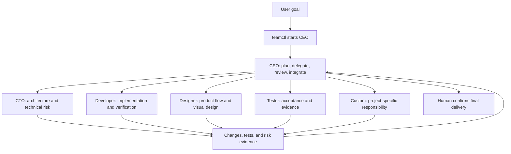

<p align="right"><a href="README.zh-CN.md">简体中文</a></p>

<h1 align="center"></h1>

<p align="center">
  <strong>Specialized AI agents, working as one delivery team.</strong>
</p>

TeamCraft is a stateful software team orchestration skill built on Herdr. It starts with a chief engineer acting as CEO. The CEO can then assemble CTO, developer, designer, tester, or custom specialists as the task requires. Each member runs in an independent pane and works toward delivery with an explicit role, file scope, and acceptance evidence.

The skill's technical name is `teamcraft`. It provides executable tools for managing a team's lifecycle rather than an unsupervised, fully autonomous delivery system. The CEO handles decomposition, delegation, and review; a human should still confirm final integration and release decisions.

## What it solves

Multi-agent development can easily lead to duplicate assignments, overlapping edits, repeated starts after failures, and uncertainty over whether a task was submitted. TeamCraft addresses these issues with:

- **On-demand staffing:** Only the CEO starts by default. The CEO decides whether the task needs a CTO, developer, designer, tester, or another specialist.
- **Separate harness and role choices:** The role defines responsibility, while `--kind` selects a Herdr-supported harness such as Codex or OpenCode.
- **Ownership coordination:** Every editing task must declare project-relative file or directory scopes. Overlapping scopes among active members are rejected.
- **Read-only members:** Reviews, research, and acceptance checks can use `--read-only` without reserving an edit scope.
- **Persistent state:** Members, pane identities, tasks, ownership scopes, and execution phases are stored in `.teamcraft/state.json`.
- **Safe recovery:** `resume` checks the terminal and native agent session. When the outcome is ambiguous, it inspects by default instead of submitting a task again.
- **Live status checks:** `status` reports `blocked`, `working`, `idle`, `done`, `unknown`, or `missing` rather than treating cached state as live state.
- **Concurrency protection:** State writes and member lifecycle operations use file locks to reduce conflicts during concurrent launches or recovery.

## Team structure



| Role | Primary responsibility |
| --- | --- |
| CEO | Understand requirements, plan, staff the team, delegate, review evidence, integrate, and assess delivery |
| CTO | Architecture, interfaces, technical tradeoffs, and risk |
| Developer | Implement and verify changes within an assigned scope |
| Designer | Product flow, interaction, visual rules, and design assets |
| Tester | Acceptance coverage, issue reproduction, and verification evidence |
| Custom | Define another responsibility, such as deployment, documentation, or security, with `--responsibility` |

## Requirements

- macOS or Linux. The current implementation uses Python's `fcntl` file locking and does not support native Windows.
- Python 3.10 or later.
- Herdr CLI installed and commands run from a Herdr pane, with `HERDR_ENV=1` and `HERDR_SOCKET_PATH` available.
- At least one Herdr-supported agent harness with its executable on `PATH`.
- OpenCode and a working model provider when using the bundled OpenCode role profiles.

The example configuration in this repository uses a local oMLX service:

```text
provider: omlx
baseURL: http://127.0.0.1:8000/v1
model: omlx/Qwen3.8-Flash-Next-oQ4e-mtp
```

This is an example from the development environment, not a fixed TeamCraft dependency.

## Install into a project

Clone TeamCraft, then run the installer from the cloned repository:

```bash
git clone https://github.com/DiQiTech-AI/teamcraft.git
cd teamcraft
bash scripts/install.sh --target /path/to/project
```

If `--target` is omitted, the installer uses the current working directory:

```bash
bash scripts/install.sh
```

Preview the changes without writing files:

```bash
bash scripts/install.sh --target /path/to/project --dry-run
```

The installer copies the project-local `teamcraft` skill, six OpenCode role profiles, and the example model configuration. It creates `opencode.json` only when that file is missing. An existing `opencode.json` is always preserved. It also adds `/.teamcraft/` and `/opencode.json` to the target project's `.gitignore` while retaining the file's existing content.

By default, an existing managed file with different content causes an error and is not overwritten. Use `--force` only when you intend to replace TeamCraft-managed skill, role, or template files:

```bash
bash scripts/install.sh --target /path/to/project --force
```

`--force` never overwrites an existing `opencode.json`. Reinstalling identical content is safe and idempotent. The installer does not install dependencies, access the network, or modify global configuration.

After installation:

1. If the installer created `opencode.json`, edit its provider, `baseURL`, and model for the target machine. If the project already had this file, review it manually; the installer leaves it untouched.
2. If you use another model, update `model` in the installed `.opencode/agents/herdr-*.md` profiles as well.
3. From the target project root, confirm that OpenCode can load the configuration:

```bash
opencode --standalone
```

Exit the trial run, open the target project root in Herdr, and check the current environment and local Herdr semantics:

```bash
test "$HERDR_ENV" = "1"
herdr --skill
```

## Quick start: create an OpenCode team

This example asks the CEO to deliver a plain HTML to-do page. `--agent-arg=--standalone` is passed through to OpenCode unchanged:

```bash
python3 .agents/skills/teamcraft/scripts/teamctl.py launch \
  --role ceo \
  --kind opencode \
  --name ceo \
  --task "Deliver a plain HTML to-do page. Create developer and read-only tester members as needed, define acceptance criteria for every assignment, and report after reviewing their results." \
  --agent-arg=--standalone
```

`teamctl` creates a sibling pane in the current Herdr tab, loads the `herdr-ceo` OpenCode profile, and submits the task. The CEO can then use the same `teamcraft` skill to create the workers it needs.

For example, the CEO can create a developer with:

```bash
python3 .agents/skills/teamcraft/scripts/teamctl.py launch \
  --role developer \
  --kind opencode \
  --name web_dev \
  --ownership 'examples/todo/**' \
  --task "Implement a dependency-free to-do page. Acceptance: users can add, complete, and delete items." \
  --agent-arg=--standalone
```

Then create a tester instructed not to modify files:

```bash
python3 .agents/skills/teamcraft/scripts/teamctl.py launch \
  --role tester \
  --kind opencode \
  --name acceptance \
  --read-only \
  --task "Verify the to-do page against the requirements and report evidence without changing project files." \
  --agent-arg=--standalone
```

## Ownership and read-only tasks

Every non-CEO member that edits files must declare at least one `--ownership` scope:

```bash
--ownership 'src/api/**'
--ownership 'tests/api/test_users.py'
```

- Paths must be relative to the project root.
- Exact files and directory scopes ending in `/**` are supported.
- Other wildcards, absolute paths, and `..` traversal are rejected.
- Equal, parent, or child scopes cannot overlap among active editing members.
- A `--read-only` member cannot also declare `--ownership`.

Ownership is coordination metadata that prevents conflicting assignments. It is not operating-system-level file isolation. The CEO and final reviewer should still inspect each member's actual changes.

## Inspect, recover, and archive

Inspect the team and each member's live state:

```bash
python3 .agents/skills/teamcraft/scripts/teamctl.py status
```

Resume an incomplete launch. The default action only inspects state and does not resubmit the task:

```bash
python3 .agents/skills/teamcraft/scripts/teamctl.py resume web_dev
```

After confirming the task never ran or must be sent again, choose that action explicitly:

```bash
python3 .agents/skills/teamcraft/scripts/teamctl.py resume web_dev --prompt-action send
```

If the task was already delivered, skip resubmission:

```bash
python3 .agents/skills/teamcraft/scripts/teamctl.py resume web_dev --prompt-action skip
```

When the result of a pane split is ambiguous, inspect the current layout first. Retry only after confirming that no pane was created:

```bash
python3 .agents/skills/teamcraft/scripts/teamctl.py resume web_dev --split-action retry
```

Archive a task and release its ownership after acceptance:

```bash
python3 .agents/skills/teamcraft/scripts/teamctl.py complete web_dev
```

Release the ownership without marking the task complete:

```bash
python3 .agents/skills/teamcraft/scripts/teamctl.py release web_dev
```

Neither `complete` nor `release` closes the pane or terminates the agent. They reject members in `working`, `blocked`, or `unknown` state. Use `--force` only after a human confirms that the member will not make further conflicting changes.

## Use another harness

Roles and harnesses are independent. Replace `--kind opencode` with another type supported by the active Herdr installation. For example:

```bash
python3 .agents/skills/teamcraft/scripts/teamctl.py launch \
  --role tester \
  --kind codex \
  --name api_review \
  --read-only \
  --task "Run the API acceptance tests and report failure evidence without changing files."
```

`teamctl` first checks Herdr's supported kind list and the corresponding executable. OpenCode additionally loads the `.opencode/agents/herdr-*.md` profiles in the target project. Other harnesses receive their role, responsibility, and ownership through the task prompt.

## Repository layout

```text
.
├── .agents/skills/teamcraft/
│   ├── SKILL.md                 # Skill rules and operating guide
│   ├── scripts/teamctl.py       # Launch, status, recovery, and archival tool
│   └── tests/test_teamctl.py    # Regression tests
├── .opencode/agents/            # CEO, CTO, developer, designer, tester, and custom profiles
├── teamcraft/                    # Side-effect-free Python core boundaries (M1-02)
├── pyproject.toml                # Package metadata; Python 3.10+ boundary
├── examples/team-demo/          # Live collaboration example
├── scripts/install.sh           # Project-local installer
├── opencode.example.json        # OpenCode/oMLX example configuration
└── PROGRESS.md                  # Implementation and live verification notes
```

`.teamcraft/` is a local runtime directory containing state, tasks, and lock files. It is ignored by Git. Its state is bound to the Herdr socket session that created it and does not migrate automatically to another Herdr server session. If `.herdr-team/state.json` is present, the CLI stops before any Herdr call or new state write; it never migrates or creates a second state automatically.

## Verification

Run the regression suite with:

```bash
python3 -B -m unittest discover -s .agents/skills/teamcraft/tests -v
python3 -B -m unittest discover -s tests -v
```

The current 42 Skill tests cover state recovery, concurrent ownership reservations, member operation locking, moved panes, recovery from start failures, ambiguous task submission, session identity checks, OpenCode configuration merging, CLI contracts, invalid input, legacy-state refusal, and runtime symlink safety.

The repository test suite contains 21 installer tests covering first installation, repeated installation, configuration preservation, conflicts, dry runs, paths with spaces, symbolic links, Git ignore rules, and the `teamcraft` Skill entry. It also contains 7 tests for the minimal Python package's ID, UTC clock, error, configuration, and side-effect-free import boundaries.

The project has also completed one live OpenCode workflow: the CEO created a developer and a read-only tester, the developer generated [`examples/team-demo/index.html`](examples/team-demo/index.html), and the tester completed acceptance. During that run, the CEO's final polling loop did not converge on its own; the controlling agent stopped the loop manually and completed archival. See [`PROGRESS.md`](PROGRESS.md) for the detailed record.

## Current limits

- CEO, Developer, and Tester have been exercised in a live workflow. CTO, Designer, and Custom have not yet been started and verified individually.
- The CEO can decompose work, create members, and collect results, but a human still needs to supervise permission requests, exception recovery, final integration, and release.
- Both `idle` and `done` can indicate a completed, settled task; do not wait only for `done`.
- `unknown` means the live state could not be verified and must not be treated as completion.
- Ownership provides team coordination, not a security sandbox.
- Use a new member name for a new task after completing or releasing a member. Historical task archival and member reuse are not implemented.
- Installing the skill into another project also requires the role profiles, with provider, model, and permission paths adjusted for the target machine.
