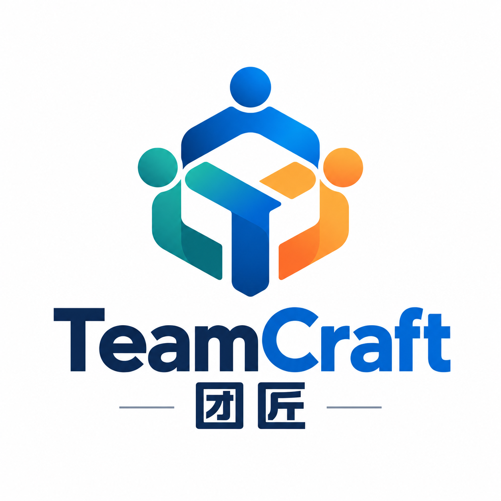
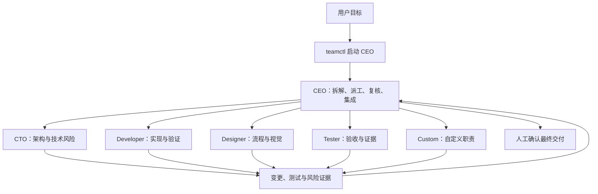

<p align="right"><a href="README.md">English</a></p>

<h1 align="center"></h1>

<p align="center">
  <strong>让 AI 各司其职，协作交付。</strong>
</p>

团匠是一个基于 Herdr 的有状态开发团队编排 Skill。它先建立一名总工 CEO，再由 CEO 按任务需要组织 CTO、研发、设计、测试或自定义专家；每名成员在独立 pane 中运行，通过明确的职责、文件范围和验收证据共同完成交付。

项目当前的 Skill 技术名为 `teamcraft`。它提供了一套可执行的团队生命周期工具，而不是一个无需监督的全自动交付系统：CEO 负责拆解、派工和复核，最终集成与发布决策仍应由人确认。

## 它解决什么问题

普通的多 Agent 协作容易遇到重复派工、文件互相覆盖、失败后重复启动，以及无法判断任务是否已经发送等问题。团匠围绕这些问题提供：

- **按需组队**：默认只启动 CEO，由 CEO 判断是否需要 CTO、研发、设计、测试或其他专家。
- **Harness 与角色分离**：角色决定职责，`--kind` 选择 Herdr 支持的 Codex、OpenCode 等 harness。
- **责任范围协调**：编辑任务必须声明项目内的文件或目录范围，活动成员之间的重叠范围会被拒绝。
- **只读成员**：评审、调研和验收任务可使用 `--read-only`，不占用编辑范围。
- **状态持久化**：成员、pane 身份、责任范围和执行阶段保存在 SQLite 数据库 `.teamcraft/teamcraft.db`。
- **安全恢复**：`resume` 会核对 terminal 和原生 Agent session；结果不明确时默认只检查，不自动重复发送任务。
- **真实状态检查**：`status` 展示 `blocked`、`working`、`idle`、`done`、`unknown` 或 `missing`，避免把缓存状态当成实时状态。
- **并发保护**：运行状态变更在项目级 Leader 租约（含 epoch fencing）下以 SQLite 事务提交；成员生命周期操作另有 flock 守护，进一步降低并发创建或恢复造成的冲突。

## 团队结构



| 角色 | 主要职责 |
| --- | --- |
| CEO | 理解需求、规划、组建团队、分配任务、复核证据、集成与交付判断 |
| CTO | 架构、接口、技术取舍和风险 |
| Developer | 在已分配范围内实现并验证 |
| Designer | 产品流程、交互、视觉规范和设计资产 |
| Tester | 验收覆盖、问题复现和验证证据 |
| Custom | 通过 `--responsibility` 定义部署、文档、安全等其他职责 |

## 环境要求

- macOS 或 Linux。当前实现使用 Python 的 `fcntl` 文件锁，不支持原生 Windows。
- Python 3.10 或更高版本。
- 已安装 Herdr CLI，并从 Herdr pane 内运行；环境中应有 `HERDR_ENV=1` 和 `HERDR_SOCKET_PATH`。
- 至少一种 Herdr 支持的 Agent harness，其可执行文件需要位于 `PATH` 中。
- 使用内置 OpenCode 角色时，需要安装 OpenCode，并准备可用的模型 provider。
- 可选：仅当需要运行本地 API（`teamcraft/api/`：M3-01 安全壳，及已实现的 M3-02 Query、M3-03 SSE、M3-04 Command 路由）时，需要 `fastapi` 和 `uvicorn`。

仓库中的示例配置使用本地 oMLX：

```text
provider: omlx
baseURL: http://127.0.0.1:8000/v1
model: omlx/Qwen3.8-Flash-Next-oQ4e-mtp
```

这只是当前开发机器的配置，不是团匠的固定依赖。

## 安装到项目

克隆团匠仓库，然后从克隆的仓库运行安装脚本：

```bash
git clone https://github.com/DiQiTech-AI/teamcraft.git
cd teamcraft
bash scripts/install.sh --target /path/to/project
```

省略 `--target` 时，安装脚本使用当前工作目录：

```bash
bash scripts/install.sh
```

可以先预览变更而不写入文件：

```bash
bash scripts/install.sh --target /path/to/project --dry-run
```

安装脚本会复制 `teamcraft` 运行 Skill、共享的 `teamcraft-ceo` 协议 Skill、六个 OpenCode 角色配置、精简 CEO 入口和示例模型配置。只有缺少 `opencode.json` 时才会创建该文件，已有的 `opencode.json` 始终保留。脚本会保留目标项目 `.gitignore` 原有内容并补充运行目录规则，且不会创建或修改 `AGENTS.md`、`CLAUDE.md`。

默认情况下，如果已存在的托管文件内容不同，安装会报错且不会覆盖。若 `.opencode/agents/teamcraft-ceo.md` 是用户自有配置，即使使用 `--force` 也会保留并在预检时报错。只有确定要替换团匠管理的 Skill、角色或模板文件时才使用 `--force`；CEO 入口必须带有团匠管理标记才能替换：

```bash
bash scripts/install.sh --target /path/to/project --force
```

`--force` 也绝不会覆盖已有的 `opencode.json` 或用户自有 CEO 入口。相同内容可以安全重复安装，结果保持幂等。安装脚本不会安装依赖、访问网络或修改全局配置。

`teamcraft-ceo` Skill 供 Codex 和 OpenCode 共用。唯一协议位于 `references/CEO_PROTOCOL.md`，版本和正文精确 UTF-8 字节的 SHA-256 由 `references/protocol.manifest.json` 固定。若当前 Attempt 绑定的协议无法恢复或校验，必须停止并请求人工处理。该入口尚不支持 Claude Code。

安装完成后：

1. 如果安装脚本创建了 `opencode.json`，请按目标机器修改 provider、`baseURL` 和模型。如果项目原本已有该文件，请手工检查；安装脚本不会改动它。
2. 如果使用其他模型，还需要同步修改已安装的 `.opencode/agents/herdr-*.md` 中的 `model`。
3. 从目标项目根目录确认 OpenCode 能加载配置：

```bash
opencode --standalone
```

退出试运行后，在 Herdr 中进入目标项目根目录。可用以下命令确认当前环境和本机 Herdr 语义：

```bash
test "$HERDR_ENV" = "1"
herdr --skill
```

## 快速开始：建立一个 OpenCode 团队

下面的例子让 CEO 负责实现一个纯 HTML 待办页面。`--agent-arg=--standalone` 会原样传给 OpenCode：

```bash
python3 .agents/skills/teamcraft/scripts/teamctl.py launch \
  --role ceo \
  --kind opencode \
  --name ceo \
  --task "交付一个纯 HTML 待办页面。按需创建研发和只读测试成员，为每项任务写明验收标准，复核结果后汇报。" \
  --agent-arg=--standalone
```

`teamctl` 会在当前 Herdr tab 中创建 sibling pane、加载 `herdr-ceo` OpenCode 角色并提交任务。CEO 随后可以通过同一个 `teamcraft` Skill 创建所需 worker。

例如，CEO 创建研发成员时可以执行：

```bash
python3 .agents/skills/teamcraft/scripts/teamctl.py launch \
  --role developer \
  --kind opencode \
  --name web_dev \
  --ownership 'examples/todo/**' \
  --task "实现无外部依赖的待办页面；验收：可新增、完成和删除事项。" \
  --agent-arg=--standalone
```

再创建一名不修改文件的验收成员：

```bash
python3 .agents/skills/teamcraft/scripts/teamctl.py launch \
  --role tester \
  --kind opencode \
  --name acceptance \
  --read-only \
  --task "按需求验收待办页面并报告证据，不修改项目文件。" \
  --agent-arg=--standalone
```

## Ownership 与只读任务

每个会编辑文件的非 CEO 成员都必须声明至少一个 `--ownership`：

```bash
--ownership 'src/api/**'
--ownership 'tests/api/test_users.py'
```

- 路径必须相对于项目根目录。
- 支持精确文件或以 `/**` 结尾的目录范围。
- 不支持其他通配符、绝对路径和 `..` 路径穿越。
- 活动编辑成员的相同、父级或子级范围不能重叠。
- `--read-only` 成员不能同时声明 `--ownership`。

Ownership 是协作元数据，用来防止派工范围冲突；它不是操作系统级的文件访问隔离。CEO 和最终审阅者仍需检查成员实际改动。

## 查看、恢复和归档

查看团队及成员实时状态：

```bash
python3 .agents/skills/teamcraft/scripts/teamctl.py status
```

恢复未完成的创建流程，默认只检查，不重复提交任务：

```bash
python3 .agents/skills/teamcraft/scripts/teamctl.py resume web_dev
```

检查后确认任务从未执行或确实需要重发时，再明确选择：

```bash
python3 .agents/skills/teamcraft/scripts/teamctl.py resume web_dev --prompt-action send
```

如果任务已经送达，可跳过重发：

```bash
python3 .agents/skills/teamcraft/scripts/teamctl.py resume web_dev --prompt-action skip
```

当 pane split 的结果不明确时，先查看当前布局。只有确认没有创建 pane 后才重试：

```bash
python3 .agents/skills/teamcraft/scripts/teamctl.py resume web_dev --split-action retry
```

验收完成后归档任务并释放 ownership：

```bash
python3 .agents/skills/teamcraft/scripts/teamctl.py complete web_dev
```

仅释放责任范围而不标记完成：

```bash
python3 .agents/skills/teamcraft/scripts/teamctl.py release web_dev
```

`complete` 和 `release` 都不会关闭 pane 或终止 Agent。成员处于 `working`、`blocked` 或 `unknown` 时会拒绝操作；`--force` 只应在人工确认该成员不会继续产生冲突修改后使用。

## 恢复、有界重试与安全重置

对停滞或结果不明的 Task 记录明确的人工决定，任何情况下都不会自动重发：

```bash
python3 .agents/skills/teamcraft/scripts/teamctl.py recovery-request \
  --task-id TASK_ID --action wait --actor human --reason "等待成员" \
  --idempotency-key wait-TASK_ID-1
```

`--action` 支持 `wait`、`cancel`、`reconcile`。针对 Watcher 记录的无进展或超时事件发起升级：

```bash
python3 .agents/skills/teamcraft/scripts/teamctl.py recovery-timeout \
  --attempt-id ATTEMPT_ID --trigger-event-id EVENT_ID
```

请求经核验的取消、在核对 Herdr 事实后结算歧义 Command，或申请经批准的有界重试：

```bash
python3 .agents/skills/teamcraft/scripts/teamctl.py recovery-cancel web_dev \
  --actor human --reason "人工取消" --idempotency-key cancel-web_dev-1
python3 .agents/skills/teamcraft/scripts/teamctl.py recovery-reconcile web_dev \
  --command-id COMMAND_ID --resolution finished \
  --actor human --reason "已核实 pane 事实"
python3 .agents/skills/teamcraft/scripts/teamctl.py recovery-retry \
  --task-id TASK_ID --actor human --reason "批准重试" \
  --idempotency-key retry-TASK_ID-1
```

超时本身不会停止或重启 Agent。`UNKNOWN` Attempt 持续占位，新 Attempt 必须经批准且在 Task 的 `max_attempts`（默认 3）内重试。

若要从干净运行状态重新开始，`reset` 会先用 SQLite 在线备份把当前数据库归档到 `.teamcraft/archive-*`，再创建空数据库。它要求传入精确解析后的项目根，且绝不导入、移动或删除旧 JSON 状态：

```bash
python3 .agents/skills/teamcraft/scripts/teamctl.py reset \
  --confirm-project /absolute/path/to/project
```

## CEO bootstrap 身份对账

若 harness 在 bootstrap Prompt 后的有界核对窗口内未上报 CEO 的 native Session，初始化保持 `UNKNOWN`，派工门禁继续阻断。先检查、再显式选择，任何环节都不会自动重发：

```bash
# 确认持久化投递记录已显示 submitted 的 Prompt（不重发）
python3 .agents/skills/teamcraft/scripts/teamctl.py prompt-reconcile-submitted ceo \
  --command-id COMMAND_ID --actor human --reason "已核对投递证据"

# 绑定 harness 迟到上报的 native Session
python3 .agents/skills/teamcraft/scripts/teamctl.py ceo-reconcile-native-session ceo \
  --actor human --reason "native session 已可见"

# 最后手段：显式非可移植 live-process 绑定——同一 pane/terminal、
# 同一 PID 启动时间指纹、同一 Herdr socket；Scheduler 与 Wake 仍然阻断
python3 .agents/skills/teamcraft/scripts/teamctl.py ceo-reconcile-live-process ceo \
  --actor human --reason "操作者已在 pane 内核实当前进程"
```

## Wake 队列（手动操作）

事件持久化在 SQLite 中并按窗口合并为 Wake 记录；Prompt 只是信号。以下命令用于手动操作队列，CEO 自动启动默认关闭：

```bash
python3 .agents/skills/teamcraft/scripts/teamctl.py wake-status --state pending
python3 .agents/skills/teamcraft/scripts/teamctl.py wake-dispatch
python3 .agents/skills/teamcraft/scripts/teamctl.py wake-ack \
  --wake-id WAKE_ID --through-seq SEQ --session-id NATIVE_SESSION_ID
python3 .agents/skills/teamcraft/scripts/teamctl.py wake-process --wake-id WAKE_ID
python3 .agents/skills/teamcraft/scripts/teamctl.py wake-reconcile --wake-id WAKE_ID \
  --resolution submitted --actor human --note "已核对 pane 记录" \
  --evidence-json '{"observed": "..."}'
```

投递结果不明的 Wake 会转为 `unknown`，绝不自动重发；`--resolution not-submitted` 会阻断该 Wake 而不触发重发；确认（ack）必须携带 Wake 提示中打印的 native CEO Session ID，确认游标单调递增。真实 Herdr 投递、重启恢复与身份漂移验证仍延期且未验证，见 [`doc/M2-09_WAKE_DISPATCH_STATUS.md`](doc/M2-09_WAKE_DISPATCH_STATUS.md)。

## Report-only 验证与审批

M2 验证器只执行由人工明确批准并持久化到项目中的 argv。参数按独立 argv 元素配置，不接受 shell 命令字符串；对已完成的 scout Attempt 执行：

```bash
python3 .agents/skills/teamcraft/scripts/teamctl.py verifier-configure \
  --executable python3 --arg=-m --arg pytest --arg=-q \
  --rules-version tests-v1 --actor human --idempotency-key verifier-v1
python3 .agents/skills/teamcraft/scripts/teamctl.py verify \
  --attempt-id ATTEMPT_ID --idempotency-key verify-ATTEMPT_ID-v1
python3 .agents/skills/teamcraft/scripts/teamctl.py verification-status --task-id TASK_ID
python3 .agents/skills/teamcraft/scripts/teamctl.py verification-artifact --verification-id VERIFICATION_ID
python3 .agents/skills/teamcraft/scripts/teamctl.py verification-approval \
  --verification-id VERIFICATION_ID --decision accept \
  --actor human --reason "接受报告" --idempotency-key approve-VERIFICATION_ID
```

执行使用 `shell=False`。有界 stdout/stderr 报告工件及 SHA-256、退出码、argv、规则版本和验证器配置版本以不可变记录保存在 SQLite。项目没有配置验证命令时不会得到 PASS。Brief 和最终 WorkerReport 保留不可变的派发时 Task 版本；Verification 另行记录 `worker_reported_done` 后 Task 的当前版本，以及 Attempt identity、Brief digest、最终 WorkerReport identity/digest。Approval 绑定这组完整证据，并在项目 Leader 事务中复核后才能将 scout Task 置为 DONE。之后 Task、Brief、WorkerReport、报告工件或验证策略发生变化都会使证据过期；已完成 scout 的 Task 证据或验证策略变化会重新打开该任务。同一幂等键的重复决定返回原记录；需要新决定时必须生成新的 Verification。普通 ship 在 M4 Worktree/Commit/Diff 证据完成前保持 VERIFYING/NEEDS_HUMAN，M2 不会把报告当成交付。

## 使用其他 Harness

角色和 harness 是独立的。将 `--kind opencode` 换成当前 Herdr 支持的其他类型即可，例如：

```bash
python3 .agents/skills/teamcraft/scripts/teamctl.py launch \
  --role tester \
  --kind codex \
  --name api_review \
  --read-only \
  --task "运行 API 验收测试并报告失败证据，不修改文件。"
```

`teamctl` 会先检查 Herdr 的 kind 列表和对应可执行文件。OpenCode 会额外加载项目中的 `.opencode/agents/herdr-*.md` 角色配置；其他 harness 通过任务提示接收角色、职责和 ownership。

## 项目结构

```text
.
├── .agents/skills/teamcraft/
│   ├── SKILL.md                 # Skill 规则与操作指南
│   ├── scripts/teamctl.py       # 启动、状态、恢复和归档工具
│   └── tests/test_teamctl.py    # 回归测试
├── .opencode/agents/            # CEO、CTO、研发、设计、测试和自定义角色
├── teamcraft/                    # Python Core 边界（存储、领域、Scheduler、Watcher、验证、Wake）
│   └── api/                    # M3-01 安全壳，挂载 M3-02 Query、M3-03 SSE、M3-04 Command 路由
├── pyproject.toml                # 包元数据、Python 3.10+ 边界与 API 依赖
├── examples/team-demo/          # 实机协作示例
├── scripts/install.sh           # 项目本地安装脚本
├── opencode.example.json        # 可复制的 OpenCode/oMLX 示例配置
└── PROGRESS.md                  # 实现与实机验证记录
```

`.teamcraft/` 是本地运行目录，保存 SQLite 数据库、锁、日志、reset 归档目录以及 API session token，已被 Git 忽略。状态绑定创建它的 Herdr socket 会话，不会自动迁移到新的 Herdr server session。若存在 `.herdr-team/state.json` 或非空 `.teamcraft/state.json`，CLI 会在任何 Herdr 调用或新数据库写入前停止，不会自动迁移、移动或删除旧 JSON。

## 本地 API 安全壳（M3-01 已完成）

`teamcraft/api/` 是 Query（M3-02）、SSE（M3-03）、Command（M3-04）路由共同挂载的 HTTP 安全壳，所有路由继承同一套 guards。服务默认绑定 `127.0.0.1:8765`；除非显式传入 `--allow-non-loopback`，其他绑定一律拒绝：

```bash
pip install -e .
python3 -m teamcraft.api --project-root /path/to/project --print-token
```

首次启动会在 `.teamcraft/api/session-token` 生成随机 session token（目录 `0700`、文件 `0600`）。除公开的健康/静态路径外，所有请求必须携带 `Authorization: Bearer <token>`；写方法还要求 `X-CSRF-Token: <token>`，且 `Origin` 需同源或在可重复传入的 `--origin` 白名单内。`GET /api/v1/health`、`/api/v1/health/live`、`/api/v1/health/ready` 无需 token 即可访问，并区分进程存活与依赖就绪：任一注册依赖为 `down` 或 `unknown` 时 readiness 返回 `503`；聚合状态对 down 使用 `degraded`，只有 unknown 而没有 down 时保留明确的 unknown 状态。`--rotate-token` 会更换当前 token（旧 token 立即失效）；经 `--static-root` 提供的静态资源被限制在该目录内（拒绝路径穿越、symlink 越界、隐藏文件与目录浏览）。

## Command API 与调度闸门（M3-04 — 已实现，经自动化测试验证）

认证写入面（`teamcraft/api/command.py`，由 `python3 -m teamcraft.api` 挂载）暴露的 Task 生命周期与控制操作全部经既有 Core 服务执行——与 CLI 走完全相同的转换：

- **Applied 操作**（`POST /api/v1/tasks`、`PATCH /api/v1/tasks/{id}`、依赖增删、`POST /api/v1/tasks/{id}/commands` 的 `pause`/`resume`/`cancel`（无占用 Attempt 时）/`retry`、`POST /api/v1/tasks/{id}/policy`、`POST /api/v1/scheduler/pause|resume`、`POST /api/v1/verifications/{id}/approvals`）返回 `200` 且 `execution: "applied"`：持久 Command 与状态转换在同一事务内 `confirmed`，每次写入都能沿 Command/Event 追溯。
- **Recorded 操作**（取消被占用 Attempt、`wait`/`reconcile`、`POST /api/v1/ceo/commands` 手动 CEO Wake 请求）返回 `202`：只落盘带 TTL 的持久 Command 与审计事件，自身绝不发 Prompt、派工或 admit——由带 fencing 的 runtime 消费。排队的 `ceo.wake_request` 事件会在下一次 scheduler tick 被折叠为普通 Wake candidate；API 不可能造成 Wake 风暴。
- **参与 Leader fencing 而非绕过：** retry/approval 档经正常协议取自身短租约（`teamcraft-api`）；当 live runtime Leader 持有 scope 时请求以 `409` 失败并带 `details.reason_code: "LEADER_BUSY"`（或 `"LEADER_STALE"`），且不写任何数据。Task 与 scheduler 的 pause/resume 完全不触碰 `leader_lease`。
- **持久 gate（schema v15）：** `tasks.paused` 使任务离开 `ready_queue` 并被 `create_attempt` 硬拒（`TASK_PAUSED`）；`tasks.execution_policy_json` 持久化封闭策略集（`delivery` ∈ report_only/local_only/direct_pr/ship、`router`、`verifier`、`timeout_seconds` 1–3600、`max_attempts` ≥1，且 `max_attempts` 镜像到 dispatcher 实际执行的列）；`scheduler_controls` 在项目级延迟所有 NEW 派工（`scheduler_paused`），但不窃取租约。Task pause 的 CAS `version` bump 会使绑定旧证据的 PENDING command 自动过期。
- **幂等与统一错误：** 所有写请求要求 `Idempotency-Key`；同 key + 完全相同内容以 `replayed: true` 重放同一 command id，内容不同则 `409` 冲突。错误统一为 `code/message/details/request_id` 结构，覆盖认证、校验、404、版本冲突、环检测与租约竞争。

`teamctl` 对同一数据库以相同的幂等、版本、拒绝与无租约语义覆盖同一组操作：`create-task`、`edit-task`、`set-priority`、`add-dependency`、`remove-dependency`、`task-pause`、`task-resume`、`task-policy`、`scheduler-pause`、`scheduler-resume` 与 `wake-request`（recorded 档；多数另有 `task-*`/`dependency-*`/`ceo-*` 别名）。Command 审计事件全程可按项目追溯：项目级命令携带显式 `project_id` 证据戳（M3-04 起为允许的证据键），因此即便尚未存在 Task 绑定，每条 `command.submitted/claimed/confirmed/expired` 事件都能经项目解析（见 `tests/test_teamctl.py` 与 `tests/test_api_m304.py`）。

未声称的部分：delivery/router 策略的*执行*语义属 M4；取消被占用 Attempt 只持久记录、由带 fencing 的 runtime executor 执行；尚无 Web UI（M3-05）；以上全部仅有自动化测试验证——本工作树未做真实浏览器/E2E，也未运行 GitHub Actions。

## 验证

运行回归测试：

```bash
python3 -B -m unittest discover -s .agents/skills/teamcraft/tests -v
python3 -B -m unittest discover -s tests -v
```

Skill 套件现有 89 项测试（2026-11-08），覆盖状态恢复、并发 ownership 预留、成员操作锁、pane 移动、启动失败恢复、任务发送歧义、会话身份检查、OpenCode 配置合并、CLI 契约、输入错误、旧状态安全拒绝、运行目录 symlink 安全，以及 SQLite 运行时与 CEO bootstrap/对账、wake CLI 等场景。

仓库套件现有 468 项测试（同日），其中安装器 25 项覆盖首次/重复安装、配置保留、冲突、预览模式、含空格路径、符号链接、Git 忽略规则与 `teamcraft` Skill 新入口，包边界 8 项覆盖 ID、UTC Clock、错误、配置加载和无导入副作用，M3-01 API 安全测试 73 项，其余覆盖存储、迁移、领域状态、事件/Command、Leader fencing、Scheduler、Brief/WorkerReport、Watcher、Recovery、Verification/Approval、Wake、CEO 协议/初始化与 Herdr Adapter。上述本地运行使用 Python 3.13.14，全部通过，退出码 0；lint 与本机 loopback HTTP 冒烟也通过。CI 已改为在两条矩阵腿的核心测试前安装 `.[test]`，但本工作树尚未运行 GitHub Actions。

截至 2026-11-10，仓库套件为 638 项测试——在此前 468 项基线之上新增 M3-02 Query API、M3-03 SSE 断线恢复、67 项 M3-04 Command API 定向测试（`tests/test_api_m304.py`）与 18 项 teamctl CLI 对等与解析器健壮性测试（`tests/test_teamctl.py`）——本地 `python3 -m pytest tests/ -q` 全部通过（2026-11-10 最终运行：638 passed，115 subtests passed，退出码 0）。teamctl 解析器对 Core 版本容错：`--help` 基于规范 Core 常量构建（对 pre-M3-04 离线包回退到封闭集合），需要 v15 API 的命令会以可操作的 reinstall 提示失败，而非 AttributeError。本工作树更早一次运行曾因沙箱 socket 限制使 M3-03 的 uvicorn 测试无法绑定 `127.0.0.1:0`（`[Errno 1] Operation not permitted`）；这些测试未做任何改动即在 2026-11-10 运行中通过，故记录为环境限制而非代码缺陷。

项目还做过一次真实 OpenCode 流程验证：CEO 创建研发和只读测试成员，研发生成 [`examples/team-demo/index.html`](examples/team-demo/index.html)，测试完成验收。该次运行中 CEO 的最终轮询未自行收敛，由当前控制 Agent 人工停止轮询并完成归档。详细记录见 [`PROGRESS.md`](PROGRESS.md)。

## 当前边界

- 已实机验证 CEO、Developer 和 Tester；CTO、Designer、Custom 的配置尚未分别实机启动验证。
- CEO 能够拆解任务、创建成员和收集结果，但当前仍需要人监督权限请求、异常恢复、最终集成和发布。
- `idle` 和 `done` 都可能表示已完成且处于稳定状态；不能只等待 `done`。
- `unknown` 表示无法核实实时状态，不应据此推断任务完成。
- ownership 只负责团队协调，不提供安全沙箱。
- M3-01 安全壳、M3-02 Query API、M3-03 SSE 恢复与 M3-04 Command API 均已实现且仅经自动化测试验证：尚无 Web UI（M3-05）；delivery/router 策略的*执行*属 M4；取消被占用 Attempt 只持久记录、由带 fencing 的 runtime executor 执行；本工作树未做真实浏览器/E2E，也未运行 GitHub Actions。
- CEO bootstrap 的可信宿主回执，以及真实 Herdr 的 Wake 投递/重启恢复/身份漂移验证仍延期且未验证；离线/Mock 回归不能替代。
- 完成或释放成员后，新任务应使用新的成员名；历史任务归档和成员复用尚未实现。
- 把 Skill 用到其他项目时，需要一并部署角色配置，并按目标机器调整 provider、模型和权限路径。
