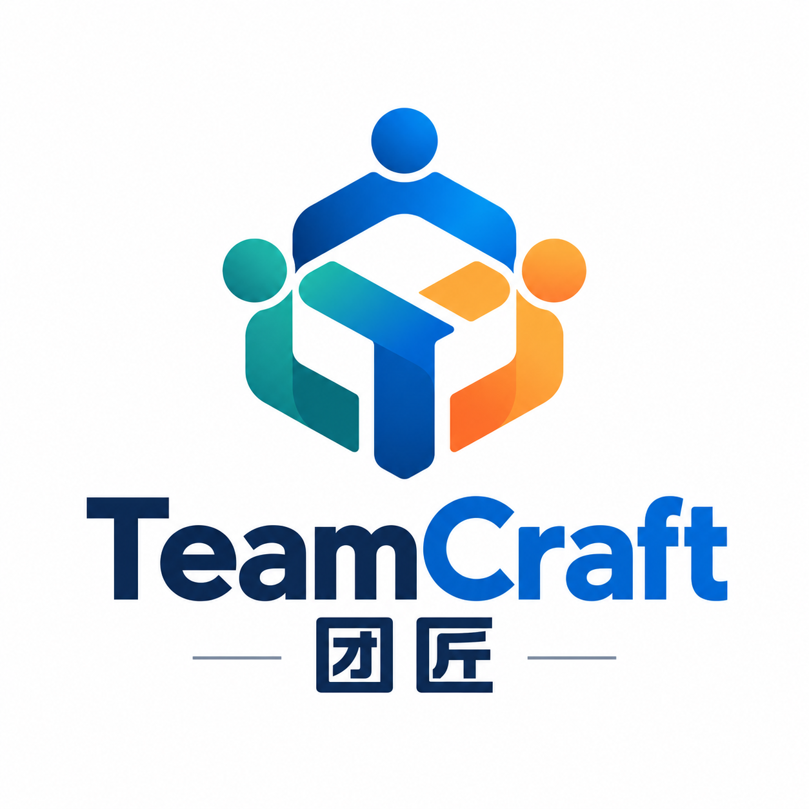
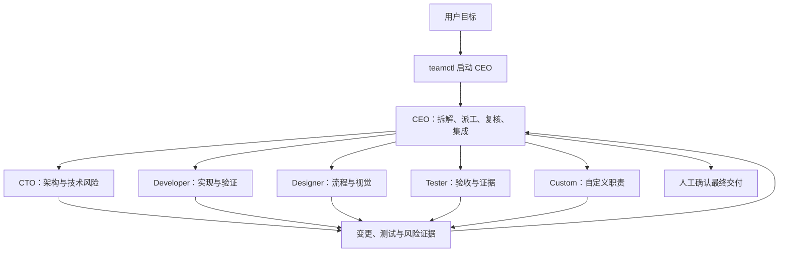

<p align="right"><a href="README.md">English</a></p>

<h1 align="center"> 团匠 TeamCraft</h1>

<p align="center">
  <strong>让 AI 各司其职，协作交付。</strong>
</p>

团匠是一个基于 Herdr 的有状态开发团队编排 Skill。它先建立一名总工 CEO，再由 CEO 按任务需要组织 CTO、研发、设计、测试或自定义专家；每名成员在独立 pane 中运行，通过明确的职责、文件范围和验收证据共同完成交付。

项目当前的 Skill 技术名为 `teamcraft`。它提供了一套可执行的团队生命周期工具，而不是一个无需监督的全自动交付系统：CEO 负责拆解、派工和复核，最终集成与发布决策仍应由人确认。

## 它解决什么问题

普通的多 Agent 协作容易遇到重复派工、文件互相覆盖、失败后重复启动，以及无法判断任务是否已经发送等问题。团匠围绕这些问题提供：

- **按需组队**：默认只启动 CEO，由 CEO 判断是否需要 CTO、研发、设计、测试或其他专家。
- **Harness 与角色分离**：角色决定职责，`--kind` 选择 Herdr 支持的 Codex、OpenCode 等 harness。
- **责任范围协调**：编辑任务必须声明项目内的文件或目录范围，活动成员之间的重叠范围会被拒绝。
- **只读成员**：评审、调研和验收任务可使用 `--read-only`，不占用编辑范围。
- **状态持久化**：成员、pane 身份、任务、责任范围和执行阶段保存在 `.teamcraft/state.json`。
- **安全恢复**：`resume` 会核对 terminal 和原生 Agent session；结果不明确时默认只检查，不自动重复发送任务。
- **真实状态检查**：`status` 展示 `blocked`、`working`、`idle`、`done`、`unknown` 或 `missing`，避免把缓存状态当成实时状态。
- **并发保护**：状态写入和成员生命周期操作使用文件锁，降低并发创建或恢复造成的冲突。

## 团队结构



| 角色 | 主要职责 |
| --- | --- |
| CEO | 理解需求、规划、组建团队、分配任务、复核证据、集成与交付判断 |
| CTO | 架构、接口、技术取舍和风险 |
| Developer | 在已分配范围内实现并验证 |
| Designer | 产品流程、交互、视觉规范和设计资产 |
| Tester | 验收覆盖、问题复现和验证证据 |
| Custom | 通过 `--responsibility` 定义部署、文档、安全等其他职责 |

## 环境要求

- macOS 或 Linux。当前实现使用 Python 的 `fcntl` 文件锁，不支持原生 Windows。
- Python 3.10 或更高版本。
- 已安装 Herdr CLI，并从 Herdr pane 内运行；环境中应有 `HERDR_ENV=1` 和 `HERDR_SOCKET_PATH`。
- 至少一种 Herdr 支持的 Agent harness，其可执行文件需要位于 `PATH` 中。
- 使用内置 OpenCode 角色时，需要安装 OpenCode，并准备可用的模型 provider。

仓库中的示例配置使用本地 oMLX：

```text
provider: omlx
baseURL: http://127.0.0.1:8000/v1
model: omlx/Qwen3.8-Flash-Next-oQ4e-mtp
```

这只是当前开发机器的配置，不是团匠的固定依赖。

## 安装到项目

克隆团匠仓库，然后从克隆的仓库运行安装脚本：

```bash
git clone https://github.com/DiQiTech-AI/teamcraft.git
cd teamcraft
bash scripts/install.sh --target /path/to/project
```

省略 `--target` 时，安装脚本使用当前工作目录：

```bash
bash scripts/install.sh
```

可以先预览变更而不写入文件：

```bash
bash scripts/install.sh --target /path/to/project --dry-run
```

安装脚本会复制项目本地的 `teamcraft` Skill、六个 OpenCode 角色配置和示例模型配置。只有缺少 `opencode.json` 时才会创建该文件，已有的 `opencode.json` 始终保留。脚本还会在保留目标项目 `.gitignore` 原有内容的基础上，加入 `/.teamcraft/` 和 `/opencode.json`。

默认情况下，如果已存在的托管文件内容不同，安装会报错且不会覆盖。只有确定要替换团匠管理的 Skill、角色或模板文件时才使用 `--force`：

```bash
bash scripts/install.sh --target /path/to/project --force
```

`--force` 也绝不会覆盖已有的 `opencode.json`。相同内容可以安全重复安装，结果保持幂等。安装脚本不会安装依赖、访问网络或修改全局配置。

安装完成后：

1. 如果安装脚本创建了 `opencode.json`，请按目标机器修改 provider、`baseURL` 和模型。如果项目原本已有该文件，请手工检查；安装脚本不会改动它。
2. 如果使用其他模型，还需要同步修改已安装的 `.opencode/agents/herdr-*.md` 中的 `model`。
3. 从目标项目根目录确认 OpenCode 能加载配置：

```bash
opencode --standalone
```

退出试运行后，在 Herdr 中进入目标项目根目录。可用以下命令确认当前环境和本机 Herdr 语义：

```bash
test "$HERDR_ENV" = "1"
herdr --skill
```

## 快速开始：建立一个 OpenCode 团队

下面的例子让 CEO 负责实现一个纯 HTML 待办页面。`--agent-arg=--standalone` 会原样传给 OpenCode：

```bash
python3 .agents/skills/teamcraft/scripts/teamctl.py launch \
  --role ceo \
  --kind opencode \
  --name ceo \
  --task "交付一个纯 HTML 待办页面。按需创建研发和只读测试成员，为每项任务写明验收标准，复核结果后汇报。" \
  --agent-arg=--standalone
```

`teamctl` 会在当前 Herdr tab 中创建 sibling pane、加载 `herdr-ceo` OpenCode 角色并提交任务。CEO 随后可以通过同一个 `teamcraft` Skill 创建所需 worker。

例如，CEO 创建研发成员时可以执行：

```bash
python3 .agents/skills/teamcraft/scripts/teamctl.py launch \
  --role developer \
  --kind opencode \
  --name web_dev \
  --ownership 'examples/todo/**' \
  --task "实现无外部依赖的待办页面；验收：可新增、完成和删除事项。" \
  --agent-arg=--standalone
```

再创建一名不修改文件的验收成员：

```bash
python3 .agents/skills/teamcraft/scripts/teamctl.py launch \
  --role tester \
  --kind opencode \
  --name acceptance \
  --read-only \
  --task "按需求验收待办页面并报告证据，不修改项目文件。" \
  --agent-arg=--standalone
```

## Ownership 与只读任务

每个会编辑文件的非 CEO 成员都必须声明至少一个 `--ownership`：

```bash
--ownership 'src/api/**'
--ownership 'tests/api/test_users.py'
```

- 路径必须相对于项目根目录。
- 支持精确文件或以 `/**` 结尾的目录范围。
- 不支持其他通配符、绝对路径和 `..` 路径穿越。
- 活动编辑成员的相同、父级或子级范围不能重叠。
- `--read-only` 成员不能同时声明 `--ownership`。

Ownership 是协作元数据，用来防止派工范围冲突；它不是操作系统级的文件访问隔离。CEO 和最终审阅者仍需检查成员实际改动。

## 查看、恢复和归档

查看团队及成员实时状态：

```bash
python3 .agents/skills/teamcraft/scripts/teamctl.py status
```

恢复未完成的创建流程，默认只检查，不重复提交任务：

```bash
python3 .agents/skills/teamcraft/scripts/teamctl.py resume web_dev
```

检查后确认任务从未执行或确实需要重发时，再明确选择：

```bash
python3 .agents/skills/teamcraft/scripts/teamctl.py resume web_dev --prompt-action send
```

如果任务已经送达，可跳过重发：

```bash
python3 .agents/skills/teamcraft/scripts/teamctl.py resume web_dev --prompt-action skip
```

当 pane split 的结果不明确时，先查看当前布局。只有确认没有创建 pane 后才重试：

```bash
python3 .agents/skills/teamcraft/scripts/teamctl.py resume web_dev --split-action retry
```

验收完成后归档任务并释放 ownership：

```bash
python3 .agents/skills/teamcraft/scripts/teamctl.py complete web_dev
```

仅释放责任范围而不标记完成：

```bash
python3 .agents/skills/teamcraft/scripts/teamctl.py release web_dev
```

`complete` 和 `release` 都不会关闭 pane 或终止 Agent。成员处于 `working`、`blocked` 或 `unknown` 时会拒绝操作；`--force` 只应在人工确认该成员不会继续产生冲突修改后使用。

## 使用其他 Harness

角色和 harness 是独立的。将 `--kind opencode` 换成当前 Herdr 支持的其他类型即可，例如：

```bash
python3 .agents/skills/teamcraft/scripts/teamctl.py launch \
  --role tester \
  --kind codex \
  --name api_review \
  --read-only \
  --task "运行 API 验收测试并报告失败证据，不修改文件。"
```

`teamctl` 会先检查 Herdr 的 kind 列表和对应可执行文件。OpenCode 会额外加载项目中的 `.opencode/agents/herdr-*.md` 角色配置；其他 harness 通过任务提示接收角色、职责和 ownership。

## 项目结构

```text
.
├── .agents/skills/teamcraft/
│   ├── SKILL.md                 # Skill 规则与操作指南
│   ├── scripts/teamctl.py       # 启动、状态、恢复和归档工具
│   └── tests/test_teamctl.py    # 回归测试
├── .opencode/agents/            # CEO、CTO、研发、设计、测试和自定义角色
├── teamcraft/                    # 无导入副作用的 Python Core 边界（M1-02）
├── pyproject.toml                # 包元数据与 Python 3.10+ 边界
├── examples/team-demo/          # 实机协作示例
├── scripts/install.sh           # 项目本地安装脚本
├── opencode.example.json        # 可复制的 OpenCode/oMLX 示例配置
└── PROGRESS.md                  # 实现与实机验证记录
```

`.teamcraft/` 是本地运行目录，保存状态、任务和锁文件，已被 Git 忽略。状态绑定创建它的 Herdr socket 会话，不会自动迁移到新的 Herdr server session。若存在 `.herdr-team/state.json`，CLI 会在任何 Herdr 调用或新状态写入前停止，不会自动迁移，也不会创建第二份状态。

## 验证

运行回归测试：

```bash
python3 -B -m unittest discover -s .agents/skills/teamcraft/tests -v
python3 -B -m unittest discover -s tests -v
```

Skill 现有 42 项测试，覆盖状态恢复、并发 ownership 预留、成员操作锁、pane 移动、启动失败恢复、任务发送歧义、会话身份检查、OpenCode 配置合并、CLI 契约、输入错误、旧状态安全拒绝和运行目录 symlink 安全等场景。

仓库测试包含 21 项安装器测试，覆盖首次安装、重复安装、配置保留、冲突、预览模式、含空格路径、符号链接、Git 忽略规则和 `teamcraft` Skill 新入口；另有 7 项最小 Python 包边界测试，覆盖 ID、UTC Clock、错误、配置加载和无导入副作用。

项目还做过一次真实 OpenCode 流程验证：CEO 创建研发和只读测试成员，研发生成 [`examples/team-demo/index.html`](examples/team-demo/index.html)，测试完成验收。该次运行中 CEO 的最终轮询未自行收敛，由当前控制 Agent 人工停止轮询并完成归档。详细记录见 [`PROGRESS.md`](PROGRESS.md)。

## 当前边界

- 已实机验证 CEO、Developer 和 Tester；CTO、Designer、Custom 的配置尚未分别实机启动验证。
- CEO 能够拆解任务、创建成员和收集结果，但当前仍需要人监督权限请求、异常恢复、最终集成和发布。
- `idle` 和 `done` 都可能表示已完成且处于稳定状态；不能只等待 `done`。
- `unknown` 表示无法核实实时状态，不应据此推断任务完成。
- ownership 只负责团队协调，不提供安全沙箱。
- 完成或释放成员后，新任务应使用新的成员名；历史任务归档和成员复用尚未实现。
- 把 Skill 用到其他项目时，需要一并部署角色配置，并按目标机器调整 provider、模型和权限路径。
