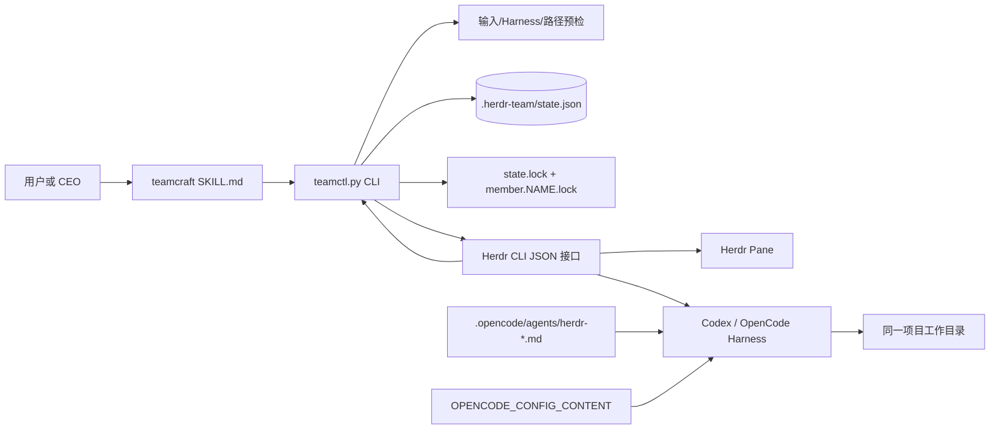
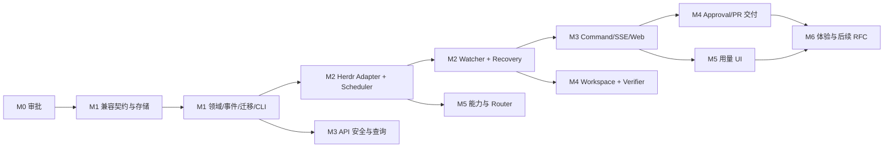

# TeamCraft 2.0 M0 架构审计与实施审查报告

> 状态：ADR-001 与 M0 退出门禁已获**原则接受**；M1-01 已通过评审；M1-02 已单独获准开工并形成待验收实现。M1-03 及以后未获开工授权；正式 cutover 尚未审批（见第 12 节）
>
> 报告版本：v1.2（M1-02 实施记录）
>
> 审计日期：2026-10-21；ADR-001 设计修订：2026-10-22；M1-01 门禁与规划一致性修订：2026-10-23；M1-02 实施记录：2026-10-23
>
> 产品需求与里程碑目标：[TEAMCRAFT_2_0_PLAN.md](TEAMCRAFT_2_0_PLAN.md)；本文第 9 节是 M1–M6 任务 ID、依赖和逐项验收的唯一权威来源
>
> 仓库基线：原始审计 `main` / `d9d95a6`；当前 M1-02 实施基线 `docs/teamcraft-2-0-planning` / `e9111c8`
>
> M0 审计轮范围（历史）：架构审计、差距分析、ADR 候选和 M1–M6 实施拆解；当时未修改产品代码。该会话另有用户授权的 DIQI 创建、命名和 Pane 布局操作；启动 DIQI 前，主 Agent 因原 `state.json` 绑定另一 Herdr Session，手动且可逆地将其移动为归档文件。这些是编排运行变更，不属于产品实现或本报告的验证动作。当前 M1-02 只修改获授权的包、Skill、安装器、文档和离线测试，未操作 Herdr 会话

## 1. 审查结论

当前 TeamCraft 是一个可工作的 Herdr 团队管理 Skill，而不是 PRD 所描述的完整编排服务。真实核心只有一条同步调用链：Skill/用户调用 `teamctl.py`，脚本在 `.herdr-team/state.json` 中预留成员和 Ownership，再直接调用 Herdr CLI 创建 Pane、启动 Harness、提交 Prompt，并通过 Herdr 实时查询完成状态检查和保守恢复。项目还包含六个 OpenCode 角色配置、一个安全安装器和两组回归测试。

现有实现已经形成必须保留的兼容基线：

- 角色与 Harness 分离，支持 CEO、CTO、Developer、Designer、Tester 和 Custom；
- 写入成员必须声明非重叠 Ownership，只读成员不能占用 Ownership；
- `status` 将持久化阶段与 Herdr 实时信号分开，无法核实时返回 `unknown`；
- `resume` 核验 Pane、terminal、Harness、成员名和原生 Agent Session，歧义时默认检查而不重发；
- JSON 状态使用原子替换、全局状态锁和成员生命周期锁；
- `complete`/`release` 不终止进程，`working`、`blocked`、`unknown` 默认不能释放；
- OpenCode 角色通过 Pane 局部配置选择，不覆盖用户已有的全局/项目配置；
- 安装器先做完整预检，拒绝符号链接目标，保留已有 `opencode.json`，支持幂等和 dry-run。

PRD 中的 SQLite、Task DAG、Attempt、Event/Command、Scheduler、Watcher、Web/API/SSE、Approval、Worktree、Verifier、GitHub PR 和成本路由均未实现。M1 不应先启动 Web 或 Worktree；应先把上述现有语义写成兼容契约，然后引入 SQLite Core，并在一次有冻结、代际栅栏和回滚条件的切换中将旧 JSON 从写入真源迁移为只读兼容视图。M2 再把直接 Herdr 调用收口为 Adapter，并增加确定性调度、观察和恢复。由于 FR-011 Verifier 和 FR-012 Approval 都是 P0，M2 还必须在 M3 Web 验收前提供面向 report-only/scout 的最小程序化验证和持久审批门禁；M4 负责 Worktree、Diff、Commit、local-only 和 direct-PR 的完整证据链。在 M4 之前，共享工作树上的验证不能证明普通 ship 产物与某个隔离执行一一对应，因此普通 ship 必须保持未交付状态，不能宣称已满足完整 P0 闭环。

规划与审计文档的规范目录是 `doc/`：PRD 位于 `doc/TEAMCRAFT_2_0_PLAN.md`，本报告位于 `doc/TEAMCRAFT_2_0_M0_REVIEW.md`。早期草案中的 `docs/` 写法已修正，不再作为当前路径说明；目标目录树中的其他文档仍只是未来建议。

## 2. 审计范围与证据

M0-01 原始审计覆盖（下列 Skill 路径是当时基线；M1-02 待验收实现已迁移到 `.agents/skills/teamcraft/`）：

- 产品与使用说明：`README.md`、`README.zh-CN.md`、`PROGRESS.md`；
- Skill 契约：`.agents/skills/herdr-team/SKILL.md`；
- 运行实现：`.agents/skills/herdr-team/scripts/teamctl.py`；
- Harness 配置：`.opencode/agents/herdr-*.md`、`opencode.example.json`；
- 安装：`scripts/install.sh`；
- 测试：`.agents/skills/herdr-team/tests/test_teamctl.py`、`tests/test_install.py`；
- 目标基准：`doc/TEAMCRAFT_2_0_PLAN.md`。

M0-01 原始基线没有 `pyproject.toml`、Python 包目录、前端工程、CI 工作流或数据库迁移目录。M1-02 待验收实现仅新增 `pyproject.toml` 与无副作用的最小 `teamcraft` Python 包边界；前端、CI 和数据库迁移仍不存在。`.herdr-team/` 和本地 `opencode.json` 继续由 `.gitignore:1-2` 排除。基线测试使用临时目录，没有读取或改写项目的实际 `state.json`；但 M0 会话在审计之外曾按用户授权创建、命名和移动 DIQI Pane。启动前，主 Agent 发现原 `state.json` 绑定另一 Herdr Session，遂手动且可逆地把它移动到归档文件名，再启动 DIQI；这不是 Herdr 自动归档。因此不能笼统声称该次运行状态或布局完全未变。架构结论只依据受跟踪实现、PRD、测试和版本探测，不把那次编排操作当作产品能力验收。本次 M1-02 未操作 Herdr 会话。

## 3. 当前真实架构

### 3.1 组件与边界

边界结论：

1. `teamctl.py` 同时承担 CLI、领域校验、状态存储、Herdr Adapter、Pane 布局、成员恢复和输出序列化，尚无独立 Core 或服务层。
2. `.herdr-team/state.json` 是成员编排记录，但并非完整历史数据库。Task 是成员记录中的文本字段，Member、Task、Attempt、Session 尚未独立建模（`teamctl.py:648-658`）。
3. Herdr 是运行态观测源。`status` 在锁内取得 JSON 快照，随后逐成员查询 Herdr；查询失败时输出 `unknown` 和 `inspection_error`，不会展示缓存状态冒充实时状态（`teamctl.py:824-863`）。
4. Worker 共享同一项目目录。Ownership 只做派工冲突协调，Skill 明确声明它不是文件系统权限隔离（`SKILL.md:31-33`；`README.md:168-174`）。
5. OpenCode 模型选择是静态配置。六个角色配置均指向同一 oMLX 模型；`opencode.example.json:1-18` 给出本地 Provider 示例，尚无运行时 Router、预算或故障升级策略。
6. 安装器把 Skill、测试、脚本、角色配置和配置模板复制到目标项目；它不是包管理器，也不安装依赖（`scripts/install.sh:50-78`；`README.md:93-101`）。

### 3.2 启动调用路径

`teamctl launch` 的实际顺序如下：

1. 要求在 Herdr 环境中运行，并要求 `HERDR_SOCKET_PATH`（`teamctl.py:102-118`）。
2. 校验成员名、超时、项目根、任务文本、角色责任和 Ownership；非 CEO 写入成员没有 Ownership 会被拒绝（`teamctl.py:618-635`）。
3. 从已安装 Herdr 的 kind 列表确认 Harness，并确认可执行文件在 `PATH`（`teamctl.py:335-351`）。
4. 查询同名实时 Agent、解析调用 Pane、计算当前 Herdr Session 身份（`teamctl.py:364-384`、`:109-118`）。
5. 在状态锁中检查 Session、成员名和 Ownership 重叠，先把 `reserved` 成员写入 JSON（`teamctl.py:310-332`）。这保证外部布局改变之前先记录意图。
6. 读取 Pane 几何并选择安全拆分方向；调用 `herdr pane split --no-focus`。OpenCode 额外注入仅覆盖 `default_agent` 的 Pane 局部 JSON（`teamctl.py:401-416`、`:475-496`、`:499-534`）。
7. 将阶段记为 `start_requested`，调用 `herdr agent start`，再用 `agent get` 记录 Pane、terminal 和原生 Session（`teamctl.py:537-565`）。
8. 在提交 Prompt 前先设置 `prompt_may_have_been_delivered=true`，再调用 `herdr agent prompt`。超时或失败统一视为结果歧义，禁止自动重发（`teamctl.py:568-601`）。
9. 输出成员摘要，包括持久化阶段、实时状态、只读标志和 Ownership（`teamctl.py:604-615`）。

### 3.3 状态、锁与恢复路径

- `StateStore` 使用 `fcntl.flock` 串行化 JSON 读写，以同目录临时文件、`fsync` 和 `os.replace` 原子替换状态文件（`teamctl.py:125-169`）。因此当前原生平台是 macOS/Linux，README 声明 Python 3.10+ 且不支持原生 Windows（`README.md:53-59`）。
- 每个成员另有非阻塞生命周期锁，避免同名成员同时 `launch`、`resume`、`complete` 或 `release`（`teamctl.py:171-189`、`:889-910`）。
- Session 身份由 Herdr socket 的解析路径、设备号和 inode 组成；状态属于其他 Herdr Session 时拒绝自动接管（`teamctl.py:109-118`、`:203-207`）。
- `resume` 先验证记录 Pane 的 terminal、成员名、Harness 和原生 Session；Pane 移动后可以用唯一成员名重新定位，但仍需验证身份（`teamctl.py:688-755`）。
- 对 `split_requested/split_ambiguous`，默认返回检查指令，只有显式 `--split-action retry` 才重试；对可能已经提交的 Prompt，默认 `inspect`，只有显式 `send`/`skip` 才推进（`teamctl.py:758-821`）。
- `status` 支持 `blocked/working/idle/done/unknown/missing`。Skill 规定 `idle` 和 `done` 都可表示 Agent 已稳定下来，但它们都不应自动推导新的 2.0 Task 已验收完成（`SKILL.md:79-87`）。
- `complete` 和 `release` 只修改记录并清空 Ownership，不关闭 Pane；实时状态为 `working`、`blocked`、`unknown` 时必须显式 `--force`（`teamctl.py:866-886`）。

### 3.4 安装和角色配置路径

安装器先构造受管文件清单并拒绝源或目标路径中的符号链接（`scripts/install.sh:50-78`、`:81-97`），在任何写入前预检全部冲突（`:170-221`），随后以原子复制/写入执行（`:113-148`、`:223-240`）。已有 `opencode.json` 无论 `--force` 与否都保留（`:204-211`）。

六个 OpenCode Profile 是角色提示和权限模板，不是独立运行服务。Developer 等角色将编辑和 shell 设置为 `ask`，拒绝外部目录、网络搜索和子任务；CEO Profile 可以编辑项目文件，但同样拒绝外部目录和子任务。`teamctl` 在 Pane 层选择 `herdr-<role>`，同时保留既有 `OPENCODE_CONFIG_CONTENT` 其他字段（`teamctl.py:471-496`）。

## 4. 兼容性矩阵

| 兼容面 | 当前真实行为 | 2.0 约束 | M1/M2 兼容验收 |
|---|---|---|---|
| Skill 入口 | `.agents/skills/teamcraft/SKILL.md` 指导原 `teamctl.py`；M0-01 基线路径为 `.agents/skills/herdr-team/` | M1-02 直接改名目录与 frontmatter 并同步 installer/README/测试；旧入口未对外部署，故不保留旧目录、窗口或别名 | 新路径承接相同命令语义；参数/默认值/stdout JSON/退出码不变；既有 59 项回归迁移通过并增加新入口发现/安装契约；最终状态以 M1-02 验收为准 |
| CLI 命令 | `launch/status/resume/complete/release`（`teamctl.py:917-966`） | 旧命令至少一个可见版本稳定 | 参数、默认值、stdout JSON 关键字段、错误退出码建立 golden/contract 测试 |
| 角色/Harness | 六类角色；`--kind` 独立选择 Harness | Core 不直接推理，仍经 Herdr | Adapter 接受现有 role/kind/agent args；未支持 kind 保持预检失败 |
| Ownership | 精确路径或尾部 `/**`；父子范围冲突；终态释放（`:264-332`） | 保留重叠检测并加入 Task/Attempt | 同一组合法/非法输入与并发预留结果一致；新增 Diff Gate 不削弱原规则 |
| read-only | 不能带 Ownership；Prompt 明令不编辑（`:264-266`、`:436-458`） | Scout/审计不获得写权限 | 数据库保存 read-only；Scheduler 不分配写租约；现有 CLI 拒绝组合保持一致 |
| 持久化路径 | `.herdr-team/state.json`，version 1 | SQLite 成为新真源，旧 JSON 不原地覆盖 | 迁移前备份+摘要；切换前 Reconcile；旧 JSON 只读导出或归档，不双主写 |
| 原子性/锁 | `state.lock` + `member.<name>.lock`；原子替换 | SQLite 事务、条件更新、Leader Lease | 并发 Ownership 和同成员生命周期测试继续通过；跨进程派工最多一次获得租约 |
| Session 身份 | socket path/device/inode + Pane/terminal/native session | Task/Attempt/Session 分离 | 不允许只凭名字接管；所有恢复仍验证已有身份并保留无法核实时的 UNKNOWN |
| 状态显示 | 阶段与 `agent_state` 分开；检查失败为 `unknown` | Task/Attempt/Session 三层状态 | 不把 `idle`、`done`、Pane 存活直接映射成 Task DONE；兼容输出继续提供旧字段 |
| 保守恢复 | split/start/prompt 歧义先记录，默认 inspect | Watcher 只观察；未知结果不盲重试 | 默认恢复不产生第二 Pane/Prompt/外部副作用；新 Attempt 前必须有确定证据或人审 |
| 完成/释放 | 不关 Pane；危险实时状态需 `--force` | 高风险动作走审批和审计 | 旧命令仍不终止 Agent；新的 cancel/stop 是独立显式 Command |
| OpenCode 配置 | Pane 局部覆盖 `default_agent`，要求角色文件存在 | Router 可选 Harness/Model | 不覆盖用户 Provider；静态 Profile 仍可运行；Router 决策另行记录 |
| 安装器 | 项目内复制，预检后写入，保留配置，拒绝 symlink | 需部署 Core/API/Web 资产和迁移工具 | 旧安装场景 10 项测试全过；新增文件仍遵守预检、幂等、dry-run 和配置保留 |
| 人工权限 | 最终集成/发布由人确认（`README.md:7-9`） | merge/deploy/delete worktree 默认审批 | 未经批准不自动 merge、部署、清理脏 Worktree 或重复高风险命令 |

## 5. 目标能力差距

状态定义：**已有**表示当前实现满足目标的核心语义；**部分**表示可复用但缺少目标领域模型或闭环；**缺失**表示仓库中没有实现证据。

| FR | 状态 | 当前证据与差距 |
|---|---|---|
| FR-001 项目注册 | 部分 | `resolve_project_root` 可验证现有目录（`teamctl.py:227-235`），但没有 Project ID、注册表、权限/仓库检查或项目配置 |
| FR-002 Task CRUD | 部分 | launch 保存不可独立编辑/查询的任务文本；没有 Task ID、验收结构、版本或审计 |
| FR-003 Task DAG | 缺失 | 没有依赖表、无环校验和 READY 推导 |
| FR-004 Attempt/Session 独立 | 缺失 | 单个 Member 记录混合角色、任务、Pane、原生 Session 和阶段 |
| FR-005 SQLite/事件 | 缺失 | 仅 JSON version 1 和文件锁；没有 Schema Migration、事务事件或 Outbox |
| FR-006 Herdr Adapter | 部分 | `run_herdr`、响应解析和直接调用可提取（`:67-100`），但无稳定 Adapter 接口、日志/停止能力和契约测试层 |
| FR-007 Watcher/恢复 | 部分 | `status/resume` 已有人工触发的保守恢复；没有后台 Watcher、租约、事件去重或自动 Reconcile |
| FR-008 Ownership | 已有（协调级） | 路径规范化、重叠拒绝、只读语义和并发测试已存在；没有 OS 沙箱和 Diff Gate |
| FR-009 Web UI | 缺失 | 没有 HTTP 或前端工程；`examples/team-demo/index.html` 是实机协作产物示例（`README.md:267`），不是 TeamCraft 控制台 |
| FR-010 CLI/Web 共享命令服务 | 缺失 | CLI 直接调用单文件内部函数 |
| FR-011 Verifier | 缺失 | Worker 自报证据，Core 不独立执行验证，也不绑定 Commit SHA |
| FR-012 用户审批 | 缺失 | 有 shell/tool 交互权限和 `--force` 人工决策，但无持久 Approval 实体、审计和统一门禁 |
| FR-013 Worktree | 缺失 | 当前所有 Pane 使用同一 `cwd`（`teamctl.py:507-510`） |
| FR-014 SSE | 缺失 | 没有 Event 序号、流和断线补拉 |
| FR-015 Model Router | 部分 | 用户可选 `--kind`，OpenCode Profile 静态指定 oMLX；没有策略、风险、健康、预算或决策原因 |
| FR-016 GitHub PR | 缺失 | 没有 `gh` 探测、PR 状态或发布门禁 |
| FR-017 Workflow DAG 图 | 缺失 | 无 DAG 数据和 Web |
| FR-018 Token/成本 | 缺失 | 没有 usage 数据；不得把缺失值解释为 0 |
| FR-019 重试/失败升级 | 部分 | 已有“歧义不自动重试”，但无失败分类、有界尝试、预算和云端升级流程 |
| FR-020 项目策略 | 部分 | 仅 OpenCode 项目配置和 CLI 参数；无并发、Verifier、审批、路由的统一项目策略 |
| FR-021 Review 专家 | 部分 | Tester/Custom/CTO 可按需启动；没有基于 Task 的交叉审查策略 |
| FR-022 远程访问 | 缺失/P2 | 当前仅本地 Herdr；没有 Web 认证、TLS、VPN/SSH 入口设计实现 |
| FR-023 多机 Worker | 缺失/P2 | 单机实现，符合当前非目标 |

除 FR 清单外，当前已有而目标必须继续支持的能力是项目内安全安装、配置保留、角色模板、Pane 自动布局和焦点保持。这些能力不应在引入 Python 包或服务进程时丢失。

## 6. 可复用组件与改造边界

| 组件 | 复用判断 | 建议动作 |
|---|---|---|
| `SKILL.md` | 直接保留，作为外部操作契约 | M1-02 待验收实现已将目录与 frontmatter 改为 `teamcraft` 并同步 installer、README 与命令路径引用；不设双入口；`.herdr-team/` 状态目录名保持不变；后续只在对应能力实现后补充 2.0 命令 |
| `teamctl` 参数与 JSON 输出 | 外部兼容面，可复用 | 保留脚本为薄入口；内部逐步转调共享 Command Service/Herdr Adapter |
| `run_process/run_herdr` 与响应解析 | 可提取 | 移到 `adapters/herdr.py`，定义超时、错误归一化、能力探测、Fake Adapter 契约 |
| `StateStore` | 仅用于迁移和兼容 | 冻结 version 1 读取器；SQLite 切换后不得与 DB 双主写；保留原文件快照和只读导出 |
| Ownership 规范化/重叠算法 | 高价值复用 | 移到 Core ownership 模块并保持输入语义；增加大小写策略、symlink/实际 Diff 检查，不改变现有 CLI 合法集合 |
| Prompt/Brief 构造 | 部分复用 | 将现有角色、责任、Ownership 和只读要求纳入结构化 Brief；Task/Attempt ID、验收和禁止操作由 Core 注入 |
| Pane 拆分方向和 `--no-focus` | 直接复用 | 留在 Herdr Adapter/Workspace 调用层；契约测试固定 Pane 参数 |
| Session/occupant 核验 | 高价值复用 | 作为 Reconcile 核心；禁止简化成仅按成员名或 Pane ID 恢复 |
| 保守恢复状态 | 高价值复用 | 映射为 Command `unknown`、Attempt `UNKNOWN` 和需人工处理事件；默认仍不重发 |
| OpenCode Profile | 可继续使用 | 保持静态回退；Router 只选择/记录，不在迁移时覆写用户 Provider/Model |
| 安装器 | 可扩展 | 保留全量预检、原子写、symlink 拒绝、配置保留和幂等；新增依赖安装需单独设计，不能暗中联网 |
| 现有单元测试 | 必须保留 | 提升为 compatibility suite；Fake Herdr 继续离线运行，另加当前 Herdr 版本的可选实机 contract suite |
| `teamctl.py` 单文件结构 | 需要拆分 | 只做渐进提取；每次提取都先保持旧入口和回归测试，不整文件重写 |
| Member 混合模型 | 需要替换内部模型 | 对外提供兼容视图；内部拆为 Task、Attempt、Agent、Session，保留原始 legacy payload 供审计 |
| 状态阶段 | 需要分层 | 现有 launch phase 保留为 Attempt/Session 兼容字段，不能和 Task 状态或实时 Agent 信号混为一列 |

## 7. 测试与环境基线

以下是 M0-01 原始测试基线；当时 README 的回归入口位于 `README.md:254-265`，并在未修改仓库和 Herdr 运行状态的情况下执行：

| 命令 | 退出码 | 结果 |
|---|---:|---|
| `python3 -B -m unittest discover -s .agents/skills/herdr-team/tests -v` | 0 | 20/20 通过，0.024s |
| `python3 -B -m unittest discover -s tests -v` | 0 | 10/10 通过，0.490s |

合计 30/30 通过。Herdr 测试使用临时目录、模拟 socket 和 Mock Herdr（`test_teamctl.py:52-68`），覆盖状态恢复、Ownership 并发、生命周期锁、Pane 移动、Session 身份、歧义恢复、实时状态和 OpenCode 配置。安装器测试通过临时目标调用真实 `scripts/install.sh`（`tests/test_install.py:10-29`），覆盖首次/重复安装、冲突、配置保留、dry-run、空格路径、符号链接和 Git ignore。

环境探测：

| 工具 | 版本/结果 | 说明 |
|---|---|---|
| Python | 3.13.14 | 当前 README 最低要求为 3.10+，PRD 建议 3.11+；最终最低版本尚未用 CI 矩阵验证 |
| Herdr | 0.9.3 | 版本命令成功；现有单元测试使用 Mock，尚无自动化实机契约套件 |
| OpenCode | 2.0.25 | 默认 `opencode --version` 因沙箱不能写用户日志目录而退出 1；将 XDG data/cache/config 指向 `/private/tmp` 后退出 0 |
| Codex CLI | 0.163.0 | 版本命令退出 0；沙箱下出现不能创建 PATH alias 的非致命警告 |
| Bash | 3.2.57 | 安装器当前可运行 |
| Git | 2.54.0 (Apple Git-157) | Worktree/PR 能力尚未测试 |

环境问题不能被误写成产品兼容结论：当前只能证明上述本机版本通过现有离线测试。最低 Herdr/OpenCode/Codex 版本、Linux 行为、真实 oMLX 健康检查和当前 Herdr 命令响应兼容性仍需 M1/M2 建立矩阵。

## 8. ADR-001（修订）：存储、状态、交付与进程模型

### 8.1 状态

**原则接受（2026-10-23）**。本节是实施设计基线；原则接受不等于后续任务开工授权、任务完成验收或正式数据迁移审批。这四种决策分别记录于第 12 节。M1-01 已单独获准、交付并通过评审；正式 cutover 仍须满足 8.3 与 M1-06/M1-07 的门禁及单独审批。本报告不实施迁移。

PRD 的建议 DDL 在实施前必须修正两点：

- PRD 要求“同一 Task 同时至多一个活动 Attempt”（`:352-355`），但 `attempts` 表只有 `(task_id, attempt_no)` 唯一约束（`:249-263`），没有数据库级活动唯一约束。M1 应通过可被 SQLite 执行的部分唯一索引、活动槽表或等价事务约束落地，并用双连接竞争测试证明。
- `verifications.commit_sha` 在建议 DDL 中为 `NOT NULL`（`:303-311`），但 `report-only`/`scout` 可以交付报告而不产生 Git Commit（`:350`、`:429-431`）。M1/M2 的最终 Schema 应允许可空 Commit，并要求另一种受控 artifact/report hash；不同交付类型通过 CHECK 或领域校验保证至少有一种可验证证据。

里程碑也有一处优先级错位：FR-011/FR-012 被列为 P0（`:115-116`），完整 Verifier 却排到 M4（`:733-744`）。本报告将“批准的验证命令、退出码/日志证据、report artifact、持久 Approval”作为 M2 的最小 P0 门禁，并仅验收 report-only/scout。M2 不再设计 local-only 只读快照：它既要冻结整个共享项目写入，又仍无法排除系统外进程，复杂度和证明强度不匹配。Worktree、Diff Gate、Commit 失效、local-only、direct-PR 和安全清理统一在 M4 验收；完整 P0 ship 产品闭环实际要等 M4 证据链完成。

### 8.2 决策

1. **持久化真源**：新 Core 使用 `.herdr-team/teamcraft.db`，SQLite 开启 foreign keys、WAL 和 busy timeout。所有领域写入只经 Repository/Command Service，状态变更与 append-only Event 在同一事务提交。数据库只支持单机、本地磁盘；网络文件系统、同步盘和多机共享 DB 不在 2.0 支持边界内。
2. **单写入源迁移**：M1 开发前半段不接管现有 Herdr 成员；旧 `teamctl` 继续是 JSON 唯一写入者，新 Core 只管理隔离测试数据。切换必须先部署旧入口写阻断，再完成冻结、静止性证明、导入和代际切换；切换后 DB 是唯一写入源，`state.json` 只保留原始快照或由 DB 生成的只读兼容导出，禁止长期双写。现有 JSON 明确绑定创建它的 Herdr socket Session（`teamctl.py:192-207`）；如果迁移发生在另一个 Session，记录可导入为历史，但关联 Attempt/Session 必须为 UNKNOWN，绝不按成员名自动认领 Pane、自动恢复或重发 Prompt。
3. **领域分层**：Task 表示用户目标和验收；Attempt 表示一次执行；Session 表示 Herdr/Harness 运行实例；Agent 表示能力配置。旧 Member 记录导入时生成稳定 ID，并把原 JSON 保存在受控 legacy payload/迁移审计中，便于核对而不是覆盖原文件。
4. **三层状态与交付状态**：Task 状态、Attempt 状态和 Session/Herdr live signal 独立。`idle/done` 只是实时信号；Worker 完成表示 Attempt 已停止执行并提交结构化结果，Verifier 通过表示绑定证据满足验证规则，PR 创建只表示远端候选已存在，PR 合并才是 direct-PR 的交付事实。这些事件都不单独等于 Task DONE。交付就绪使用策略中立的 `READY_FOR_ACCEPTANCE`；只有 direct-PR 在 PR 已创建、检查通过且等待 merge 决定时使用 `READY_TO_MERGE`。若实现继续沿用 PRD 的 Task 主状态枚举，则把前者建模为独立 `delivery_status`，不得把报告或本地 Commit 描述成“待合并”。这是目标状态设计，不是现有 CLI 已实现能力。现有 launch phase 作为兼容字段/事件保留。
5. **交付策略的 DONE 条件**：`report-only`/scout 必须有受控 report artifact、摘要匹配、Verifier PASS 和明确的人类接受；`local-only` 必须从 M4 的隔离 Worktree 产生 Commit，完整 Diff 通过 Ownership Gate，Verifier PASS，并由人明确接受指定本地 Commit/分支；`direct-PR` 必须绑定预期 base/head，必需检查和 Approval 通过，且 PR 已合并到预期 base。Worker FINISHED、Verifier PASS、Approval 记录或 PR created 都是独立状态，不可折叠为 DONE；PR created 最多进入 READY_TO_MERGE。
6. **Approval 证据绑定**：Approval 至少绑定 `task_id/task_version`、`attempt_id/attempt_no`、artifact digest 或 `commit_sha + diff_digest`、Verifier 结果与配置版本、proposed action；direct-PR 还绑定 repository、PR、head SHA 和 base branch/base SHA。任一绑定字段、策略或验证配置变化都使旧 Approval 失效，将 Task 重新打开到 VERIFYING/NEEDS_HUMAN；执行副作用前 Command 必须以 compare-and-swap 再核对 evidence version，不能复用过期批准。
7. **并发不变量**：同一 Task 最多一个活动 Attempt；不能照搬当前建议 DDL，而要以数据库可执行的唯一活动约束配合事务条件更新。所有 Herdr、Git/GitHub、进程停止等外部副作用只能由持久 Command 驱动，并由持有带 fencing token 的唯一 Leader 执行；每次执行前在事务内核验 Command 版本、租约 epoch 和证据版本。Lease 到期不等于进程已死，接管前必须核验 Herdr、Git 和外部副作用。边界补充：Leader fencing 只保证受控状态提交（CAS/epoch 校验）和执行准入，不改变 Herdr、GitHub 等外部接口本身不具备 exactly-once 的事实；失租瞬间可能已发出的外部调用仍须按第 11 条经 Reconcile 判定，不得把“已被 fence”误当成“副作用未发生”。
8. **职责边界**：CLI 是输入/输出适配器，可离线打开只读连接查询快照；Web 只通过 API 查询或提交命令；Command Service 负责验证、授权、版本检查、幂等、领域转换并原子写 State/Event/Command；Scheduler 仅由 Leader 运行，领取 READY Task、执行持久 Command、续租并协调 Watcher。CLI/Web 不直写表，也不直接调用 Herdr、GitHub 或其他外部副作用。
9. **后台服务缺席**：只读 CLI 仍可工作；需要外部副作用的命令默认返回 `SERVICE_UNAVAILABLE`，不静默留下未来会突然执行的请求。若调用者显式使用 queue 模式，可写入带 TTL、提交者、evidence version 和前置条件的 `PENDING_SERVICE` Command，并明确显示“尚未执行”；Leader 恢复后必须重新验证前置条件，过期、版本变化或身份不明则转 EXPIRED/NEEDS_HUMAN。为保留旧 CLI 可用性，可由旧入口显式启动一次性 Command Service，但它必须先取得同一 fenced Leader Lease，且只处理本次命令；崩溃后仍按持久 Command Reconcile，不能绕过 Leader 直接调用 Herdr。
10. **Herdr/Watcher 边界**：所有 Herdr 命令经 Adapter；Adapter 复用现有 terminal/native-session 核验和错误语义。Watcher 分别记录进程存活、Agent 活跃和实际任务进展；Pane/进程存在或日志仍滚动都不能证明验收进展。实际进展只由版本化规则认可的产物、状态里程碑、Commit/report digest 或验证结果推进。Watcher 只做确定性观察、Reconcile 和事件产生，空闲时不调用 LLM。
11. **外部副作用与恢复**：Command 采用 `pending/running/confirmed/unknown`，通过 idempotency key 去重。系统承诺 at-least-once 检查和幂等处理，不承诺外部操作 exactly-once。重启先 Reconcile `running/unknown/PENDING_SERVICE`，确认旧副作用事实后才继续；`unknown` 不自动产生新 Attempt。
12. **安全默认**：保留 Ownership/read-only；M4 叠加 Worktree 和 Diff Gate。merge、deploy、删除脏 Worktree、强制释放和不确定重试均进入 Approval/显式人审。
13. **SQLite 运维**：备份必须使用 SQLite Online Backup API、`VACUUM INTO`（满足适用条件时）或在受控 checkpoint/停写后的等价一致性流程，并连同 schema version、应用版本、校验摘要和 cutover generation 写 manifest；禁止在 WAL 活跃时只复制主 `.db` 文件。启动时发现数据库 schema 高于当前二进制支持版本必须只读失败并拒绝服务写入，不得自动降级。事件、命令、日志和 artifact 的保留期按项目策略执行，但迁移审计、Approval/交付摘要和恢复必需事件不能被无证明清除。恢复到备份后先做完整性检查和 DB/Herdr/Git Reconcile，再恢复派工。
14. **回滚**：迁移失败不写 cutover 标记，继续使用原 JSON；迁移成功后如需回滚，必须冻结派工并恢复同一 generation 的一致性快照，不能把较新的 DB 状态无提示地倒灌旧 JSON。Schema 降级不可无损时采用数据库快照恢复。

### 8.3 SQLite cutover 协议与崩溃恢复

当前实现的 `STATE_VERSION = 1` 只校验 JSON 格式代际（`teamctl.py:22`、`:140-151`）；`StateStore` 的 `fcntl` 锁只协调仍使用同一 `state.lock` 的 JSON 操作（`:125-169`），而 `reserve_member` 在锁内直接覆写 JSON（`:310-332`）。它没有 cutover generation、旧入口写阻断或跨 JSON/SQLite 的共同事务。即使替换了磁盘上的脚本，已经载入旧 Python 代码的进程仍能在导入后取得旧锁并覆盖 `state.json`。因此“持有 state.lock 后导入”不足以证明安全。

切换顺序必须固定如下：

1. **准备代际**：生成不可复用的 `cutover_generation`，在 DB migration record、冻结记录和兼容入口中使用同一值；记录旧 JSON 路径、inode、字节数、mtime 和 SHA-256。generation 不是 JSON 的现有 `version=1`，两者不可混用。
2. **先部署写阻断**：所有已知旧入口在任何 `launch/resume/complete/release` 写入前检查 freeze/cutover marker；新 guard 必须在持有 legacy `state.lock` 时、紧邻每次 JSON mutation 前核对 marker/generation，避免“锁外检查通过、随后冻结、再取得锁写入”的竞态。marker 含 generation 和新入口位置，检测到后 fail closed。`status` 可只读，但不得生成兼容写。入口守卫及其错误语义先于正式 cutover 发布并验证。
3. **冻结与静止性证明**：暂停 Scheduler/新派工，取得迁移锁和旧 `state.lock`，枚举可识别的 legacy writer/lifecycle lock，等待在途操作结束；随后释放/重新获取旧锁并在规定静止窗口前后比较 inode/mtime/size/hash，同时 Reconcile Herdr Session、Pane、terminal 和 native session。活动或未知 Session 不被假定结束。
4. **条件导入**：只从已摘要的不可变快照导入；导入事务内保存 source hash、generation、legacy payload 和映射结果。最终阶段取得 legacy `state.lock` 后再次核对当前 JSON hash、freeze marker 和 DB generation；任一变化均回滚导入。
5. **原子切换**：迁移器从上述最终 JSON hash 检查开始持续持有同一个 legacy `state.lock`，在 DB 事务写入 `DB_AUTHORITATIVE` generation 和事件，并等待 DB transaction/cutover marker 的结果持久化后才释放该锁。兼容入口只有观察到精确 generation 后才可转到 Command Service。保留原 JSON 字节快照，不原地改写为新格式。这个顺序可以约束已部署 guard 的新入口，但仍不能 fence 已载入且不认识 marker 的旧代码，因此第 3 步的 quiescence 证明和无法证明时取消 cutover 仍是硬门禁。
6. **切后监视**：记录 cutover 时 JSON 指纹。其后任何非受控兼容导出导致的 JSON 指纹变化都视为 stale writer 证据：立即暂停 dispatch，将相关 Command/Attempt 置 UNKNOWN/NEEDS_HUMAN，保存双方证据并要求人工 reconciliation；不得把变化自动合并进 DB，也不得回到双主。

无法可靠枚举、停止或以共同 generation 栅栏约束旧进程时，安全策略是取消 cutover：JSON 保持唯一 writer，SQLite 仅作为可丢弃的 shadow/read model，且不得承载新外部副作用或被 Web/CLI 展示为权威状态。M1-06 必须用双进程交错和故障注入覆盖：旧进程在 freeze 前载入后延迟写、hash 检查间写、导入提交前写、DB 提交后旧写、每个 marker/backup/事务边界崩溃、重启选择权威 generation。只有这些测试证明 fail closed，M1-07 才允许实际切换。**2026-10-23 时点确认（非永久保证）**：用户确认当前没有旧版 `teamctl.py` 进程在运行，因此此刻不存在需要立即 fence 的历史进程。该确认只描述当下时点，不构成迁移日仍然静止的证明：M1-06/M1-07 仍必须保留安全迁移、备份/回滚和必要的旧进程故障注入测试，每次 cutover 前重新执行静止性证明；但不为此建设长期跨版本兼容服务。

### 8.4 交付状态判定表

| 事实/策略 | report-only / scout | local-only | direct-PR |
|---|---|---|---|
| Worker FINISHED | 仅表示结果已提交 | 仅表示执行已停止 | 仅表示执行已停止 |
| Verifier PASS | 报告 artifact/hash 与规则匹配 | M4 Worktree、Commit、完整 Diff/Ownership 与验证匹配 | local-only 全部证据加远端检查匹配 |
| 人工 Approval | 接受绑定版本的报告 | 接受绑定 Commit/分支和 Diff | 接受绑定 PR head/base、检查和 proposed merge action |
| 交付就绪 | Verifier PASS 后为 READY_FOR_ACCEPTANCE | M4 证据 PASS 后为 READY_FOR_ACCEPTANCE | PR created + 必需检查通过后为 READY_TO_MERGE |
| DONE | 人已接受相同 artifact version | 人已接受指定本地 Commit/分支 | 经有效 Approval 后已合并到绑定的 intended base |

### 8.5 不采用的方案

- **长期 JSON/SQLite 双写**：两处原子边界不同，崩溃后无法证明一致，会破坏保守恢复。
- **Web 服务单独写库、CLI 直接改表**：会绕过统一状态机、幂等和审计。
- **在后台缺席时由 CLI 直接调用 Herdr**：绕过 Leader fencing 和 Command 恢复，无法证明副作用只执行一次。
- **M2 local-only 共享树快照**：需要冻结系统内外全部写入仍不能形成隔离执行证据，推迟到 M4 Worktree/Commit/Diff 链更可验收。
- **Lease 到期即重派**：可能在原 Worker 或外部副作用仍运行时重复执行。
- **将 Herdr idle/done 直接映射 Task DONE**：没有验证和交付证据，会产生虚假完成。
- **M1 直接重写 `teamctl.py`**：缺少兼容夹具和实机契约，回归风险过高。

### 8.6 主要后果

该方案增加 SQLite Schema、迁移、Leader 和服务生命周期复杂度，但能保留现有 CLI 的调用方式，并为 Task 历史、事件、幂等和重启恢复提供确定边界。M1 的关键风险不在建表，而在旧 Member 到 Task/Attempt/Session 的映射、已载入旧代码的进程和切换窗口；因此迁移排练与实际切换必须分开验收，不能与 Scheduler 或 Web 一并发布。显式 queue/TTL 和一次性 Leader 会增加 CLI 交互状态，但避免服务恢复后意外执行陈旧请求。

## 9. M1–M6 可执行任务图

本节是 M1–M6 任务编号、名称、依赖、实施步骤、逐项验收和阶段退出门禁的唯一权威来源；PLAN 第 12 节只保留产品阶段目标与退出原则。以下任务以小而可评审的变更为交付单位；同一里程碑内强相关、需共同验收的任务可合并为一个 PR，不机械地一任务一 PR，也不跨里程碑打包。每项必须保留原有 30 项回归，并在 M1-01 后保留全部新增契约测试，按 PRD Definition of Done 提供命令、退出码、失败路径和回滚说明。

### 9.1 M1 — Durable Core

| ID / 依赖 | 实施步骤 | 独立验收标准 | 主要风险 |
|---|---|---|---|
| **M1-01 兼容契约夹具（已验收）**；依赖 M0 审查/ADR-001 原则接受及单独开工授权 | 记录五个 CLI 命令的 parser/default、JSON 关键字段、错误码和 Herdr argv；把现有 30 项测试标为 compatibility；增加典型 stdout/error golden 或结构断言；为 JSON writer、锁、`version=1`、无 generation fence 的现状建立只读 fixture/威胁用例清单，不在本任务实现迁移 | 不改产品行为；现有 30 项全过；夹具能检测默认 inspect、`--no-focus`、OpenCode 局部配置、complete/release 不关 Pane；明确证明当前旧入口在载入后可继续写 JSON，不能误标成已有 fence；交付与测试证据见第 12 节 | 过度锁死非公开文本；威胁 fixture 被误当 cutover 实现 |
| **M1-02 包骨架、配置边界与 Skill 命名迁移**；依赖 M1-01 | 建立 `teamcraft` 包和 `pyproject.toml`；定义 ID、UTC 时间、错误类型、配置加载边界；旧脚本仍是入口；用户已确认旧 Skill 入口从未对外部署，故直接改名 `.agents/skills/herdr-team/` → `.agents/skills/teamcraft/`，frontmatter `name` 改 `teamcraft`，不引入双入口、兼容窗口或别名；同步更新 installer、README、中英命令路径与测试引用；`teamcraft/` Python 包与 `.agents/skills/teamcraft/` Skill 目录明确区分；`.herdr-team/` 运行状态目录不动（归 M1-06/M1-07），其备份、冻结、旧进程故障测试与安全门禁继续有效 | Python 最低版本在 CI/本地矩阵明确；import 不产生状态写入；安装器预检/幂等/dry-run/配置保留覆盖新路径；以 M1-01 为行为基线，59 项既有回归（40 teamctl + 19 installer）迁移后全部通过；另验收新入口发现/安装契约与最小 Core 边界；不要求保留旧文件/命令路径；Herdr/Ownership/read-only/Session 身份/保守恢复语义不变 | 打包方式改变项目内 Skill 的可移植性；依赖版本过早膨胀；外部私有文档或脚本中的旧路径引用会失效——以仓库内 grep 审计、README 中英文同步与迁移说明缓解 |
| **M1-03 SQLite Repository/Migration v1**；依赖 M1-02 | 实现连接、WAL/外键、migration 表、事务 API、busy timeout；先建 Project/Task/Agent/Attempt/Session 基础表；修正 PRD DDL 的活动 Attempt 与可空 Commit/report 证据模型；实现 Online Backup API/等价一致性备份、manifest、保留策略入口和恢复检查 | 空库初始化、重复 migrate、并发写、事务中断、损坏、磁盘路径不支持和 schema 版本过新均有测试；版本过新拒绝写；WAL 活跃备份可恢复且通过 integrity check；禁止只复制主 DB；ship/scout Schema 样例均可表达 | WAL/锁在不同文件系统语义差异；误放网络盘；保留策略删掉审计证据；降级不可逆 |
| **M1-04 领域状态与 DAG**；依赖 M1-03 | 实现 Task/Attempt/Session 状态机、数据库级单活动 Attempt 约束、DAG 循环路径检测、READY 推导、优先级排序和 optimistic version | 合法/非法转换均测试；循环返回具体路径；Session 消失不改变 Task ID；两个独立 DB 连接竞争时只有一个活动 Attempt | 状态枚举与现有 phase/live_state 混淆；SQLite 部分唯一索引兼容 |
| **M1-05 Event/Command 原子性**；依赖 M1-04 | 实现 append-only Event、单调 seq、Command idempotency key、载荷/evidence version、TTL、同键载荷冲突和 pending/running/confirmed/unknown/expired；定义 Command Service API 和 CAS | 状态+事件+Command 同事务；故障注入后不存在只有状态无事件；相同请求复用结果，不同载荷同键冲突；证据变化使待执行命令失效 | 外部副作用误宣称 exactly-once；payload 可能泄密或无限增长 |
| **M1-06 Legacy 导入排练与 cutover 故障矩阵**；依赖 M1-03、M1-04、M1-05 | 冻结 v1 reader；实现只读 backup/hash/import rehearsal、generation/freeze/cutover 协议和 guard contract；覆盖空/只读/多成员/unknown/损坏/跨 Session；用双进程故障注入模拟已载入旧 writer 在 hash 检查间、提交前后写入及各边界崩溃。本任务不把生产入口切为 DB | 原 JSON 字节不被覆盖；重复 rehearsal 幂等；字段映射可核对；跨 Session 不 adopt/resume/resend；stale/interleaving writer 必须中止切换或触发切后 pause；若无法 fence，测试证明 JSON 继续唯一 writer、DB shadow 不执行副作用；重启选择唯一权威 generation | 旧进程无法枚举或停止；测试时序假阳性；legacy 记录缺稳定 ID |
| **M1-07 共享 Command Service、旧 CLI Guard 与原子 cutover**；依赖 M1-06 | 先将旧 `teamctl.py` 改为薄兼容入口并在所有写路径部署 freeze/generation guard；状态查询/变更收口到 Command Service；为新 Task CRUD/依赖提供 CLI；实现只读离线、服务缺席拒绝/显式 TTL queue，以及供旧 CLI 单次操作使用的最小持久 Command executor。该 executor 每次只处理本次命令，必须取得排他 fenced lease，不承担长期调度；最后按 8.3 条件执行可回滚 cutover | guard 在持有 legacy `state.lock` 且紧邻 mutation 前检查 marker/generation；迁移器从最终 JSON hash 检查到 DB_AUTHORITATIVE/marker 持久化持续持有同一锁；guard 契约通过后才允许冻结；已载入旧进程无法可靠 fence 时 cutover 被拒绝；新旧查询最终指向同一 DB 真源；CLI 不能直写表或直调 Herdr，Command Service API 明确约束未来 Web 也只能提交 Command；一次性 executor 失租后不能继续副作用；切后意外 JSON 变化暂停 dispatch；全部 crash matrix 通过 | 替换磁盘入口不能约束已载入旧代码；一次性 executor 与后台服务竞争 lease；兼容输出额外查询竞态 |

**M1 退出门禁**：ADR-001 已获原则接受；新 Core 可在无 Web 情况下创建/查询 Task、DAG、Attempt、Session、Event 和持久 Command；一致性备份/恢复、schema forward protection 和本地磁盘检查通过；旧入口 guard 先于 cutover 生效；冻结、双进程 interleaving、generation、hash/CAS、崩溃恢复矩阵全部通过且实际切换获单独审批后，DB 才成为唯一写入源。若任何旧 writer 不能可靠 fence，门禁不允许 cutover，JSON 保持唯一 writer 且 M1 不得宣称退出。全部既有回归和新增事务/迁移测试通过。

### 9.2 M2 — Watcher & Safe Recovery

| ID / 依赖 | 实施步骤 | 独立验收标准 | 主要风险 |
|---|---|---|---|
| **M2-01 Herdr Adapter 契约**；依赖 M1-07 | 从 teamctl 提取 capability/list/pane split/start/get/prompt/read/stop；统一超时、JSON shape、错误码；提供 Fake 和当前 Herdr 可选实机契约 | 现有 launch/status/resume argv 与身份核验不变；缺字段、非 UTF-8、超时、命令失败均归一化；无 Herdr 可跑离线测试 | Herdr 0.9.3 响应不是稳定协议；stop/read 在版本间差异 |
| **M2-02 Scheduler 与 fenced Leader**；依赖 M1-07、M2-01 | 复用 M1-07 的 durable Command executor、lease schema、epoch/fencing token，将一次性排他执行扩展为长期 Scheduler Leader、续租、READY Task 领取和受配额的并行 dispatch；应用优先级、创建顺序、Ownership/read-only；仍只有当前 Leader 可执行持久外部副作用 Command | 一次性 CLI executor 与长期 Scheduler 竞争时只有一个有效 lease；两 Scheduler 竞争只派发/执行一次；旧 Leader 失租后不能提交状态或继续新副作用；两个非重叠任务可并行；冲突任务保持 READY/BLOCKED 并解释原因；读查询不触发派工 | Lease 时钟漂移；已经发出的不可撤销副作用；长事务；跨项目公平性不足 |
| **M2-03 结构化 Brief 与完成报告**；依赖 M1-04、M2-01 | Brief 包含 Task/Attempt、目标、非目标、Ownership、依赖、验收、命令白名单、预算；定义 Worker result schema 并保留纯文本兼容 | Codex/OpenCode 均收到既有角色/责任/只读限制；缺失/非法结果不会直接完成 Task；报告可关联 Attempt | 本地模型结构化输出不稳定；Prompt 过长；旧 Harness 只支持文本 |
| **M2-04 Deterministic Watcher 与进展时钟**；依赖 M1-05、M2-01 | 分别观察 process liveness、Agent activity、progress evidence；仅认可版本化的里程碑/artifact/report digest/verification 为实际进展；维护 `last_observed_at`、`last_activity_at`、`last_progress_at`、task deadline、可配置无进展阈值和退避；未知 Token 保持 NULL | 进程活着但无进展达到阈值时进入 STALLED/NEEDS_HUMAN；日志滚动不重置进展时钟；任务超时产生可审计事件；相同观察不重复事件；未知用量不显示为 0、免费或低成本；空闲不调用 LLM | 不同任务进展信号差异；阈值误报；日志噪声；Token 数据缺失使预算决策更保守 |
| **M2-05 Reconcile、超时与有界 Attempt**；依赖 M2-02、M2-04 | 复用 terminal/native-session 核验；交叉检查 DB、Herdr、结果；为等待、取消、人工处理、经批准的新 Attempt 定义 Command；配置 max Attempts 和异常升级路径 | Prompt 回执丢失不重发；Pane 移动可验证恢复；身份不符拒绝接管；达到无进展/任务超时或 max Attempts 时升级，不无限重试；UNKNOWN 不自动重试且未审批不能产生新 Attempt | 证据不足时用户负担；阈值和最大次数设置不当；把活跃误判成进展 |
| **M2-06 report-only/scout Verification/Approval Gate**；依赖 M1-05、M2-03、M2-05 | 建立 Verification/Approval 服务；仅运行项目批准的 argv 验证命令；记录受控报告 artifact/hash、规则/config version 和人类接受；Approval 按 8.2 绑定 evidence version。普通 ship 保留 `VERIFYING` 或转 `NEEDS_HUMAN`，原因标记为等待 M4 Worktree/Commit/Diff evidence；不实现 local-only 快照 | Worker FINISHED 不能直接 DONE；无验证命令不默认 PASS；report-only/scout 仅在 artifact 验证和相同证据版本的人类接受后 DONE；证据变化使 Approval 失效；local-only/direct-PR 在 M4 前不能 DONE；批准/拒绝可审计且重复决定幂等 | artifact 可信边界；审批 TOCTOU；把 M2 报告门禁误用于代码交付 |
| **M2-07 Core/Runtime 故障注入**；依赖 M2-03、M2-05、M2-06 | 覆盖启动响应丢失、Agent 进程退出、进程存活但无进展、活动无产物进展、任务超时、max Attempts、重复 completed、Leader 换届、旧 Leader 在外部 Herdr/GitHub 调用执行期间失租（epoch 已推进）、Core 重启/事件回放、report Verifier/Approval 写入前后崩溃；Worktree/Git 留给 M4、浏览器一致性留给 M3 | 每场景记录三类信号、阈值、证据、安全动作、人工升级和幂等边界；无重复 Pane/Prompt/Attempt/外部副作用；未知 Token 维持 NULL；UNKNOWN 不自动重试；外部调用期间失租必须转入 Reconcile：以 Herdr/Git 事实判定副作用是否已发生，禁止盲目重发或自动确认（呼应 8.2 第 7 条，fencing 只保证受控状态提交与准入，不保证外部 exactly-once）；事件可回放 | Mock 与实机偏差；故障窗口难稳定复现；阈值需要真实工作负载校准 |

**M2 退出门禁**：所有外部副作用由单一 fenced Leader 执行持久 Command；后台观察不消耗 LLM Token；进程存活、Agent 活跃和实际进展可分别查询；无进展阈值、任务超时、max Attempts 和升级路径通过故障测试；未知 Token 保持 NULL 且不作为低成本依据；Herdr 失联、UNKNOWN 或结果歧义不会盲重派。最小 Verification/Approval 已可在 CLI 验收 report-only/scout，Worker 自述不能完成 Task；local-only、direct-PR 和普通 ship 明确停在等待 M4 证据的非终态。浏览器生命周期由 M3-06 验收，脏 Worktree、Commit 回执丢失和 Worktree Verifier 崩溃由 M4 验收。

### 9.3 M3 — Web UI 最小控制台

| ID / 依赖 | 实施步骤 | 独立验收标准 | 主要风险 |
|---|---|---|---|
| **M3-01 API 安全壳**；依赖 M1-07、M2-06 | FastAPI/Uvicorn 默认绑定 `127.0.0.1`；本地随机 Session Token、Origin/CSRF、request ID、统一错误模型；静态资源边界 | 未授权/错误 Origin/CSRF 写请求拒绝；服务默认不对外网；日志不打印 Token；健康接口区分进程与依赖健康 | localhost 被误当完全可信；Token 保存/轮换体验 |
| **M3-02 Query API 与快照**；依赖 M3-01、M2-04 | 实现 Projects、Tasks、Attempts、Agents、Events、Approvals 查询 DTO；只经 Query Service；分页、过滤、日志截断/脱敏 | API 数据与 CLI 同源；读请求不改变状态或派工；unknown/缺失用量不伪造；长日志受限 | N+1 查询；内部 Schema 泄漏；日志路径越界 |
| **M3-03 SSE 与断线恢复**；依赖 M1-05、M3-01 | `after`/`Last-Event-ID`、心跳、批量补拉、序号缺口回快照；限制连接和 payload；顺序权威为 SQLite 持久 `events.seq`（进程内广播不得作为顺序真源），断线后按 seq 补拉缺口，客户端按 seq 去重 | 断线后无丢失/重复副作用；客户端检测缺口并重拉且重复投递不产生重复渲染或重复命令；SSE 只读；事件序号严格递增且与 DB 查询结果一致 | 慢客户端占资源；代理缓冲；敏感 payload |
| **M3-04 Task 管理、受控 Command 与 Approval API**；依赖 M3-01、M1-04、M1-05、M2-05、M2-06 | 通过 Core Command Service 暴露 Task create/edit/query、依赖增删、优先级调整、执行策略配置，以及 pause/resume/cancel/retry-request/Approval；所有写请求要求 Idempotency-Key、Task/evidence version，外部动作异步返回 command ID | Web 能创建、编辑、查询 Task，管理 DAG、priority 和 delivery/router/verifier/timeout/max-attempt policy；循环依赖拒绝并返回路径；版本冲突 409；运行中 Task 的目标、依赖、Ownership 或策略变更按项目策略拒绝或生成新版本并使旧证据失效；CLI/API 得到同一转换；所有写入可追到 Core Command/Event | 运行中编辑破坏 Brief/证据；循环竞态；策略变更绕过审批；Approval TOCTOU |
| **M3-05 最小 Web 页面**；依赖 M3-02、M3-03、M3-04 | Overview、Task list/detail/create/edit、依赖管理、priority 和 execution policy 控件、Agents、Events、Approvals；真实 API；离线/空/错误/截断状态；HTML/Markdown 净化 | 页面覆盖 M3-04 的全部 Task 管理能力；展示 Task、Attempt、Agent 和三类进展信号的区别；运行中不可编辑项和版本冲突明确；关闭浏览器任务继续；无 Demo 数据混入真实视图；恶意日志不执行 | 前端缓存冒充真源；复杂策略表单错误默认；依赖/bundle 膨胀 |
| **M3-06 浏览器 E2E 与恢复**；依赖 M3-05、M2-07 | 临时 DB+Fake Herdr；以 report-only/scout 测试创建→编辑→依赖/优先级/策略→派工状态→报告验证→待审批→接受/拒绝；另测 DAG cycle、stale version、运行中编辑策略、普通 ship 等待 M4；覆盖断线、后端重启、服务缺席、显式 queue/TTL、重复点击、长日志和恶意 HTML | Chromium E2E 可重复；CLI/Web 对同命令产生同一转换；所有写入均经过 Command Service；浏览器断开不影响任务；后端重启后快照/SSE 收敛且不重复命令；过期 queue 不执行；普通 ship 不被 UI/API 误报完成 | E2E 脆弱；测试未覆盖真实 Herdr 时序；复杂状态组合遗漏 |

**M3 退出门禁**：Web 可通过 Core Command Service 完成 Task 创建、编辑、查询、依赖管理、优先级调整和执行策略配置；循环、stale version 和运行中编辑策略均有测试。API/CLI 共用状态转换；report-only/scout 的验证/审批闭环在 Web/CLI 一致；local-only/direct-PR/普通 ship 清楚显示“等待 M4 workspace/commit/diff evidence”且不能 DONE。本门禁只验收控制台和 report-only/scout，不宣称完整 PRD P0 ship 已交付。Web 关闭不影响后台；SSE 可续传或安全重拉；后台缺席不会静默延迟执行；所有写命令幂等和可审计；安全与浏览器恢复场景通过。

### 9.4 M4 — Workspace & Verification

| ID / 依赖 | 实施步骤 | 独立验收标准 | 主要风险 |
|---|---|---|---|
| **M4-01 Workspace 路径与 Diff Gate**；依赖 M2-02 | 统一真实路径、仓库根、大小写和 symlink 检查；以 NUL 分隔的 Git plumbing/status 组合收集 staged、unstaged、untracked、deleted 和 renamed 的全部路径及 rename 源/目标，不能只用会漏掉 untracked 的 `git diff --name-only -z`；将规范化后的完整变更集与 Ownership 比较并记录 base SHA | `../`、绝对路径、symlink、大小写变体和越权文件均拒绝；新增未跟踪文件、暂存/未暂存修改、删除、rename 源/目标都进入边界检查；现有合法 Ownership 保持通过 | macOS 大小写不敏感与 Linux 不同；Git porcelain/plumbing 版本差异；rename、submodule 和嵌套仓库解析 |
| **M4-02 Worktree 生命周期**；依赖 M4-01 | 为写 Attempt 创建 `tc/<task>/<attempt>` 分支和独立目录；记录 ALLOCATED→CLEANABLE；资源命名空间；只读策略；注入“任务失败但 Worktree 有未提交改动”场景 | 两 Worker 不共享未提交代码；重启可发现/认领已记录 Worktree；失败状态不掩盖脏现场；脏、未合并、身份不明 Worktree 不自动删除 | Worktree 不是沙箱；磁盘增长；分支名碰撞 |
| **M4-03 Worktree Verifier 增强**；依赖 M4-02、M2-06 | 在 M4-02 已登记并核验身份的 Attempt Worktree 内运行 P0 Verifier，固定受控 cwd/env/timeout，扩展 lint/test/typecheck/secret scan 和 PASS/FAIL/ERROR/SKIPPED；验证前后调用 M4-01 完整变更集检查；保留 report-only artifact 验证；注入 Verifier 完成前后服务崩溃 | Verifier 拒绝未登记、身份不符或生命周期不允许的 Worktree；UI/Task 不能注入任意 shell；无命令不默认 PASS；并发 Attempt 的验证互不污染；staged、unstaged、untracked、deleted、renamed 越界均不能通过；Verifier 恢复不丢失或重复接受结果；超时和非零码准确；日志路径限制在工件根 | 项目测试本身有副作用；秘密出现在输出；平台命令差异；Worktree 身份或生命周期记录与 Git 事实漂移 |
| **M4-04 Commit/Diff 证据与 local-only 接受**；依赖 M4-02、M4-03、M3-04 | ship Verification 绑定 Attempt、Commit SHA、完整 Diff 摘要和 verifier/config version；Approval 固定 evidence version 和 proposed action；代码、配置或策略变化使旧 PASS/Approval 失效；实现 local-only 明确接受；注入“Commit 已存在但完成回执丢失” | 回执丢失时以 Git+Session+Event Reconcile 且不重复提交；HEAD/Diff/config 改变后不能沿用证据；越权 Diff 或失败测试不能交付；local-only 只有指定 Commit/分支被人接受后 DONE | amend/rebase 改 SHA；大 Diff 存储成本；接受了错误分支或 base |
| **M4-05 GitHub PR Adapter**；依赖 M4-04 | 探测 `gh` 和认证；显式启用 direct-PR；幂等创建/更新 PR；同步 head/base、检查和 merge 事实；merge Command 永远绑定人工 Approval 并由 fenced Leader 执行 | 无 `gh`/未认证时安全 BLOCKED；重试不重复开 PR；创建 PR 只到 READY_TO_MERGE；head/base 漂移使 Approval 失效；仅合并到绑定 intended base 后 direct-PR DONE；默认不 push 受保护主分支 | 网络/认证失败；重复 PR；远端分支权限；批准后 head/base 漂移 |
| **M4-06 集成冲突与安全清理**；依赖 M4-02、M4-05 | 检测 base 漂移和冲突；创建显式 integration task；清理前核验脏文件、未交付 commit、审批、交付事实和路径；审计所有动作 | 冲突不强制覆盖；脏现场保留；仅 CLEANABLE 且对应交付策略已 DONE、证据齐全才可清理；失败可定位恢复 | 自动合并掩盖语义冲突；误删调查证据 |

**M4 退出门禁**：并行写任务使用独立 Worktree；完整 Diff Gate 能拒绝越权；Verifier、Approval 和 Command CAS 绑定同一 evidence version；local-only 只有隔离 Worktree/Commit/Diff 验证通过并明确接受后 DONE；direct-PR 创建只到 READY_TO_MERGE，只有有效批准后合并到 intended base 才 DONE。失败不进入交付成功；不自动 merge，不删除脏或未交付 Worktree；至此普通 ship 才首次具备可独立验收的 workspace/commit/diff 交付证据，完整 P0 ship 闭环才可宣称成立。

### 9.5 M5 — Model Routing & Cost

| ID / 依赖 | 实施步骤 | 独立验收标准 | 主要风险 |
|---|---|---|---|
| **M5-01 能力注册与健康检查**；依赖 M2-01 | 为 Harness/Provider/Model 记录能力、来源和探测时间；Codex/OpenCode/oMLX 健康检查；不读取/存储明文密钥 | 本地服务断开被识别；过期/未知健康不视为 healthy；实际选择记录到 Attempt | 探测本身有费用；版本/模型名不稳定 |
| **M5-02 确定性 Router**；依赖 M5-01、M2-02 | 配置 local-first、任务风险、能力要求、人工覆盖；输出选择及 reason code；高风险规则优先 | 相同输入/配置得到相同结果；认证/密钥/部署任务不能仅因便宜走弱模型；用户覆盖有审计 | 风险分类错误；策略过度复杂 |
| **M5-03 有界失败升级与预算**；依赖 M5-02、M2-05 | 复用 M2 的 max Attempts/超时/失败分类，增加云端 Token 预算和升级 Approval；local unavailable 时 BLOCKED/NEEDS_HUMAN 或获批升级；未知 Token 以 NULL 和保守预算策略处理 | 不无限重试；UNKNOWN 不计作可自动重试失败；未知用量不当作 0、免费或仍有完整预算；预算不足不调用云端；拒绝升级后不偷跑 | 不同 Provider 用量不可比；未知用量导致保守阻塞；失败归因不准确 |
| **M5-04 Usage 数据与价格来源**；依赖 M1-03、M5-01 | 记录 source、exact/estimated、input/output/cache tokens、响应数、时长、币种、价格版本；未知保持 NULL | 缺失显示 unavailable 而非 0；估算与实数可区分；价格可追溯生效时间 | Harness 不暴露用量；订阅额度无法折算 |
| **M5-05 用量/成本 UI**；依赖 M3-05、M5-04 | 任务级明细、趋势和筛选；精度标签；失败尝试也计入；不默认宣称节省率 | 任一数字可追到 Attempt/来源；NULL 不参与错误求和；权限和脱敏与其他页面一致 | 图表给人虚假精确感；大量明细查询慢 |
| **M5-06 对照实验**；依赖 M5-03、M5-04 | 固定版本、同一任务集和验收；运行纯云端与混合策略；记录成功率、耗时、人工介入、恢复和用量 | 实验可复现；失败任务保留；结果标注样本和限制；“50%”只作为目标而非承诺 | 样本偏差；模型更新导致结果漂移；真实费用 |

**M5 退出门禁**：本地 Worker 完成至少一个真实小任务；oMLX 不可用时有界阻塞或按审批升级；Router 决策可解释；成本数据区分真实、估算、缺失；对照实验可复现且不虚报收益。

### 9.6 M6 — UX Polish / Optional

| ID / 依赖 | 实施步骤 | 独立验收标准 | 主要风险 |
|---|---|---|---|
| **M6-01 只读 DAG 可视化**；依赖 M3-05、M1-04 | React Flow 展示依赖、状态、角色和阻塞原因；大图筛选/定位；不开放拖拽编辑 | UI 与后端依赖一致；循环不可能由 UI 制造；阻塞路径可解释 | 大图性能；视觉状态与事件延迟 |
| **M6-02 Diff/验证/时间线页面**；依赖 M4-04、M3-05 | 安全渲染 Diff、Verification、Attempt/Session/Event 时间线；截断和下载受控 | 内容转义；大日志/二进制有明确提示；Commit 与证据关联清楚 | XSS；超大工件；敏感内容 |
| **M6-03 脱敏诊断包**；依赖 M2-07、M3-02 | 选择性导出版本、Schema、事件摘要、健康和日志；密钥/env/路径策略脱敏；生成 manifest | 默认不含凭证和原始敏感日志；用户预览导出清单；包可用于复现已覆盖故障 | 脱敏遗漏；包仍暴露源码/路径 |
| **M6-04 模板与个人偏好**；依赖 M3-05、M5-02 | Task Brief 模板、Verifier/路由显示偏好、项目覆盖；配置版本和导入校验 | 模板不能绕过 Ownership、命令白名单或审批；配置错误可回退 | 模板成为隐蔽命令注入载体 |
| **M6-05 远程/多机独立 RFC**；依赖 M4-06、M5-06 退出验收与实际运行数据 | 基于实际瓶颈评估 SSH/VPN、授权、TLS、Worker 身份、文件/DB 一致性；不直接实现 | RFC 有威胁模型、协议、失败场景、迁移和“不做”选项；未批准不开放公网监听 | 范围失控；多机一致性和凭证面显著扩大 |

**M6 退出门禁**：P2 项逐项独立发布；任何远程或多机能力先有单独 RFC；新增界面只展示真实 Core 数据，不引入第二状态真源。

## 10. 全阶段强制门禁

每个阶段除自身退出条件外，还需同时满足：

1. 30 项现有测试保持通过；涉及旧 CLI/Skill 的改动必须增加兼容测试。
2. 合法与非法状态转换、重复请求、崩溃窗口和回滚路径均有证据。
3. 未知结果停在 UNKNOWN/NEEDS_HUMAN，不自动重发 Prompt、创建新 Attempt 或执行外部副作用。
4. Ownership、read-only、锁、Session 身份和保守恢复语义不得以“后续补齐”为由暂时删除。
5. 数据迁移不得覆盖用户旧 JSON；失败必须可继续使用旧版本或从快照恢复。
6. Web/CLI 不直写数据库；所有写操作经统一 Command Service、幂等键、evidence version 和审计；外部副作用只能由唯一 fenced Leader 执行持久 Command。
7. 不把 Herdr `idle/done`、Agent 自述、PR 已创建或测试命令缺失当成 Task DONE。
8. 不自动 merge、部署、删除脏 Worktree、push 受保护主分支或批准高风险升级。
9. 文档只描述已验证能力；性能、兼容性、成本节省和成功率必须附实测条件。
10. 每个 PR 小而可回滚，附变更文件、Schema/迁移、测试命令与退出码、失败场景、回滚和未完成项。
11. JSON→SQLite 切换必须先部署旧入口 guard；无法 fence 任何已知或疑似旧 writer 时保持 JSON 单写，禁止双主和强行 cutover。
12. SQLite 只运行在单机本地磁盘；WAL 活跃备份不得只复制主 DB；schema 版本过新必须拒绝写入；恢复后先 Reconcile 再派工。
13. Approval 绑定 evidence version；artifact、Commit/Diff、Verifier/config 或 PR head/base 变化必须失效并重新审批。
14. 未知 Token 保持 NULL，不作为零成本、低成本或仍有完整预算的依据。

## 11. M0 新增风险与决策清单

以下解决策略均为设计要求，当前仓库尚未实现。

### 11.1 风险登记

| 风险 | 等级 | 真实代码/测试证据 | 解决策略与验收阶段 |
|---|---|---|---|
| 旧进程在 SQLite 导入后继续写 JSON，形成双主 | **Critical** | 当前仅有 JSON `version=1`、`state.lock` 和原子替换（`teamctl.py:22`、`:125-169`）；写路径没有 generation guard（`:210-224`、`:310-332`）；现有测试只证明同锁并发 Ownership 有一个成功（`test_teamctl.py:97-110`） | M1-06 双进程 interleaving/crash matrix；M1-07 先 guard 后 cutover；不能可靠 fence 时 fail closed，JSON 保持唯一 writer |
| CLI、服务或旧 Leader 重复执行 Herdr/GitHub 副作用 | **Critical** | 当前 `teamctl.py` 直接调用 Herdr（`:89-99`、`:499-601`），仓库无 Command Service/Leader 测试 | M1-05 持久 Command/CAS；M1-07 服务缺席规则；M2-02 epoch fencing；M2-07 换届与回执丢失故障注入 |
| Approval 对象在批准后改变仍被执行 | **High** | 当前无 Approval 实体（差距表 FR-012）；PRD UI 只提出展示 Commit/Verifier（PRD `:517`） | 绑定 task/attempt/artifact 或 Commit/Diff/verifier-config/PR head-base；变化即失效；副作用前 CAS；M2-06/M4-04/M4-05 验收 |
| Worker、Verifier、PR created 被错误折叠成 DONE | **High** | 现有 `complete` 是人工归档成员且不终止 Agent（`teamctl.py:866-886`）；PRD 明言 PR 创建不等于已合并（`:350`） | 按 8.4 区分状态；M2 仅 report-only/scout DONE；M4 验收 local-only/direct-PR |
| Pane/进程活着或日志变化被误判为任务进展，导致无限等待/重试 | **High** | 当前 live state 只有 `blocked/working/idle/done/unknown`（`teamctl.py:25-26`、`:429-433`）；测试只验证 blocked/unknown 展示（`test_teamctl.py:303-339`） | M2-04 三类信号和进展时钟；M2-05 timeout/max Attempts/升级；UNKNOWN 不自动重试 |
| 未知 Token 被当作零成本，错误放行预算或路由 | **High** | 当前完全没有 usage 数据；PRD 要求缺失不写零（`:325`、`:472`） | NULL 贯穿 Watcher/Router/UI；未知值采用保守预算决策；M2-04、M5-03/M5-04 验收 |
| WAL 活跃时朴素复制导致不一致备份，或旧二进制写入新 Schema | **High** | 仓库当前无 SQLite、migration 或备份实现；现有测试不覆盖数据库 | M1-03 使用 SQLite 一致性备份、manifest、integrity check、forward-version write refusal；恢复后 Reconcile |
| Web Task 写入绕过 Core 或运行中编辑使 Brief/证据失效 | **High** | 当前无 Web/API；`teamctl.py` 单文件直接写 StateStore（`:125-169`、`:310-332`） | M3-04 全部 Task CRUD/依赖/优先级/策略经 Command Service；optimistic version、DAG cycle、运行中策略和证据失效测试 |
| M2 local-only 快照扩大范围仍不能排除系统外写入 | **Medium** | 当前共享同一 `cwd`（`teamctl.py:507-510`），Ownership 明确不是文件系统隔离（`README.md:168-174`） | 取消 M2 快照；M2/M3 只闭环 report-only/scout；M4 用 Worktree/Commit/完整 Diff 证据 |
| 迁移或 Core 改造削弱 Ownership、Session 身份和保守恢复 | **High** | 现有 normalize/overlap、session identity、默认 inspect 已有代码和测试（`teamctl.py:109-118`、`:264-332`、`:688-821`；`test_teamctl.py:83-132`、`:218-301`） | 30 项回归保持；M1-01 契约固定语义；各阶段强制门禁 3–4 |

### 11.2 已接受的设计决策

“已接受”仅表示设计原则已获认可，不表示功能已实现、后续任务获准开工或正式数据迁移获批；各项决策状态见第 12 节。

- 保留现有 Herdr/Skill 行为语义、Ownership/read-only、锁、Session 身份和 inspect-first 恢复语义（M1-02 Skill 目录改名不保留旧路径，但承接相同语义）。
- SQLite 目标是单机本地磁盘上的单一真源；不长期双写，不能 fence 旧 writer 就不 cutover。
- 旧 CLI guard 必须先于实际切换发布；M1-06 做只读排练/故障矩阵，M1-07 才允许条件切换。
- Skill 命名迁移 `herdr-team` → `teamcraft`（2026-10-23 确认）：用户确认旧 Skill 入口从未对外部署，无需双版本迁移或别名；M1-02 待验收实现已直接改名目录与 frontmatter `name`，同步 installer、README、中英命令路径与测试引用，只安装一个入口；`.herdr-team/` 运行状态目录未改名。备份、冻结、旧进程故障测试与安全门禁仍归 M1-06/M1-07。
- Python Core 最低版本保持 3.10，与现有 CLI 支持范围一致；`pyproject.toml` 固定该边界，M1-02 本地回归记录实际解释器版本。Linux CI 验证仍是未完成证据，不据此宣称跨平台通过。
- CLI/Web 只作适配器；所有写入经 Command Service，所有外部副作用经持久 Command 和唯一 fenced Leader。
- report-only/scout 在 M2/M3 完整验收；local-only 与 direct-PR 的 Worktree/Commit/Diff/PR 交付集中到 M4，不建设 M2 共享树快照。
- DONE、Verifier、Approval、PR created 和 PR merged 分开；Approval 绑定 evidence version，变化后失效。
- M3 MVP 包含 Task 创建、编辑、查询、依赖、优先级和执行策略管理。
- Watcher 区分 process liveness、Agent activity 和 task progress；未知 Token 永不解释为零。

### 11.3 未解决决策（按最晚决策点）

1. **正式 cutover 审批（M1-07 实际切换前）**：在 M1-06 故障矩阵、备份恢复、旧 writer 静止性证明与 M1-07 Guard 验收后，单独审查切换窗口与恢复方案；ADR-001 的原则接受不能替代该审批。
2. **稳定 ID（M1-03/04 前）**：在 UUIDv7/ULID/UUID4 中选择并固定排序/序列化；M1-02 仅定义 opaque ID 与注入式生成边界，不提前选择格式；Event 继续以 SQLite seq 排序。
3. **运维默认值（对应实现任务前）**：Command queue TTL、Watcher 周期/无进展阈值/任务超时/max Attempts、备份和日志/artifact 保留期必须以测试和项目策略定值，不能照抄 PRD 示例。
4. **一次性 CLI Leader 默认策略（M1-07 前）**：决定默认允许即时启动，还是要求显式参数；两者都不得静默排队或绕过 fencing。

### 11.4 推迟解决的决策

- FastAPI/React/Vite 的具体版本锁定和前端包管理器；仓库当前没有依赖管理基线。
- 本地 Session Token 的存储/轮换、浏览器引导和 CSRF 细节。
- Worktree 根目录、分支命名冲突和磁盘保留期限。
- Provider 用量能否可靠获取；未知值必须保持未知。
- `gh` 的认证/远端选择和 fork 场景。
- M5 的具体模型能力/价格源和成本对照实验方法。
- M6 远程与多机能力；在单机 SQLite/Leader 数据稳定前只写 RFC。

### 11.5 尚无证据，不应宣称

- Herdr 0.9.3 之外版本的命令/JSON 兼容性；
- Linux 上的 installer、`fcntl`、SQLite WAL、大小写路径和 Worktree 行为；
- CTO、Designer、Custom Profile 的实机运行；当前记录只验证 CEO、Developer、Tester（`PROGRESS.md:42-49`、`:77-83`）；
- oMLX 服务在故障、并发、长任务和结构化输出上的稳定性；
- Codex/OpenCode 的精确 Token 数据来源和成本；
- 任一成本节省比例、恢复成功率或并发 SLA；
- GitHub PR、浏览器安全和远程访问能力。

## 12. M0/M1 证据与决策登记

### 12.1 M0-01 架构审计交付

`M0-01` 的工作是审计已有入口、脚本、Skill 与测试并绘制实际调用路径；它不是 `M1-01` 的兼容契约测试。前者形成对现状的审查证据，后者把既有行为固定为可执行断言。

| 项目 | 状态 | 可核对证据 | 对应 Commit |
|---|---|---|---|
| M0-01 真实架构、组件边界和 launch/status/resume 路径 | **已交付；随 M0 第二轮审查获原则接受** | 本报告第 2 节审计文件清单、第 3 节调用图与逐步路径，原始审计对照 `.agents/skills/herdr-team/scripts/teamctl.py`、`.agents/skills/herdr-team/SKILL.md`、`scripts/install.sh` 和现有测试 | `f841d5bbf32a62eb5b2750f71736021a9d73402a`（首次交付）；`86cec5fd3be7ba02c0e73c25775eb051b4dff566`（设计修订） |
| M0-01 代码运行语义或真实 Herdr 实机兼容的完整证明 | **未宣称完成** | 第 7 节的 30 项原始离线回归只支持本机/Mock 基线；第 11.5 节列出未验证范围 | 无 |
| M0-02–M0-05 的逐项独立完成验收 | **未登记为完成** | 本报告含兼容矩阵、30 项测试摘要、环境探测与 ADR，但不以此替代各项独立交付记录；最低 Herdr/OpenCode/Codex 版本及 Linux 行为仍未证实 | 无逐项验收 Commit |

M0-01 的审计结论是文档证据，不等于产品功能实现。`M1-01` 在提交 `2087a00c1ee4db77cf199c3212669807c6180e8e` 中由当时的 `.agents/skills/herdr-team/tests/test_compat_contract.py` 与 `tests/test_install_compat_contract.py` 固定 CLI、Herdr、Ownership、恢复和安装器契约，给出 40/40 teamctl、19/19 installer 离线测试通过；M1-02 仅把前者迁移到 `.agents/skills/teamcraft/tests/`，不改变其断言语义。两项任务不可互换编号或交付证据。

M1-02 待验收工作树在 Python 3.13.14 上执行 `.agents/skills/teamcraft/tests` 得到 40/40，通过根目录 `tests` 得到 28/28（21 项安装器与 7 项最小 Core 边界），合计 68/68、退出码均为 0。该结果包含 59 项既有契约、2 项新 Skill 发现/安装契约和 7 项新 Core 边界测试；它是完成验收输入，不在用户评审或最终 Commit 前把 M1-02 标记为已验收。

### 12.2 分层决策记录

| 决策类型 | 当前状态 | 证据与边界 |
|---|---|---|
| 设计原则接受 | **已接受（2026-10-23）** | 用户原则接受修订后的 ADR-001 与 M0 退出门禁；约束设计，不证明功能已实现 |
| 任务开工授权 | **M1-01、M1-02 分别获单独授权；M1-03 及以后未授权** | M1-02 授权只覆盖第 9.1 节的包/配置边界、Skill 改名、相关文档与契约测试；依赖满足不是后续开工许可 |
| 任务完成验收 | **M1-01 已验收；M1-02 待验收** | M1-01 证据为上述 `2087a00c1ee4db77cf199c3212669807c6180e8e` 与 59 项离线测试；M1-02 须以本次完整回归、新入口契约和最终 Commit 为证据，不在提交/用户评审前标记完成 |
| 正式数据迁移 / cutover 审批 | **尚未批准** | M1-06 仅排练，M1-07 必须先验收 Guard、备份恢复、静止性与故障矩阵，再单独批准实际切换；当前没有旧进程运行的时点确认不代替切换日证明 |

### 12.3 下一任务边界

当前唯一后续动作是评审并验收 `M1-02` 的待验收实现：核对最小包边界、Skill 新入口、安装器和全部回归证据，并确认 CLI、Herdr、Ownership、read-only、Session 身份及保守恢复语义未变。`M1-03` 虽在依赖图中紧随其后，但尚未获开工授权；不得执行 SQLite 迁移、Watcher、Web、Worktree、模型 Router，亦不得操作正在运行的 Herdr 会话。正式 cutover 继续独立审批。
