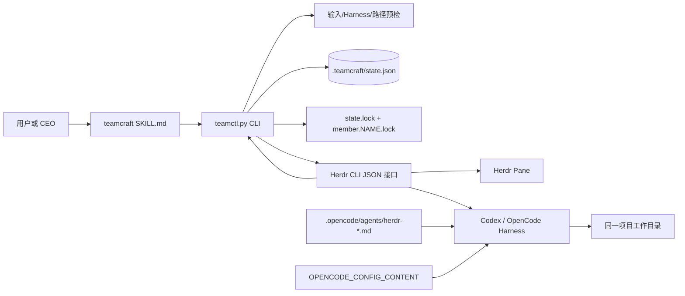
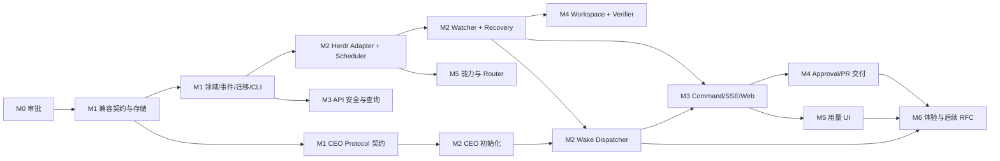

# TeamCraft 2.0 M0 架构审计与实施审查报告

> 状态：ADR-001 与 M0 退出门禁已获**原则接受**；M1-01 至 M1-07 已验收；M1-08 的协议、Codex/OpenCode 入口及安装契约已实施，离线门禁通过（证据见第 12.11 节）。M1-02 原有的 Python 3.10/Linux/CI 条件已关闭（证据见第 12.7、12.9 节）。Owner 于 2026-11-02 决定采用 SQLite-only Fresh Start，最终 Runtime 于 2026-11-04 通过 GitHub Actions run 41779790463 @ `6638341`（第 12.9 节）。OpenCode 实际模型调用因 `provider.no-route` 未能验证 Skill 加载；记录为限制，不以 Mock 代替。项目不提供生产 JSON→SQLite 迁移或 JSON 回滚。M2-01 至 M2-06 已完成并关闭（第 12.10–12.16 节）。2026-11-08 Owner 决定将 M2-07、M2-08、M2-09 登记为**实现任务完成**（第 12.18 节）：这不改变验证事实——M2-08/M2-09 的真实 Herdr 投递、响应丢失/重启恢复、身份漂移与可信宿主回执验证仍为**未验证（不是通过）**（第 12.17 节）。M3-01 API 安全壳已完成实现并通过 CEO 验收：73 项定向测试、468 项 core 回归、89 项 Skill 回归、lint 与本机 loopback HTTP 冒烟均通过；本工作树尚未运行 GitHub Actions（验收记录见第 12.18 节）。M3-04 Command API、持久调度闸门（schema v15）与 teamctl CLI 对等已完成实现并通过本机自动化回归（67 项定向 + 18 项 CLI 对等/解析器 + core 全量 638 项；tester 首轮两项阻塞缺陷与 CLI --help 启动缺陷均已修复；证据见第 12.19 节）；M3-05 最小 Web 控制台已完成实现并通过本机自动化回归与 loopback HTTP 冒烟（35 项定向 + core 全量 673 项；其 wheel/sdist 打包缺口已关闭，wheel、sdist 与安装态 WEB_ROOT 的资产证据见第 12.20 节），真实浏览器/E2E 属 M3-06，GitHub Actions 未在本工作树运行，均维持**未验证**。M3-06 Chromium 浏览器 E2E 套件已完成实现并经本机可重复验证（2026-11-11）：`tests/test_web_m306.py` 以纯标准库 CDP 客户端驱动真实无头 Google Chrome 157.0.8103.50，覆盖 M3-06 恢复矩阵，连续两次全量 **20 passed、退出码 0**，core 全量 **693 passed / 115 subtests / 退出码 0**，并据此修复 `teamcraft/api/web/app.js` 六处真实控制台缺陷（证据见第 12.21 节）。该套件的一切 runtime 场景均为 Fake Herdr 走同一套 Core 原语，**不构成真实 Herdr 证据**——真实 Herdr 投递/重启恢复/身份漂移、可信宿主回执、GitHub Actions 与非 Chromium 引擎维持**未验证**。M4-06 集成冲突与安全清理已完成实现并经独立 tester 验收 PASS（2026-11-26）：base 漂移检测与 `git merge-tree --write-tree` 纯内存冲突探测、显式 `itg-` 前缀集成 Task、证据门控的受控 Worktree 清理（唯一删除面 `git worktree remove` 永不带 `--force`、branch/commit 全部保留）与 crash 后 reconcile 均落地；M4-06 定向 21 tests OK、M4 相邻回归 318 tests OK、全量 1466 tests 通过 + 1 skip、0 失败、0 error（在隔离 venv 安装 `.[test]` 依赖后），独立 tester 复核给出 PASS；无 Schema 变更、无 HTTP API 面（延期至 M6-02）；真实 Herdr 与 GitHub Actions 未运行，维持**未验证**（证据见第 12.32 节）。
>
> 报告版本：v2.9（M4-06 集成冲突与安全清理独立验收 PASS 登记，第 12.32 节）
>
> 审计日期：2026-10-21；ADR-001 设计修订：2026-10-22；M1-01 门禁与规划一致性修订：2026-10-23；M1-02 实施记录：2026-10-23；M1-02 有条件验收登记：2026-10-24；运行目录统一及 CEO Protocol 规划复核：2026-10-27；M1-05 验收与旧 M1-06 授权：2026-11-01；SQLite-only Fresh Start 决策与 M1-06 验收：2026-11-02；M1-07 授权及运行环境门禁：2026-11-02；M1-07 最终验收关闭：2026-11-04；M1-08 CEO Protocol 接受及实施：2026-11-04；M2-02–M2-06 验收关闭：2026-11-04 至 2026-11-05；M2-08 首次启动修正与 M2-09 状态登记：2026-11-07；M2-07–M2-09 实现完成登记与 M3-01 验收关闭：2026-11-08；M3-04 实现完成登记：2026-11-10；M3-05 Web 控制台实现完成登记：2026-11-10；M3-05 package-data 打包缺口关闭登记：2026-11-10；M3-06 Chromium 浏览器 E2E 实现完成登记：2026-11-11；M4-06 集成冲突与安全清理独立验收 PASS 登记：2026-11-26
>
> 产品需求与里程碑目标：[TEAMCRAFT_2_0_PLAN.md](TEAMCRAFT_2_0_PLAN.md)；本文第 9 节是 M1–M6 任务 ID、依赖和逐项验收的唯一权威来源
>
> 仓库基线：原始审计 `main` / `d9d95a6`；M1-02 开工基线 `docs/teamcraft-2-0-planning` / `e9111c8`；本轮规划修订前运行目录更新提交 `924dfad`
>
> M0 审计轮范围（历史）：架构审计、差距分析、ADR 候选和 M1–M6 实施拆解；当时未修改产品代码。该会话另有用户授权的 DIQI 创建、命名和 Pane 布局操作；启动 DIQI 前，主 Agent 因原 `state.json` 绑定另一 Herdr Session，手动且可逆地将其移动为归档文件。这些是编排运行变更，不属于产品实现或本报告的验证动作。当前 M1-02 只修改获授权的包、Skill、安装器、文档和离线测试，未操作 Herdr 会话

## 1. 审查结论

当前 TeamCraft 是一个可工作的 Herdr 团队管理 Skill，而不是 PRD 所描述的完整编排服务。真实核心只有一条同步调用链：Skill/用户调用 `teamctl.py`，脚本在 `.teamcraft/state.json` 中预留成员和 Ownership，再直接调用 Herdr CLI 创建 Pane、启动 Harness、提交 Prompt，并通过 Herdr 实时查询完成状态检查和保守恢复。项目还包含六个 OpenCode 角色配置、一个安全安装器和两组回归测试。

现有实现已经形成必须保留的兼容基线：

- 角色与 Harness 分离，支持 CEO、CTO、Developer、Designer、Tester 和 Custom；
- 写入成员必须声明非重叠 Ownership，只读成员不能占用 Ownership；
- `status` 将持久化阶段与 Herdr 实时信号分开，无法核实时返回 `unknown`；
- `resume` 核验 Pane、terminal、Harness、成员名和原生 Agent Session，歧义时默认检查而不重发；
- JSON 状态使用原子替换、全局状态锁和成员生命周期锁；
- `complete`/`release` 不终止进程，`working`、`blocked`、`unknown` 默认不能释放；
- OpenCode 角色通过 Pane 局部配置选择，不覆盖用户已有的全局/项目配置；
- 安装器先做完整预检，拒绝符号链接目标，保留已有 `opencode.json`，支持幂等和 dry-run。

M0 审计时点（2026-10-21）PRD 中的 SQLite、Task DAG、Attempt、Event/Command、Scheduler、Watcher、Web/API/SSE、Approval、Worktree、Verifier、GitHub PR 和成本路由均未实现（2026-11-08 状态更新：SQLite Core、Task/Attempt/DAG、Event/Command、Scheduler/Leader、Watcher 与 report-only Verification/Approval 已随 M1-03 至 M2-06 落地并验收；M3-01 API 安全壳已验收关闭；Worktree、GitHub PR、SSE、业务 Query/Command API 与成本路由仍未实现；以第 9、12 节为准）。M1 不应先启动 Web 或 Worktree；应先把上述现有语义写成兼容契约，然后引入 SQLite Core，并在一次有冻结、代际栅栏和回滚条件的切换中将旧 JSON 从写入真源迁移为只读兼容视图。M2 再把直接 Herdr 调用收口为 Adapter，并增加确定性调度、观察和恢复。由于 FR-011 Verifier 和 FR-012 Approval 都是 P0，M2 还必须在 M3 Web 验收前提供面向 report-only/scout 的最小程序化验证和持久审批门禁；M4 负责 Worktree、Diff、Commit、local-only 和 direct-PR 的完整证据链。在 M4 之前，共享工作树上的验证不能证明普通 ship 产物与某个隔离执行一一对应，因此普通 ship 必须保持未交付状态，不能宣称已满足完整 P0 闭环。

截至 2026-11-08，仓库已有独立薄 `teamcraft-ceo` Skill、唯一 CEO_PROTOCOL.md、detached version/hash manifest 和 OpenCode 薄 CEO Agent；M2-08 的两阶段身份绑定初始化 Runtime（`teamcraft/ceo_initialization.py`，Schema v13/v14）与 M2-09 持久 Wake Dispatcher（`teamcraft/wake.py`，Schema v12 及 `wake-*` CLI 入口）已落地代码，Claude Code 入口仍延至 M6-06。但初始化与 Wake 的可信宿主回执、reset 后真实首次启动、真实 Herdr 投递/重启恢复/身份漂移仍为未验证（第 12.17、12.18 节），`assumed_default` 只是显式临时假设，不构成宿主证明。`teamctl.prompt_member()` 已保留“提交前记录可能已投递、结果歧义不自动重发”的安全语义，可作为后续持久 Command/Reconcile 的兼容基础；Prompt 投递（submitted）、Agent 接收（acknowledged）、执行结束（execution_finished）与 Task 完成在 M2-03 后已分别建模、不再混同。以下新增设计是 ADR-001 的待人工审查扩展，不改写或自动扩大 2026-10-23 的原则接受范围。

规划与审计文档的规范目录是 `doc/`：PRD 位于 `doc/TEAMCRAFT_2_0_PLAN.md`，本报告位于 `doc/TEAMCRAFT_2_0_M0_REVIEW.md`。早期草案中的 `docs/` 写法已修正，不再作为当前路径说明；目标目录树中的其他文档仍只是未来建议。

## 2. 审计范围与证据

M0-01 原始审计覆盖（下列 Skill 路径是当时基线；M1-02 实现已迁移到 `.agents/skills/teamcraft/`）：

- 产品与使用说明：`README.md`、`README.zh-CN.md`、`PROGRESS.md`；
- Skill 契约：`.agents/skills/herdr-team/SKILL.md`；
- 运行实现：`.agents/skills/herdr-team/scripts/teamctl.py`；
- Harness 配置：`.opencode/agents/herdr-*.md`、`opencode.example.json`；
- 安装：`scripts/install.sh`；
- 测试：`.agents/skills/herdr-team/tests/test_teamctl.py`、`tests/test_install.py`；
- 目标基准：`doc/TEAMCRAFT_2_0_PLAN.md`。

M0-01 原始基线没有 `pyproject.toml`、Python 包目录、前端工程、CI 工作流或数据库迁移目录。M1-02 实现仅新增 `pyproject.toml` 与无副作用的最小 `teamcraft` Python 包边界；前端、CI 和数据库迁移仍不存在。当前 `.teamcraft/`、为保护本仓库既有本地数据而保留的 `.herdr-team/` 忽略项，以及本地 `opencode.json` 由 `.gitignore` 排除；新安装项目只写入 `/.teamcraft/` 与 `/opencode.json`。基线测试使用临时目录，没有读取或改写项目的实际 `state.json`；但 M0 会话在审计之外曾按用户授权创建、命名和移动 DIQI Pane。启动前，主 Agent 发现原 `state.json` 绑定另一 Herdr Session，遂手动且可逆地把它移动到归档文件名，再启动 DIQI；这不是 Herdr 自动归档。因此不能笼统声称该次运行状态或布局完全未变。架构结论只依据受跟踪实现、PRD、测试和版本探测，不把那次编排操作当作产品能力验收。本次运行目录统一没有读取、移动或改写真实 `.herdr-team/`，也未操作 Herdr 会话。

## 3. 当前真实架构

### 3.1 组件与边界

边界结论：

1. `teamctl.py` 同时承担 CLI、领域校验、状态存储、Herdr Adapter、Pane 布局、成员恢复和输出序列化，尚无独立 Core 或服务层。
2. `.teamcraft/state.json` 是成员编排记录，但并非完整历史数据库。Task 是成员记录中的文本字段，Member、Task、Attempt、Session 尚未独立建模（`teamctl.py:648-658`）。
3. Herdr 是运行态观测源。`status` 在锁内取得 JSON 快照，随后逐成员查询 Herdr；查询失败时输出 `unknown` 和 `inspection_error`，不会展示缓存状态冒充实时状态（`teamctl.py:824-863`）。
4. Worker 共享同一项目目录。Ownership 只做派工冲突协调，Skill 明确声明它不是文件系统权限隔离（`SKILL.md:31-33`；`README.md:168-174`）。
5. OpenCode 模型选择是静态配置。六个角色配置均指向同一 oMLX 模型；`opencode.example.json:1-18` 给出本地 Provider 示例，尚无运行时 Router、预算或故障升级策略。
6. 安装器把 Skill、测试、脚本、角色配置和配置模板复制到目标项目；它不是包管理器，也不安装依赖（`scripts/install.sh:50-78`；`README.md:93-101`）。

### 3.2 启动调用路径

`teamctl launch` 的实际顺序如下：

1. 要求在 Herdr 环境中运行，并要求 `HERDR_SOCKET_PATH`（`teamctl.py:102-118`）。
2. 校验成员名、超时、项目根、任务文本、角色责任和 Ownership；非 CEO 写入成员没有 Ownership 会被拒绝（`teamctl.py:618-635`）。
3. 从已安装 Herdr 的 kind 列表确认 Harness，并确认可执行文件在 `PATH`（`teamctl.py:335-351`）。
4. 查询同名实时 Agent、解析调用 Pane、计算当前 Herdr Session 身份（`teamctl.py:364-384`、`:109-118`）。
5. 在状态锁中检查 Session、成员名和 Ownership 重叠，先把 `reserved` 成员写入 JSON（`teamctl.py:310-332`）。这保证外部布局改变之前先记录意图。
6. 读取 Pane 几何并选择安全拆分方向；调用 `herdr pane split --no-focus`。OpenCode 额外注入仅覆盖 `default_agent` 的 Pane 局部 JSON（`teamctl.py:401-416`、`:475-496`、`:499-534`）。
7. 将阶段记为 `start_requested`，调用 `herdr agent start`，再用 `agent get` 记录 Pane、terminal 和原生 Session（`teamctl.py:537-565`）。
8. 在提交 Prompt 前先设置 `prompt_may_have_been_delivered=true`，再调用 `herdr agent prompt`。超时或失败统一视为结果歧义，禁止自动重发（`teamctl.py:568-601`）。
9. 输出成员摘要，包括持久化阶段、实时状态、只读标志和 Ownership（`teamctl.py:604-615`）。

### 3.3 状态、锁与恢复路径

- `StateStore` 使用 `fcntl.flock` 串行化 JSON 读写，以同目录临时文件、`fsync` 和 `os.replace` 原子替换状态文件（`teamctl.py:125-169`）。因此当前原生平台是 macOS/Linux，README 声明 Python 3.10+ 且不支持原生 Windows（`README.md:53-59`）。
- 每个成员另有非阻塞生命周期锁，避免同名成员同时 `launch`、`resume`、`complete` 或 `release`（`teamctl.py:171-189`、`:889-910`）。
- Session 身份由 Herdr socket 的解析路径、设备号和 inode 组成；状态属于其他 Herdr Session 时拒绝自动接管（`teamctl.py:109-118`、`:203-207`）。
- `resume` 先验证记录 Pane 的 terminal、成员名、Harness 和原生 Session；Pane 移动后可以用唯一成员名重新定位，但仍需验证身份（`teamctl.py:688-755`）。
- 对 `split_requested/split_ambiguous`，默认返回检查指令，只有显式 `--split-action retry` 才重试；对可能已经提交的 Prompt，默认 `inspect`，只有显式 `send`/`skip` 才推进（`teamctl.py:758-821`）。
- `status` 支持 `blocked/working/idle/done/unknown/missing`。Skill 规定 `idle` 和 `done` 都可表示 Agent 已稳定下来，但它们都不应自动推导新的 2.0 Task 已验收完成（`SKILL.md:79-87`）。
- `complete` 和 `release` 只修改记录并清空 Ownership，不关闭 Pane；实时状态为 `working`、`blocked`、`unknown` 时必须显式 `--force`（`teamctl.py:866-886`）。

### 3.4 安装和角色配置路径

安装器先构造受管文件清单并拒绝源或目标路径中的符号链接（`scripts/install.sh:50-78`、`:81-97`），在任何写入前预检全部冲突（`:170-221`），随后以原子复制/写入执行（`:113-148`、`:223-240`）。已有 `opencode.json` 无论 `--force` 与否都保留（`:204-211`）。

六个 OpenCode Profile 是角色提示和权限模板，不是独立运行服务。Developer 等角色将编辑和 shell 设置为 `ask`，拒绝外部目录、网络搜索和子任务；CEO Profile 可以编辑项目文件，但同样拒绝外部目录和子任务。`teamctl` 在 Pane 层选择 `herdr-<role>`，同时保留既有 `OPENCODE_CONFIG_CONTENT` 其他字段（`teamctl.py:471-496`）。

## 4. 兼容性矩阵

| 兼容面 | 当前真实行为 | 2.0 约束 | M1/M2 兼容验收 |
|---|---|---|---|
| Skill 入口 | `.agents/skills/teamcraft/SKILL.md` 指导原 `teamctl.py`；M0-01 基线路径为 `.agents/skills/herdr-team/` | M1-02 直接改名目录与 frontmatter 并同步 installer/README/测试；旧入口未对外部署，故不保留旧目录、窗口或别名 | 新路径承接相同命令语义；参数/默认值/stdout JSON/退出码不变；既有 59 项回归迁移通过并增加新入口发现/安装契约；最终状态以 M1-02 验收为准 |
| CLI 命令 | `launch/status/resume/complete/release`（`teamctl.py:917-966`） | 旧命令至少一个可见版本稳定 | 参数、默认值、stdout JSON 关键字段、错误退出码建立 golden/contract 测试 |
| 角色/Harness | 六类角色；`--kind` 独立选择 Harness | Core 不直接推理，仍经 Herdr | Adapter 接受现有 role/kind/agent args；未支持 kind 保持预检失败 |
| Ownership | 精确路径或尾部 `/**`；父子范围冲突；终态释放（`:264-332`） | 保留重叠检测并加入 Task/Attempt | 同一组合法/非法输入与并发预留结果一致；新增 Diff Gate 不削弱原规则 |
| read-only | 不能带 Ownership；Prompt 明令不编辑（`:264-266`、`:436-458`） | Scout/审计不获得写权限 | 数据库保存 read-only；Scheduler 不分配写租约；现有 CLI 拒绝组合保持一致 |
| 持久化路径 | `.teamcraft/state.json`，version 1；发现旧 `.herdr-team/state.json` 时 fail closed | SQLite 成为新真源，旧 JSON 不原地覆盖 | 迁移前备份+摘要；切换前 Reconcile；旧 JSON 只读导出或归档，不双主写；目录改名不自动迁移 |
| 原子性/锁 | `state.lock` + `member.<name>.lock`；原子替换 | SQLite 事务、条件更新、Leader Lease | 并发 Ownership 和同成员生命周期测试继续通过；跨进程派工最多一次获得租约 |
| Session 身份 | socket path/device/inode + Pane/terminal/native session | Task/Attempt/Session 分离 | 不允许只凭名字接管；所有恢复仍验证已有身份并保留无法核实时的 UNKNOWN |
| 状态显示 | 阶段与 `agent_state` 分开；检查失败为 `unknown` | Task/Attempt/Session 三层状态 | 不把 `idle`、`done`、Pane 存活直接映射成 Task DONE；兼容输出继续提供旧字段 |
| 保守恢复 | split/start/prompt 歧义先记录，默认 inspect | Watcher 只观察；未知结果不盲重试 | 默认恢复不产生第二 Pane/Prompt/外部副作用；新 Attempt 前必须有确定证据或人审 |
| 完成/释放 | 不关 Pane；危险实时状态需 `--force` | 高风险动作走审批和审计 | 旧命令仍不终止 Agent；新的 cancel/stop 是独立显式 Command |
| OpenCode 配置 | Pane 局部覆盖 `default_agent`，要求角色文件存在 | Router 可选 Harness/Model | 不覆盖用户 Provider；静态 Profile 仍可运行；Router 决策另行记录 |
| 安装器 | 项目内复制，预检后写入，保留配置，拒绝 symlink | 需部署 Core/API/Web 资产和迁移工具 | 旧安装场景 10 项测试全过；新增文件仍遵守预检、幂等、dry-run 和配置保留 |
| 人工权限 | 最终集成/发布由人确认（`README.md:7-9`） | merge/deploy/delete worktree 默认审批 | 未经批准不自动 merge、部署、清理脏 Worktree 或重复高风险命令 |

## 5. 目标能力差距

状态定义：**已有**表示当前实现满足目标的核心语义；**部分**表示可复用但缺少目标领域模型或闭环；**缺失**表示仓库中没有实现证据。本表随里程碑验收更新：状态列反映本报告 v2.3（2026-11-08）时点；行内注明"实机/真实宿主未验证"的项目不是通过，只是尚未验证；验收细节以第 9、12 节为准。

| FR | 状态 | 当前证据与差距 |
|---|---|---|
| FR-001 项目注册 | 部分 | `resolve_project_root` 可验证现有目录；首次 CLI/Scheduler 操作幂等建立带 ID 的 Project 行并以 `project:<project_id>` 租约约束（M2-02，第 12.13 节）；仓库/权限检查与项目级配置集仍未实现 |
| FR-002 Task CRUD | 部分 | Core 已有带 version 的 Task/acceptance 持久模型与命令（M1-04/M2-03 Brief、WorkerReport 绑定 Task/Attempt 版本）；成员 launch 任务文本仍在 members 兼容记录中；面向操作的 CRUD API 属 M3-02/M3-04 |
| FR-003 Task DAG | 部分 | M1-04 实现依赖表、循环路径检测（返回具体路径）、READY 推导与优先级排序；M2-02 Scheduler 按 READY/配额/Ownership 原子领取（第 12.13 节）。DAG 的 CRUD API 与 Web 图属 M3/M6 |
| FR-004 Attempt/Session 独立 | 部分 | M1-04 起 Task/Attempt/Session 在 Core 中独立建模并可分层查询，Prompt 投递、执行结束与 Task 完成在 M2-03 后分别记录；`members` 表保留运行时兼容视图（pane/terminal/native session 与阶段），legacy Member 混合形态仅存于兼容层 |
| FR-005 SQLite/事件 | 部分 | M1-03 实现 SQLite Storage、Schema migration、WAL/外键、在线备份与版本过新拒写；M1-05 实现 append-only Event、单调 `seq`、Command 幂等键/evidence version/CAS（`teamcraft/storage.py`、`teamcraft/events.py`、`teamcraft/commands.py`）；M1-07 后 Runtime 以 SQLite 为唯一权威源（第 12.6–12.9 节）。尚无独立 Outbox 机制，Domain Event 实体审计关联留待后续集成（第 9.1 节 M1-05 后续门禁） |
| FR-006 Herdr Adapter | 部分（离线契约完成） | M2-01 落地 `teamcraft/herdr_adapter.py`：统一超时、JSON 形状、稳定错误码与 capability/pane/agent start/get/prompt/read/stop 接口；`teamctl` 生产路径经 typed Adapter 且保持 claim-before-effect（第 12.10、12.12 节）；Fake 契约测试离线可跑。Herdr 0.9.3 之外的可选实机契约未运行 |
| FR-007 Watcher/恢复 | 部分 | `status/resume` 人工保守恢复之外，M2-04 已实现 caller-driven 低频 Watcher：liveness/activity/progress 三类信号、`seq`+dedupe key 幂等事件、无进展/deadline 阈值与退避；M2-05 提供 wait/cancel/reconcile 持久 Command、UNKNOWN 结算与核验后取消（第 12.14、12.15 节）。无常驻后台进程；订阅式事件源未验证，自动 Reconcile 仍由 CLI/Scheduler tick 触发 |
| FR-008 Ownership | 已有（协调级） | 路径规范化、重叠拒绝、只读语义和并发测试已存在；没有 OS 沙箱和 Diff Gate |
| FR-009 Web UI | 部分（M3-01 已验收；M3-02–M3-06 实现完成） | HTTP 面已有通过 CEO 验收的 M3-01 安全壳 `teamcraft/api/`（loopback 默认、token/Origin/CSRF、request ID、统一错误、静态边界、健康分层；证据见第 12.18 节），并已挂载 M3-02 Query、M3-03 SSE 与 M3-04 Command 业务路由；内置零依赖最小控制台 `teamcraft/api/web/`（经 `http://127.0.0.1:8765/static/index.html` 提供，仅展示真实 API 数据，M3-05 登记见第 12.20 节）。真实浏览器/E2E 的 Fake-Herdr 场景已由 M3-06 无头 Chromium 套件覆盖（第 12.21 节），真实 Herdr 场景与非 Chromium 引擎仍未验证。`examples/team-demo/index.html` 是实机协作产物示例，不是 TeamCraft 控制台 |
| FR-010 CLI/Web 共享命令服务 | 部分 | CLI 运行状态读写已经由 SQLite Core 与带 fencing 的 Command 边界承接（M1-07，第 12.8–12.9 节），不再直写 JSON；Web 侧的 Query/Command API（M3-02/M3-04）与 CLI 走同一 Core 转换与同一数据库（第 12.19 节），Web 控制台（M3-05）仅消费这些路由（第 12.20 节） |
| FR-011 Verifier | 部分 | M2-06 落地 report-only/scout 最小验证：仅执行项目持久化、人工批准的 argv（`shell=False`），有界输出 artifact+SHA-256、退出码与 verifier/config version 绑定，并按同一 evidence version 做 Approval（第 12.16 节）；无验证命令不 PASS。Worktree/Commit/Diff 的完整 Verifier 与 ship 验证留待 M4 |
| FR-012 用户审批 | 部分 | M2-06 已有持久化 Approval 实体：绑定 verification 与完整 evidence version，accept/reject 可审计、同幂等键幂等，证据变化使旧批准失效（第 12.16 节）；merge、部署、脏 Worktree 清理等高风险动作的统一审批门禁属 M4 |
| FR-013 Worktree | 缺失 | 当前所有 Pane 使用同一 `cwd`（`teamctl.py:507-510`） |
| FR-014 SSE | 缺失 | 没有 Event 序号、流和断线补拉 |
| FR-015 Model Router | 部分 | 用户可选 `--kind`，OpenCode Profile 静态指定 oMLX；没有策略、风险、健康、预算或决策原因 |
| FR-016 GitHub PR | 缺失 | 没有 `gh` 探测、PR 状态或发布门禁 |
| FR-017 Workflow DAG 图 | 缺失 | 无 DAG 数据和 Web |
| FR-018 Token/成本 | 缺失 | 没有 usage 数据；不得把缺失值解释为 0 |
| FR-019 重试/失败升级 | 部分 | M2-05 已实现 `max_attempts`（默认 3，建 Attempt 时事务内强制）、无进展/任务超时升级 NEEDS_HUMAN、UNKNOWN 占位与需审批的有界 retry（第 12.15 节），并保持"歧义不自动重试"；失败分类、预算与云端升级流程留待 M5-03 |
| FR-020 项目策略 | 部分 | 已有分散的项目级策略：Scheduler 并发配额与优先级（M2-02）、项目级 verifier argv 配置（M2-06）、`max_attempts`（M2-05）与 Brief 时钟默认值并绑定 digest（第 10 节第 18 条）；尚无统一的并发/Verifier/审批/路由项目策略模型与 API |
| FR-021 Review 专家 | 部分 | Tester/Custom/CTO 可按需启动；没有基于 Task 的交叉审查策略 |
| FR-022 远程访问 | 缺失/P2 | 当前仅本地 Herdr；已验收的 M3-01 安全壳默认只绑 loopback，非 loopback 绑定需显式 ack（第 12.18 节）；TLS、VPN/SSH 入口无设计实现 |
| FR-023 多机 Worker | 缺失/P2 | 单机实现，符合当前非目标 |
| FR-024 CEO Protocol/跨 Harness | 部分 | M1-08 建立单一协议、Codex/OpenCode 薄入口与安装契约并通过 Codex 0.166.0 实机发现；OpenCode v2.0.29 入口实机调用因模型 `provider.no-route` 未完成；Claude 延至 M6-06；M2-08 两阶段初始化握手与 Session/nonce 绑定已实现（实现任务按 2026-11-08 Owner 决定登记完成），可信宿主回执与实机初始化仍未验证（第 12.17、12.18 节） |
| FR-025 CEO 初始化/Wake | 部分（实机未验证） | M2-08 已实现初始化握手：Prompt 前绑定 server/team、Session、pane/terminal、Attempt 与协议 pin/nonce，两阶段身份绑定与 dispatch gate，live-only 非可移植身份显式且受完整进程/socket 指纹核验；M2-09 已实现持久 Wake 队列、dedupe/优先级窗口合并、ack/处理游标与 `wake-*` 手动入口（第 12.17、12.18 节）。auto-start 默认关闭；真实 Herdr 投递、重启恢复、身份漂移与可信宿主回执未验证 |

除 FR 清单外，当前已有而目标必须继续支持的能力是项目内安全安装、配置保留、角色模板、Pane 自动布局和焦点保持。这些能力不应在引入 Python 包或服务进程时丢失。

## 6. 可复用组件与改造边界

| 组件 | 复用判断 | 建议动作 |
|---|---|---|
| `SKILL.md` | 直接保留，作为外部操作契约 | M1-02 实现（已条件验收）已将目录与 frontmatter 改为 `teamcraft` 并同步 installer、README 与命令路径引用；不设双入口；2026-10-27 后续修订将状态目录统一为 `.teamcraft/` 并对旧状态 fail closed；后续只在对应能力实现后补充 2.0 命令 |
| `teamctl` 参数与 JSON 输出 | 外部兼容面，可复用 | 保留脚本为薄入口；内部逐步转调共享 Command Service/Herdr Adapter |
| `run_process/run_herdr` 与响应解析 | 可提取 | 移到 `adapters/herdr.py`，定义超时、错误归一化、能力探测、Fake Adapter 契约 |
| `StateStore` | 仅用于迁移和兼容 | 冻结 version 1 读取器；SQLite 切换后不得与 DB 双主写；保留原文件快照和只读导出 |
| Ownership 规范化/重叠算法 | 高价值复用 | 移到 Core ownership 模块并保持输入语义；增加大小写策略、symlink/实际 Diff 检查，不改变现有 CLI 合法集合 |
| Prompt/Brief 构造 | 部分复用 | 保留现有角色、责任、Ownership 和只读要求；由 M2-03 分层注入 Task/Attempt、任务文件版本、验收和禁止操作，并在 Herdr prompt 前持久化 Command；不复制完整 CEO Protocol |
| `teamcraft` 运行 Skill | 直接保留 | 继续负责 Herdr 会话和 Agent 运行；新增 `teamcraft-ceo` 只作协议加载入口，不回退到旧 `herdr-team` 名称，也不复制 Core/Herdr CLI |
| Pane 拆分方向和 `--no-focus` | 直接复用 | 留在 Herdr Adapter/Workspace 调用层；契约测试固定 Pane 参数 |
| Session/occupant 核验 | 高价值复用 | 作为 Reconcile 核心；禁止简化成仅按成员名或 Pane ID 恢复 |
| 保守恢复状态 | 高价值复用 | 映射为 Command `unknown`、Attempt `UNKNOWN` 和需人工处理事件；默认仍不重发 |
| OpenCode Profile | 可继续使用 | 保持静态回退；Router 只选择/记录，不在迁移时覆写用户 Provider/Model |
| 安装器 | 可扩展 | 保留全量预检、原子写、symlink 拒绝、配置保留和幂等；新增依赖安装需单独设计，不能暗中联网 |
| 现有单元测试 | 必须保留 | 提升为 compatibility suite；Fake Herdr 继续离线运行，另加当前 Herdr 版本的可选实机 contract suite |
| `teamctl.py` 单文件结构 | 需要拆分 | 只做渐进提取；每次提取都先保持旧入口和回归测试，不整文件重写 |
| Member 混合模型 | 需要替换内部模型 | 对外提供兼容视图；内部拆为 Task、Attempt、Agent、Session，保留原始 legacy payload 供审计 |
| 状态阶段 | 需要分层 | 现有 launch phase 保留为 Attempt/Session 兼容字段，不能和 Task 状态或实时 Agent 信号混为一列 |

## 7. 测试与环境基线

以下是 M0-01 原始测试基线；当时 README 的回归入口位于 `README.md:254-265`，并在未修改仓库和 Herdr 运行状态的情况下执行：

| 命令 | 退出码 | 结果 |
|---|---:|---|
| `python3 -B -m unittest discover -s .agents/skills/herdr-team/tests -v` | 0 | 20/20 通过，0.024s |
| `python3 -B -m unittest discover -s tests -v` | 0 | 10/10 通过，0.490s |

合计 30/30 通过。Herdr 测试使用临时目录、模拟 socket 和 Mock Herdr（`test_teamctl.py:52-68`），覆盖状态恢复、Ownership 并发、生命周期锁、Pane 移动、Session 身份、歧义恢复、实时状态和 OpenCode 配置。安装器测试通过临时目标调用真实 `scripts/install.sh`（`tests/test_install.py:10-29`），覆盖首次/重复安装、冲突、配置保留、dry-run、空格路径、符号链接和 Git ignore。

环境探测：

| 工具 | 版本/结果 | 说明 |
|---|---|---|
| Python | 3.13.14 | 当前 README 最低要求为 3.10+，PRD 建议 3.11+；最终最低版本尚未用 CI 矩阵验证 |
| Herdr | 0.9.3 | 版本命令成功；现有单元测试使用 Mock，尚无自动化实机契约套件 |
| OpenCode | 2.0.25 | 默认 `opencode --version` 因沙箱不能写用户日志目录而退出 1；将 XDG data/cache/config 指向 `/private/tmp` 后退出 0 |
| Codex CLI | 0.163.0 | 版本命令退出 0；沙箱下出现不能创建 PATH alias 的非致命警告 |
| Bash | 3.2.57 | 安装器当前可运行 |
| Git | 2.54.0 (Apple Git-157) | Worktree/PR 能力尚未测试 |

环境问题不能被误写成产品兼容结论：当前只能证明上述本机版本通过现有离线测试。最低 Herdr/OpenCode/Codex 版本、Linux 行为、真实 oMLX 健康检查和当前 Herdr 命令响应兼容性仍需 M1/M2 建立矩阵。

## 8. ADR-001（修订）：存储、状态、交付与进程模型

### 8.1 状态

**原则接受（2026-10-23）；持久化路线于 2026-11-02 更新**。本节的状态机、事务、Command/Event、并发与恢复原则仍是设计基线；其中 legacy 导入、旧 writer fencing、JSON rollback 和生产 cutover 方案被 2026-11-02 的 Owner 决策明确取代，不再是 TeamCraft 2.0 的实施路径。原则接受不等于任务开工授权或任务完成验收；决策状态见第 12 节。M1-01 的原验收记录不变。

PRD 的建议 DDL 在实施前必须修正两点：

- PRD 要求“同一 Task 同时至多一个活动 Attempt”（`:352-355`），但 `attempts` 表只有 `(task_id, attempt_no)` 唯一约束（`:249-263`），没有数据库级活动唯一约束。M1 应通过可被 SQLite 执行的部分唯一索引、活动槽表或等价事务约束落地，并用双连接竞争测试证明。
- `verifications.commit_sha` 在建议 DDL 中为 `NOT NULL`（`:303-311`），但 `report-only`/`scout` 可以交付报告而不产生 Git Commit（`:350`、`:429-431`）。M1/M2 的最终 Schema 应允许可空 Commit，并要求另一种受控 artifact/report hash；不同交付类型通过 CHECK 或领域校验保证至少有一种可验证证据。

里程碑也有一处优先级错位：FR-011/FR-012 被列为 P0（`:115-116`），完整 Verifier 却排到 M4（`:733-744`）。本报告将“批准的验证命令、退出码/日志证据、report artifact、持久 Approval”作为 M2 的最小 P0 门禁，并仅验收 report-only/scout。M2 不再设计 local-only 只读快照：它既要冻结整个共享项目写入，又仍无法排除系统外进程，复杂度和证明强度不匹配。Worktree、Diff Gate、Commit 失效、local-only、direct-PR 和安全清理统一在 M4 验收；完整 P0 ship 产品闭环实际要等 M4 证据链完成。

### 8.2 决策

1. **持久化真源**：新 Core 使用 `.teamcraft/teamcraft.db`，SQLite 开启 foreign keys、WAL 和 busy timeout。所有领域写入只经 Repository/Command Service，状态变更与 append-only Event 在同一事务提交。数据库只支持单机、本地磁盘；网络文件系统、同步盘和多机共享 DB 不在 2.0 支持边界内。
2. **旧版迁移约束（历史基线，2026-11-02 已 superseded）**：此前方案要求旧 `teamctl` JSON 唯一写入、部署旧入口写阻断、冻结与静止性证明后导入，再切换 DB 权威；其会话身份和 UNKNOWN 约束仅作为旧方案的审计记录保留。当前路线不读取或导入历史 JSON，不支持 JSON 回滚或双写；新 Core 以 SQLite-only Fresh Start 初始化，发现非空旧状态时拒绝并要求人工处置。
3. **领域分层**：Task 表示用户目标和验收；Attempt 表示一次执行；Session 表示 Herdr/Harness 运行实例；Agent 表示能力配置。此前“导入旧 Member 并保存原 JSON payload”的内容属于已 supersede 的 Legacy 迁移设计，不是当前功能或 M1-06 验收范围。
4. **三层状态与交付状态**：Task 状态、Attempt 状态和 Session/Herdr live signal 独立。`idle/done` 只是实时信号；Worker 完成表示 Attempt 已停止执行并提交结构化结果，Verifier 通过表示绑定证据满足验证规则，PR 创建只表示远端候选已存在，PR 合并才是 direct-PR 的交付事实。这些事件都不单独等于 Task DONE。交付就绪使用策略中立的 `READY_FOR_ACCEPTANCE`；只有 direct-PR 在 PR 已创建、检查通过且等待 merge 决定时使用 `READY_TO_MERGE`。若实现继续沿用 PRD 的 Task 主状态枚举，则把前者建模为独立 `delivery_status`，不得把报告或本地 Commit 描述成“待合并”。这是目标状态设计，不是现有 CLI 已实现能力。现有 launch phase 作为兼容字段/事件保留。
5. **交付策略的 DONE 条件**：`report-only`/scout 必须有受控 report artifact、摘要匹配、Verifier PASS 和明确的人类接受；`local-only` 必须从 M4 的隔离 Worktree 产生 Commit，完整 Diff 通过 Ownership Gate，Verifier PASS，并由人明确接受指定本地 Commit/分支；`direct-PR` 必须绑定预期 base/head，必需检查和 Approval 通过，且 PR 已合并到预期 base。Worker FINISHED、Verifier PASS、Approval 记录或 PR created 都是独立状态，不可折叠为 DONE；PR created 最多进入 READY_TO_MERGE。
6. **Approval 证据绑定**：Approval 至少绑定 `task_id/task_version`、`attempt_id/attempt_no`、artifact digest 或 `commit_sha + diff_digest`、Verifier 结果与配置版本、proposed action；direct-PR 还绑定 repository、PR、head SHA 和 base branch/base SHA。任一绑定字段、策略或验证配置变化都使旧 Approval 失效，将 Task 重新打开到 VERIFYING/NEEDS_HUMAN；执行副作用前 Command 必须以 compare-and-swap 再核对 evidence version，不能复用过期批准。
7. **并发不变量**：同一 Task 最多一个活动 Attempt；不能照搬当前建议 DDL，而要以数据库可执行的唯一活动约束配合事务条件更新。所有 Herdr、Git/GitHub、进程停止等外部副作用只能由持久 Command 驱动，并由持有带 fencing token 的唯一 Leader 执行；每次执行前在事务内核验 Command 版本、租约 epoch 和证据版本。Lease 到期不等于进程已死，接管前必须核验 Herdr、Git 和外部副作用。边界补充：Leader fencing 只保证受控状态提交（CAS/epoch 校验）和执行准入，不改变 Herdr、GitHub 等外部接口本身不具备 exactly-once 的事实；失租瞬间可能已发出的外部调用仍须按第 11 条经 Reconcile 判定，不得把“已被 fence”误当成“副作用未发生”。
8. **职责边界**：CLI 是输入/输出适配器，可离线打开只读连接查询快照；Web 只通过 API 查询或提交命令；Command Service 负责验证、授权、版本检查、幂等、领域转换并原子写 State/Event/Command；Scheduler 仅由 Leader 运行，领取 READY Task、执行持久 Command、续租并协调 Watcher。CLI/Web 不直写表，也不直接调用 Herdr、GitHub 或其他外部副作用。
9. **后台服务缺席**：只读 CLI 仍可工作；需要外部副作用的命令默认返回 `SERVICE_UNAVAILABLE`，不静默留下未来会突然执行的请求。若调用者显式使用 queue 模式，可写入带 TTL、提交者、evidence version 和前置条件的 `PENDING_SERVICE` Command，并明确显示“尚未执行”；Leader 恢复后必须重新验证前置条件，过期、版本变化或身份不明则转 EXPIRED/NEEDS_HUMAN。为保留旧 CLI 可用性，可由旧入口显式启动一次性 Command Service，但它必须先取得同一 fenced Leader Lease，且只处理本次命令；崩溃后仍按持久 Command Reconcile，不能绕过 Leader 直接调用 Herdr。
10. **Herdr/Watcher 边界**：所有 Herdr 命令经 Adapter；Adapter 复用现有 terminal/native-session 核验和错误语义。Watcher 分别记录进程存活、Agent 活跃和实际任务进展；Pane/进程存在或日志仍滚动都不能证明验收进展。实际进展只由版本化规则认可的产物、状态里程碑、Commit/report digest 或验证结果推进。Watcher 只做确定性观察、Reconcile 和事件产生，空闲时不调用 LLM。
11. **外部副作用与恢复**：Command 采用 `pending/running/confirmed/unknown`，通过 idempotency key 去重。系统承诺 at-least-once 检查和幂等处理，不承诺外部操作 exactly-once。重启先 Reconcile `running/unknown/PENDING_SERVICE`，确认旧副作用事实后才继续；`unknown` 不自动产生新 Attempt。
12. **安全默认**：保留 Ownership/read-only；M4 叠加 Worktree 和 Diff Gate。merge、deploy、删除脏 Worktree、强制释放和不确定重试均进入 Approval/显式人审。
13. **SQLite 运维**：备份必须使用 SQLite Online Backup API、`VACUUM INTO`（满足适用条件时）或在受控 checkpoint/停写后的等价一致性流程，并连同 schema version、应用版本与校验摘要写 manifest；generation 若出现，仅表示备份 lineage 元数据，不代表 legacy writer fencing。禁止在 WAL 活跃时只复制主 `.db` 文件。启动时发现数据库 schema 高于当前二进制支持版本必须只读失败并拒绝服务写入，不得自动降级。事件、命令、日志和 artifact 的保留期按项目策略执行；恢复必需证据不能被无证明清除。恢复到备份后先做完整性检查和 DB/Herdr/Git Reconcile，再恢复派工。
14. **恢复政策**：保留 SQLite 数据库快照恢复和 Schema 前向升级；不支持生产状态回滚至 JSON。数据库恢复后必须完成完整性检查和 DB/Herdr/Git Reconcile，未知 Attempt/外部副作用仍按 UNKNOWN 人工核对。

### 8.3 SQLite cutover 协议与崩溃恢复（历史设计，已于 2026-11-02 superseded）

当前实现的 `STATE_VERSION = 1` 只校验 JSON 格式代际（`teamctl.py:22`、`:140-151`）；`StateStore` 的 `fcntl` 锁只协调仍使用同一 `state.lock` 的 JSON 操作（`:125-169`），而 `reserve_member` 在锁内直接覆写 JSON（`:310-332`）。它没有 cutover generation、旧入口写阻断或跨 JSON/SQLite 的共同事务。即使替换了磁盘上的脚本，已经载入旧 Python 代码的进程仍能在导入后取得旧锁并覆盖 `state.json`。因此“持有 state.lock 后导入”不足以证明安全。

切换顺序必须固定如下：

1. **准备代际**：生成不可复用的 `cutover_generation`，在 DB migration record、冻结记录和兼容入口中使用同一值；记录旧 JSON 路径、inode、字节数、mtime 和 SHA-256。generation 不是 JSON 的现有 `version=1`，两者不可混用。
2. **先部署写阻断**：所有已知旧入口在任何 `launch/resume/complete/release` 写入前检查 freeze/cutover marker；新 guard 必须在持有 legacy `state.lock` 时、紧邻每次 JSON mutation 前核对 marker/generation，避免“锁外检查通过、随后冻结、再取得锁写入”的竞态。marker 含 generation 和新入口位置，检测到后 fail closed。`status` 可只读，但不得生成兼容写。入口守卫及其错误语义先于正式 cutover 发布并验证。
3. **冻结与静止性证明**：暂停 Scheduler/新派工，取得迁移锁和旧 `state.lock`，枚举可识别的 legacy writer/lifecycle lock，等待在途操作结束；随后释放/重新获取旧锁并在规定静止窗口前后比较 inode/mtime/size/hash，同时 Reconcile Herdr Session、Pane、terminal 和 native session。活动或未知 Session 不被假定结束。
4. **条件导入**：只从已摘要的不可变快照导入；导入事务内保存 source hash、generation、legacy payload 和映射结果。最终阶段取得 legacy `state.lock` 后再次核对当前 JSON hash、freeze marker 和 DB generation；任一变化均回滚导入。
5. **原子切换**：迁移器从上述最终 JSON hash 检查开始持续持有同一个 legacy `state.lock`，在 DB 事务写入 `DB_AUTHORITATIVE` generation 和事件，并等待 DB transaction/cutover marker 的结果持久化后才释放该锁。兼容入口只有观察到精确 generation 后才可转到 Command Service。保留原 JSON 字节快照，不原地改写为新格式。这个顺序可以约束已部署 guard 的新入口，但仍不能 fence 已载入且不认识 marker 的旧代码，因此第 3 步的 quiescence 证明和无法证明时取消 cutover 仍是硬门禁。
6. **切后监视**：记录 cutover 时 JSON 指纹。其后任何非受控兼容导出导致的 JSON 指纹变化都视为 stale writer 证据：立即暂停 dispatch，将相关 Command/Attempt 置 UNKNOWN/NEEDS_HUMAN，保存双方证据并要求人工 reconciliation；不得把变化自动合并进 DB，也不得回到双主。

无法可靠枚举、停止或以共同 generation 栅栏约束旧进程时，旧方案的安全结论是取消 cutover。**2026-11-02 Owner 路线决策（当前基线）**：Owner 确认 TeamCraft 2.0 没有需要保留或迁移的生产旧系统及历史状态，因此取消生产 Legacy JSON→SQLite 迁移、生产 JSON 回滚、JSON/SQLite 双真源与旧 writer freeze/compat 服务。旧 cutover 细节保留为历史审计，不再是活动实施门禁。M1-06 改为 SQLite Fresh Start Validation：全程仅临时目录与合成数据；非空 legacy `state.json` 必须 fail closed，原文件不自动导入、移动或删除。M1-07 改为 SQLite Runtime Integration，仍需 Owner 单独授权。SQLite Schema 版本升级、数据库备份/恢复、事务/事件原子性与 Runtime Leader fencing 不随该路线取消。

### 8.4 交付状态判定表

| 事实/策略 | report-only / scout | local-only | direct-PR |
|---|---|---|---|
| Worker FINISHED | 仅表示结果已提交 | 仅表示执行已停止 | 仅表示执行已停止 |
| Verifier PASS | 报告 artifact/hash 与规则匹配 | M4 Worktree、Commit、完整 Diff/Ownership 与验证匹配 | local-only 全部证据加远端检查匹配 |
| 人工 Approval | 接受绑定版本的报告 | 接受绑定 Commit/分支和 Diff | 接受绑定 PR head/base、检查和 proposed merge action |
| 交付就绪 | Verifier PASS 后为 READY_FOR_ACCEPTANCE | M4 证据 PASS 后为 READY_FOR_ACCEPTANCE | PR created + 必需检查通过后为 READY_TO_MERGE |
| DONE | 人已接受相同 artifact version | 人已接受指定本地 Commit/分支 | 经有效 Approval 后已合并到绑定的 intended base |

### 8.5 不采用的方案

- **长期 JSON/SQLite 双写**：两处原子边界不同，崩溃后无法证明一致，会破坏保守恢复。
- **Web 服务单独写库、CLI 直接改表**：会绕过统一状态机、幂等和审计。
- **在后台缺席时由 CLI 直接调用 Herdr**：绕过 Leader fencing 和 Command 恢复，无法证明副作用只执行一次。
- **M2 local-only 共享树快照**：需要冻结系统内外全部写入仍不能形成隔离执行证据，推迟到 M4 Worktree/Commit/Diff 链更可验收。
- **Lease 到期即重派**：可能在原 Worker 或外部副作用仍运行时重复执行。
- **将 Herdr idle/done 直接映射 Task DONE**：没有验证和交付证据，会产生虚假完成。
- **M1 直接重写 `teamctl.py`**：缺少兼容夹具和实机契约，回归风险过高。

### 8.6 主要后果

SQLite Core 仍增加 Schema、Leader 和服务生命周期复杂度，但本路线避免了没有生产迁移对象支撑的 JSON 字段映射、双真源和旧 writer cutover 服务。M1-06 风险聚焦初始化原子性、Schema 完整性、权限、既有数据保护和并发恢复；M1-07 Runtime Integration 风险则聚焦 CLI/Skill 接线、Command Service 边界和外部副作用 Reconcile。Schema 迁移与数据库备份恢复仍是运行期能力，不等同于 Legacy JSON 迁移。

### 8.7 ADR-001 扩展：CEO Protocol、Harness 入口与 Wake（分项接受）

**状态：分项接受（2026-11-04、2026-11-05）。** Owner 接受并授权 M1-08：本节第 1 项的协议唯一来源/version/hash，以及第 2 项中 Codex/OpenCode 的薄入口和安全安装契约。2026-11-05 Owner 进一步授权并行实施 M2-03（第 4 项 Prompt/Brief/报告）与 M2-04（第 5 项确定性 Watcher/进展时钟），按下方边界执行；当前 Herdr 无已验证事件订阅接口，M2-04 使用低频 polling fallback，不宣称订阅/轮询等价。协议使用 `1.0.0`；外置 `protocol.manifest.json` 保存正文原始 UTF-8 字节 SHA-256，避免自引用；安装器不写 `AGENTS.md`/`CLAUDE.md`，用户自有 CEO Agent 冲突即使 `--force` 也保留并拒绝安装。第 2 项 Claude Code 入口，以及第 3、6–8 项 CEO 初始化握手、Wake 和观测仍为 Proposed，未接受或授权实现。已接受的 8.1–8.6 与 ADR-001 原则边界不变。

1. **协议唯一来源**：未来以 `.agents/skills/teamcraft-ceo/references/CEO_PROTOCOL.md` 维护唯一 CEO 业务协议，内容覆盖 Discovery、Requirements、Architecture、Planning、Implementation、Verification、Delivery、Recovery 八阶段、责任边界和审批门禁。协议有显式 `protocol_version` 与稳定内容 hash；Attempt 创建时固定版本/hash，运行中不自动切换；旧协议无法恢复时进入 NEEDS_HUMAN，不兼容升级须重新初始化并留下审计记录。相邻 `teamcraft-ceo/SKILL.md` 是薄加载器，不复制协议正文。现有 `.agents/skills/teamcraft/` 继续负责 Herdr/Agent 运行，不更名、不复制 Core 或 Herdr CLI。
2. **跨 Harness 薄入口**：Codex/OpenCode 共用 `.agents/skills/teamcraft-ceo/`；`AGENTS.md` 只写必要加载规则，OpenCode 可由 `.opencode/agents/` 的薄 CEO 配置适配。Claude Code 通过 `.claude/skills/` 安装受管副本或经目标版本验证的 symlink，并由精简 `CLAUDE.md` 引导；两种方式都必须指向或验证同一协议 version/hash。安装器先探测目标 Harness/版本和冲突，支持 dry-run/no-op，绝不覆盖已有 `AGENTS.md`、`CLAUDE.md` 或 Agent 配置。不兼容时明确降级/fail closed，不维护不同 CEO 业务协议。
3. **初始化握手**：CEO 启动 Prompt 只声明身份、协议位置/期望版本、`teamcraft` 运行 Skill 和读取当前项目/任务状态的要求。初始化记录区分 Skill discovered、Protocol read、CEO initialized；Core 从实际协议文件独立计算 hash 并校验文件声明的版本；Protocol read 需要绑定 nonce、Session ID、protocol version/hash 的结构化回执，Core 对照本地文件计算结果和当前 Session 验证，不能从 Skill 可见或 Prompt 已投递推断。Agent 自述只能作为回执证据，不能证明实际遵循协议，也不能代替 Core 的派工、Ownership、审批和 evidence version 安全门禁。只有协议 version/hash、运行 Skill 可用性、Harness/Session 身份都确认并持久化后才能派工。缺失、读取失败、无法确认或不兼容产生事件并阻断派工。
4. **Prompt 分层与投递事实**：M2-03 统一 CEO/CTO/Developer/Tester/custom Prompt：稳定角色规则 + 版本化 Task Brief/任务文件引用 + Ownership/read-only + 验收/交付。Core 在调用既有 Herdr `agent prompt` 前持久化 Command/Attempt/Session/evidence version，投递状态至少区分 pending、sending、submitted、acknowledged；Attempt 另记 executing、execution_finished。`acknowledged` 需要目标会话的可关联回执；不具此能力时保持未确认并 Reconcile，不伪造 ack。Worker 报告、Herdr idle/done 和 execution_finished 均不能直接完成 Task。投递结果 unknown 时按现有 inspect-first 语义 Reconcile，不盲目重发。
5. **确定性观察**：Watcher 先探测 Herdr 的可靠事件订阅能力；仅在版本化契约验证通过时订阅，否则低频查询。无论来源，统一以 SQLite `events.seq`、稳定 dedupe key 和事务写入为权威；分别维护 process liveness、Agent activity、Task progress。Watcher 不调用 LLM 做日常巡检。
6. **Wake Dispatcher 边界**：Wake Dispatcher 是唯一 Scheduler Leader 进程内组件，不新增后台服务或消息中间件。它从 SQLite 读取事件，按 key/seq/优先级/合并窗口生成持久 Wake，状态为 `pending/sending/submitted/acknowledged/processed`，另记结果不明或阻塞原因；Prompt 只是信号，SQLite 事件是待办真源。`submitted` 仅表示 Herdr 接受投递；`acknowledged` 需要 CEO 对绑定事件序号的显式确认；`processed` 需要对应决策和处理游标持久化，不能从 `idle/done` 推断。CEO working 时普通 Wake 延后；idle/done 且 Session 身份有效时可发送；unknown/missing 进入隔离/Reconcile，不能盲启新会话。事件在 CEO 明确确认前保留；确认游标单调递增。相同事件对同一目标和动作重复产生 CEO Command 时由 Core 幂等处理，同一 Task/Attempt 的重复派工不得产生额外执行；重放事件仍须检查 Approval 与 evidence version，不得绕过门禁。Dormant 模式允许 CEO 不常驻；自动启动 opt-in 且默认关闭；云端预算不足或未知时保守阻塞/升级。
7. **外部副作用边界不变**：SQLite 幂等键和 fencing 只保证受控执行准入、状态提交及重复状态处理，不能保证 Herdr/GitHub exactly-once。Leader 在 sending/外部调用期间失租时，旧 Leader 不再提交确认；新 Leader必须从 Herdr/Git/远端事实对账后决定 submitted/unknown，禁止自动再发。
8. **可观测性**：M3 通过 Query/Command Service 展示 CEO Harness、协议版本、初始化阶段、Agent Session、Task/Attempt、三类进展信号、Event/Wake 状态、Verification、审批、恢复和用量。手动请求 CEO、暂停/恢复调度只创建 Command；Web 不直接发送 Prompt 或改表。

**官方发现依据（2026-10-27 规划复核）**：Codex 项目 Skills 为 [`$REPO_ROOT/.agents/skills`](https://learn.chatgpt.com/docs/build-skills)，项目规则见 [AGENTS.md 文档](https://learn.chatgpt.com/docs/agent-configuration/agents-md)；OpenCode v2 支持 [`.agents/skills` 和按需 skill tool](https://dev.opencode.ai/v2/docs/skills/) 及 [AGENTS.md 指令](https://dev.opencode.ai/v2/docs/instructions/)；Claude Code 项目 Skills 见 [`.claude/skills`](https://code.claude.com/docs/en/skills)，项目规则见 [memory 文档](https://code.claude.com/docs/en/memory)。当前 Claude 文档只对 v2.1.277+ 且项目没有 `CLAUDE.md` 时说明 `AGENTS.md` fallback，不能外推到所有版本。本机探测只有 Codex CLI 0.163.0、OpenCode 2.0.25、Herdr 0.9.3；`claude` 不可用。这些是版本/文档证据，不是 Skill 发现端到端测试。

## 9. M1–M6 可执行任务图

本节是 M1–M6 任务编号、名称、依赖、实施步骤、逐项验收和阶段退出门禁的唯一权威来源，也承担 Milestone TODO 清单；仓库目前没有独立 TODO 文件，PLAN 第 12 节只保留产品阶段目标与退出原则。任务 ID 保持原有编号，执行顺序由依赖决定，因此新增 M2-08/M2-09 验收后才执行 M2-07 故障矩阵；该顺序条件已于本轮满足——2026-11-08 Owner 决定将 M2-07 故障矩阵登记为实现任务完成（真实外部结果分栏不变，见第 12.18 节）。以下任务以小而可评审的变更为交付单位；同一里程碑内强相关、需共同验收的任务可合并为一个 PR，不机械地一任务一 PR，也不跨里程碑打包。每项必须保留原有 30 项回归，并在 M1-01 后保留全部新增契约测试，按 PRD Definition of Done 提供命令、退出码、失败路径和回滚说明。

### 9.1 M1 — Durable Core

| ID / 依赖 | 实施步骤 | 独立验收标准 | 主要风险 |
|---|---|---|---|
| **M1-01 兼容契约夹具（已验收）**；依赖 M0 审查/ADR-001 原则接受及单独开工授权 | 记录五个 CLI 命令的 parser/default、JSON 关键字段、错误码和 Herdr argv；把现有 30 项测试标为 compatibility；增加典型 stdout/error golden 或结构断言；为 JSON writer、锁、`version=1`、无 generation fence 的现状建立只读 fixture/威胁用例清单，不在本任务实现迁移 | 不改产品行为；现有 30 项全过；夹具能检测默认 inspect、`--no-focus`、OpenCode 局部配置、complete/release 不关 Pane；明确证明当前旧入口在载入后可继续写 JSON，不能误标成已有 fence；交付与测试证据见第 12 节 | 过度锁死非公开文本；威胁 fixture 被误当 cutover 实现 |
| **M1-02 包骨架、配置边界与 Skill 命名迁移**；依赖 M1-01 | 建立 `teamcraft` 包和 `pyproject.toml`；定义 ID、UTC 时间、错误类型、配置加载边界；旧脚本仍是入口；用户已确认旧 Skill 入口从未对外部署，故直接改名 `.agents/skills/herdr-team/` → `.agents/skills/teamcraft/`，frontmatter `name` 改 `teamcraft`，不引入双入口、兼容窗口或别名；同步更新 installer、README、中英命令路径与测试引用；`teamcraft/` Python 包与 `.agents/skills/teamcraft/` Skill 目录明确区分。原验收在 2026-10-24 保留 `.herdr-team/` 运行目录；2026-10-27 后续指示将当前目录统一为 `.teamcraft/`，发现旧 `.herdr-team/state.json` 或不可信运行目录 symlink 时在外部副作用和新写入前 fail closed，不自动迁移 | Python 最低版本在 CI/本地矩阵明确；import 不产生状态写入；安装器预检/幂等/dry-run/配置保留覆盖新路径；以 M1-01 为行为基线，既有回归迁移后全部通过，并覆盖五个 CLI 的旧状态拒绝与 symlink 安全边界；另验收新入口发现/安装契约与最小 Core 边界；Herdr/Ownership/read-only/Session 身份/保守恢复语义不变 | 打包方式改变项目内 Skill 的可移植性；依赖版本过早膨胀；未显式处置旧状态的项目将被安全拒绝——以仓库内 grep 审计、中英文说明和无副作用 fail-closed 提示缓解 |
| **M1-03 SQLite Repository/Migration v1**；依赖 M1-02 | 实现连接、WAL/外键、migration 表、事务 API、busy timeout；先建 Project/Task/Agent/Attempt/Session 基础表；修正 PRD DDL 的活动 Attempt 与可空 Commit/report 证据模型；实现 Online Backup API/等价一致性备份、manifest、保留策略入口和恢复检查 | 空库初始化、重复 migrate、并发写、事务中断、损坏、磁盘路径不支持和 schema 版本过新均有测试；版本过新拒绝写；WAL 活跃备份可恢复且通过 integrity check；禁止只复制主 DB；ship/scout Schema 样例均可表达 | WAL/锁在不同文件系统语义差异；误放网络盘；保留策略删掉审计证据；降级不可逆 |
| **M1-04 领域状态与 DAG**；依赖 M1-03 | 实现 Task/Attempt/Session 状态机、数据库级单活动 Attempt 约束、DAG 循环路径检测、READY 推导、优先级排序和 optimistic version | 合法/非法转换均测试；循环返回具体路径；Session 消失不改变 Task ID；两个独立 DB 连接竞争时只有一个活动 Attempt | 状态枚举与现有 phase/live_state 混淆；SQLite 部分唯一索引兼容 |
| **M1-05 Event/Command 原子性（已验收，2026-11-01）**；依赖 M1-04 | 实现 append-only Event、单调 seq、Command idempotency key、载荷/evidence version、TTL、同键载荷冲突和 pending/running/confirmed/unknown/expired；定义 Command Service API 和 CAS。**TTL 纳入归一化请求身份**：TTL 取 `None` 或校验后的整数秒（1..30 天），其持久表示直接复用 v3 已有的不可变 `requested_at`/`expires_at` 列对，由该原始时间对派生并校验出原请求 TTL，**因此不需升 v4** | 状态+事件+Command 同事务；故障注入后不存在只有状态无事件；相同请求复用结果，不同载荷同键冲突；证据变化使待执行命令失效。**TTL 身份语义**：仅 kind/payload/evidence/TTL 四要素全同才复用原结果（含已确认命令的 `result_json`）；任何 TTL 差异（含 `None`↔显式两个方向）均以 `IdempotencyConflictError` 拒绝且零副作用；比较**只用相对秒**（自存储行的原始时间对派生），绝不比较重试按自身时钟新算的绝对 `expires_at`；已过期行仍仲裁其幂等键——同 TTL 重放复用该过期行且不新增任何事件，不同 TTL 重放仍冲突；并发同 TTL 收敛为单行单事件，并发不同 TTL 恰好一胜一冲突且失败方无额外事件；派生结果不合法（不可解析/naive/非整秒/越界）时 fail closed 抛 `StorageError`，不得猜测相等或不等 | 外部副作用误宣称 exactly-once；payload 可能泄密或无限增长；TTL 若误比绝对期限会把每次重试误判为冲突，若忽略 TTL 则会使不同期限的副作用承诺被静默复用 |
| **M1-06 SQLite Fresh Start Validation（已获开工授权，2026-11-02）**；依赖 M1-03、M1-04、M1-05 | 在合成数据与临时项目根验证首次 SQLite 初始化、完整 Schema/索引/约束、Schema 版本、重复初始化、现有有效库保留、损坏/过新库拒绝、不可写目录与初始化崩溃恢复、并发首次初始化；对非空 `.teamcraft/state.json` / `.herdr-team/state.json` fail closed，不读取、导入、移动或删除；移除已确认无运行时调用的 Legacy JSON 导入/cutover 专用代码。本任务不接入现有 CLI Runtime，也不改 Herdr | 所有验证只用临时目录；重复初始化幂等且不覆盖状态；Schema 不完整时不得显示 ready，失败后可安全拒绝或重试收敛；损坏/不兼容库和旧状态冲突均保留原字节并明确拒绝；双进程初始化只得到一个完整可验证 DB；M1-03/04/05、CLI/Skill 回归通过；不得执行正式 Cutover | 初始化事务异常后的 schema-zero 残留须保持不可用；文件系统权限语义随平台变化；错误处理不能把权限错误当作状态缺失 |
| **M1-07 SQLite Runtime Integration（已授权；前置门禁已于 2026-11-02 全绿，实施切片待 CEO 分解，任务未完成）**；依赖 M1-06 完成并独立验收 | 门禁已通过（见第 12.7 节）；将 CLI/Skill 状态读写接入 SQLite Core 与唯一 Command Service；运行入口不得以 JSON 为权威源；状态变更与 Event 同事务；保留 Command 幂等性、UNKNOWN/Reconcile、Task version、Attempt、Session 身份、Ownership、Herdr Adapter 协议、Runtime Leader fencing、重复派发防护与崩溃恢复；安装器提供可导入 Python Core 模块。不得实现 Legacy 导入、JSON 回滚或双写 | 门禁要求（**已满足，2026-11-02**）：Python 3.10 全量及 Skill/安装回归通过；GitHub Actions Ubuntu/Python 3.10 全绿——run **41466544296** @ `d7fddcd`（ubuntu-26.04/3.10：core unittest 249 OK、Skill 42 OK、包安装/导入探针 OK、installer 冒烟 OK；macOS/3.13 基线腿同步通过；首跑 41461763132 @ `acfe9c9` 的失败与根因修复为历史记录，见第 12.7 节）。Runtime 验收：CLI/Skill 读写仅走 Core Command Service；服务未运行/结果未知时 fail closed 或持久化排队并受控 Reconcile，不盲目重发外部副作用；多进程 fencing/CAS 及 CLI/安装回归通过；不启动真实 Agent、不自动恢复旧状态 | CLI 与 Core 接线可能改变既有兼容语义；SQLite fencing 不能使 Herdr/GitHub exactly-once，需外部对账；服务缺席处理不得静默丢命令 |
| **M1-08 CEO Protocol 元数据、Codex/OpenCode 发现与安装契约（已授权并实施；验收证据见 12.11）**；依赖 M1-05、M1-02 | 建立薄 CEO Skill、唯一协议正文和 OpenCode 薄入口；正文 frontmatter 声明 `1.0.0`，detached manifest 记录正文原始字节 SHA-256；Attempt pin 为不可变精确 version/hash，缺失/漂移/pin 不匹配即拒绝；恢复不到原 bytes 时由后续 Runtime 转 `NEEDS_HUMAN`，升级使用新 Attempt；Codex/OpenCode 共用 `.agents/skills/`。安装器支持 dry-run/预检，不生成或改写 `AGENTS.md`、`CLAUDE.md`；用户自有 CEO Agent 冲突即使 `--force` 也 fail-before-write，带 TeamCraft 管理标记的文件才可显式升级；保留现有 `teamcraft` Runtime Skill，Claude 延至 M6-06 | Codex/OpenCode mock discovery 返回相同版本/hash；缺失/不可读/坏 manifest/正文漂移/version/hash pin 不匹配均拒绝；Attempt pin 不能被静默替换；安装器首次安装、dry-run、幂等、用户规则保留、冲突零部分写入、受管文件显式升级均有测试；实机冒烟和 Mock 分栏，Mock 不代替实测 | Harness 官方发现规则变化；旧协议 bytes 需要精确恢复；管理标记可能被误复制；Claude 暂未适配 |

> **M1-05 后续集成门禁（本轮未实现，留给后续集成任务）**：上行的 TTL 与幂等验收只覆盖 Event/Command 持久核心自身。以下两项是 M1-05 边界内已定义但**尚未接线**的集成门禁，不得以本行验收为准宣称其已完成：
>
> 1. **Attempt/Digest 证据的实际校验**——`evidence_json` 中的 `attempt_id`/`attempt_no`/`digest` 当前只做形状与配对校验并原样往返，尚未与真实 Attempt 行及 digest 事实做存在性/一致性比对；真实校验随 M2-05/M2-06 的 Verification/Approval Gate 接入，证据变化使待执行命令失效的规则届时须按实际 digest 复验。
> 2. **Domain Event 审计条目**——命令状态迁移目前写入 `events` 流（`command.submitted`/`claimed`/`confirmed`/`unknown`/`reconciled`/`expired`），但尚未产出面向领域实体的 Domain Event 审计条目，也未与 Task/Attempt 状态变化建立双向绑定与可追溯链；该审计条目随 M2 的 Watcher/Reconcile 集成补齐。
>
> 两项均需各自独立的开工授权与验收证据；M1-05 不为此扩张模块或预埋功能代码。

**M1 退出门禁（SQLite-only Fresh Start 路线，2026-11-02）**：ADR-001 的事务、状态、Command/Event、Schema、备份恢复和 Runtime Leader 安全原则继续有效；生产 Legacy JSON 迁移、JSON rollback、双真源和旧 writer freeze/cutover 门禁不再适用。新 Core 可在无 Web 情况下管理持久 Task、DAG、Attempt、Session、Event 和 Command；SQLite 可从全新项目根安全初始化，Schema 前向版本保护、事务/备份恢复和单机本地磁盘边界通过；CEO Protocol 单一来源/version/hash 与 Harness 契约通过；M1-06 Fresh Start 及 M1-03/04/05 回归验收通过。M1-07 已获 Owner 授权，但 Runtime 接线先决门禁必须先满足 Python 3.10、Linux、CI 全绿；之后再验收 CLI/Skill 到 Core Command Service 的集成。正式 JSON→SQLite cutover 不属于本产品路线。

### 9.2 M2 — Watcher & Safe Recovery

| ID / 依赖 | 实施步骤 | 独立验收标准 | 主要风险 |
|---|---|---|---|
| **M2-01 Herdr Adapter 契约（实现完成，验收证据见 12.10）**；依赖 M1-07 | 从 teamctl 提取 capability/list/pane split/start/get/prompt/read/stop；统一超时、JSON shape、错误码；提供 Fake 和当前 Herdr 可选实机契约 | 现有 launch/status/resume argv 与身份核验不变；缺字段、非 UTF-8、超时、命令失败均归一化；无 Herdr 可跑离线测试 | Herdr 0.9.3 响应不是稳定协议；stop/read 在版本间差异 |
| **M2-02 Scheduler 与 fenced Leader（已完成，CEO 验收见 12.13）**；依赖 M1-07、M2-01 | 复用 M1-07 的 durable Command executor、lease schema、epoch/fencing token，将一次性排他执行扩展为长期 Scheduler Leader、续租、READY Task 领取和受配额的并行 dispatch；应用优先级、创建顺序、Ownership/read-only；仍只有当前 Leader 可执行持久外部副作用 Command | 一次性 CLI executor 与长期 Scheduler 竞争时只有一个有效 lease；两 Scheduler 竞争只派发/执行一次；旧 Leader 失租后不能提交状态或继续新副作用；两个非重叠任务可并行；冲突任务保持 READY/BLOCKED 并解释原因；读查询不触发派工 | Lease 时钟漂移；已经发出的不可撤销副作用；长事务；跨项目公平性不足 |
| **M2-03 分层角色 Prompt、版本化 Brief 与完成报告**；依赖 M1-04、M1-05、M2-01 | 统一 CEO/CTO/Developer/Tester/custom Prompt 层：稳定角色规则、Task/Attempt、带 digest/version 的任务文件、Ownership/read-only、依赖、验收、命令白名单和预算；不复制 CEO Protocol；投递前持久化 Command/Attempt/Session/evidence version，并记录 pending/sending/submitted/acknowledged/executing/execution_finished/unknown；定义 Worker result schema 并保留纯文本兼容 | Codex/OpenCode 均收到既有角色/责任/只读限制；Herdr argv 与 API 不被替代；提交、接收、执行结束和 Task 完成可区分；崩溃/回执丢失进入 Reconcile 且不盲重发；缺失/非法结果不会直接完成 Task；报告绑定 Attempt 和任务版本 | 本地模型结构化输出不稳定；Prompt 过长；旧 Harness 只支持文本；ack 信号可能不可得 |
| **M2-04 Deterministic Watcher 与进展时钟**；依赖 M1-05、M2-01 | 先探测 Herdr 是否存在可验证、可恢复的事件订阅；契约不满足时低频查询；分别观察 process liveness、Agent activity、progress evidence；仅认可版本化里程碑/artifact/report digest/verification 为实际进展；维护 `last_observed_at`、`last_activity_at`、`last_progress_at`、task deadline、可配置无进展阈值和退避；事件以 SQLite seq 和 dedupe key 持久化；未知 Token 保持 NULL | 订阅与 polling 产生相同领域事件语义；进程活着但无进展达到阈值时进入 STALLED/NEEDS_HUMAN；日志滚动不重置进展时钟；任务超时产生可审计事件；相同观察不重复事件；重启后不重复派工；未知用量不显示为 0、免费或低成本；空闲不调用 LLM | Herdr 事件能力可能不存在或版本不稳；阈值误报；日志噪声；Token 数据缺失使预算决策更保守 |
| **M2-05 Reconcile、超时与有界 Attempt**；依赖 M2-02、M2-04 | 复用 terminal/native-session 核验；交叉检查 DB、Herdr、结果；为等待、取消、人工处理、经批准的新 Attempt 定义 Command；配置 max Attempts 和异常升级路径 | Prompt 回执丢失不重发；Pane 移动可验证恢复；身份不符拒绝接管；达到无进展/任务超时或 max Attempts 时升级，不无限重试；UNKNOWN 不自动重试且未审批不能产生新 Attempt | 证据不足时用户负担；阈值和最大次数设置不当；把活跃误判成进展 |
| **M2-06 report-only/scout Verification/Approval Gate（已完成，CEO 验收见 12.16）**；依赖 M1-05、M2-03、M2-05 | 建立 Verification/Approval 服务；仅运行项目批准的 argv 验证命令；记录受控报告 artifact/hash、规则/config version 和人类接受；Approval 按 8.2 绑定 evidence version。普通 ship 保留 `VERIFYING` 或转 `NEEDS_HUMAN`，原因标记为等待 M4 Worktree/Commit/Diff evidence；不实现 local-only 快照 | Worker FINISHED 不能直接 DONE；无验证命令不默认 PASS；report-only/scout 仅在 artifact 验证和相同证据版本的人类接受后 DONE；证据变化使 Approval 失效；local-only/direct-PR 在 M4 前不能 DONE；批准/拒绝可审计且重复决定幂等 | artifact 可信边界；审批 TOCTOU；把 M2 报告门禁误用于代码交付 |
| **M2-07 Core/Runtime/Wake 故障注入（实现任务完成，2026-11-08 Owner 决定；证据汇总见 12.18；真实 Herdr/Harness 实机列仍未验证）**；依赖 M2-03、M2-05、M2-06、M2-08、M2-09 | 覆盖启动响应丢失、Agent 进程退出、进程存活但无进展、活动无产物进展、任务超时、max Attempts、重复 completed、Leader 换届、旧 Leader 在外部 Herdr/GitHub 调用执行期间失租、Watcher/Dispatcher 重启、CEO working 时多事件、Wake 各投递阶段崩溃、CEO 确认前崩溃、协议版本不兼容、Core 重启/事件回放、report Verifier/Approval 写入前后崩溃；Worktree/Git 留给 M4、浏览器一致性留给 M3 | 每场景记录三类信号、阈值、证据、安全动作、人工升级和幂等边界；事件/Wake 可回放且未确认事件保留；受控状态不重复提交，歧义期间不盲目再次创建 Pane、投递 Prompt 或派发 Attempt；未知 Token 维持 NULL；UNKNOWN 不自动重试；外部调用期间失租必须转入 Reconcile，以 Herdr/Git 事实判定且禁止盲目重发或自动确认，不能把 Mock 结果解释成外部副作用 exactly-once；Mock 与真实 Herdr/Harness 结果分栏 | Mock 与实机偏差；故障窗口难稳定复现；阈值需要真实工作负载校准 |
| **M2-08 CEO 初始化 Runtime（首次启动 P1 修正已实现；实现任务按 2026-11-08 Owner 决定登记完成；可信宿主回执、reset 后真实首次启动与 Codex/OpenCode 实机初始化仍未验证——未验证，不是通过，见 12.17、12.18）**；依赖 M1-08、M2-01、M2-03 | Runtime Adapter 启动/恢复 CEO，发送最短 bootstrap Prompt；由 Core 独立计算协议文件 hash 并验证文件版本。首次 Prompt 前以 Herdr server/team、TeamCraft Session、pane/terminal、Attempt 与协议 pin 绑定 durable Command/nonce，不要求尚未出现的 native Harness Session；Herdr 返回投递成功后，在同一 Leader-fenced 事务中记录 delivery=`submitted`、确认 Prompt Command 并把 Member 记为 `prompt_submitted`。随后在有界窗口内只读重查同一目标：Herdr 官方集成已上报 native Session 时，在另一 Core 事务中一次性绑定 Member、TeamCraft Session 与初始化记录；仍无 native ID 时保持 UNKNOWN，只有显式人工 Reconcile 才可按 live-only 规则建立非可移植身份；初始化完成前保持 dispatch gate | Skill 缺失、协议不可读/hash 不符/版本不兼容均阻断派工并产事件；Prompt Command 尚未 claim 时，本地发现失败或遗留的 discovered challenge 可审计地重试/换 nonce；已有 durable Prompt Command 后不得轮换 nonce，必须 Reconcile；已持久化的 `submitted` 可通过显式、无重发的 fenced 对账确认旧 Prompt Command，但不得改变 CEO 初始化状态；Codex/OpenCode 的空 Session 表示受支持的集成尚未/未能上报，不能误判为 Harness 不支持；有界核对超时、能力未经验证、Prompt 结果不明或身份漂移均保持初始化 UNKNOWN/阻断且不得盲重发；pane/terminal/PID 不得冒充 native Session；无 native ID 时仅允许显式非可移植 live-only（`live_process`）模式，须记录 actor/reason，并在 CEO 当前 pane 内以同一进程指纹（PID+`ps` 启动时间+进程名/argv/cwd）与同一 Herdr socket 身份（path/device/inode）核验通过方可建立与续接，Core Scheduler 与 Wake 一律拒绝 live-only；Agent 自述不能绕过 Core 安全门禁；Codex/OpenCode 以 Mock + 可用版本实机分别验收。可信宿主回执和本次首次启动实机证据仍未通过，不得由 Mock 替代。 | Harness 集成回调遗漏或延迟；Harness 无可靠加载确认；Prompt 注入攻击；恢复时协议升级 |
| **M2-09 Wake Dispatcher（实现已完成并按 Owner 决定关闭；真实投递/重启恢复/身份漂移实机验证延期——未验证，不是通过，见 12.17、12.18）**；依赖 M2-08、M2-02、M2-04、M2-05 | 在 Scheduler Leader 内读取 SQLite Events，按 dedupe key、seq、优先级和窗口合并 Wake；持久化 pending/sending/submitted/acknowledged/processed/unknown/blocked；CEO working 延后普通 Wake，idle/done 且身份有效时用 Herdr prompt 唤醒，unknown/missing 隔离；CEO 明确确认前保留事件；auto-start 默认关闭；对提示事件负载设有界预算，未知 Token 用量保持 NULL | 多事件合并且不丢优先级；持久化队列、Command、游标和 CLI 投递/对账入口已实现；UNKNOWN/重启恢复不盲重发；CEO working 不注入普通 Wake；身份核验失败不启动新会话；重复 Command 幂等、确认游标单调递增。真实 Herdr 投递、响应丢失、重启恢复和身份漂移的实机验证延期至后续测试；Dormant CEO auto-start 保持关闭，不声称已完成自动启动路径。 | 合并延迟紧急事件；CEO ack 语义不统一；外部 Prompt 不具 exactly-once；预算未知导致保守阻塞 |

**M2 退出门禁**：所有外部副作用由单一 fenced Leader 执行持久 Command；CEO 只有在协议和运行 Skill 初始化确认后才能派工；Watcher 日常观察不消耗 LLM Token；Wake 可合并、去重、确认、重启恢复，Dormant CEO 不要求常驻且 auto-start 默认关闭。进程存活、Agent 活跃和实际进展可分别查询；无进展阈值、任务超时、max Attempts 和升级路径通过故障测试；未知 Token 保持 NULL 且不作为低成本依据；Herdr 失联、UNKNOWN 或投递歧义不会盲重派/重发。最小 Verification/Approval 已可在 CLI 验收 report-only/scout，Worker 自述不能完成 Task；local-only、direct-PR 和普通 ship 明确停在等待 M4 证据的非终态。浏览器生命周期由 M3-06 验收，脏 Worktree、Commit 回执丢失和 Worktree Verifier 崩溃由 M4 验收。M2-08 首次启动修正与 M2-09 延期实机验证按第 12.17 节记录；2026-11-08 Owner 决定将 M2-07、M2-08、M2-09 登记为实现任务完成（第 12.18 节），实现任务完成不等于实机门禁通过，本门禁涉及的真实 Herdr/宿主验证项仍为未验证。

**当前实施记录**：M2-08 原关闭记录因空状态首次启动在 Prompt 前错误强制 native Session 而重新进入修正验收；Schema v13 允许 challenge 初始 native Session 为 NULL，并只允许在已 admission 的 UNKNOWN bootstrap 成功提交后一次性绑定非空 native Session；Schema v14 另增加与 native 模式互斥的 `live_process` 身份。Herdr Prompt 投递成功与 CEO 身份初始化现为两个独立事实：前者以 delivery=`submitted`、confirmed Command 和 Member=`prompt_submitted` 表示，后者在 native Session 缺失时仍为 UNKNOWN 并保持派工阻断；旧的 submitted/unknown 组合只能通过显式 `prompt-reconcile-submitted` 对账确认，绝不重发。Herdr 只有在官方 Harness 集成报告原生会话引用后才暴露 `agent_session`；因此 Codex/OpenCode 返回空值只表示报告尚未到达或回调失败。Runtime 在提交后执行短时、有界、只读核对，超时仍进入 UNKNOWN/Reconcile；pane、terminal 或 PID 绝不冒充 native Session。若操作者显式选择 live-only Reconcile，Core 只在已确认 Prompt、协议 pin、当前进程指纹及 Herdr socket 身份全部匹配时写入非可移植 `assumed_default`，并将 Scheduler/Wake/跨进程恢复继续关在门禁外。临时 `assumed_default` 无论使用 native 或 live-only 身份都只表示受控的临时初始化策略，不得表述为可信宿主回执。可信宿主回执、Codex/OpenCode 实机初始化及本次首次启动修正的实机证据仍待补。M2-09 的既有关闭状态不因本次修正改变；其真实 Herdr 投递、响应丢失、重启恢复与身份漂移验证仍暂缓。详见 [M2-09 Wake Dispatcher 状态记录](M2-09_WAKE_DISPATCH_STATUS.md) 及第 12.17 节。

M2-07 的 GitHub 失租窗口只使用可控 Fake 外部调用验证 Leader/Reconcile 边界；在该里程碑登记时真实 GitHub Adapter 尚未出现，后续须在 M4-05 另行验证，不把 M2 Mock 记作真实 GitHub 集成证据。

### 9.3 M3 — Web UI 最小控制台

| ID / 依赖 | 实施步骤 | 独立验收标准 | 主要风险 |
|---|---|---|---|
| **M3-01 API 安全壳（实现完成并经 CEO 验收，2026-11-08；证据见 12.18）**；依赖 M1-07、M2-06 | FastAPI/Uvicorn 默认绑定 `127.0.0.1`；本地随机 Session Token、Origin/CSRF、request ID、统一错误模型；静态资源边界 | 未授权/错误 Origin/CSRF 写请求拒绝；服务默认不对外网；日志不打印 Token；健康接口区分进程与依赖健康。73 项定向测试、468 项 core、89 项 Skill、lint 和本机 HTTP 冒烟均通过；CI 已在 core 前安装 `.[test]`，但本工作树尚未运行 GitHub Actions | localhost 被误当完全可信；Token 保存/轮换体验 |
| **M3-02 Query API 与快照**；依赖 M3-01、M2-04、M2-09 | 实现 Projects、Tasks、Attempts、Agents、CEO 初始化/协议、Events、Wakes、Approvals、恢复记录和 Verification 查询 DTO；只经 Query Service；分页、过滤、日志截断/脱敏 | API 数据与 CLI 同源；读请求不改变状态、唤醒或派工；能区分 Session、Attempt、Task、三类进展和 Wake 状态；unknown/缺失用量不伪造；长日志受限 | N+1 查询；内部 Schema 泄漏；日志路径越界 |
| **M3-03 SSE 与断线恢复**；依赖 M1-05、M3-01 | `after`/`Last-Event-ID`、心跳、批量补拉、序号缺口回快照；限制连接和 payload；顺序权威为 SQLite 持久 `events.seq`（进程内广播不得作为顺序真源），断线后按 seq 补拉缺口，客户端按 seq 去重 | 断线后无丢失/重复副作用；客户端检测缺口并重拉且重复投递不产生重复渲染或重复命令；SSE 只读；事件序号严格递增且与 DB 查询结果一致 | 慢客户端占资源；代理缓冲；敏感 payload |
| **M3-04 Task/调度/Wake 受控 Command 与 Approval API**（实现完成并经自动化验证，2026-11-10；证据见 12.19；Web/E2E 属 M3-05，未验证）；依赖 M3-01、M1-04、M1-05、M2-05、M2-06、M2-09 | 通过 Core Command Service 暴露 Task create/edit/query、依赖增删、优先级调整、执行策略配置，以及 pause/resume/cancel/retry-request/Approval、手动请求 CEO 处理和调度 pause/resume；所有写请求要求 Idempotency-Key、Task/evidence version，外部动作异步返回 command ID | Web 能管理 DAG、priority 和 delivery/router/verifier/timeout/max-attempt policy；手动 Wake 只创建持久 Command，不直接发 Prompt；暂停/恢复不绕过 Leader；循环依赖拒绝并返回路径；版本冲突 409；运行中关键变更拒绝或生成新版本并使旧证据失效；CLI/API 同转换；所有写入可追到 Command/Event。自动化证据（第 12.19 节）：67 项 Command API 定向测试与 18 项 teamctl CLI 对等/解析器测试通过（tester 报出的 PARITY-CLI-SURFACE、EV-LINK-PROJ 与 CLI --help 启动缺陷均已修复并加回归）；真实浏览器/E2E 与 GitHub Actions 未运行，不作声称 | 运行中编辑破坏 Brief/证据；循环竞态；手动 Wake 风暴；策略变更绕过审批 |
| **M3-05 最小 Web 页面**（实现完成并经自动化验证，2026-11-10；证据见 12.20；真实浏览器/E2E 属 M3-06，未验证）；依赖 M3-02、M3-03、M3-04 | Overview、Task list/detail/create/edit、依赖/priority/policy、Agents、CEO/Protocol、Events、Wakes、Approvals、Verification；真实 API；支持查看 Wake 失败、有效进展和恢复记录，手动请求 CEO、暂停/恢复调度；离线/空/错误/截断状态；HTML/Markdown 净化 | 页面覆盖 M3-04；显示 CEO Harness、protocol version/hash、初始化阶段、Task/Attempt/Session、三类进展、Wake 历史和实际证据；运行中不可编辑项和版本冲突明确；关闭浏览器任务继续；无 Demo 数据；恶意日志不执行。自动化证据（第 12.20 节）：35 项定向测试 + core 全量 673 项 + 本机 loopback HTTP 冒烟 + wheel/sdist 随包资产检视（安装态 `WEB_ROOT` 解析通过）均通过；真实浏览器/E2E 与 GitHub Actions 未运行，不作声称 | 前端缓存冒充真源；复杂策略表单错误默认；敏感 Prompt/Event 展示；依赖/bundle 膨胀 |
| **M3-06 浏览器 E2E 与恢复**（实现完成并经本机可重复验证，2026-11-11；证据见 12.21；真实 Herdr 场景、GitHub Actions 与非 Chromium 引擎未运行，不作声称）；依赖 M3-05、M2-07 | 临时 DB+Fake Herdr；以 report-only/scout 测试完整管理与验收；另测协议信息、CEO working 多事件、空闲合并唤醒、Wake 失败/手动请求、DAG cycle、stale version、普通 ship 等待 M4；覆盖 SSE 断线补拉/客户端去重、后端重启、服务缺席、显式 queue/TTL、重复点击、长日志和恶意 HTML | Chromium E2E 可重复；CLI/Web 同转换；所有写入经 Command Service；浏览器断开不影响任务；重启后快照/SSE 按 SQLite seq 收敛，不重复命令/Wake；过期 queue 不执行；普通 ship 不被误报完成；Fake 证据不标成真实 Harness E2E。自动化证据（第 12.21 节）：20 项 E2E 连续两次全量通过（退出码 0）、core 全量 693 passed / 115 subtests（退出码 0）、期间修复 `teamcraft/api/web/app.js` 六处真实缺陷；矩阵全部以 Fake Herdr 走同一 Core 原语达成 | E2E 脆弱；测试未覆盖真实 Herdr 时序；复杂状态组合遗漏 |

**M3 退出门禁**：Web 可通过 Core Command Service 完成 Task 管理、手动请求 CEO 和调度 pause/resume；展示真实 CEO/协议/Session/Attempt/Task、进展、Event/Wake、Verification、审批、恢复与用量。API/CLI 共用状态转换；report-only/scout 的验证/审批闭环一致；local-only/direct-PR/普通 ship 清楚显示等待 M4 且不能 DONE。Web 关闭不影响后台；SSE 按 SQLite seq 续传、补拉和客户端去重；后台缺席不会静默延迟执行；所有写命令幂等和可审计；安全与浏览器恢复场景通过。

### 9.4 M4 — Workspace & Verification

| ID / 依赖 | 实施步骤 | 独立验收标准 | 主要风险 |
|---|---|---|---|
| **M4-01 Workspace 路径与 Diff Gate**；依赖 M2-02 | 统一真实路径、仓库根、大小写和 symlink 检查；以 NUL 分隔的 Git plumbing/status 组合收集 staged、unstaged、untracked、deleted 和 renamed 的全部路径及 rename 源/目标，不能只用会漏掉 untracked 的 `git diff --name-only -z`；将规范化后的完整变更集与 Ownership 比较并记录 base SHA | `../`、绝对路径、symlink、大小写变体和越权文件均拒绝；新增未跟踪文件、暂存/未暂存修改、删除、rename 源/目标都进入边界检查；现有合法 Ownership 保持通过 | macOS 大小写不敏感与 Linux 不同；Git porcelain/plumbing 版本差异；rename、submodule 和嵌套仓库解析 |
| **M4-02 Worktree 生命周期**；依赖 M4-01 | 为写 Attempt 创建 `tc/<task>/<attempt>` 分支和独立目录；记录 ALLOCATED→CLEANABLE；资源命名空间；只读策略；注入“任务失败但 Worktree 有未提交改动”场景 | 两 Worker 不共享未提交代码；重启可发现/认领已记录 Worktree；失败状态不掩盖脏现场；脏、未合并、身份不明 Worktree 不自动删除 | Worktree 不是沙箱；磁盘增长；分支名碰撞 |
| **M4-03 Worktree Verifier 增强**；依赖 M4-02、M2-06 | 在已登记并核验身份的 Attempt Worktree 内独立运行 P0 Verifier，固定 cwd/env/timeout，扩展 lint/test/typecheck/secret scan 和 PASS/FAIL/ERROR/SKIPPED；记录真实 argv、退出码、日志 digest；验证前后做完整 Diff Gate；保留 report artifact；注入 Worker 表示完成但测试失败及 Verifier 崩溃 | Worker/execution_finished 只触发验证；非零码、超时、ERROR、无命令或越权变更均不能 PASS/DONE；修复创建新有界 Attempt；并发验证不污染；恢复不丢失或重复接受结果；日志路径限制在工件根 | 项目测试有副作用；秘密出现在输出；平台差异；身份记录与 Git 漂移 |
| **M4-04 Commit/Diff 证据与 local-only 接受（实现完成并于 2026-11-14 独立验收通过；证据见 12.22）**；依赖 M4-02、M4-03、M3-04 | ship Verification 绑定 Task/Attempt/Brief version、Commit SHA、完整 Diff 摘要、artifact 和 verifier/config version；Approval 固定 evidence version 和 proposed action；代码、任务、配置或策略变化使旧 PASS/Approval 失效；实现 local-only 明确接受；注入 Commit 已存在但完成回执丢失 | 回执丢失时以 Git+Session+Event Reconcile 且不重复提交；任一绑定证据改变后不能沿用 PASS/Approval；越权 Diff 或失败测试不能交付；Worker finished、Verifier pass 和 Approval 保持独立；local-only 只有指定 Commit/分支被人接受后 DONE | amend/rebase 改 SHA；大 Diff 存储成本；接受错误分支/base；任务版本漂移 |
| **M4-05 GitHub PR Adapter（实现完成并于 2026-11-15 独立验收通过；证据见 12.23）**；依赖 M4-04 | 探测 `gh` 和认证；显式启用 direct-PR；幂等创建/收养/同步 PR；持久化 head/base、检查和 merge 事实；merge Command 永远绑定人工 Approval 并由 fenced Leader 执行 | 无 `gh`/未认证时零写入返回 blocked；重试不重复开 PR；创建 PR 只到 READY_TO_MERGE；head/base/check/policy 漂移使 Approval 失效；仅合并到绑定 intended base 后 direct-PR DONE；不 push 受保护主分支。Core/API/runtime/CLI/bundle 定向 83 项与 CEO 全量 988/988 本机通过；独立 tester 建议 PASS | 网络/认证失败；重复 PR；远端分支权限；批准后 head/base 漂移 |
| **M4-06 集成冲突与安全清理（实现完成并经独立 tester 验收 PASS；证据见 12.32）**；依赖 M4-02、M4-05 | 检测 base 漂移和冲突；创建显式 integration task；清理前核验脏文件、未交付 commit、审批、交付事实和路径；审计所有动作 | 冲突不强制覆盖；脏现场保留；仅 CLEANABLE 且对应交付策略已 DONE、证据齐全才可清理；失败可定位恢复 | 自动合并掩盖语义冲突；误删调查证据 |

**M4 退出门禁**：并行写任务使用独立 Worktree；完整 Diff Gate 能拒绝越权；Verifier、Approval 和 Command CAS 绑定同一 evidence version；local-only 只有隔离 Worktree/Commit/Diff 验证通过并明确接受后 DONE；direct-PR 创建只到 READY_TO_MERGE，只有有效批准后合并到 intended base 才 DONE。失败不进入交付成功；不自动 merge，不删除脏或未交付 Worktree；至此普通 ship 才首次具备可独立验收的 workspace/commit/diff 交付证据，完整 P0 ship 闭环才可宣称成立。M4-06 集成冲突与安全清理已完成并经独立 tester 验收 PASS（证据见第 12.32 节），集成检查与证据门控清理已纳入闭环，完整 P0 ship 闭环可宣称成立；但真实 Herdr 与 GitHub Actions 均未运行，维持未验证。

### 9.5 M5 — Model Routing & Cost

| ID / 依赖 | 实施步骤 | 独立验收标准 | 主要风险 |
|---|---|---|---|
| **M5-01 Harness/Provider 能力注册与健康检查（实现及当前版本本机核验完成，验收通过（2026-11-28；证据见 §12.51）；原证据见 12.25）**；依赖 M2-01、M1-08 | 记录 Harness/Provider/Model 版本、Skill/规则发现、事件/ack 能力、来源和探测时间；Codex/OpenCode 仅执行隔离的版本探测，oMLX 仅查询 loopback 模型目录，Claude 标为待适配；不读取/存储明文密钥 | 本地服务断开被识别；过期/未知健康不视为 healthy；不支持的发现/ack 安全降级；实际选择与能力快照记录到 Attempt。2026-11-20 当前版本本机结果：Codex/OpenCode/oMLX 有界探测 healthy，定向测试 9/9 通过，待独立 tester 验收（该独立验收已于 2026-11-28 复验通过，见 §12.51） | 探测结果不证明推理可用；版本/模型名不稳定；文档能力与实机不同 |
| **M5-02 确定性 Router（实现完成，验收通过（2026-11-28；证据见 §12.51）；原证据见 12.26）**；依赖 M5-01、M2-02 | 纯决策层配置 local-first、任务风险、能力要求、人工覆盖；消费 M5-01 快照并输出选择、稳定 reason code 与决策 digest；高风险规则优先 | 相同输入/配置得到相同结果；认证/密钥/部署任务不会仅因便宜走弱模型；unknown/unhealthy/stale、能力不足和无效覆盖 fail closed；用户覆盖有显式审计 | 风险分类错误；策略过度复杂 |
| **M5-03 有界失败升级、CEO Wake 与预算（任务完成，两项验证延期；见 12.27）**；依赖 M5-02、M2-05、M2-09 | 复用 max Attempts/超时/失败分类，增加云端 Token/Wake 预算和升级 Approval；local unavailable 时 BLOCKED/NEEDS_HUMAN 或获批升级；未知 Token 以 NULL 和保守策略处理 | 不无限重试；UNKNOWN 不计作可自动重试失败；合并 Wake 遵守预算且紧急项可升级；未知用量不当作 0、免费或完整预算；预算不足不调用云端 | Provider 用量不可比；未知导致保守阻塞；Wake 预算延误事件（两项延期验证结果见 §12.52；升级链路已闭环、真实投递已复现，runner 级 submitted 见 §12.53/§12.54） |
| **M5-04 Usage 数据与价格来源（用户验收通过；见 12.28）**；依赖 M1-03、M5-01 | 分别记录 CEO、Worker、Verifier 的 Harness/model、source、exact/estimated、input/output/cache tokens、响应/Wake 次数、时长、币种、价格版本；未知保持 NULL | 缺失显示 unavailable；估算与实数可区分；本地/云端和 CEO/Worker 可筛分；价格可追溯 | Harness 不暴露用量；订阅额度无法折算 |
| **M5-05 用量/成本 UI（实现完成，2026-11-28；证据见 §12.50）**；依赖 M3-05、M5-04 | 任务级及 CEO/Wake 明细、趋势和筛选；本地模型/云端标记；精度标签；失败尝试也计入；不默认宣称节省率 | 任一数字可追到 Attempt/Wake/来源；NULL 不错误求和；权限和脱敏一致 | 图表虚假精确；大量明细查询慢 |
| **M5-06 对照实验（工具验收完成；本地试点已完成（两臂 6/8，无云端臂，见 §12.56）；正式云端对照仍 PENDING）**；依赖 M5-03、M5-04 | 固定版本、同一任务集和验收；运行纯云端与混合策略；记录成功率、耗时、人工介入、恢复和用量 | 实验可复现；失败任务保留；结果标注样本和限制；“50%”只作为目标而非承诺 | 样本偏差；模型更新导致结果漂移；真实费用 |

**M5 退出门禁**：本地 Worker 完成至少一个真实小任务；oMLX 不可用时有界阻塞或按审批升级；Router 决策可解释；成本数据区分真实、估算、缺失；对照实验可复现且不虚报收益。

### 9.6 M6 — UX Polish / Optional

| ID / 依赖 | 实施步骤 | 独立验收标准 | 主要风险 |
|---|---|---|---|
| **M6-01 只读 DAG 可视化（功能验收通过；见 12.30）**；依赖 M3-05、M1-04 | React Flow 展示依赖、状态、角色和阻塞原因；大图筛选/定位；不开放拖拽编辑 | UI 与后端依赖一致；循环不可能由 UI 制造；阻塞路径可解释 | 大图性能；视觉状态与事件延迟 |
| **M6-02 Diff/验证/时间线页面（实现完成，2026-11-28；证据见 §12.50）**；依赖 M4-04、M3-05 | 安全渲染 Diff、Verification、Attempt/Session/Event 时间线；截断和下载受控 | 内容转义；大日志/二进制有明确提示；Commit 与证据关联清楚 | XSS；超大工件；敏感内容 |
| **M6-03 脱敏诊断包（本地 Python 接口；见 12.31）**；依赖 M2-07、M3-02 | 选择性导出版本、Schema、事件摘要、健康和日志；密钥/env/路径策略脱敏；生成 manifest | 默认不含凭证和原始敏感日志；用户预览导出清单；包可用于复现已覆盖故障 | 脱敏遗漏；包仍暴露源码/路径 |
| **M6-04 模板与个人偏好（实现完成，2026-11-28；证据见 §12.50；运行时接线与独立验收 PASS 见 §12.55）**；依赖 M3-05、M5-02 | Task Brief 模板、Verifier/路由显示偏好、项目覆盖；配置版本和导入校验 | 模板不能绕过 Ownership、命令白名单或审批；配置错误可回退 | 模板成为隐蔽命令注入载体 |
| **M6-05 远程/多机独立 RFC**；依赖 M4-06、M5-06 退出验收与实际运行数据 | 基于实际瓶颈评估 SSH/VPN、授权、TLS、Worker 身份、文件/DB 一致性；不直接实现 | RFC 有威胁模型、协议、失败场景、迁移和“不做”选项；未批准不开放公网监听 | 范围失控；多机一致性和凭证面显著扩大 |
| **M6-06 Claude 适配与跨 Harness 真实 E2E**（**路径 B 关闭，2026-11-27**；OpenCode + Codex 真实 local-only leg 通过，Codex 编辑方式 caveat 已接受；Claude 延期 M6-07（已关闭，2026-11-28）；**M6-07 已登记**，见 §12.46）；依赖 M1-08、M2-09、M3-06、M4-04、M5-03；direct-PR 场景另依赖 M4-05 | 按目标 Claude Code 版本验证 `.claude/skills/` 与规则发现，决定受管副本或验证 symlink；生成精简 `CLAUDE.md` 且不覆盖用户文件；用同一 protocol version/hash 分别跑 Codex、OpenCode、Claude 的初始化→派工→Wake→验证→交付场景；记录版本/能力矩阵和降级 | Codex/OpenCode 基础契约已在 M1/M2，不等到 M6 才实现；三 Harness 的真实测试与 Mock 分栏；Claude 不可用时保持 pending，不能宣称通过；协议无复制漂移；report/local-only E2E 绑定证据，direct-PR 若纳入则满足 M4-05 | Claude 版本/许可/安装不可得；规则冲突；跨平台 symlink；真实调用成本 |

**M6 退出门禁**：P2 项逐项独立发布；跨 Harness E2E 按实际版本和真实运行证据验收，未安装 Claude 时明确未验证；任何远程或多机能力先有单独 RFC；新增界面只展示真实 Core 数据，不引入第二状态真源或第二份 CEO 协议。

### 9.7 CEO Protocol / Wake 跨任务测试索引

| 场景 | 负责任务 | 最低证据 |
|---|---|---|
| Codex/OpenCode 发现同一 CEO Skill/协议 | M1-08、M2-08 | Mock 契约 + 各自已安装版本真实冒烟，version/hash 一致 |
| Claude 项目入口与发现 | M6-06→M6-07（已登记，§12.46） | 目标版本真实测试；本机不可用期间标记 `pending:PG-1` |
| Skill/协议缺失、读取失败、版本不兼容 | M1-08、M2-08 | 离线失败路径；初始化不通过且零派工 |
| Worker Prompt 成功/失败、投递后崩溃 | M2-03、M2-07 | Fake Adapter 故障注入；可用 Herdr 实机契约另列 |
| CEO working 多事件、idle 合并 Wake | M2-09、M2-07 | 持久 DB 状态、单次发送、事件未丢失 |
| Watcher/Dispatcher 重启及 Event/Wake 去重 | M2-04、M2-09、M2-07 | SQLite seq/dedupe 恢复，不重复派工/发送 |
| CEO 收到 Wake 但处理前崩溃 | M2-09、M2-07 | submitted/acknowledged 保留，重启先 Reconcile |
| Herdr unknown/missing | M2-05、M2-09 | 隔离/升级，不新建 CEO 或重派 Worker |
| Worker 自报完成但测试失败 | M2-06、M4-03 | Attempt execution_finished 与 Verification FAIL 分离，Task 非 DONE |
| 日志持续输出但无有效进展 | M2-04、M2-07 | `last_activity_at` 变化而 `last_progress_at` 不变，达到阈值升级 |
| 外部调用中 Leader 失租 | M2-02、M2-07 | epoch 阻止旧 Leader 提交，外部事实对账，不宣称 exactly-once |
| Web 断线事件补拉/客户端去重 | M3-03、M3-06 | SQLite seq 为权威，重复 frame 不产生重复 Command/Wake |
| Ownership/Resume/Launch/Complete/Release 不回退 | 全阶段兼容门禁，重点 M2-01/M2-03 | M1-01 契约与后续全部回归持续通过 |

Mock/Fake 只能证明领域与 Adapter 契约，不能替代真实 Harness/Herdr 的发现、Prompt、Session 和时序验证。每次报告须列出二进制版本、平台、是否真实调用及退出码；未运行的真实测试保持“未验证”。

## 10. 全阶段强制门禁

每个阶段除自身退出条件外，还需同时满足：

1. 30 项现有测试保持通过；涉及旧 CLI/Skill 的改动必须增加兼容测试。
2. 合法与非法状态转换、重复请求、崩溃窗口和回滚路径均有证据。
3. 未知结果停在 UNKNOWN/NEEDS_HUMAN，不自动重发 Prompt、创建新 Attempt 或执行外部副作用。
4. Ownership、read-only、锁、Session 身份和保守恢复语义不得以“后续补齐”为由暂时删除。
5. 数据迁移不得覆盖用户旧 JSON；失败必须可继续使用旧版本或从快照恢复。
6. Web/CLI 不直写数据库；所有写操作经统一 Command Service、幂等键、evidence version 和审计；外部副作用只能由唯一 fenced Leader 执行持久 Command。
7. 不把 Herdr `idle/done`、Agent 自述、PR 已创建或测试命令缺失当成 Task DONE。
8. 不自动 merge、部署、删除脏 Worktree、push 受保护主分支或批准高风险升级。
9. 文档只描述已验证能力；性能、兼容性、成本节省和成功率必须附实测条件。
10. 每个 PR 小而可回滚，附变更文件、Schema/迁移、测试命令与退出码、失败场景、回滚和未完成项。
11. **历史方案，已 superseded**：此前 JSON→SQLite 切换要求先部署旧入口 guard；当前 SQLite-only Fresh Start 不做此切换。Runtime Leader fencing 仍用于将来 SQLite 外部副作用执行，不因 Legacy cutover 取消。
12. SQLite 只运行在单机本地磁盘；WAL 活跃备份不得只复制主 DB；schema 版本过新必须拒绝写入；恢复后先 Reconcile 再派工。

13. Approval 绑定 evidence version；artifact、Commit/Diff、Verifier/config 或 PR head/base 变化必须失效并重新审批。
14. 未知 Token 保持 NULL，不作为零成本、低成本或仍有完整预算的依据。
15. CEO Protocol 只维护一份权威正文；Harness 入口只适配发现/加载，必须记录 version/hash，初始化未确认不得派工。
16. Wake Prompt 只是通知；SQLite Event/Wake 是权威待办。unknown/missing 或投递结果不明先 Reconcile，不自动新建会话或重发。
17. Mock/Fake 与真实 Harness/Herdr 证据分开报告，不得以模拟通过宣称跨 Harness 端到端兼容。
18. **M2-03/M2-04 时钟默认策略（2026-11-05）**：Attempt Brief 默认 `poll_interval_seconds=60`、`no_progress_timeout_seconds=3600`；两者均在 Brief digest 中绑定，并可由显式 Brief API 参数覆盖。`deadline_at` 默认空（无截止阈值），仅接受带时区 ISO-8601 值；不得从本地时间或未知预算推断 deadline。Runtime Brief 从 acceptance 生成稳定 `acceptance-<n>` milestones；无 acceptance 时仅允许 final/final 报告，不能用任意 progress 刷新进展时钟。

## 11. M0 新增风险与决策清单

以下解决策略均为设计要求，当前仓库尚未实现。

### 11.1 风险登记

| 风险 | 等级 | 真实代码/测试证据 | 解决策略与验收阶段 |
|---|---|---|---|
| Legacy JSON writer 与 SQLite 并存（旧方案历史风险，当前路线不执行 cutover） | **历史 Critical / 当前不适用** | 旧 `teamctl.py` 仍以 JSON 为运行状态，但 SQLite-only Fresh Start 不接管该入口、不导入旧状态；当前实现不存在并行权威源 | 不提供生产迁移、双写或 freeze/compat 服务；M1-07 若未来获授权，单独验证唯一 Command Service 与 Runtime Leader，不把历史 cutover matrix 当作已实现能力 |
| CLI、服务或旧 Leader 重复执行 Herdr/GitHub 副作用 | **Critical** | 当前 `teamctl.py` 直接调用 Herdr（`:89-99`、`:499-601`），仓库无 Command Service/Leader 测试 | M1-05 持久 Command/CAS；M1-07 服务缺席规则；M2-02 epoch fencing；M2-07 换届与回执丢失故障注入 |
| Approval 对象在批准后改变仍被执行 | **High** | 当前无 Approval 实体（差距表 FR-012）；PRD UI 只提出展示 Commit/Verifier（PRD `:517`） | 绑定 task/attempt/artifact 或 Commit/Diff/verifier-config/PR head-base；变化即失效；副作用前 CAS；M2-06/M4-04/M4-05 验收 |
| Worker、Verifier、PR created 被错误折叠成 DONE | **High** | 现有 `complete` 是人工归档成员且不终止 Agent（`teamctl.py:866-886`）；PRD 明言 PR 创建不等于已合并（`:350`） | 按 8.4 区分状态；M2 仅 report-only/scout DONE；M4 验收 local-only/direct-PR |
| Pane/进程活着或日志变化被误判为任务进展，导致无限等待/重试 | **High** | 当前 live state 只有 `blocked/working/idle/done/unknown`（`teamctl.py:25-26`、`:429-433`）；测试只验证 blocked/unknown 展示（`test_teamctl.py:303-339`） | M2-04 三类信号和进展时钟；M2-05 timeout/max Attempts/升级；UNKNOWN 不自动重试 |
| 未知 Token 被当作零成本，错误放行预算或路由 | **High** | 当前完全没有 usage 数据；PRD 要求缺失不写零（`:325`、`:472`） | NULL 贯穿 Watcher/Router/UI；未知值采用保守预算决策；M2-04、M5-03/M5-04 验收 |
| WAL 活跃时朴素复制导致不一致备份，或旧二进制写入新 Schema | **High**（备份风险仍适用；旧二进制共存部分为历史 cutover 风险） | M1-03 已实现 SQLite Storage、Schema 版本保护与在线备份；旧 JSON CLI 未接入 SQLite Runtime | WAL 活跃时必须使用 SQLite 一致性备份；恢复后做 integrity check 和 Reconcile；不把历史 JSON writer 风险当作运行中双真源 |
| Web Task 写入绕过 Core 或运行中编辑使 Brief/证据失效 | **High** | 当前无 Web/API；`teamctl.py` 单文件直接写 StateStore（`:125-169`、`:310-332`） | M3-04 全部 Task CRUD/依赖/优先级/策略经 Command Service；optimistic version、DAG cycle、运行中策略和证据失效测试 |
| M2 local-only 快照扩大范围仍不能排除系统外写入 | **Medium** | 当前共享同一 `cwd`（`teamctl.py:507-510`），Ownership 明确不是文件系统隔离（`README.md:168-174`） | 取消 M2 快照；M2/M3 只闭环 report-only/scout；M4 用 Worktree/Commit/完整 Diff 证据 |
| 迁移或 Core 改造削弱 Ownership、Session 身份和保守恢复 | **High** | 现有 normalize/overlap、session identity、默认 inspect 已有代码和测试（`teamctl.py:109-118`、`:264-332`、`:688-821`；`test_teamctl.py:83-132`、`:218-301`） | 30 项回归保持；M1-01 契约固定语义；各阶段强制门禁 3–4 |
| CEO Protocol 在 Harness 入口复制或版本漂移 | **High** | 当前没有独立协议或版本字段；CEO 规则散在 Skill、Profile 和 `build_prompt()` | M1-08 单一 `CEO_PROTOCOL.md` + version/hash；入口只加载；M2-08 初始化握手；M6-06 跨 Harness 校验 |
| Skill 被发现但协议未读取/初始化却开始派工 | **High** | CTO 接线后 active CEO Attempt 的 version/hash 会在每次 runtime 同步和派发 claim 前独立复验；M2-08 已实现状态与 Session/nonce 绑定，但当前 `assumed_default` 不证明宿主真实读取 | 后续实测可信宿主回执来源；M2-07 验证缺失/不兼容故障隔离 |
| Wake 投递结果不明导致重复 CEO 决策或重复派工 | **Critical** | 当前 prompt 歧义只存 JSON phase，无持久 Event/Wake/Command 对账 | M1-05/M2-03 持久 Command；M2-09 Wake 状态/合并/ack；M2-07 sending/失租/崩溃测试；禁止盲重发 |
| Harness 官方发现规则或版本变化 | **High** | 本机只有 Codex 0.163.0、OpenCode 2.0.25；Claude 不可用，官方文档不能替代实测 | M1-08/M5-01 能力矩阵；每版本真实冒烟；Claude 延至 M6-06，未测不宣称支持 |
| CEO 唤醒过频消耗云端 Token | **High** | 当前无 Wake 合并、预算或用量数据 | M2-09 working 延后、合并窗口、优先级、Dormant；M5-03/04 预算和统计；未知用量保守处理 |

### 11.2 已接受的设计决策

“已接受”仅表示设计原则已获认可，不表示功能已实现、后续任务获准开工或正式数据迁移获批；各项决策状态见第 12 节。

- 保留现有 Herdr/Skill 行为语义、Ownership/read-only、锁、Session 身份和 inspect-first 恢复语义（M1-02 Skill 目录改名不保留旧路径，但承接相同语义）。
- SQLite Core 目标是单机本地磁盘上的状态真源；当前 Fresh Start 不迁移、不接管旧 CLI JSON 状态。
- M1-06 仅验证 SQLite 从零初始化；M1-07 是需单独授权的 Runtime Integration，不执行 JSON cutover。
- Skill 命名迁移 `herdr-team` → `teamcraft`（2026-10-23 确认）：用户确认旧 Skill 入口从未对外部署，无需双版本迁移或别名；M1-02 实现（已条件验收）已直接改名目录与 frontmatter `name`，同步 installer、README、中英命令路径与测试引用，只安装一个入口。M1-02 当时保留 `.herdr-team/` 运行目录的决定已被 2026-10-27 后续指示取代，当前目录为 `.teamcraft/`；旧状态存在时安全拒绝且不自动迁移。SQLite 的 Schema 迁移、备份恢复与 Runtime Leader 安全门禁继续适用；Legacy JSON cutover 不适用。
- Python Core 最低版本保持 3.10，与现有 CLI 支持范围一致；`pyproject.toml` 固定该边界，M1-02 本地回归记录实际解释器版本。Linux CI 验证仍是未完成证据，不据此宣称跨平台通过。
- CLI/Web 只作适配器；所有写入经 Command Service，所有外部副作用经持久 Command 和唯一 fenced Leader。
- report-only/scout 在 M2/M3 完整验收；local-only 与 direct-PR 的 Worktree/Commit/Diff/PR 交付集中到 M4，不建设 M2 共享树快照。
- DONE、Verifier、Approval、PR created 和 PR merged 分开；Approval 绑定 evidence version，变化后失效。
- M3 MVP 包含 Task 创建、编辑、查询、依赖、优先级和执行策略管理。
- Watcher 区分 process liveness、Agent activity 和 task progress；未知 Token 永不解释为零。

### 11.2.1 已接受的 M1-08 与仍待审设计

- M1-08 的协议唯一来源、Codex/OpenCode 薄入口与安装契约已于 2026-11-04 接受并授权实施；验收结果见第 12.11 节。
- 第 8.7 节的初始化握手、Prompt 分层、Watcher、Wake 与观测，以及 M2-08、M2-09、M6-06，仍为 Proposed，未由 M1-08 接受一并授权。
- Codex/OpenCode 真实 Harness 冒烟单独登记；本次离线 Mock 契约不等于实机发现证据。Claude Code 入口仍推迟到 M6-06。

### 11.3 未解决决策（按最晚决策点）

1. **旧状态人工处置**：若遇到旧 `state.json`，由 Owner 在 TeamCraft 外人工决定归档或删除；产品不提供导入、自动恢复或 JSON rollback。
2. **稳定 ID（M1-03/04 前）**：在 UUIDv7/ULID/UUID4 中选择并固定排序/序列化；M1-02 仅定义 opaque ID 与注入式生成边界，不提前选择格式；Event 继续以 SQLite seq 排序。
3. **运维默认值（对应实现任务前）**：Command queue TTL、Watcher 周期/无进展阈值/任务超时/max Attempts、备份和日志/artifact 保留期必须以测试和项目策略定值，不能照抄 PRD 示例。
4. **一次性 CLI Leader 默认策略（M1-07 前）**：决定默认允许即时启动，还是要求显式参数；两者都不得静默排队或绕过 fencing。
5. **Core 模块在已安装项目中的可用性（旧 CLI 或入口脚本依赖 Python Core 前，最晚 M1-07）**：一旦 `teamcraft/` Python Core 成为 CLI 的运行时依赖，安装器必须让目标项目获得可导入模块——例如在目标环境执行打包安装（`pip install`）、将包随 Skill 分发并由入口脚本显式注入模块路径，或提供其他可回滚的离线安装方式；不得依赖源码仓库根目录的隐式 PYTHONPATH（当前 `teamctl.py` 尚未导入 `teamcraft`，故 M1-02 无此问题，但引入依赖即触发本决策）。
6. **CEO Protocol 首版与升级规则（M1-08 已解决）**：首版 `1.0.0`；协议文件原始 UTF-8 字节由外置 manifest 的 SHA-256 固定；Attempt 精确 pin 版本/hash，不静默切换；不可恢复 pin 时 NEEDS_HUMAN，不兼容升级用新 Attempt。
7. **Harness 入口安装策略（M1-08 部分解决）**：Codex/OpenCode 共用 `.agents/skills/`，OpenCode 使用薄 Agent 文件；不创建/修改 `AGENTS.md`、`CLAUDE.md`，用户配置冲突 fail-before-write。Claude 方式仍由 M6-06 决定。
8. **Wake 默认策略（M2-09 前）**：合并窗口、优先级、ack 超时、事件保留期与云端预算需用真实负载校准；CEO auto-start 继续默认关闭，开启方式须显式且可审计。

### 11.4 推迟解决的决策

- FastAPI/React/Vite 的具体版本锁定和前端包管理器；仓库当前没有依赖管理基线。
- 本地 Session Token 的存储/轮换、浏览器引导和 CSRF 细节。
- Worktree 根目录、分支命名冲突和磁盘保留期限。
- Provider 用量能否可靠获取；未知值必须保持未知。
- `gh` 的认证/远端选择和 fork 场景。
- M5 的具体模型能力/价格源和成本对照实验方法。
- M6 远程与多机能力；在单机 SQLite/Leader 数据稳定前只写 RFC。
- Claude Code 的真实发现、Prompt/Session 能力和最低支持版本；本机没有 `claude`，在 M6-06 实测前保持未验证。

### 11.5 尚无证据，不应宣称

- Herdr 0.9.3 之外版本的命令/JSON 兼容性；
- Linux 上的 Worktree 行为与大小写路径语义（installer、`fcntl` 与 SQLite WAL 已有 Ubuntu CI 腿通过记录，见第 12.7、12.9 节；Worktree 属 M4，尚未实现）；
- CTO、Designer、Custom Profile 的实机运行；当前记录只验证 CEO、Developer、Tester（`PROGRESS.md:42-49`、`:77-83`）；
- oMLX 服务在故障、并发、长任务和结构化输出上的稳定性；
- Codex/OpenCode 的精确 Token 数据来源和成本；
- 任一成本节省比例、恢复成功率或并发 SLA；
- GitHub PR、浏览器安全和远程访问能力。
- OpenCode 模型驱动的 `teamcraft-ceo` Skill 加载（本轮 `provider.no-route` 限制，待模型路由恢复后复验）；可信宿主回执、reset 后真实首次启动与 native/显式 live-only 身份绑定的实机结果、真实 Herdr Wake 投递/响应丢失/重启恢复/身份漂移（M2-08/M2-09 延期项）；跨 Harness 真实 E2E 与 Claude 入口（M6-06）。M3-01 本地 API 安全壳已完成本机验收，但本工作树尚未运行 GitHub Actions。注意：`teamcraft-ceo` Skill、`CEO_PROTOCOL.md`、Codex 协议发现、CEO 初始化 Runtime 与 Wake Dispatcher 的代码已存在（不再是"仅是规划"），但上述对应实机证据仍缺失，二者不可混淆。

## 12. M0/M1/M2/M3 证据与决策登记

### 12.1 M0-01 架构审计交付

`M0-01` 的工作是审计已有入口、脚本、Skill 与测试并绘制实际调用路径；它不是 `M1-01` 的兼容契约测试。前者形成对现状的审查证据，后者把既有行为固定为可执行断言。

| 项目 | 状态 | 可核对证据 | 对应 Commit |
|---|---|---|---|
| M0-01 真实架构、组件边界和 launch/status/resume 路径 | **已交付；随 M0 第二轮审查获原则接受** | 本报告第 2 节审计文件清单、第 3 节调用图与逐步路径，原始审计对照 `.agents/skills/herdr-team/scripts/teamctl.py`、`.agents/skills/herdr-team/SKILL.md`、`scripts/install.sh` 和现有测试 | `f841d5bbf32a62eb5b2750f71736021a9d73402a`（首次交付）；`86cec5fd3be7ba02c0e73c25775eb051b4dff566`（设计修订） |
| M0-01 代码运行语义或真实 Herdr 实机兼容的完整证明 | **未宣称完成** | 第 7 节的 30 项原始离线回归只支持本机/Mock 基线；第 11.5 节列出未验证范围 | 无 |
| M0-02–M0-05 的逐项独立完成验收 | **未登记为完成** | 本报告含兼容矩阵、30 项测试摘要、环境探测与 ADR，但不以此替代各项独立交付记录；最低 Herdr/OpenCode/Codex 版本及 Linux 行为仍未证实 | 无逐项验收 Commit |

M0-01 的审计结论是文档证据，不等于产品功能实现。`M1-01` 在提交 `2087a00c1ee4db77cf199c3212669807c6180e8e` 中由当时的 `.agents/skills/herdr-team/tests/test_compat_contract.py` 与 `tests/test_install_compat_contract.py` 固定 CLI、Herdr、Ownership、恢复和安装器契约，给出 40/40 teamctl、19/19 installer 离线测试通过；M1-02 仅把前者迁移到 `.agents/skills/teamcraft/tests/`，不改变其断言语义。两项任务不可互换编号或交付证据。

M1-02 实现工作树在 Python 3.13.14 上执行 `.agents/skills/teamcraft/tests` 得到 40/40，通过根目录 `tests` 得到 28/28（21 项安装器与 7 项最小 Core 边界），合计 68/68、退出码均为 0。该结果包含 59 项既有契约、2 项新 Skill 发现/安装契约和 7 项新 Core 边界测试；主 Agent 已核对该证据，据此在 12.2 给予 M1-02 有条件验收通过。

### 12.2 M1-02 实施交付与验收证据（2026-10-24 登记；主 Agent 已**有条件验收通过**）

**权威实施 Commit**：`952b39ef1f4e5d794910f10939ccdd8224a34fb6`（"feat: establish TeamCraft skill and core boundaries"，2026-10-23，分支 `docs/teamcraft-2-0-planning`，父提交 `e9111c8` 为文档一致性修订）。主 Agent 已核对下列冒烟与回归证据并决定 M1-02 **有条件验收通过**；条件即本节残余 1（Python 3.10/Linux 与 CI 未关闭）。本收尾登记的文档提交 SHA 不在本文档内自引用补记，由主 Agent 在最终回复中提供。

**交付文件**（原提交共 20 个）：Skill 目录整体改名 `.agents/skills/{herdr-team → teamcraft}/`，其中 `scripts/teamctl.py`、`tests/test_teamctl.py`、`tests/test_compat_contract.py` 逐字节未变（blob hash 与原路径一致），`SKILL.md` 更新 frontmatter `name: teamcraft` 及全部命令路径；新增 `pyproject.toml` 与最小包 `teamcraft/{__init__,clock,config,errors,ids}.py`；新增 `tests/test_core_contract.py`（7 项边界测试）；更新 `scripts/install.sh`（源根单点改为 `teamcraft`）、`tests/test_install.py`、`tests/test_install_compat_contract.py`（含新入口发现/安装断言与旧目录负断言）、`.opencode/agents/herdr-ceo.md`、`README.md`、`README.zh-CN.md`、`PROGRESS.md` 及两份规划文档。

**安装冒烟**（2026-10-24，`mktemp` 干净目录，验证后已自动清理，全程未连接 Herdr）：`bash scripts/install.sh --target <tmp>/proj` 退出码 0，输出 13 creates / 0 already current；目标仅含 `.agents/skills/teamcraft/`（无 `herdr-team`）；SKILL.md frontmatter `name: teamcraft`、description 非空；目标 `.gitignore` 含 `/.herdr-team/` 与 `/opencode.json`；已安装 `teamctl.py --help` 退出码 0。

**离线回归**（Python 3.13.14，macOS 27.0.1，arm64）：`python3 -B -m unittest discover -s .agents/skills/teamcraft/tests -v` 40/40 OK，退出码 0；`python3 -B -m unittest discover -s tests -v` 28/28 OK，退出码 0（21 安装器 + 7 最小 Core 边界）；合计 68/68，覆盖 M1-01 的 59 项行为基线（自 `2087a00` 起断言语义不变，仅迁移测试位置与路径引用）并新增新入口发现/安装契约与包边界测试。

**运行目录统一复核**（2026-10-27，Python 3.13.14，Darwin 27.0.0 arm64）：用户后续指示将当前运行目录从 `.herdr-team/` 统一为 `.teamcraft/`。`python3 -B -m unittest discover -s .agents/skills/teamcraft/tests -v` 42/42 OK、退出码 0；`python3 -B -m unittest discover -s tests -v` 28/28 OK、退出码 0；合计 70/70。新增两项 Skill 契约验证 `launch/status/resume/complete/release` 在旧 `.herdr-team/state.json` 存在时均于 Herdr 调用和新状态写入前失败，以及新旧运行目录 symlink 的保守拒绝。干净临时目录安装输出 13 creates / 0 already current，退出码 0；已安装 CLI `--help` 退出码 0；目标 `.gitignore` 含 `/.teamcraft/` 与 `/opencode.json`，不含旧规则。复核未读取、移动或改写仓库中的真实 `.herdr-team/`，未连接 Herdr，也未执行 SQLite 迁移。

**独立复核残余（验收评审时裁决）**：
1. **【未关闭验收限制】Python ≥3.10 下限与 Linux**：仅为 `pyproject.toml` 声明；本机仅 Python 3.13.14 有运行证据，CI 工作流尚不存在，Linux 未验证，未声称 3.10/Linux 已通过。在后续 Python Core 成为 CLI 运行时依赖前，必须补齐对应环境（3.10、Linux）的可执行验证，并确保安装器提供可导入模块（见 11.3 第 5 条）。
2. `PROGRESS.md` 记录外部 `quick_validate.py` 校验通过；该工具位于仓库外，本报告无法复现，属弱证据。
3. `.opencode/agents/herdr-*.md` 保留 `herdr-` 前缀（与 teamctl 内部 role→profile 映射绑定），属已识别命名债而非改名遗漏，建议 M2 Adapter 阶段收口。
4. frontmatter 契约当前断言 `name`，未锁 `description` 漂移，列为改进项。

### 12.3 分层决策记录

| 决策类型 | 当前状态 | 证据与边界 |
|---|---|---|
| 设计原则接受 | **已接受（2026-10-23）** | 用户原则接受修订后的 ADR-001 与 M0 退出门禁；约束设计，不证明功能已实现 |
| CEO Protocol / 跨 Harness / Wake 提议扩展 | **M1-08 部分接受（2026-11-04）；其余仍 Proposed** | 第 8.7 节第 1 项和 Codex/OpenCode 第 2 项子集已接受；初始化/Wake/Claude 等未接受，也未授权 |
| 任务开工授权 | **M1-01–M1-08 均已获授权；M1-08 于 2026-11-04 完成；M2-03、M2-04 于 2026-11-05 获并行授权并完成验收** | 2026-11-01 的 M1-06 Legacy 导入排练授权为历史记录，已由 Owner 2026-11-02 SQLite-only Fresh Start 决策取代。M1-07 的 Python 3.10/Linux/CI 门禁于 2026-11-02 通过（run 41466544296 @ `d7fddcd`，见第 12.7 节）；Runtime 接线随后按 Owner 授权实施，并于 run 41779790463 @ `6638341` 全绿后关闭（见第 12.9 节）。 |
| 任务完成验收 | **M1-01–M1-07、M2-02–M2-06 已验收关闭；M2-07、M2-08、M2-09 实现任务按 2026-11-08 Owner 决定登记完成（其真实 Herdr/宿主实机验证仍未验证，见 12.17、12.18）；M1-08 实施/离线验收完成，OpenCode Skill 实机调用待模型路由恢复后复验** | M1-01 证据为上述 `2087a00c1ee4db77cf199c3212669807c6180e8e` 与 59 项离线测试；M1-02 权威实施 SHA 为 `952b39ef1f4e5d794910f10939ccdd8224a34fb6`，证据为 12.2 的冒烟、68 项回归和独立复核记录；其 Python 3.10/Linux/CI 限制由 run 41466544296 与 41779790463 满足。M1-03、M1-04 的此前独立验收记录保持不变。M1-05 证据登记见第 12.5 节，提交为 `f607b55139ef10dcfd9b2d04a5b49e46bd42b645`；M1-06 实施提交为 `959e1a2b92baf66cee470a4f9b46e26c13057138`，新 Fresh Start 测试及回归证据见第 12.6 节；M1-07 实施及最终门禁证据见第 12.8–12.9 节；M1-08 见第 12.11 节；M2-02 见第 12.13 节；M2-03/M2-04 见第 12.14 节；M2-05 见第 12.15 节；M2-06 见第 12.16 节；M2-08/M2-09 状态与延期项见第 12.17 节；M2-07 完成登记与本轮一致性修正见第 12.18 节。 |
| 正式数据迁移 / cutover 审批 | **不适用 / 已从路线取消（2026-11-02）** | Owner 确认无生产旧系统及历史状态；TeamCraft 2.0 不提供生产 JSON→SQLite 迁移、旧 writer 共存或 JSON rollback。遇到旧文件由 Fresh Start 明确拒绝并提示人工处置，不自动读取、修改或删除。该决策不取消 SQLite Schema 升级、数据库备份恢复或 Runtime Leader fencing。 |

### 12.4 下一任务边界

M1-05、M1-06、M1-07、M1-08、M2-02、M2-03、M2-04、M2-05、M2-06 和 M2-09 已分别完成并关闭（证据见第 12.5–12.17 节）。按 2026-11-08 Owner 决定，M2-07 故障矩阵与 M2-08 首次启动/live-only 身份修正的实现任务登记完成（第 12.18 节）；该决定不改变验证事实：M2-08 的可信宿主回执、reset 后真实首次启动、native Session/显式 live-only 绑定的实机验证，以及 M2-09 的真实 Herdr 投递/响应丢失/重启恢复/身份漂移验证均为**未验证（不是通过）**，仍需分别补证，延期不代表验证通过。M1-08 Codex/OpenCode 入口与协议契约已落地；OpenCode 模型不可用导致当轮实机调用未通过，作为历史未验证限制记录。生产 JSON→SQLite 迁移已从产品路线取消。M3-01 API 安全壳已实现并通过 CEO 验收；M3-02/M3-03/M3-04 可按依赖继续推进（验收记录见第 12.18 节）。

### 12.5 M1-05 完成交付与 M1-06 开工记录（2026-11-01）

**M1-05：Completed / 验收通过。** 实施提交 `f607b55139ef10dcfd9b2d04a5b49e46bd42b645`（分支 `docs/teamcraft-2-0-planning`，远端分支 SHA 已核对相同）。交付文件：`teamcraft/commands.py`、`tests/test_events_m105.py`、本报告。TTL 纳入幂等身份并以相对秒比较；损坏的持久 TTL 时间对 fail closed；未升级 Schema v3。

运行证据（Python 3.13.14，macOS 27.0.1 arm64；临时测试数据在仓库内临时目录）：`python3 -B -m pytest tests/test_events_m105.py -q` 退出码 0，38 passed、4 subtests passed；`python3 -B -m pytest tests/test_storage_m103.py -q` 退出码 0，108 passed、95 subtests passed；`python3 -B -m pytest tests/test_domain_m104.py -q` 退出码 0，36 passed；`python3 -B -m unittest discover -s .agents/skills/teamcraft/tests -v` 退出码 0，42 tests；`python3 -B -m pytest -q` 退出码 0，211 passed、99 subtests passed；`git diff --check` 退出码 0。全量回归涵盖 Schema v2→v3 迁移、事务/事件原子性、CLI/Skill 兼容性。CI 没有与本提交对应的可用流水线结果。

未解决集成门禁保持待后续阶段处理：`evidence_json` 的 Attempt/Digest 只验证结构，尚未与真实 Attempt 事实校验；Domain Event 目前仅为 Command Event 流，尚未建立领域实体双向审计关联。详见第 9.1 节 M1-05 后续集成门禁，不影响本次 Event/Command 持久核心的验收结论。

**M1-06：旧开工授权（2026-11-01，已被 2026-11-02 路线决策取代）。** 当时授权范围为只读 Legacy 导入排练、generation/freeze 模拟与双进程故障矩阵；该范围是历史记录，不得当作本次 Fresh Start 验收证据。当前授权和验收状态另记于第 12.6 节。

### 12.6 SQLite-only Fresh Start 路线决策、M1-06 验收与 M1-07 门禁（2026-11-02）

**Owner 决策与授权**：Owner 确认 TeamCraft 2.0 无需保留或迁移的生产旧系统及历史状态，采用 SQLite-only Fresh Start；正式 JSON→SQLite 生产迁移、JSON rollback、双真源、旧 writer freeze/compat 服务从产品路线移除。该决策不削弱 SQLite Schema 升级、事务/Event 原子性、数据库备份恢复、Runtime Leader fencing 或外部副作用 Reconcile。Owner 授权按此新范围执行 M1-06（已验收），并于 2026-11-02 授权 M1-07 SQLite Runtime Integration；在 Python 3.10/Linux/CI 先决门禁全部通过前，Runtime 接线仍被阻断。

**M1-06：Completed / CEO 验收通过（2026-11-02）**：实施提交 `959e1a2b92baf66cee470a4f9b46e26c13057138`（分支 `docs/teamcraft-2-0-planning`）；交付 `teamcraft/fresh_start.py`、`tests/test_fresh_start_m106.py`、删除仅服务于 Legacy Import/Cutover 的 `teamcraft/migration.py` 与 `tests/test_migration_m106.py`、`teamcraft/__init__.py`、PLAN/M0 Review 及 CTO 安全只读 shell allowlist。M1-06 不接入 CLI Runtime。CEO 在 Python 3.13.14、macOS 27.0.1、Darwin arm64 独立复跑，所有 Fresh Start 测试仅用临时项目根与合成数据：`env TMPDIR=/Users/blade/GitHub/teamcraft/.tmp-m106 python3 -B -m pytest tests/test_fresh_start_m106.py -q` 退出码 0（27 passed、2 subtests passed）；`env TMPDIR=/Users/blade/GitHub/teamcraft/.tmp-m106 python3 -B -m pytest tests/test_storage_m103.py -q` 退出码 0（108 passed、95 subtests passed）；`env TMPDIR=/Users/blade/GitHub/teamcraft/.tmp-m106 python3 -B -m pytest tests/test_domain_m104.py -q` 退出码 0（36 passed）；`env TMPDIR=/Users/blade/GitHub/teamcraft/.tmp-m106 python3 -B -m pytest tests/test_events_m105.py -q` 退出码 0（38 passed、4 subtests passed）；`python3 -B -m unittest discover -s .agents/skills/teamcraft/tests -v` 退出码 0（42 tests）；`env TMPDIR=/Users/blade/GitHub/teamcraft/.tmp-m106 python3 -B -m pytest tests/ -q` 退出码 0（238 passed、101 subtests passed）；`python3 -m ruff check teamcraft/fresh_start.py teamcraft/__init__.py tests/test_fresh_start_m106.py` 与 `git diff --check` 均退出码 0。旧 M1-06 migration-only 测试撤销是因为其只覆盖已取消的生产 Legacy 导入/cutover 设计；新 Fresh Start 与 M1-03/04/05、全量和 Skill 回归均实际执行通过，并未保留或改写旧测试的历史结果。

本轮未执行正式迁移；未读取或修改真实 `.teamcraft/state.json`，未改变现有 CLI/Herdr 运行状态。M1-07 已获授权；其 Python/Linux/CI 前置门禁的建立、首跑失败与修复复跑经过登记于第 12.7 节。

### 12.7 M1-07 前置门禁全绿记录（2026-11-02）

**门禁失败与修复（历史证据，保留）**：门禁 CI（`.github/workflows/ci.yml`，两条 leg：ubuntu-latest + Python 3.10 为 M1-07 强制腿，macos-latest + Python 3.13 为基线腿）首跑 **Actions run 41461763132 @ `acfe9c9`** 中，macOS/3.13 腿通过，ubuntu/3.10 强制腿失败（core unittest 238 例中 8 failures + 181 errors）。根因：`storage._classify_mount` 只识别 macOS 的 `dev on POINT (opts)` 布局，util-linux `mount` 实际输出 `dev on POINT type FSTYPE (opts)`，mount point 捕获被 `type ext4` 污染，Linux mount 表无法覆盖任何临时目录，写侧位置支持判定全部 fail-closed。修复提交 **`d7fddcd`**：在 macOS 分支之前新增 util-linux 解析分支（mount point 取第二段、fstype 取显式 `type` 段），不放宽 local/remote/unknown 语义、不使用 `allow_unverified_location`、不 skip 测试、强制腿不变，并新增合成 mount 表回归 `tests/test_mount_parsing_m107gate.py`（util-linux local/最深覆盖、nfs+cifs 保持 remote、tmpfs 不判 local、proc/macOS 形式保持、无覆盖保持 unknown、列格式 fail-closed）。

**门禁通过证据（CEO 确认，2026-11-02）**：**Actions run 41466544296 @ `d7fddcd1783f0b724829179db1f8e7a0af318446`** 成功完成——ubuntu-26.04/Python 3.10（强制腿）：core unittest **249 OK**、Skill 契约 **42 OK**、包安装/导入探针 OK、installer 冒烟 OK；macOS/Python 3.13 基线腿全部步骤通过。**Python 3.10 / Linux / CI 三项先决门禁就此满足，M1-07 Runtime 接线阻断解除。**

**边界声明**：门禁全绿不等于 M1-07 完成。Runtime 集成（CLI/Skill → SQLite Core Command Service、JSON 退出权威源）仍为独立实施阶段，实施切片、文件所有权与验收由 CEO 在只读架构审计后分解下达；本阶段未改任何产品运行代码，未读取或修改真实 `.teamcraft/state.json`，未启动或控制 Herdr 会话。

### 12.8 M1-07 SQLite Runtime Integration 实施证据（2026-11-03，本地完成，待 CEO 独立评审）

**实施范围（按 CEO 批准的 A–E 门禁与后续两项评审修正）**：

* **单一权威（A）**：运行时状态仅存 `.teamcraft/teamcraft.db`（schema v4：`leader_lease`、`runtime_meta`、`members`、`idx_members_phase`，前向演进，无 JSON 导入/双写/cutover/回滚）。`.herdr-team/state.json` 或非空 `.teamcraft/state.json` 出现即 fail-closed（字节保留、零创建、读侧同样冻结，人工移除后恢复）；StateStore 构造保持纯检查 fail-fast，数据库 provisioning 延迟到首次操作，被拒根目录可证明零新文件。
* **五命令兼容（B）**：launch/status/resume/complete/release 的 argv、默认值、退出码、JSON 输出键集冻结不变；status 仅读 SQLite + 实时 Herdr overlay；所有权/只读/会话校验强制；每次 mutation 经单一 Core 边界在同一事务写 state+event+command。
* **持久 Command（C）**：split/start/prompt 三段副作用均为 effect 之前 claim 并提交的事务性 Command（测试以 effect 时刻独立连接证实 `running` 已落盘）；事务不跨 Herdr 调用；丢失响应/租约丧失 → UNKNOWN + resume 事实对账；无 pane 事实时仅给 `--split-action retry` 显式指引，绝不盲发（prompt 永不自动重发，保持 `prompt_may_have_been_delivered` 冻结语义）。
* **Leader 租约/fencing（D）**：`member:<name>` 粒度租约、单调 epoch；**CEO 评审修正 1**：`release` 不再删行，保留 `state='released'` 行使 epoch 永不复位（含幂等 release、外部 release 拒绝、5 轮 release/acquire 单调回归）；**CEO 评审修正 2**：leader 与 adapter 原语经 `_tx` 复用具名事务（外层 `storage.transaction` 打开时 join，不再嵌套 BEGIN）；stale leader 的 success 提交被拒并记 UNKNOWN，command 待对账。
* **离线安装（E）**：安装器将 `teamcraft/*.py` 捆绑至 `<target>/.agents/skills/teamcraft/scripts/core/teamcraft/`（与 `teamctl._bootstrap_core` 搜索路径一致，修正了安装/搜索路径不一致缺陷），忽略规则同步；新增隔离冒烟在剥离 PYTHONPATH 的清洁环境中真实执行已安装 `teamctl.py --help` 并断言导入解析到捆绑副本（非文件存在性声称）。

**CEO 所有权批准**：`test_compat_contract.py` 中 8 处 JSON 钉死断言于 2026-11-03 获批迁移为 SQLite 等价（recorded-read→团队视图 dict、bytes 快照→跨操作视图等价、`temp_reset`→删 `.teamcraft` 整目录、v1 artifacts 内容→视图断言且 0700/state.lock 原样保留）；`cutover.json` 威胁夹具更新为 SQLite 语义（标记惰性、写入落 SQLite、JSON 永不复写）。存储/域测试的字面量表与降级夹具因 schema v4 机械同步（EXPECTED_TABLES、applied、missing_head_tables、honest v1/v2 降级夹具 shed v4 工件）。

**本地测试证据（2026-11-03，macOS aarch64）**：`TMPDIR=$PWD/.tmp-m107 python3 -m pytest tests/ .agents/skills/teamcraft/tests/` → **332 passed + 136 subtests，exit 0**；`python3.10 -m unittest discover -s tests` → **279 OK**（基线 249 + `test_leader_m107.py` 13 + `test_runtime_adapter_m107.py` 16 + install 隔离冒烟 1）；`python3.10 -m unittest discover -s .agents/skills/teamcraft/tests` → **53 OK**（基线 42 + `test_runtime_sqlite_m107.py` 11）；`git diff --check` 干净。3.10 解释器为门禁缓存的 cpython-3.10-macos-aarch64。

**边界与当时状态**：截至 2026-11-03，本阶段未读取/修改真实 `.teamcraft/state.json`，未运行改动后的 teamctl 于本仓库根，未启动 Herdr，也未 push。其后的评审修正、回归测试、Linux/3.10 CI 复跑及验收关闭记录见第 12.9 节。

### 12.9 M1-07 最终评审修正、回归与验收关闭（2026-11-04）

**评审修正**：提交 `ec0970a` 将 split/start/prompt 的 Command 确认与成员状态/事件更新合并到同一受租约 fencing 保护的 SQLite 事务；确认事务失去租约时将 Command 记录为 `UNKNOWN`。提交 `6638341` 进一步绑定成员映射键、成员记录 `name` 与 `member:<name>` 租约 scope，并在 Core `sync_state` 边界拒绝键名与成员身份不匹配的数据。新增回归覆盖确认与状态写入原子回滚、CLI 成员身份/scope 校验和 Core 成员身份校验。

**本地验证**：Python 3.10 核心回归 `python3.10 -m unittest discover -s tests -v` → **281 tests，exit 0**；Skill 回归 `python3.10 -m unittest discover -s .agents/skills/teamcraft/tests -v` → **59 tests，exit 0**。另在临时 venv 完成 `pip install .` 及仓库外 import/Schema API 探针；隔离目标 `install.sh --dry-run`、实际安装和安装后 **59 项 Skill 测试**均通过；`git diff --check` 干净。

**GitHub Actions 门禁**：Actions run [41779790463](https://github.com/DiQiTech-AI/teamcraft/actions/runs/41779790463)，head `6638341fdf81359aa15281d14bc42b559b50010e`，结论 **success**。`ubuntu-latest / Python 3.10 (M1-07 gate)` 与 `macos-latest / Python 3.13 (baseline)` 两条 job 的核心 unittest、Skill 契约、包安装/导入检查、隔离安装器冒烟全部通过。

**验收结论：M1-07 SQLite Runtime Integration 于 2026-11-04 完成并关闭。** 代码提交 `ec0970a` 与 `6638341` 已推送至 `docs/teamcraft-2-0-planning`；最终 CI 通过。未读取或修改真实 `.teamcraft/state.json`，未启动或控制真实 Herdr 会话。M1-08 已于 2026-11-04 按第 12.11 节验收；后续 M2 仍按依赖和单独授权推进。

### 12.10 M2-01 Herdr Adapter 契约实现与离线验收（2026-11-04）

新增 `teamcraft/herdr_adapter.py`，抽出 Herdr subprocess/JSON 边界、稳定错误码、agent/pane/list 形状解析及 capability、pane、agent start/get/prompt/read/stop 接口。`teamctl.py` 保留原有命令参数构造、身份核验和持久副作用前 Command claim 顺序；`run_herdr` 与 kind 探测经 Adapter transport，既有 launch/status/resume argv 合同不变。Fake 测试不依赖 Herdr，覆盖 list/pane 缺字段、JSON/shape/UTF-8/timeout/命令错误分类，以及 split/start/prompt/read/stop argv 和 timeout。

**本地验证**：Python 3.10.20 下 `python3.10 -m unittest tests.test_herdr_adapter -v`（6 tests）、`python3.10 -m unittest discover -s tests -v`（287 tests）及 `python3.10 -m unittest discover -s .agents/skills/teamcraft/tests -v`（59 tests）均通过；`git diff --check` 通过。没有 Herdr 实机契约运行证据；该项为可选验证，故不声称实机兼容已验证。M1-08 随后的实施和验收见第 12.11 节。

### 12.11 M1-08 CEO Protocol 与 Codex/OpenCode 入口实施（2026-11-04）

**Owner 接受与开工授权**：Owner 接受 M1-08 的 CEO Protocol 元数据、Codex/OpenCode 发现与安装契约并授权实施。8.7 第 1 项与第 2 项中的 Codex/OpenCode 子集接受；Claude、CEO 初始化握手、Prompt、Watcher、Wake 与可观测性仍 Proposed，未随本次接受扩大。

**实现**：新增 `.agents/skills/teamcraft-ceo/` 薄 Skill、唯一 `references/CEO_PROTOCOL.md`（`1.0.0`，Discovery→Recovery 八阶段）和 detached `protocol.manifest.json`。Manifest 的 SHA-256 覆盖协议 Markdown 原始 UTF-8 字节；校验器拒绝 symlink、非 UTF-8、缺失、格式错误、版本/hash 漂移和 Attempt pin 不匹配，不可恢复旧 pin 时要求人工处理。Schema v5 为 Attempt 增加成对的 `protocol_version`/`protocol_hash` 字段；创建时可原子设置，DB trigger 禁止其后任何改变（包括从未 pin 改成有 pin）；v4 升级为前向迁移，历史 Attempt 保持 null。CEO 的真实 Attempt 创建、runtime 同步和每个 durable dispatch claim 均已接入协议发现/pin 复验；历史活跃 CEO Attempt 缺 pin 时 fail closed。新 `teamctl` 派发 Prompt 明确加载 CEO Skill 与 Herdr runtime Skill。Agent 初始化状态及 nonce/Session 绑定在 M2-08 实现；可信宿主回执实测延期见 12.17。新增 `.opencode/agents/teamcraft-ceo.md` 作为无重复协议正文的薄入口。安装器将 CEO Skill/入口纳入全量预检、dry-run、幂等安装；从不写 `AGENTS.md`/`CLAUDE.md`；用户自有同名 CEO Agent 冲突即使 `--force` 也在写入前失败，带管理标记的受管入口才可显式更新。README 中英同步说明。

**离线验证**：Python 3.10.20 下 CEO protocol/discovery、Attempt pin/升级保持、v4→v5 数据保留、pin 不可改、manifest/hash 与 symlink 路径保护由测试覆盖。完整 `python3.10 -m unittest discover -s tests -q` **298 tests OK**；Skill 回归 **59 tests OK**；`git diff --check` 通过。安装器隔离冒烟实际执行安装后的 `teamcraft.ceo_protocol`，验证已安装副本能读取协议 manifest。

**Harness 实机证据与限制**：Codex CLI **0.166.0** 的只读实机调用发现并加载 `teamcraft-ceo` Skill，返回 `1.0.0`、manifest 一致的 SHA-256 `c5c358bf5e1654bc902579972acda4b29984ffde171a547559d289b20ef0a742` 和八阶段。OpenCode **v2.0.29** 的 `opencode debug agents` 实机发现 `teamcraft-ceo` Agent 配置；进一步运行该 Agent 的只读 Skill smoke 失败，返回 `provider.no-route: Model unavailable: omlx/Qwen3.8-Flash-Next-oQ4e-mtp`，因此 OpenCode 的模型驱动 Skill 加载本次未验证，须在模型路由恢复后复验。Claude Code 本机版本为 2.1.284，但其入口按 M6-06 推迟，本次未安装或测试。Mock/离线结果未代替上述实机状态。

**结论**：M1-08 代码、安装和离线契约已完成；Codex 实机通过，OpenCode 实机发现 Agent 配置通过但模型调用未验证。该限制已显式登记，不影响已通过的 Python 3.10/Linux 兼容测试设计，但 OpenCode 真实 Skill 加载仍需后续补验。本次未提交或推送。

### 12.12 CTO follow-up：协议 Attempt 接线与 Herdr typed adapter（2026-11-04）

此前只读复核发现 M1-08 的协议字段仅由 domain API 接受、正常 runtime Attempt 创建未传入 pin；同时 `teamctl` 仍用通用 Herdr argv 路径执行生命周期操作。本次将 CEO `discover_protocol` 接入实际 Attempt 创建，并在同步/恢复推进及 `stage_claim` 前按 Attempt 固定版本/hash复验；失配时返回 `NEEDS_HUMAN`，不创建新的副作用命令。旧活跃 CEO Attempt 若无 pin 也 fail closed，不尝试追认当前文件。完整 Agent 读取/初始化证明仍属于 M2-08，没有以静态校验冒充 Agent 证明。

`teamctl` 的 pane split、agent start、prompt、get/list/current/layout/process-info 等生产操作现调用 typed `HerdrAdapter` 方法。Stage payload 中的历史 argv 保持不变，split/start/prompt 仍先持久 claim 再产生副作用；CLI 将 adapter 的解析错误映射回既有 `TeamctlError`，确保歧义结果仍进入 UNKNOWN 并要求 resume 检查。回归测试覆盖 runtime pin 创建、变更协议对同步和 dispatch 的拒绝、v4→v5 历史 Attempt 保持、adapter argv/timeout 以及生产 start 路径的 claim-before-effect 顺序。

**验证**：Python 3.10.20 下定向协议/Adapter/Runtime/Schema 回归 **142 tests**、完整 Core `python3.10 -m unittest discover -s tests -q` **301 tests**、Skill `python3.10 -m unittest discover -s .agents/skills/teamcraft/tests -q` **59 tests**均通过；`git diff --check` 和相关模块 `py_compile` 通过。真实 Herdr 会话未用于本次离线验证；OpenCode Skill 实机模型路由限制仍见第 12.11 节。未提交或推送。

### 12.13 M2-02 Scheduler 与 fenced Leader 验收关闭（2026-11-04）

**实现范围**：新增 SQLite Scheduler Core 的确定性只读计划、项目级 Leader acquire/renew/release 与 epoch fencing、基于优先级/创建顺序/配额的 READY Task 原子预留，以及 Ownership 冲突和 read-only 规则。Scheduler 与 one-shot `teamctl` 共用 `project:<project_id>` 租约；首次 CLI 操作幂等建立 Project 行。Runtime Command claim、confirm、reconcile 均校验成员/Task 所属 Project 的租约，UNKNOWN 仍可在失租后记录。生命周期 helper 支持调用方注入 Scheduler 租约；新增 `launch_reserved()` 将 Scheduler 产生的 Task/Attempt 带入成员 reservation、pane split、agent start、prompt 与确认，不再次创建 Task/Attempt，也不在内部 acquire/release Scheduler 租约。

持久 Command claim 后、每次 Herdr split/start/prompt 调用前都重新校验项目租约；校验失败时不调用 Herdr，将 Command 置为 UNKNOWN 以便事实对账。Herdr 调用仍在 SQLite 事务之外。

**验证证据**：DIQI CTO 最终只读复评无可执行代码发现并建议关闭。Python 3.10.20：定向 Leader/Runtime/Scheduler **41 tests**、SQLite 生命周期与 Scheduler 端到端 **21 tests**、Core 全量 **311 tests**、Skill 全量 **63 tests**均通过；修改模块 `py_compile` 与 `git diff --check` 通过。覆盖包括 CLI/Scheduler 两种竞争顺序、两 Scheduler 竞争/续租/epoch、项目隔离、失租后拒绝确认及阻止新的 Herdr 调用、reserved Attempt 完整生命周期确认、Ownership/read-only/配额与只读计划。

**CEO 验收结论：M2-02 完成并关闭。** 已发出的外部 Herdr 调用不能被租约撤销；最后一次租约检查与 Herdr 实际调用之间仍存在极短、无法原子消除的竞争窗口。该边界不提供 exactly-once 保证，歧义结果必须保持 UNKNOWN 并 reconcile。启用 Scheduler dispatch 前须排空仍持有旧 `member:<name>` 租约语义的 M1-07 `teamctl` 进程。Scheduler 提供 caller-driven handoff，不负责 Harness/角色选择策略。后续 M2-03 与 M2-04 可按依赖推进。

### 12.14 M2-03 分层 Prompt/Brief/WorkerReport 与 M2-04 Watcher 验收关闭（2026-11-05）

**实现**：Schema v6 增加不可变 Attempt Brief、append-only WorkerReport 和独立 Prompt delivery 记录。Prompt 包含角色层规则、Task/Attempt/Session、Ownership/read-only、验收条件、允许命令、预算规则和版本化 Brief 正文；最终发送给 Herdr 的 prompt bytes、持久 Brief 正文及 Command 中的两个 SHA-256 绑定一致。Prompt 副作用前重查 Task/Brief/evidence 版本、投递状态和正文摘要；claim 后 Task 漂移会阻止 Herdr 调用并将 Command/delivery 留为 UNKNOWN。Herdr 当前无可验证的目标会话 Prompt receipt，因此状态只记录为 submitted/unknown，不将 idle/done 推断为 acknowledged。WorkerReport 严格校验类型、Task/Attempt/版本/digest 和 Brief milestone；新报告只允许活动 Attempt，重复报告幂等，final 只结束 Attempt 并写 `attempt.execution_finished`，不直接完成 Task。空 acceptance Task 仅可提交 final/final，不允许合成 milestone 被 progress 报告刷新时钟。

Watcher 使用 caller-driven 低频 polling；校验 pane、terminal、native session 和 Agent 身份，分别记录 liveness、activity 和基于有效报告的 progress。默认轮询间隔 60 秒、无进展阈值 3600 秒，均在 Brief digest 中固定且 API 可覆盖；deadline 可空，若配置必须带时区。状态/阈值事件通过稳定 key 幂等持久化，重复状态循环可生成新的 activity 事件；阈值触发只产生审计事件和 `stalled` 派生结果，Task 转 NEEDS_HUMAN、重试、取消和 reconcile 留给 M2-05。Token 用量未知时保持 NULL。

**独立评审与验证**：DIQI CTO 对初版及修正后工作树进行只读技术评审；Prompt/Brief 漂移、真实 Herdr `agent_status` 映射、循环 activity 去重、空 acceptance synthetic milestone 等发现均已修复并加入回归，最终复评无剩余阻塞问题。Python 3.10.20 下 Core 全量 **330 tests OK**、Skill 全量 **64 tests OK**；还通过 M2 Watcher/Event 定向 **50 tests**、runtime SQLite **22 tests**、teamctl **20 tests**、Brief/WorkerReport 及 deadline 定向测试、`py_compile` 与 `git diff --check`。最终独立 Core/Skill 复跑结果一致。

**CEO 验收结论：M2-03 与 M2-04 完成并关闭。** M2-04 使用 polling fallback；目前不具备已验证的订阅或可恢复事件 cursor，也不声称与订阅等价。默认 deadline 不设值；需由项目策略提供。Prompt acknowledgement 不可由当前 Herdr 证明。阈值升级/Task 状态转换、超时恢复、bounded retry 属 M2-05；Task Verification/Approval 属 M2-06。当前修改仅在本地工作树，未提交或推送。

### 12.15 M2-05 Reconcile、超时与有界 Attempt（已完成并关闭）

**当前实现**：Schema v7 为 Task 持久化 `max_attempts`（默认 3），创建 Attempt 时事务内强制上限；Scheduler 对上限耗尽且已无占位 Attempt 的 Task 写审计事件并升级 NEEDS_HUMAN。新增 Recovery API 与 `teamctl recovery-*` 命令，支持超时评估、Watcher 事件升级、wait/cancel/reconcile 持久 Command、核验后的取消、UNKNOWN 恢复/结算以及有界 retry 审批。超时不会自动停止或重试；UNKNOWN 始终占位；取消需要租约、命令 claim、停止前后 terminal/native-session 身份核验及原子结算。schema 完整性门禁检查 `max_attempts` 类型、NOT NULL、默认值与 CHECK 约束。Runtime 同步已移除按成员 phase 自动把 UNKNOWN 结算为 finished 的旧路径。

**独立评审与验证**：DIQI CTO 多轮只读复核发现并协助定位取消 UNKNOWN 结算、并发重复 stop、未核验 Command 即 claim、Brief 固定版本与 Task 升级冲突，以及不同幂等键并发创建取消命令等问题；均已修复。最终 stop admission 重新校验 Command kind/state、payload/evidence 中 task_id/attempt_id/attempt_no/task_version 的一致性、当前 Task 版本及项目归属、Attempt 占位状态和项目租约；`project_id` 从 evidence.task_id 关联 Tasks 推导。确定未调用 stop 的准入拒绝会记录无副作用结果，不误标 UNKNOWN。DIQI 最终只读复审结论：无阻塞。Python 3.13.11 下定向 Recovery/Schema/Scheduler **19 tests OK**、teamctl **22 tests OK**、Core 全量 **340 tests OK**、Skill 全量 **66 tests OK**；`compileall` 与 `git diff --check` 通过。

**CEO 验收结论：M2-05 完成并关闭。** Timeout 只触发审计与升级，不会自动停止或重试；UNKNOWN Attempt 保持占位，只有经核验、审批的 retry 才能创建新 Attempt。取消在副作用前再次校验 Command、任务版本、Attempt 占位和项目租约，只有确认 stop 及原子结算成功后才结束 Attempt。本次验收未提交或推送。

### 12.16 M2-06 report-only/scout Verification/Approval Gate（已完成并关闭）

**实现**：Schema v8 增加项目级、追加式 verifier 配置，追加式 Verification 记录和受控 artifact，以及按相同 evidence version 绑定的 Approval 决策。项目 verifier 仅接受显式 argv 配置并以 `shell=False` 执行；stdout/stderr 通过非阻塞管道采集，合计最多保留 256 KiB，超限终止进程组并在 4 秒硬期限内排空和回收；超时、超限或回收失败均记录为 error，不能通过审批。Verification 区分不可变 Brief 的派发 Task version 与验证时 Task version，并绑定 Attempt、Brief digest、最新 final WorkerReport 行/摘要和 verifier config。执行前后受项目 lease 与 evidence fencing 约束；Task、Brief、WorkerReport、配置或最新 Verification 改变都会使旧 Verification/Approval 失效。只读 `verification-status` 在关闭数据库连接前计算 current。Worker FINISHED 不直接完成 Task；只有 PASS 且人工接受的 scout 报告可转 DONE；普通 ship 及 M4 delivery 在 M2 明确阻断。

**独立评审与验证**：DIQI CTO 三轮只读复审，修复状态查询关闭连接后访问 SQLite、verifier 输出未有界采集、以及终止清理存在无界进程等待等发现；最终结论无 P0/P1 阻塞。Python 3.13.11 下 M2-06 Verification 定向 **9 tests OK**、teamctl **24 tests OK**、Core 全量 **349 tests OK**、Skill 全量 **68 tests OK**；另外 `compileall` 和 `git diff --check` 通过。覆盖包括 v7→v8 升级、证据版本绑定、lease 丢失、scout 人工接受、ship/M4 阻断、超限输出终止子进程组、有限进程回收和 verification-status 连接生命周期。

**CEO 验收结论：M2-06 完成并关闭。** 非 POSIX 平台目前只终止直接 verifier 子进程，不保证终止其后代；verifier argv 以当前用户权限执行，并不构成沙箱；外部进程启动后租约过期无法撤回已发生的副作用，结果提交仍受 fencing 保护。M2-06 本次实现、测试及验收记录现可提交。

### 12.17 M2-08 CEO 初始化 Runtime 与 M2-09 Wake Dispatcher 状态记录（更新至 2026-11-08）

**M2-08 实施与边界（首次启动修正）**：原实现要求 `agent start` 后、首次 Prompt 前已经存在 native Harness Session ID；Codex 实机表明该字段此时可为空，导致初始化在 durable Prompt Command 前即永久失败。修正采用两阶段身份绑定：Prompt 前持久化 server/team、TeamCraft Session、pane/terminal、Attempt、协议 pin 与 nonce；Prompt transport 成功后先以单一 fenced 事务提交 delivery、Command 和 Member 状态，再在固定短窗口内只读检查同一 live target。Herdr 官方集成已上报非空 native Session ID 时，在另一 Core 事务中绑定 Member、TeamCraft Session 与初始化记录并进入显式 `assumed_default`；仍为空时保持 UNKNOWN，之后只能由操作者以 actor/reason 发起显式 live-only Reconcile，Core 不会自动降级。因此“Prompt 已提交”不会被后续身份绑定失败降级为“投递不明”，也不会单独打开 dispatch gate。Codex/OpenCode 是明确支持会话报告的 Harness；空值表示报告未到达或集成回调失败，不表示能力不支持。能力未经验证的其他 Harness 同样不得以 pane、terminal、PID 或 Agent 自述冒充 native Session，也不得跳过 live-only 的完整身份核验。Prompt transport 结果不明时 Command/delivery 保持 UNKNOWN；transport 已提交但有界等待后仍缺 ID 或身份漂移时只有初始化保持 UNKNOWN 并阻断派工。尚未 claim 外部副作用的 discovery 失败只写审计事件，未关联任何 durable Prompt Command 的 discovered challenge 可轮换一次性 nonce 后安全重试，已有 Command 则强制 Reconcile。Agent 自述仍仅作 unverified audit material。该修正已完成 Fake/临时数据库测试，独立审查与 reset 后真实首次启动验收尚待执行；可信宿主回执和 Codex/OpenCode 完整实机验证仍不计作已通过。

**live-only 身份能力边界与已定设计（2026-11-07 定稿）**：逐项核实 Herdr 能力边界——process-info schema 无进程实例 ID 或启动时间，仅有 PID、进程名、命令行与 cwd，进程实例防复用指纹由本机 `ps -p <pid> -o lstart=` 读取启动时间补足；Herdr session API 无 server generation 字段，Herdr server/会话更换以 socket path + device + inode 识别。设计边界据此定稿：native Session ID 可用时优先绑定 native；无 native ID 时仅允许显式非可移植的 live-only（Schema v14 `identity_mode='live_process'`）模式，其建立与续接必须同时满足——CEO 当前 pane 与 terminal 未漂移、同一进程指纹（PID+启动时间+进程名/argv/cwd 全部一致）、同一 Herdr socket 身份（path/device/inode 哈希一致），且进程启动时间严格早于已确认提交的 bootstrap Prompt 以拒绝追溯收养替换进程。Core Scheduler 派工与 Wake 准入/投递/对账一律要求 native Session ID，`require_initialized` 默认拒绝 live-only；live-only 仅窗内 CLI 显式放行且每次外部效果前即时重验。进程退出、PID 复用指纹变化或 Herdr socket 更换均阻断续接并升级 NEEDS_HUMAN。验收映射：非可移植性与 Scheduler 阻断、追溯替换拒绝见 `test_ceo_initialization_m208.py`；socket/进程元数据漂移与观察绑定见 `test_teamctl.py`；Wake 准入拒绝见本目录测试；DB 层 native/live-only 互斥与不可静默切换由 Schema v14 触发器强制。以上为 Mock/本机 OS 证据；`ps` 指纹在跨机恢复下不成立正是 live-only 非可移植的原因，真实 Herdr 环境验收仍待执行。

**M2-09 实施与边界**：Schema v12 持久化事件聚合、Wake 队列、Command 绑定、事件关联和确认/处理游标。`wake-dispatch`、`wake-status`、`wake-ack`、`wake-process` 与 `wake-reconcile` 提供手动投递和显式对账入口；歧义及重启中断转为 UNKNOWN，不自动重发；明确未投递的对账会阻断该 Wake。auto-start 保持关闭；Dormant CEO 自动启动路径与 Token 用量预算决策不属于本次实际交付。按负责人决定关闭 M2-09 实现任务；真实 Herdr 投递、响应丢失/重启恢复、身份漂移和 CEO 确认流程的实机验证留待后续实际测试。

**原关闭轮次本地验证**：Python 3.13 相关定向测试 **37 tests OK**，覆盖 Wake、CEO initialization 和 verification migration；`compileall`、CLI `wake-dispatch --help` 及 `git diff --check` 通过。首次启动修正的新增证据应单独登记，不改写该历史结果。未发送真实 Herdr Prompt；因此上述实机验证仍为待测。

**CEO 验收结论**：M2-09 的既有关闭决定保留。M2-08 因首次启动 P1 重新进入修正验收；在独立审查及 reset 后真实首次启动、native Session 或显式 live-only 绑定、相应派工门禁验证完成前，不重新声明关闭。本节不将临时回执假设或模拟测试表述为真实宿主/Herdr 验证结果。

**2026-11-08 Owner 决定补充登记**：Owner 决定将 M2-08 的实现任务（含首次启动两阶段身份修正与 live-only 边界）与 M2-09 的实现任务一并登记为完成。该决定改变的仅是任务登记状态：本节所列可信宿主回执、真实首次启动、真实 Herdr 投递/响应丢失/重启恢复与身份漂移等实机验证项仍为**未验证，不是通过**，仍须在后续实际测试中补证；在完成前不得据此打开任何实机门禁表述。见第 12.18 节的完整登记口径。

### 12.18 M2-07 实现完成登记、M2-08/M2-09 状态对齐与 M3-01 验收记录（2026-11-08）

**Owner 决定（实现任务完成登记）**：按 2026-11-08 Owner 决定，M2-07、M2-08、M2-09 的实现任务登记为完成。登记口径固定如下，任何章节不得扩写：

1. 完成的是实现任务（代码、CLI 入口与离线回归），不是实机验收。M2-08/M2-09 的可信宿主回执、reset 后真实首次启动、真实 Herdr 投递、响应丢失/重启恢复、身份漂移与显式 CEO 确认流程的验证状态保持**未验证（unverified）——不是通过（not passed）**，留待后续实际测试补证（第 12.17 节）。
2. Mock/Fake 与真实 Harness/Herdr 结果继续分栏（第 10 节第 17 条）；M2-07 的 GitHub 失租窗口仍以可控 Fake 验证 Leader/Reconcile 边界，真实 GitHub Adapter 的实现与验收归属 M4-05；浏览器一致性属 M3；Dormant CEO auto-start 保持关闭。
3. 实现完成登记不豁免后续发现：若后续离线/实机测试暴露缺陷，按既有流程登记并修复，不因本决定拒斥回归。

**M2-07 故障矩阵证据映射（离线/Mock 列）**：M2-07 场景由既有套件中的故障注入用例覆盖，映射为——启动响应丢失与提交后歧义：`tests/test_events_m105.py`（故障注入不留下半状态）、`tests/test_runtime_adapter_m107.py`；Leader 换届/失租/epoch fencing：`tests/test_leader_m107.py`、`tests/test_scheduler_m202.py`（两 Scheduler 竞争、过期租约接管 epoch 单调、stale leader 拒绝提交）；进程存活但无进展/活动无产物进展/任务超时：`tests/test_watcher_m204.py`、`tests/test_events_m204.py`（阈值边界幂等、deadline、activity 刷新不推进进展时钟）；任务超时升级、max Attempts、重复 completed、UNKNOWN 占位：`tests/test_recovery_m205.py`、`tests/test_schema_v7_m205.py`；Wake 各投递阶段崩溃、CEO 确认前崩溃、重启/事件回放：`tests/test_wake_m209.py`（sending 中断下一次 dispatch 转 unknown、游标单调、重放不重复 Wake/命令链接）；Verifier/Approval 写入前后崩溃与 lease 丢失：`tests/test_verification_m206.py`；协议版本不兼容与初始化漂移：`tests/test_ceo_protocol_m108.py`、`tests/test_ceo_initialization_m208.py`。M2-07 完成登记时的历史快照（2026-11-08，Python 3.13.14，macOS arm64）为 core **456 OK**、Skill **89 OK**，退出码均 0；当时 M3-01 定向套件仅有 **61 tests OK**，仍在扩充。该中间计数只用于说明 M2-07 登记时点，已由下方 M3-01 最终验收的 **73 focused / 468 core / 89 Skill** 取代，不是当前总数。工作树同时包含 peer 未提交的 M2-08 身份对账测试增强（`tests/test_ceo_initialization_m208.py`、`.agents/skills/teamcraft/tests/test_teamctl.py`），其内容归属 peer，本节不代其申报验收。以上 M2-07 场景仍属于 Mock/离线证据；真实 Herdr/Harness 对应场景仍未验证。

**M3-01 API 安全壳验收记录（dev_m301 实现，2026-11-08 CEO 接受并关闭）**：M3-01 代码位于 `teamcraft/api/`，`pyproject.toml` 增加 `fastapi>=0.111`、`uvicorn>=0.30` 依赖、`test` extras（`pytest>=8`、`httpx>=0.27`）与 `teamcraft-api` console script。经代码审查与下述本地验证，行为边界为：

- **绑定**：默认 `127.0.0.1:8765`（`api/config.py`）；`localhost` 与环回 IP 判定为 loopback；非 loopback 绑定必须显式 `--allow-non-loopback` 或 `TEAMCRAFT_API_ALLOW_NON_LOOPBACK`，否则 `ConfigurationError` 拒绝。环境变量 `TEAMCRAFT_API_HOST`/`TEAMCRAFT_API_PORT` 可覆盖，优先级为参数 > 环境 > 默认。
- **认证**：除公开路径外所有请求要求 `Authorization: Bearer <token>`，本地地址本身不构成信任。Token 为 256 位 CSPRNG URL-safe 值；持久化于 `<项目根>/.teamcraft/api/session-token`（目录 0700、文件 0600，temp+fsync+`os.replace` 原子写）；校验用 `hmac.compare_digest` 常数时间比较；`rotate()` 后旧 token 立即失效；磁盘上缺失/空/畸形文件被替换而非信任。公开路径仅 `/api/v1/health`、`/api/v1/health/live`、`/api/v1/health/ready` 与 `/static/` 前缀。
- **CSRF/Origin**：非 GET/HEAD/OPTIONS 方法（TRACE 刻意不豁免）还要求请求 `Origin` 为同源或 `--origin` 显式白名单，且 `X-CSRF-Token` 与 session token 一致；违反分别返回 403 `FORBIDDEN_ORIGIN` / `CSRF_CHECK_FAILED`。
- **相关性与错误模型**：每个响应携带 `X-Request-Id`（入站 id 仅接受安全不透明字符且 ≤128，否则服务端新生成）；所有失败统一为 `{code, message, details, request_id}`，带 `Cache-Control: no-store`；5xx 不回显异常文本，仅记录脱敏日志。
- **日志脱敏**：`SecretRedactingFilter` 挂到 API logger 与 root handlers（覆盖传播的 uvicorn 日志），session token 注册为受保护 secret，任何日志行不得打印 token。
- **健康**：`GET /api/v1/health` 分开 `process`（含 pid）与 `dependencies`；有 `down` 时顶层为 `degraded`，没有 `down` 但存在 `unknown` 时保留明确的 unknown 聚合状态；`/health/live` 只报进程存活，不受依赖抖动影响；`/health/ready` 在任一依赖 `down` 或 `unknown` 时返回 503 `SERVICE_UNAVAILABLE` 并列出未就绪依赖；无探针或探针无法下结论的依赖绝不伪造 `up`。
- **静态资源**：`--static-root` 挂载 `GET /static/{path}`，拒绝 NUL、绝对路径、盘符、反斜杠、原始或百分号解码后的 `..`、任何点前缀段（`.git`/`.env`/`.teamcraft` 不可达）、resolve 后越出 root 的 symlink，以及目录浏览；只允许常规文件。
- **脚手架路由**：当前仅有 `GET /api/v1/ping`（需认证）与 `POST /api/v1/_probe`（验证 Origin/CSRF 写路径，无状态变更）；docs/redoc/openapi 端点关闭。M3-02 Query 与 M3-04 Command 路由必须挂载到同一 `create_app` 实例以继承 guards，验收时须核查无旁路挂载。

**验收证据（2026-11-08，Python 3.13.14，fastapi 0.141.1 / uvicorn 0.52.1）**：M3-01 定向套件 `tests/test_api_m301.py` **73 tests OK**；core 全量 **468 tests OK**；Skill 全量 **89 tests OK**；lint 与 `git diff --check` 通过。内存 TestClient 覆盖未授权、Origin/CSRF、token rotation、统一错误、静态路径越界、日志脱敏，以及 DOWN/UNKNOWN 健康状态；本机 loopback HTTP 冒烟实际启动服务并验证公开 health、受保护 ping、鉴权失败和写路径，随后正常停止。首轮发现的 `python3 -m teamcraft.api --help` 退出码 2 缺陷已修复并复验为 0。`.github/workflows/ci.yml` 已在两条矩阵腿的 core 测试前增加 `python -m pip install '.[test]'`，防止 API 契约在缺少 Web 依赖时跳过；**GitHub Actions 尚未在本工作树运行**，因此本节不声称远端 CI 已通过。安装器仍保持不联网、不代装依赖的契约，API 使用者通过项目包依赖安装所需组件。

**操作者指引（M3-01，2026-11-08 验收版本）**：

1. 依赖：`pip install -e .`（或 `pip install 'fastapi>=0.111' 'uvicorn>=0.30'`）。
2. 启动：`python3 -m teamcraft.api` 或 `teamcraft-api`（默认 127.0.0.1:8765，无需 Herdr）；`--project-root` 指定 `.teamcraft` 归属项目根；`--access-log` 仅在需要时开启（headers/token 永不入日志）。
3. Token：首次启动自动在 `<项目根>/.teamcraft/api/session-token` 生成（0700/0600）；`--print-token` 在 stdout 打印一次交操作者（注意勿留存于 shell 历史/截图）；`--rotate-token` 签发新 token 并使旧 token 立即失效。
4. 调用：读请求带 `Authorization: Bearer <token>`；写请求另带 `X-CSRF-Token: <同一 token>`，且浏览器来源需同源或经 `--origin http(s)://<authority>`（可重复）加白。例：`curl -H "Authorization: Bearer $(cat .teamcraft/api/session-token)" http://127.0.0.1:8765/api/v1/ping`。
5. 健康：公开 `GET /api/v1/health|/health/live|/health/ready`；依赖为 down 或 unknown 时 readiness 返回 503，均不得解读为通过；聚合接口区分 degraded 与 unknown。
6. 边界：当前无业务路由（仅 ping/_probe scaffold）；业务工作流等待 M3-02/M3-04；除非明确接受暴露风险，不要使用 `--allow-non-loopback`。

**README 同步**：README.md / README.zh-CN.md 已补充真实存在的用法——recovery/`reset` 运维命令、Wake 队列手动入口、CEO bootstrap 身份对账命令、SQLite 事务+租约的并发描述，以及已验收的 M3-01 安全壳与其无业务路由边界；未加入 M3-02/M3-04 能力。

### 12.19 M3-04 Command API、持久调度闸门与 CLI 对等实现记录（2026-11-10，本地自动化验证）

**登记口径**：M3-04 登记为**实现完成并经自动化测试验证**。本节只声称离线 pytest 证据；真实浏览器/E2E、GitHub Actions 在本工作树均未运行，状态为**未验证**；Web UI 属 M3-05。

**实现范围**：

1. **Schema v15**（`teamcraft/storage.py`）：`tasks.paused`、`tasks.execution_policy_json`、`scheduler_controls` 表；升级阶梯追加 v15。同时收紧升级门禁：新增 `_COLUMNS_BY_VERSION` 单一来源，`user_version` 落后但后续步骤的附加列已存在时按既有" stray table 拒绝"同款语义拒绝升级（`later-step columns already present`），并新增回归 `test_upgrade_refuses_preexisting_v15_columns_under_older_claim`。
2. **域级 gate（单一执行点，`teamcraft/domain.py`）**：`ready_queue` 排除 paused 任务；`create_attempt` 以 `TASK_PAUSED` 硬拒；`pause_task`/`resume_task` CAS bump version（使绑定旧证据的 PENDING command 经 sweep 自动过期）并发 `task.paused`/`task.resumed` 事件；resume 依据依赖事实重导出 pending/ready，不复活过期 READY；`set_execution_policy` 以封闭键集（delivery/router/verifier/timeout_seconds/max_attempts）与取值范围校验持久化 `execution_policy_json`，`max_attempts` 镜像到 dispatcher 实际执行的列，发 `task.policy_updated`。
3. **调度控制面（`teamcraft/scheduler.py`）**：`pause_schedule`/`resume_schedule` 在一个事务内写 Command（`scheduler.pause/resume`，confirmed）+ 控制行 + `scheduler.paused/resumed` 事件；`_plan_snapshot` 每轮读取控制行，paused 时以显式 `scheduler_paused` 推迟全部 READY 任务（可观测、非静默）；全程不触碰 `leader_lease`；`Scheduler.tick` 顺序为 stale-command sweep → wake ingest → dispatch。
4. **手动 CEO Wake（`teamcraft/wake.py`）**：`request_ceo_attention` 只记录一条带 24h TTL 的 `ceo.wake_request` Command 与一条 `ceo.wake_requested` 事件；该事件不在忽略名单，下一次 fenced tick 将其折叠为普通 Wake candidate（同 dedupe/window 规则），API 本身绝不 admit/发 Prompt；未消费的请求由 sweep 以 `TTL_EXPIRED` 落终态。
5. **API 路由（`teamcraft/api/command.py`，挂载于同一 `create_app`，无旁路）**：
   - **Applied 档（200，`execution:"applied"`）**：任务 create/edit、依赖增删、pause/resume、无占用 Attempt 的 cancel、policy、scheduler pause/resume、retry、Approval——Command 与转换同事务 confirmed。
   - **Recorded 档（202）**：占用 Attempt 的 cancel、wait/reconcile、`ceo.wake_request`——仅持久化，由 fenced runtime 消费。
   - **Fencing 参与**：retry/approval 档经 `leader.acquire_or_renew` 取自身短租约（holder `teamcraft-api`，10s，用完即释放）；live 他方持有 → 409 `LEADER_BUSY`（details 含 scope/holder/epoch/expires_at），stale → 409 `LEADER_STALE`，均零写入；绝不窃取 live lease。
   - **幂等**：所有写要求 `Idempotency-Key`；同 key 同内容重放（`replayed:true`、同 command id、无副作用）；不同内容 409（reason_code CONFLICT/IDEMPOTENCY_KEY_REUSED，按 Core 语义）。
   - **统一错误**：`{code,message,details,request_id}` 覆盖认证/校验/404/版本冲突/环路径/租约竞争/503；响应经脱敏。
6. **CLI 对等（`.agents/skills/teamcraft/scripts/teamctl.py`）**：新增 `create-task`、`edit-task`、`set-priority`、`add-dependency`、`remove-dependency`、`task-pause`、`task-resume`、`task-policy`、`scheduler-pause`、`scheduler-resume`、`wake-request`（多数含 `task-*`/`dependency-*`/`ceo-*` 别名），逐一路由到与 API 相同的 Core 转换（`domain.create_task/update_task/pause_task/resume_task/set_execution_policy/add_dependency/remove_dependency`、`scheduler.pause_schedule/resume_schedule`、`wake.request_ceo_attention`），同一 Command kind、同一事务、同一幂等/版本/拒绝语义，错误输出带 Core `reason_code`；`--delivery` argparse choices 与 `DELIVERY_MODES` 封闭集一致；创建时 `--depends-on` 与 API 一样原子落边。
7. **事件项目可追溯性（tester EV-LINK-PROJ 修复）**：证据键契约扩展封闭集允许 `project_id`（`commands._EVIDENCE_ALLOWED_KEYS` + 非空字符串校验）；`commands._associate` 优先采用显式项目戳、回退 Task 解析；`api create_task`、`scheduler._set_paused`、`wake.request_ceo_attention` 与 `ceo.wake` 派工 Command 均落 `project_id` 戳，使 `command.submitted/claimed/confirmed/expired` 不再出现 NULL-project 孤儿，项目事件查询返回完整审计链。

**tester 首轮验收缺陷与整改（2026-11-10）**：tester 对本树验收报出两项阻塞——PARITY-CLI-SURFACE（CLI 缺 create/edit/依赖/优先级/手动 Wake 对等命令）与 EV-LINK-PROJ（16 条 command 事件中 10 条 project_id 为 NULL，项目查询只见 15）。整改见上文第 6、7 条，并新增回归：API 侧 `EventProjectTraceabilityTests`（31+ 条 command 事件全量比对项目查询、零 NULL），CLI 侧 create/edit/priority/依赖/别名/链式版本/自环拒绝/Wake 排队重放与 CLI 全量 command 事件项目追溯断言。

**自动化证据（2026-11-10 最终复跑，macOS arm64，本机）**：`tests/test_api_m304.py` **67 tests OK**（守卫继承、幂等重放/冲突、版本 CAS、依赖 DAG 与环路径、pause/resume/cancel/retry/policy/approval 语义、真实 `Scheduler.tick` 下的 dispatch gate（`scheduler_paused` defer/恢复后放行）、Wake 折叠与 TTL、leader 竞争零写入、外部效应全炸弹探针、CLI/API 同源）；`tests/test_teamctl.py` **18 tests OK**（CLI 与 Core 同一事实面：create/edit/priority/依赖增删/自环拒绝/Wake 排队重放/applied/replay/拒绝无残留/policy 镜像/调度闸门 lease-free/交叉面单一真源/CLI command 事件零孤儿；另有解析器健壮性 6 项：build_parser 构造、进程内与真实子进程 `--help` 退出码 0、全部新子命令与别名解析并路由到正确 handler、--delivery choices 跟随规范 `DELIVERY_MODES`（旧包回退封闭集合）、stale-core 能力守卫输出 reinstall 提示而非 AttributeError——直接脚本调用的 `_bootstrap_core` 在 `teamcraft` 未安装时回落到 gitignore 的 `scripts/core` 离线包，该包为 installer 生成的快照，不手工双源；旧包下 `--help` 照常可用，v15 命令给出 `bash scripts/install.sh`/`pip install -e .` 提示）；core 全量 `python3 -m pytest tests/ -q` **638 passed、115 subtests passed、退出码 0**；Skill 套件 **89 OK**。环境注记：本工作树更早一次运行中 `tests/test_api_m303.py` 的 uvicorn 测试因沙箱 socket 限制无法绑定 `127.0.0.1:0`（`[Errno 1] Operation not permitted`）；2026-11-10 复跑未改动即全部通过，记录为环境限制而非代码缺陷。

**明确未声称/延期**：delivery/router 策略的**执行**语义（路由、ship、worktree、PR）属 M4，本节仅持久化与校验配置；占用 Attempt 的取消由带 fencing 的 runtime executor 执行，API/CLI 只落持久意图；Approval 的自动领取方（API 自取短租约）已按上述边界实现，但真实 runtime 共存下的长时竞争行为待 M3-06 联调；Web 页面属 M3-05；真实浏览器/E2E 与 GitHub Actions 未运行，均**未验证**。**GitHub Actions 未在本工作树运行，本节不声称远端 CI 已通过。**

**README 同步**：README.md / README.zh-CN.md 已新增 M3-04 Command API 与 CLI 对等的真实用法与边界（含 638 测试计数与环境注记），并将"尚无业务路由"的过期表述更正为 M3-02/M3-03/M3-04 现状。

### 12.20 M3-05 最小 Web 控制台实现记录（2026-11-10，本地自动化验证）

**登记口径**：M3-05 登记为**实现完成并经自动化测试与本机 loopback HTTP 冒烟验证**。本节只声称离线 pytest/unittest 与本机 HTTP 冒烟证据；真实浏览器渲染/点击 E2E、跨浏览器 `sessionStorage` 行为、GitHub Actions 在本工作树均未运行，状态为**未验证**（真实浏览器 E2E 属 M3-06）。

**实现范围**：

1. **零依赖控制台壳**（`teamcraft/api/web/`：`index.html`、`app.js`、`style.css`，无框架、无 CDN、无构建步骤）：由既有受限静态路由 `GET /static/{path}` 提供，入口 `http://127.0.0.1:8765/static/index.html`。壳本身公开（公开前缀 `/static/`，无秘密、无状态变更）、不含任何数据；页面上每一个值都来自认证的 `/api/v1` 响应。`serve.py` 默认将 `static_root` 指向该目录（`--static-root` 覆盖、`--no-web-ui` 关闭），`app.py` 记录该接线；不新增任何路由、旁路或守卫变更。
2. **真实数据面板**（仅使用 M3-02/M3-03/M3-04 既有路由，无任何演示/占位行）：Overview（`/projects/{id}/snapshot` + `/scheduler/state`：Task/Attempt/Session/Wake 状态计数、durable `event_seq`、Wake 游标、CEO 初始化状态、调度闸门）；Tasks（过滤/分页列表、详情分层 Task→Attempts→Brief/投递/sessions/WorkerReports、验证/审批/恢复记录、create/edit/priority、依赖增删与环路径展示、执行策略表单（delivery 为封闭下拉，仅提供 report_only/local_only/direct_pr/ship））；Agents/Members（与 `teamctl status` 同一事实面）；CEO（初始化记录含 protocol version/hash、`receipt_source`、identity 布尔值与各 Harness 可用性 + 手动请求 CEO 处理）；Events（SSE 实时尾随 + REST 补拉）；Wakes（生命周期分离，`unknown`/`blocked` 标注为故障，含游标与恢复记录）；Approvals/Verifications（决策表单 + digest 锚定 artifact 预览与配置版本）。
3. **写入语义与守卫继承**：写请求携带 `Authorization: Bearer`、`X-CSRF-Token`、`Idempotency-Key`（按 method+path+body 确定性派生，误触发的相同重复提交在服务端被重放为同一 Command 而非第二次写入）与 Task `expected_version`；未认证写沿用 Origin/CSRF 拒绝。409 `VERSION_CONFLICT` 呈现为"视图过期（expected/found），未写入，先重载再重试"；`LEADER_BUSY`/`DEPENDENCY_CYCLE`（含 `cycle` 路径）等 reason_code 均有解释文案。手动 CEO 请求仅排队 `ceo.wake_request`（页面物理上无 Prompt/dispatch 路径，静态扫描钉住路径字面量不含 prompt/dispatch/admit/_probe）。
4. **运行中不可变字段显式化**：identity 字段（id、project、kind、acceptance、ownership、`max_attempts`）标注"创建后无 API 修改路径"；任务处于 running/verifying/ready_to_merge 时展示关键编辑警告（title/description/priority/risk 会 bump version 并使绑定旧证据的 PENDING commands 过期）；依赖编辑仅在 pending/ready/blocked 开放（与 Core `DEPENDENCY_EDITABLE_STATUSES` 一致，按钮禁用并说明）。
5. **状态诚实与净化渲染**：loading/空/offline（横幅明示服务端工作继续、关闭浏览器不暂停任何任务）/503 存储不可用/401/403/409/429 与截断（`*_truncated`、`payload_truncated` 徽章 + REST 恢复提示）与 null 用量（"unknown"，绝不显示为零，FR-018）都是可辨状态；所有服务端文本仅经 `textContent`/`value` 进入 DOM，脚本不含 HTML 解析或动态代码汇（测试以字面量扫描钉住）、无外部资源、token 只存 `sessionStorage`（Forget 仅清本地，不影响服务端）。
6. **SSE 客户端**：以 `fetch` + 手动帧解析实现（EventSource 无法携带 Authorization 头），`after`/`Last-Event-ID` 游标续传、客户端按 durable seq 去重、`snapshot_required` 显式回快照重同步、游标超前（服务重启 seq 复位）时重置后再连、连接到期自动续连；页脚明示断线/关页不影响服务端。

**自动化证据（2026-11-10，macOS arm64，本机）**：`tests/test_web_m305.py` **35 tests OK**（资产存在与安全扫描：无 HTML 解析/动态代码汇、无内联脚本/handler、无外部 URL、无 localStorage/cookie/URL token；策略表单 delivery 钉住封闭集 report_only/local_only/direct_pr/ship——钉住值与运行时 `domain.DELIVERY_MODES` 比对，另钉 `pyproject.toml` 的 `package-data` 声明；serve 接线：默认静态根=内置目录、`--static-root` 覆盖、`--no-web-ui` 关闭后 404；受限 `/static` 语义：公开壳、穿越/隐藏文件拒绝、目录不可浏览；空/不可用/未认证诚实状态；以控制台请求形态跑通真实流程：create→同 key 重放（`X-Idempotent-Replay`）→同 key 异内容 409→stale 版本 409 VERSION_CONFLICT→priority/标题编辑 bump、依赖查询/添加/环路径/移除、policy 持久化与 `max_attempts` 镜像、封闭集外伪造自由文本 delivery 被 422 拒绝且零残留（version 不变、无存活 command 行，作为 UI 封闭下拉的服务端兜底）、task pause/resume、scheduler pause/resume 且 `leader_lease` 零行、CEO 请求仅 queued（wakes/attempts/prompt_deliveries 零行 + `ceo.wake_requested` 事件）、恶意 HTML/脚本文本以 JSON 原样往返、存储超长文本的 `description_truncated`、事件按 durable seq 分页、真实 uvicorn SSE 尾随 id 与 REST seq 一致且严格递增、token 不出现在任何响应体、客户端消失后持久 command 仍可读）。全量 `python3 -m pytest tests/ -q` **673 passed、115 subtests passed、退出码 0**（在此前 638 基线上新增本文件 35 项；`unittest discover -s tests` 当日两次运行亦 673 OK）。本机 loopback HTTP 冒烟：真实 `python3 -m teamcraft.api` 进程上 `/static/index.html` 返回 200 `text/html`、公开健康 `alive`、bearer 查询返回真实项目行、未认证 401、Origin+CSRF+Idempotency-Key 写经 Command 面 applied（返回 confirmed command id）。环境注记：`tests/test_api_m303.py::M303GapFallback::test_live_gap_detected_after_backfill`（SSE 缺口检测时序）存在既有的全量运行负载敏感性——2026-11-10 四次全量 pytest 中失败 2 次，而单独运行 3/3、整文件与其余全量运行均通过，`unittest discover` 两次均 OK；记录为既有 flaky 时序限制，该文件超出 M3-05 打包修复所有权、未做任何改动。

**打包缺口关闭与随包资产证据（2026-11-10，本机、离线，本次整改）**：CEO 复核指出的 wheel/sdist 缺资产问题已关闭——`pyproject.toml` 新增 `[tool.setuptools.package-data]`（`teamcraft = ["api/web/index.html", "api/web/app.js", "api/web/style.css"]`）。用本机 `setuptools.build_meta`（setuptools 78.1.0）不联网构建并检视两类归档：`teamcraft-0.2.0.dev0-py3-none-any.whl`（SHA-256 `4256c31ccf6ea3f7fc0a3e6451f873f0df09b02bcc9308ff993a0706bd630e7f`，共 46 文件）在 `teamcraft/api/web/` 下包含全部三个资产（index.html 2595B、app.js 73555B、style.css 5423B）且 RECORD 记录各自哈希；`teamcraft-0.2.0.dev0.tar.gz`（SHA-256 `cdf44c5c722a55b9547e617d0930a83b8c89fe9e1d9484a5976a4f5f33dc5676`）在 `teamcraft-0.2.0.dev0/teamcraft/api/web/` 下同样包含三个资产并列入 SOURCES.txt；该 sdist 回灌构建出的 wheel（SHA-256 `0f4f36ffa82e3908642f02349f1235ba8c0bb404d94b76c2117b97e79d8bd62c`）仍含全部三个资产。将 wheel 在仓库外解包（模拟常规安装，非 editable）后，默认 `serve.WEB_ROOT` 解析到随包目录 `site-packages 解包根/teamcraft/api/web`（is_dir=True，恰含三个资产），`make_server` 默认接线的 `static_root` 与之相等，`/static/index.html|app.js|style.css` 全部返回 200（text/html、text/javascript、text/css），`/api/v1/projects` 未认证仍为 401。`tests/test_web_m305.py` 新增 `package-data` 声明断言与 delivery 封闭集断言，防止两处静默回退。

**明确未声称/延期**：真实浏览器渲染、点击流与跨浏览器行为（`sessionStorage` 持久性、SSE `fetch` 流式兼容性）未做 E2E 验证，属 M3-06；Approval 决策 UI 的可交互路径依赖运行时存在 Verification 行，本节仅覆盖空态与既有 M3-04 的决策语义，真实 runtime 共存竞争同 12.19 延期口径；"关闭浏览器任务继续"在本节以"客户端从不持有执行权威 + 持久意图在客户端消失后可读"作为可自动化代理证据，浏览器实机断连属 M3-06；为静态壳增设 CSP 响应头需改 `teamcraft/api/static.py`（非本里程碑所有权），当前以"脚本零 HTML 注入汇 + API 恒为 JSON"作为缓解。**GitHub Actions 未在本工作树运行，本节不声称远端 CI 已通过。**（原先登记的 "`pyproject.toml` 尚无 `[tool.setuptools.package-data]`、wheel 需补配置" 后续小项已于同日关闭，wheel/sdist 与安装态 WEB_ROOT 证据见上节，不再列为限制。）

**README 同步**：README.md / README.zh-CN.md 已新增 M3-05 Web 控制台入口（`http://127.0.0.1:8765/static/index.html`）、token 上手流程（`--print-token` → 页面粘贴，仅存 `sessionStorage`）、面板与写入语义清单、已验证/未验证分栏，并将"尚无 Web UI（M3-05）"的过期表述更正为现状。打包整改后的同步：两份 README 已移除 wheel 排除 caveat，改记 `[tool.setuptools.package-data]` 声明与 wheel/sdist 归档检视、sdist 回灌、安装态 `WEB_ROOT` 解析的资产证据（含 SHA-256），策略表单条目改述为 delivery 封闭下拉，测试计数更新为 35 定向 / 673 全量，并记录 M3-03 既有 flake 的环境限制。

### 12.21 M3-06 Chromium 浏览器 E2E 实现记录（2026-11-11，本机自动化验证）

**登记口径**：M3-06 登记为**实现完成并经本机可重复的 Chromium E2E 验证**。工具前置调查：本机装有 Google Chrome 157.0.8103.50，但 Playwright、Selenium、chromedriver 均不存在；任务明令禁止下载/安装，故未安装任何包或浏览器——套件改以**纯标准库实现的 Chrome DevTools Protocol 客户端**（`socket` + SHA-1 握手 + 帧掩码，`--headless=new --remote-debugging-port`）直接驱动本机 Chrome；找不到 Chromium 二进制时整套件以显式理由 skip（`TEAMCRAFT_E2E_CHROME` 可覆盖路径），**skip 不计为证据**。本节只声称：真实无头 Chromium + Fake Herdr + 隔离临时 DB/项目根的 E2E 证据；真实 Herdr 投递/重启恢复/身份漂移、可信宿主回执、GitHub Actions、非 Chromium 引擎（Safari/Firefox）全部**未验证**，Fake 证据一律不冒充真实 Harness E2E。

**实现范围（`tests/test_web_m306.py`，20 项测试 / 11 个测试类，约 2600 行）**：

1. **隔离与真实接线**：每个测试独立临时项目根（`fresh_start.initialize_project_root`）+ 独立 SQLite + 独立 session token（`<root>/.teamcraft/api/session-token`）；后端是真实子进程 `python3 -B -m teamcraft.api --project-root <tmp> --port <探测端口>`；共享一个 Chrome，每测试新标签页 + `/json/activate`；点击为真实 `Input.dispatchMouseEvent`，先 `scrollIntoView` 重测坐标并经 `elementFromPoint` 命中检测后单次按下；断言同时读页面文本与 SQLite 持久事实。FakeHerdrRuntime 复用真实 Core 原语（wake/scheduler/verification/leader lease，短 lease 与 API 面一致），且 transcript 钉住"从未接触真实 Herdr 主机"。
2. **矩阵覆盖**：① Chromium 预检（真实浏览器渲染真实控制台壳与守卫）；② 认证态与服务缺席（Forget 清本地、真实离线 = unreachable 徽章 + "API unreachable"横幅 + 不伪造概览，Refresh 恢复后项目重载）；③ report-only/scout 全流程（浏览器创建→Fake worker 上报→verifier 通过→Accept；同 key 重复提交与双击不双写；`report_only` 策略与 ship 等 M4 文案）；④ 任务管理（DAG 环拒绝在状态框命名闭环路径且零持久化、stale 版本 409 命名冲突零写入、调度器/任务暂停恢复徽章）；⑤ 普通 ship 等待 M4（verification 被 `M4_EVIDENCE_REQUIRED` 拒绝、verifications/approvals 零行、任务行绝不显示 done）；⑥ SSE（实时尾随、断开→REST 补拉且游标推进、游标超前触发 snapshot_required 重同步、三条并发流客户端去重：每个 durable seq 恰好一次——一次任务写入≈3 个持久事件，断言全部游标/计数语义）；⑦ 后端重启（SSE 打开时杀进程、宕机期间 Fake 直写事件、同端口重启+重载页面后 DOM seq == REST seq == SQLite 顺序，command/wake/依赖计数跨重启不变）；⑧ 显式 queue/TTL（手动 CEO 请求仅排队 202，1s TTL 过期被扫描置 EXPIRED、永不执行且过期在页面可见）；⑨ Fake-Herdr CEO/Wake 生命周期实时渲染（协议 version/hash、`assumed_default` 回执如实标注、空闲 30s 合并窗 4 事件折叠为单 Wake、`ceo_working` 准入阻塞、wake 失败渲染）；⑩ 长/恶意 HTML 与浏览器断开持久性（`preview_truncated`/`*_truncated` 标记、`` 仅转义文本渲染且 `#main` 内 img 元素为零、关标签页后持久 intent 仍可读、写入经 Command Service 可追）。
3. **修复的六处真实控制台缺陷（`teamcraft/api/web/app.js`，均属 M3-05 既有缺陷、为 M3-06 通过所必需）**：`el()` 对非可迭代/标量 children 抛错（徽章/按钮表格整体渲染失败）；`recoveryTable()` 被引用但从未定义；迟到的异步视图提交覆盖新导航（引入 `renderSeq` 代际守卫，8 个会在 `await` 后提交内容的异步视图与 `loadProjects` 迟到提交均受检）；Events 视图自动连接未置 `state.streamActive`（读流循环即刻退出——除非手点 Connect，SSE 永远没有卡片）；REST 补拉不推进 `state.lastSeq`（随后的 SSE 重连会把补拉事件二次渲染）；`parseSse` 改为规范 field/value 切分并修复 `decisionForms(pending)` 数组嵌套（此前渲染 `[object HTMLDivElement]`、Accept 按钮缺失）。

**自动化证据（2026-11-11，macOS arm64，Python 3.13.14，Chrome 157.0.8103.50，修订 `68a77e5027d6cfdde5875b33348a435d464b506b` + 本次未提交工作树）**：`python3 -B -m py_compile tests/test_web_m306.py` 退出码 0；`node --check teamcraft/api/web/app.js` 退出码 0；`python3 -B -m pytest tests/test_web_m306.py -q` **连续两次全量通过（20 passed，41.47s / 41.19s，退出码均 0）**证明可重复；`python3 -B -m pytest tests/ -q`（含 E2E 全量）**693 passed、115 subtests passed、101.32s、退出码 0**。既有 flake 注记：`tests/test_api_m303.py::M303GapFallback::test_live_gap_detected_after_backfill` 在一次排除 E2E 的全量运行中再次偶发失败，单独运行两日累计 6/6 通过，维持第 12.20 节既有记录；该文件超出 M3-06 所有权未做任何改动，且 M3-06 唯一代码改动 `app.js` 是其从不加载的浏览器端 JS。

**明确未声称/延期**：真实 Herdr 时序（投递歧义、重启恢复、身份漂移、宿主回执）不在本套件内——Fake Herdr 走同一 Core 原语只证明 API/存储/渲染的一致性，不证明宿主行为；GitHub Actions 未在本工作树运行；Safari/Firefox 的 `fetch`-SSE 与 `sessionStorage` 行为未覆盖；错误对话框与真实网络断连（拔线级）以进程杀除与标签页关闭代理。M4（delivery/router 执行、commit 回执、Worktree Verifier）与 M5 各项不受本节影响。

**README 同步**：README.md / README.zh-CN.md 新增"浏览器 E2E（M3-06）"一节（方法、矩阵、命令与退出码、Fake≠真实边界），验证节计数更新为 693 全量 / 20 定向 / 连续两次绿色，当前边界条目改述"控制台已经真实无头 Chromium 演练（Fake Herdr），真实 Herdr 与 GitHub Actions 仍未验证"。OpenCode 角色档案（`.opencode/agents/herdr-developer.md`、`herdr-tester.md`）同步收紧：预授权仅限只读检视（pwd/ls/cat/head/tail/wc/grep/rg/git status|diff|log|show|rev-parse）、语法检查（node --check、python3 -B -m py_compile、python3 --version）、摘要（shasum -a 256）与项目测试命令（python3 -B -m pytest|unittest 系列）；`"*": ask`、`external_directory: deny`、webfetch/websearch/task deny 保留，tester `edit: ask` 保留；并显式 deny pip/pip3/npm/npx/curl/wget/git push|commit|checkout|reset/sudo/rm。

### 12.22 M4-04 Commit/Diff 证据与 local-only 接受实现记录（2026-11-14，本地自动化验证）

**登记口径**：M4-04 登记为**实现完成，并于 2026-11-14 通过独立 tester 验收**。该结论只接受本节所列本地证据，不声称 GitHub Actions 已运行。`report_only`/scout 继续沿用 M2 Verification Approval，不受本里程碑改变；`direct_pr` 仍由 M4-05 门禁，M4-04 不执行 push、merge、部署或 Worktree 删除。

**实现范围**：

1. **不可变证据链（`teamcraft/delivery.py`）**：沿用 schema v17 的 append-only `events`，以确定性 event id 保存每个 Attempt 唯一的 `delivery_commit_evidence`、`delivery_ship_evidence` 与每份 ship evidence 唯一的 `delivery_approval`，不增加 schema step；严格加载校验并重算 evidence digest。ship evidence 绑定 Task/Attempt/Brief、最终 WorkerReport、Worktree allocation/base、精确 Commit SHA 与 `tc/<task>/<attempt>` 分支、完整 base-to-Commit Diff digest/artifact，以及 M4-03 必需 verifier profile/config/PASS。完整二进制 Diff 上限为 8 MiB，超限会 fail closed，不以截断摘要冒充完整证据。
2. **先 Command、后本地 Git；可恢复且不重复提交**：`create_local_commit` 在任何 Git 副作用前持久化并领取 `delivery.local_commit` Command，再次核验登记的 Worktree identity 与 M4-01 完整 Ownership Diff Gate，之后才执行限定的本地 add/commit/plumbing。Commit 已产生而回执丢失时，`reconcile_commit_receipt` 只会依据登记 Worktree、Attempt/native Session、Event 与精确 Git 拓扑收养唯一已有 Commit；歧义、错误 parent、脏现场或无未决 Command 均拒绝，不创建替代 Commit。
3. **local-only 显式接受门禁**：Worker `execution_finished`、M4-03 verifier PASS、ship evidence 与人工 Approval 是四个独立事实。接受请求必须回显 evidence 绑定的精确 Commit SHA 和分支；Task/策略版本、verifier profile/config、Commit/分支、Diff、Worktree identity 或 cleanliness 任一漂移都会使旧 evidence/Approval 不再 current。只有 still-current 的 `accept` 才能经域级 `local_delivery_accepted` 门禁把 `local_only` ship 从 VERIFYING 原子转为 DONE；`reject` 留在 VERIFYING，修复需新有界 Attempt 与新证据。
4. **CLI/runtime adapter**：`.agents/skills/teamcraft/scripts/teamctl.py` 暴露 `commit-create`（别名 `delivery-commit`）、`commit-reconcile`（`delivery-commit-reconcile`）、`ship-evidence`（`delivery-ship-evidence`）、`delivery-status`、`delivery-diff`、`delivery-accept`（`accept-local-delivery`）与 `delivery-reject`（`reject-local-delivery`）；全部落到 `teamcraft/runtime_adapter.py` 的同一 Core 原语，不另造状态面。
5. **认证 API**：写面为 `POST /api/v1/attempts/{attempt_id}/delivery/commit`、`POST /api/v1/attempts/{attempt_id}/delivery/ship-evidence`、`POST /api/v1/commands/{command_id}/delivery/reconcile`、`POST /api/v1/ship-evidence/{ship_evidence_id}/approval`；读面为 `GET /api/v1/tasks/{task_id}/delivery`、`GET /api/v1/attempts/{attempt_id}/delivery`、`GET /api/v1/ship-evidence/{ship_evidence_id}` 与 `GET /api/v1/ship-evidence/{ship_evidence_id}/diff`。写请求继续受 bearer、Origin/CSRF、`Idempotency-Key`、expected Task version 与短 Leader lease 约束；模型只接受 opaque id、版本/摘要回显和有界审计文本，不接受客户端 Git argv、路径或 shell 片段。report-only/scout 的既有决策入口仍为 `/api/v1/verifications/{verification_id}/approvals`。

**自动化与独立验收证据（2026-11-14，macOS 本机）**：CEO 运行 `python3 -B -m pytest tests -q -p no:cacheprovider`，结果为 **905 passed、131 subtests passed、退出码 0**。独立 tester 分层复核取得：M4-04 定向 **86 tests + 6 subtests**；M4-01/M4-02/M4-03 回归 **119 tests + 10 subtests**；M2-06 **11 tests**；相邻回归 **424 tests + 95 subtests**。初次审查的一项非阻塞 finding 指出 `reconcile_member_commit` 的 member-scope 验证必须发生在 Core reconcile effect 之前；修复将 scope guard 前置。修复后的独立复验为 adapter/CLI 定向 **25/25 passed**、`-k reconcile` **2/2 passed**，并用直接 probe 覆盖 foreign Attempt/Task/project binding、畸形/list/缺失 evidence key、错误 Command kind和只读成员，所有拒绝路径均证明 `core_called=False`。tester 最终结论为 **PASS、零阻塞**。905 项全量与 tester 的较宽矩阵发生在最后这项窄 scope-guard 补丁之前，故不冒充补丁后的全量复跑；补丁后证据仅为上述 25、2 与直接 probe。SSE/Web 用例需绑定并访问 `127.0.0.1`，网络受限沙箱的端口绑定失败属于执行环境限制。**本工作树未运行 GitHub Actions。**

**明确未声称/延期**：M4-04 不建立或更新 PR，不 push/fetch/pull/merge/rebase，不清理 Worktree，不绕过受保护分支，也不实现 M6-02 丰富 Diff UI；GitHub PR Adapter 属 M4-05，集成冲突与安全清理属 M4-06。独立验收已完成，但 GitHub Actions 状态仍为未验证。

**README 同步**：README.md / README.zh-CN.md 已新增 local-only Commit/Diff CLI 流程、API 路径、对账与漂移失效语义、report-only/direct-PR/no-push 边界，并区分登记补丁前全量/分层回归与 scope-guard 修复后的独立定向复验。

### 12.23 M4-05 GitHub PR Adapter 实现与独立验收记录（2026-11-15）

**登记口径**：M4-05 的 Core adapter、持久证据链、域状态门禁、认证 API、runtime adapter、`teamctl` 命令与离线 bundle 同步验证已经实现；83 项定向测试与最终 988/988 全量均通过，独立 tester 复核后给出 PASS 建议，因此 M4-05 登记为**实现完成并通过独立验收**。tester 较早的一轮全量在既有 M4-04 API verifier 测试夹具中出现一次负载诱发的 timeout；仅把测试夹具 timeout 从 10 秒放宽到 30 秒后，该文件连续两次 27/27 通过，最终仓库全量亦通过，且未修改生产代码。本节不声称真实 GitHub 或 GitHub Actions 结果。

**已实现范围**：

1. **显式配置与零写入探测**：`delivery=direct_pr` 只有在 Task 同时持久化封闭的 `direct_pr {repo, base, merge_method}` 子策略后才可执行；repo 必须是 `owner/name`，base 为安全分支名，merge method 限 `merge|squash|rebase`。`teamcraft/github_adapter.py` 只允许 `gh auth` 与受限的 `gh pr list/create/view/merge` argv，以 `shell=False`、硬超时和可注入 runner 执行；`gh` 缺失或未认证会在 Command/Event 写入前返回 blocked，零持久残留。
2. **幂等 PR 创建/收养/同步**：`prepare_direct_pr` 先复核登记 Worktree、M4-04 Commit evidence、当前 PASS verifier、Task/Attempt/Brief/最终 WorkerReport 与 Leader lease，再持久化 `delivery.pr_prepare` Command；副作用仅允许把登记的 `tc/<task>/<attempt>` 分支 push 到 origin，绝不 force-push 外来 remote head，并拒绝 `main`/`master` 等受保护 head。创建前按精确 head→base 查找现有 open PR；同 key 重放、PR 已存在或创建回执丢失均收敛到唯一 PR/evidence，不重复开单。`sync_direct_pr` 只刷新同一 PR 的 live facts。
3. **READY_TO_MERGE 证据门禁**：append-only `delivery_pr_evidence` 绑定 repo/PR number/URL、head branch/SHA、base ref/SHA、mergeability/check rollup 与 digest，以及 policy、Commit、Worktree、Task/Attempt/Brief/WorkerReport 和 Command。只有 live PR open、MERGEABLE 且所有 check conclusion 属 `SUCCESS|NEUTRAL|SKIPPED`，域级 `direct_pr_ready` 才允许 VERIFYING→READY_TO_MERGE；prepare/sync 不会把 Task 直接置为 DONE。
4. **人工 Approval 与 fenced merge**：`approve_direct_pr_merge` 的决定绑定精确 PR evidence digest、PR number、head SHA、base/intended base、check digest、policy 与 Task version；`merge_direct_pr` 必须在当前 fenced Leader 下再次探测认证、复核 live head/base/check/mergeability 与 still-current Approval，之后才运行配置的 merge method。head/base/check/policy/Task/Commit 漂移、较新的 PR observation、错误 intended base 或失效 lease 均 fail closed。只有 merge 后回读确认同一 PR 已进入 MERGED 且 base 等于 intended base，`delivery_pr_merge_evidence` 才可驱动 READY_TO_MERGE→DONE。
5. **歧义恢复与范围边界**：`reconcile_pr_receipt` 与 `reconcile_pr_merge` 只按已持久 Command、Git/PR live facts和精确绑定收养已发生的唯一结果；不明结果不会盲目重试外部副作用。M4-05 不部署、不删除 Worktree、不解决 base 冲突，也不实现 M4-06 清理。
6. **认证 API 接线**：prepare/adopt、sync、Approval、merge 与 reconcile 写面依次为 `POST /api/v1/attempts/{attempt_id}/delivery/pr`、`POST /api/v1/tasks/{task_id}/delivery/pr/sync`、`POST /api/v1/pr-evidence/{pr_evidence_id}/approval`、`POST /api/v1/pr-evidence/{pr_evidence_id}/merge` 与 `POST /api/v1/commands/{command_id}/delivery/pr/reconcile`。既有 Task/Attempt delivery 读视图扩展为返回 PR evidence、Approval、merge evidence 与 freshness，且不暴露本地 Worktree 路径。写面继承 bearer、Origin/CSRF、`Idempotency-Key`、有界 payload 与短 Leader lease。
7. **runtime/CLI 接线**：`teamcraft/runtime_adapter.py` 以 member scope 暴露 prepare、sync、status、Approval、merge 与 effect reconcile；`.agents/skills/teamcraft/scripts/teamctl.py` 的对应命令为 `pr-prepare`、`pr-sync`、`pr-status`（可用 `--offline` 关闭 live GitHub 复核）、`pr-approval`、`pr-merge` 与 `pr-reconcile`。有副作用的命令取得项目 Leader lease 后调用同一 Core 原语，参数只接受 member/evidence/Command id、幂等键和有界审批文本，不接受 Git/`gh` argv。

**自动化与独立验收证据（2026-11-15，macOS 本机）**：`python3 -m unittest discover -s tests -p 'test_*_m405.py'` 最终结果为 **83 tests、退出码 0**：Core adapter/domain/delivery **67**，API **7**，runtime adapter **4**，teamctl CLI **4**，离线 bundle **1**。覆盖 adapter argv allowlist/解析、域 transition/fail-closed gate、真实本地 Git + bare origin + Fake GitHub 的 create/adopt/retry/sync/approval/drift/merge/reconcile、API/CLI 参数与 scope 转换，以及安装器生成离线 Core 后逐字节/导入一致性。此前 `delivery_pr_evidence.branch` 未写入导致 20 个 delivery 用例报错，修复 payload 字段后同一模式全部通过；adapter 另收紧为仅允许 `gh auth status` 与 `gh pr list|create|view|merge`。独立 `tester_m405_accept` 复核 M4-05 实现、边界与定向矩阵后给出 **PASS 建议**。其较早的一轮完整仓库运行仅在既有 `tests/test_api_m404.py` verifier fixture 中出现一次负载诱发 timeout，并非 M4-05 失败；测试专用 timeout 从 10 秒放宽到 30 秒后，该文件独立连续两次 **27/27 tests、退出码 0**，未修改生产代码。CEO 随后运行完整仓库套件，最终结果为 **988/988 tests、退出码 0**。真实 GitHub 与 GitHub Actions 当前均未运行。

**README 同步**：README.md / README.zh-CN.md 已新增 direct-PR 显式策略、零写入 probe、唯一 PR 收敛、READY_TO_MERGE、人工 Approval、漂移失效、intended-base DONE 门禁和受保护分支边界，并登记五个认证 API 写路由、六个 `teamctl` 命令、83 项定向测试、最终 988/988 全量与独立 tester PASS 建议；同时保留真实 GitHub/GitHub Actions 未验证边界，并说明 M4-04 测试夹具 10→30 秒的纯测试稳定化及其两次 27/27 复验。

### 12.24 旧版缺失 WorkerReport 的有界恢复路径（已验证）

早期在项目根目录执行的 ship Attempt 可能已是 `finished`，而 Task 停在
`VERIFYING`，但运行时没有最终 WorkerReport、Worktree/Commit/Diff、Verifier
或 Approval 证据。该历史状态不能补造成功报告，也不能绕过 M4 门禁直接
DONE。新增的 owner 操作为认证 Task Command `legacy_incomplete`（CLI：
`recovery-legacy-incomplete`）：在 expected-version、项目 Leader lease、最新
Attempt 身份和幂等键约束下，只有确认上述全部证据均不存在时，才写入
`recovery.legacy_missing_report` Command 与 append-only disposition Event，并将
Task 从 `VERIFYING` 转为 `NEEDS_HUMAN`；原 finished Attempt 保持不变。

随后仍须通过独立 `recovery-retry` 审批。Core 只认与当前 Task version、同一
Attempt 精确绑定的 disposition Event，并在审批时重新核对最终报告和所有 M4
证据仍不存在、Attempt 上限未耗尽且没有 occupying Attempt，之后才允许
`NEEDS_HUMAN → READY`。新 Attempt 仍由正常调度创建，依赖 DONE 门禁保持不变。
若还需调整执行策略，顺序必须是 disposition → 独立 retry approval → policy
update → fresh dispatch；policy 更新引起的 Task version bump 会按设计使旧恢复
证据失效。
任何已有报告/交付/验证/审批事实、绑定 Attempt 的未结算 Verification/Delivery
Command、非最新或非 finished Attempt、陈旧版本或
失效 Leader 均在事务内 fail closed，不留下部分 Command/Event。

**验证证据（2026-11-15）**：恢复契约定向套件 **10/10**、安装器离线 Core
bundle 套件 **1/1** 均通过；bundle 门禁逐字节核对 `domain.py`、`recovery.py`
等 canonical Core，并从隔离安装目录成功导入
`disposition_legacy_missing_report`。既有 Recovery、API 与 CLI 回归分别
**7/7**、**67/67**、**4/4** 通过，独立 tester 复核后给出 PASS。本节的通过
只确认有界恢复能力本身，不改变 M4-02/M4-05 的历史交付结论；两项旧 Task
仍须经 disposition、独立 retry approval、fresh Attempt 和正常 M4 证据门禁。

### 12.25 M5-01 Harness/Provider 能力注册与健康检查（更新于 2026-11-20）

新增 `teamcraft/providers.py`，以既有 append-only Event 流作为能力注册表和
Attempt 能力快照账本，不增加第二状态真源。Codex/OpenCode 探测只在临时
`HOME` 和 `XDG_CONFIG_HOME`/`XDG_DATA_HOME`/`XDG_CACHE_HOME`、固定最小 PATH
组成的隔离环境中执行 `--version`；输出有大小上限，诊断行不会被误记为版本。
探测同时记录 CEO Skill 与项目规则发现，但不会读取用户配置、日志、缓存、代理
或凭证。Claude 明确返回 `unsupported/adapter_pending`。oMLX 探测只允许不含
用户信息、query 或 fragment 的 loopback HTTP `/v1/models`，并显式禁用环境代理；
它只检查服务连通性和模型目录，不发起推理请求。断连、HTTP 错误和非法响应均为
非 healthy。因此版本探测 healthy 或模型目录可读均不构成 live inference 证据。

每个快照包含版本、模型目录、发现和事件/ack 能力、来源、探测时间、有效期与
稳定 reason code。`unknown`、`unhealthy`、`unsupported` 以及超过有效期的
`stale` 均不会投影为 healthy。持久化前递归拒绝 credential-shaped 字段或文本。
实际 Harness/Provider/Model 选择连同两个完整能力快照和 SHA-256 digest 以唯一
不可变事件绑定到 Attempt；绑定只接受已在同一 Project 持久注册、当前仍 healthy
且模型目录包含所选模型的快照，重复相同绑定幂等，不同绑定 fail closed。读取
Attempt 快照时会重新投影两个快照的当前 effective health，使其过期后明确显示
`stale/healthy:false`。M5-01 只提供显式绑定入口，不决定选择；确定性路由、风险
规则和覆盖审计属于 M5-02。
Query Service 与 `/api/v1/projects/{project_id}/capabilities` 暴露最新能力投影，
Attempt 详情同时返回其能力快照。

**当前版本本机观察（2026-11-20 11:00 UTC）**：Codex `0.170.0` 的版本探测为
`healthy/ok`；OpenCode `2.2.6` 的版本探测为 `healthy/ok`；oMLX loopback
`/v1/models` 返回 `healthy/ok`，模型目录含 2 个模型。Claude 仍为
`unsupported/adapter_pending`。这些结果只证明上述有界探测在该时刻的返回值；
本节未执行任何模型推理请求，不能据此声称 oMLX 或任何 provider 的 live
inference 可用。

**定向自动化验证**：`tests/test_providers_m501.py` 覆盖隔离的最小子进程环境、
诊断行过滤与输出上限、进程失败分类、版本和规则发现、Claude pending、oMLX
模型发现和断连、环境代理禁用、非 loopback/含凭证 URL 拒绝、unknown/stale 非
healthy、未注册/unsupported/unhealthy 绑定拒绝、注册与 Attempt 绑定幂等/不可变、
Query 投影和密钥形状拒绝；通过项目 test extra 运行时，真实 FastAPI 路由投影也会
执行。本工作树运行以下命令取得 **9/9 passed（≈0.5s，0.435–0.555s）**。
可复现命令采用 `python3 -B -m unittest discover -s tests -p
test_providers_m501.py`，避免第三方同名 `tests` package 遮蔽本项目模块。
安装器离线 bundle 与相邻 API 回归由独立验收补跑后再关闭 Task。本节不声称已
验证 live inference 或 GitHub Actions。

### 12.26 M5-02 确定性 Router 实现记录（2026-11-18）

新增 `teamcraft/router.py` 作为无 I/O 的纯决策层。调用方必须提供显式、带时区
的 `now`、M5-01 `CapabilitySnapshot` 候选、任务风险/标签、能力要求和策略；
Router 不探测服务、不读取环境或凭证、不写数据库，也不调用模型。候选先按
Harness/Provider 当前 effective health 与模型目录过滤，再按显式能力要求和风险
保证等级过滤。`unknown`、`unhealthy`、`unsupported`、`stale`、模型缺失、能力
未知或不足都不能进入排序。

普通任务按 local-first、相对 cost rank、保证等级和规范候选 ID 的稳定顺序选择；
关闭 local-first 时才把 cost rank 提到普通任务的首要偏好。`auth`、`secrets`、
`keys`、`deploy`、`deployment` 等标签自动提升为 high risk；high/critical 任务先
按保证等级降序，再考虑 locality 与 cost，因此不会仅因便宜选择较弱模型。
Router 不把未知价格当成 0：每个候选的相对 `cost_rank` 必须由调用方明确给出，
真实价格与用量来源仍属 M5-04。

人工覆盖包含目标 Harness/Provider/Model、actor 和 reason。覆盖目标仍须通过同一
健康、模型、能力和风险门禁；目标不存在或不合格时 fail closed，不静默回退到
另一候选。决策返回覆盖是否应用、稳定 reason code、effective risk、能力要求、
以规范 JSON 三元组编码的 considered 列表和 SHA-256 decision digest。JSON 三元组
保留 Harness/Provider/Model 的字段边界，含 `/` 的合法 M5-01 标识符不会相互碰撞。
actor/reason 有长度边界，
credential-shaped 文本在进入审计结果前被拒绝。

**本地实现验证**：`tests/test_router_m502.py` **12/12** 通过，覆盖候选输入排列的
选择与 digest 确定性、local-first 开关、普通任务价格偏好、高风险强模型优先、
认证/密钥/部署标签升级、能力不满足、unknown/unhealthy/stale/模型缺失拒绝、
人工覆盖的应用/审计/风险绕过拒绝、目标不存在、credential-shaped reason、
含 `/` 的不同选择保持唯一且覆盖匹配无歧义、重复候选和无时区 `now`。
`py_compile` 与 `git diff --check` 通过。M5-01 相邻回归
与独立 tester 验收由交付门禁补跑后再关闭 Task；本节不声称真实模型调用、全量
仓库回归或 GitHub Actions 已验证。

### 12.27 M5-03 验收与关闭记录（2026-11-21）

按用户决定，接受当前已验证范围并关闭本轮任务。定向测试 54/54、Wake 回归
11/11、调度回归 10/10 通过，`git diff --check` 通过。复核覆盖调度预留的
有界重试与云端审批／预算检查，以及 Wake CLI 的预算配置和紧急派发。

延期验证：

- 云端正向派发。当前无云端传输，实际 Token 用量未知时拒绝派发。
- 紧急 Wake 超预算。当前已记录持久化升级事件，后续补齐事件转
  `NEEDS_HUMAN` 或人工通知的端到端验证。

本轮 M5-03 已按用户批准的范围完成。TeamCraft 任务 `ae8ca9d6-0b4d-4896-b45c-bee3b58f578b`
尚无正式 Attempt 或 `local_only` 交付证据，按用户指示使用取消状态关闭追踪项。

### 12.28 M5-04 用户验收记录（2026-11-21）

用户确认验收通过。独立复跑 90 项定向与回归测试全部通过，差异检查通过。
WorkerReport、Verifier 和调度预算已接入用量记录，CEO Wake 次数可从持久化账本查询，
缺失的 Token、费用和耗时保留为 NULL。逐次 Wake 写入用量账本留待后续。
本次记录用户验收决策，正式 local_only 交付证据另行记录。

### 12.29 M5-06 对照实验工具验收

提交 `470d5c3` 已推送主线。90 项测试和 8 个子测试通过。用户接受工具范围并关闭追踪项。当前条件不足，纯云端与混合模式的真实对照实验延期，未记录实际收益。

**后续更新（2026-11-28）**：本地试点已完成并登记于 §12.56；云端对照仍 PENDING。

### 12.30 M6-01 只读 DAG 验收

验收通过。26 项 DAG 定向测试与 20 项相邻回归通过，JavaScript 语法检查通过。实际 Chromium 验证了登录后打开 DAG 页面、显示两个任务与一条未满足的依赖边，并且无页面错误。采用现有前端的原生 SVG 实现只读图，React Flow 未引入。

### 12.31 M6-03 脱敏诊断包验收

本地 Python 调用方可用 `diagnostics.build_preview(conn)` 检查 `preview.manifest`，再用
`diagnostics.export_bundle(preview, output_dir)` 写出同一份预览。默认仅导出版本、Schema、
健康和事件摘要。故障记录需调用方显式提供带证据的结构化元数据。本次交付范围为 Python 接口，
CLI 和 HTTP/Web 入口尚未接入。预览与导出一致性、密钥及路径脱敏、边界限制和防覆盖均有测试。

### 12.32 M4-06 集成冲突与安全清理实现记录（2026-11-26，独立 tester 验收 PASS）

**登记口径**：M4-06 登记为**实现完成并经独立 tester 验收 PASS**。实现提交为 `bd75be7`（"Implement safe worktree integration and cleanup"，2026-11-19）与 `26e4983`（"fix: preserve commit evidence on audited policy rebind"）。独立 tester（`tester_m406`，OpenCode + DeepSeek V4 Pro，read-only）在装有 `.[test]` 依赖的隔离 venv 中复跑并给出 PASS；该结论只接受本节所列本地证据，不声称真实 Herdr 或 GitHub Actions 已运行。M4-06 不 merge、不覆盖、不部署；无 Schema 变更（全部走 append-only events），且无 HTTP API 面（延期至 M6-02）。

**实现范围**：

1. **集成冲突检测（`teamcraft/worktrees.py`）**：`detect_base_drift` 比较 recorded base 与 live HEAD；`check_merge_conflicts` 以 `git merge-tree --write-tree` 做纯内存探测，返回 clean/fast_forward/ancestor/empty/conflict/unknown，不产生任何 merge 副作用。
2. **受控 Worktree 删除（`teamcraft/worktrees.py`）**：`finalize_cleaned_worktree` 是唯一删除面，只运行 `git worktree remove`、永不带 `--force`，branch 与 commit 全部保留；`load_cleaned_record` 读取已清理记录。
3. **集成 Task 与清理资格（`teamcraft/delivery.py`）**：`check_integration_state`、`ensure_integration_task`（幂等创建显式 `itg-` 前缀集成 Task，绑定单一 `integration_required` 事实）、`load_integration_requirement`、`evaluate_cleanup_eligibility`（完整资格矩阵，只读）、`cleanup_attempt_worktree`（fenced Leader lease → 资格矩阵 → 证据重推 → 受控删除）与 `reconcile_cleanup_worktree`（crash-after-effect 采纳）。
4. **清理资格门禁顺序**：CLEANABLE 生命周期 + terminal Attempt + delivery-DONE Task + 完整交付证据（Commit/Verifier/Approval）+ 精确 worktree 身份 + 工作区完全干净 + 无未交付 commit + branch tip 复证。任何拒绝都保留现场并落 `worktree_cleanup_refused` 审计事实。
5. **CLI（`teamctl.py`）**：`integration-check`、`integration-ensure`、`integration-status`、`worktree-cleanup-status`、`worktree-cleanup`、`worktree-cleanup-reconcile`。
6. **审计事件 kind**：`integration_check`、`integration_required`、`worktree_cleanable`（M4-02）、`worktree_cleaned`、`worktree_cleanup_refused`。

**自动化证据（2026-11-26，macOS 本机）**：M4-06 定向 `python3 -B -m unittest discover -s tests -p 'test_m406_integration_cleanup.py'` → **21 tests OK**；M4 相邻回归 `python3 -B -m unittest discover -s tests -p 'test_*m40*.py'` → **318 tests OK**；全量 `python3 -B -m unittest discover -s tests`（在隔离 venv 安装 `.[test]` 依赖后）→ **1466 tests 通过 + 1 skip、0 失败、0 error、退出码 0**。独立 tester（`tester_m406`，OpenCode + DeepSeek V4 Pro，read-only）复跑三条命令并给出 PASS，四个验收点全部覆盖且通过。真实 Herdr 与 GitHub Actions 均未运行，维持**未验证**。

**明确未声称/延期**：M4-06 不声称真实 Herdr 或 GitHub Actions 结果；无 Schema 变更；无 HTTP API 面（延期至 M6-02）；无 merge/覆盖/部署副作用；M6-02 丰富 Diff/时间线 UI 仍待实现。

**README 同步**：README.md / README.zh-CN.md 新增"Worktree 集成冲突与安全清理（M4-06）"章节（六个 `teamctl` 命令、安全语义、审计事件 kind 列表、无 HTTP API 面说明），更新 Current limits / 当前边界 bullet 移除已完成的 M4-06 项，并在 Verification / 验证 章节登记上述三组测试数字；真实 Herdr / GitHub Actions 均标注未验证。

### 12.33 M6-06 跨 Harness 收尾切片自检记录（2026-11-26）

**登记口径**：本节只登记 M6-06 当前未提交切片的**实现范围与离线自检证据**，用于审计现状，**不构成 M6-06 验收通过**。本节不声称任何真实 Herdr pane、真实 Claude、真实模型驱动 Skill-load 或 GitHub Actions 证据；Mock/Fake 与离线夹具的结果均不被表述为真实跨 Harness E2E。记录快照时间：2026-11-26 21:17 CST，`HEAD` 为 `f189ba7`；工作树同时存在其他里程碑的未提交改动与并发进行中的改动，本记录只读分类，不修改、不提交它们。

#### 1. 切片清单（快照）

下表按文件名或文档主题归类为 M6-06；数字来自本轮实际执行的 `git status --short` 与 `git diff --numstat`。`+/-` 为对已跟踪文件的改动行数；未跟踪文件给出当前行数。

**已跟踪修改（M6-06 相关）**

| 文件 | 改动 |
|---|---|
| `scripts/m606_prepare_opencode_pane.py` | `+311 / -12`（631 行） |
| `tests/test_m606_prepare_opencode_pane.py` | `+216 / -5`（511 行） |
| `doc/M6_06_HARNESS_READINESS.md` | `+68 / -0` |
| `doc/M6_06_HOST_GATE_RESULTS.md` | `+163 / -0` |

以上 4 个文件合计 `+758 / -17`。

**未跟踪新增（M6-06 相关）**

| 文件 | 当前行数 |
|---|---|
| `doc/M6_06_NATIVE_SESSION_VALIDATION.md` | 211 |
| `scripts/m606_verify_opencode_skill.py` | 555 |
| `tests/test_m606_pane_launch_contract.py` | 421 |
| `tests/test_m606_verify_opencode_skill.py` | 355 |

**归属未确认、未计入 M6-06 的改动**（本记录不修改、不声称归属）：`.agents/skills/teamcraft-ceo/SKILL.md`（`+2`，pane 标签说明）、`.opencode/agents/herdr-tester.md`（`+1`，本机权限路径）以及未跟踪的 `.codex/`。

**同工作树中可判定属于其他里程碑的改动**（不计入 M6-06）：`teamcraft/recovery.py`、`teamcraft/domain.py`、`tests/test_recovery_m205.py`、`tests/test_legacy_unknown_reconcile.py`、`tests/test_retry_failed_verifier.py`、`tests/test_retry_stale_verifier_profile.py` 对应 M2 有界重试/旧版恢复；`teamcraft/worktrees.py`、`teamcraft/delivery.py`、`teamcraft/runtime_adapter.py`、`.agents/skills/teamcraft/scripts/teamctl.py`、`tests/test_m406_integration_cleanup.py`、`tests/test_runtime_adapter_m402.py`、`tests/test_worktrees_m402.py`、`tests/test_teamctl_m406.py` 对应 M4-06/M4-02 集成、清理与恢复命令作用域。上述判定来自 diff 内容（例如新增事件 kind、清理资格函数与 recovery 命令绑定），不是仅凭文件名猜测。`git diff --stat` 在快照时为 **16 files changed, 2321 insertions(+), 99 deletions(-)**，该总数包含这些非 M6-06 改动，不能直接当作 M6-06 的规模。

说明：`doc/M6_06_HARNESS_READINESS.md`、`doc/M6_06_HOST_GATE_RESULTS.md`、`scripts/m606_verify_opencode_skill.py`、`tests/test_m606_verify_opencode_skill.py` 是在本轮全量测试启动**之后**由并发工作出现的；因此下面的全量数字不包含最后两个文件的测试（后者已单独复跑，见 §2）。

#### 2. 证据数字（本轮实际执行）

| 命令 | 观察到的结果 | 退出码 |
|---|---|---|
| `python3 -B -m unittest discover -s tests` | `Ran 1541 tests in 431.786s`；`OK (skipped=4)`；0 failures / 0 errors | 0 |
| `python3 -B -m unittest discover -s tests -p 'test_m606_prepare_opencode_pane.py' -v` | `Ran 39 tests in 0.585s`；`OK`；0 skip | 0 |
| `python3 -B -m unittest discover -s tests -p 'test_m606_pane_launch_contract.py' -v` | `Ran 10 tests in 0.133s`；`OK (skipped=3)`；3 个 live 用例因未设置 `M606_LIVE_BRIDGE=1` 而 skip | 0 |
| `M606_LIVE_BRIDGE=1 python3 -B -m unittest discover -s tests -p 'test_m606_pane_launch_contract.py'` | `Ran 10 tests in 4.069s`；`OK`；0 skip | 0 |
| `python3 -B -m unittest discover -s tests -p 'test_m606_verify_opencode_skill.py'` | `Ran 24 tests in 0.006s`；`OK`；0 skip | 0 |

环境：Python 3.13.14，macOS（darwin arm64）。全量运行时的 `ResourceWarning`（未关闭文件/数据库句柄）只出现在测试输出中，未改变 `OK` 与退出码 0；未观察到测试失败。`M606_LIVE_BRIDGE=1` 的 10 项只证明**已安装 bridge 在一次性隔离目录与一次性 socket 上**能识别注册并逐字上报预注册的合成 `ses_` id，不涉及真实 pane、真实 Prompt 或模型推理。

#### 3. 未关闭项与状态更新（PG-9 已 host-local 复验；其余仍 pending，不得表述为通过）

| ID | 当前状态 | 本轮事实 |
|---|---|---|
| PG-1（Claude 行） | **pending:PG-1** | 本机 `command -v claude` 无输出（2026-11-26 复检），无 Claude 二进制、无版本/PATH/hash 证据。所有 Claude 矩阵单元保持 `pending:PG-1`，本切片未安装、未探测、未调用 Claude。 |
| PG-7 / G1（真实派工与真实 Herdr 运行） | **pending** | 真实派工需要操作者按 HG-F 检查点显式同意；本轮未执行任何真实 Prompt、未启动或读取真实 pane、未做真实 Wake/ack/event-stream。`doc/M6_06_HOST_GATE_RESULTS.md` 当前快照同样标注 G1 **NOT released**。 |
| PG-9（OpenCode 模型驱动 `teamcraft-ceo` Skill 加载） | **host-local pass（一次性 CLI，非真实 Herdr 交互 pane）** | 2026-11-26 CEO 独立复跑 `.venv/bin/python -B scripts/m606_verify_opencode_skill.py --live --model deepseek/deepseek-flash --timeout 180 --json`：`status=pass`，opencode exit 0，observed `1.0.0` / `c5c358bf5e1654bc902579972acda4b29984ffde171a547559d289b20ef0a742`，elapsed 4.703s；模型真实调用了 `skill` 工具加载 `teamcraft-ceo`。**边界**：这是 host-local 一次性 CLI 探测，**不是**真实 Herdr 交互 pane 的身份证据；真实 pane 身份与跨 Harness E2E 仍 **pending**。此前 §12.11 在 OpenCode v2.0.29 上的 `provider.no-route` 失败保留为历史记录，不被本次结果抹除。 |

#### 4. README 同步建议（仅建议，本轮未修改 README）

若后续获得授权，建议对齐以下小节，并继续把未关闭项写成 pending：

- `README.md` → `## Verification`：追加 M6-06 离线证据段落，登记全量 `1541 tests / 4 skips / exit 0` 与定向 `39`、`10（3 skipped）`、`10（live bridge opt-in）`、`24` 的结果，并明确这些是离线/隔离夹具证据。
- `README.md` → `## Current limits`：新增 M6-06 未关闭项 bullet，逐条写明 `pending:PG-1`、PG-7/G1 需操作者显式同意、PG-9 已 host-local 一次性 CLI 复验但真实 pane/跨 Harness E2E 仍 pending；不得写成跨 Harness E2E 已通过。
- `README.md` → `## Use another harness`：补充 native Session 身份边界——预注册的 `ses_` id 由 bridge 逐字上报；没有真实 native `ses_` id 的 pane 必须继续被 runner 拒绝；真实交互 pane 属操作者所有，本切片未触碰。
- `README.md` → `## Repository layout`（可选）：登记 `scripts/m606_prepare_opencode_pane.py`、`scripts/m606_verify_opencode_skill.py` 及 `doc/M6_06_*` 验证记录的位置。
- `README.zh-CN.md` 镜像以上四处：`## 验证`、`## 当前边界`、`## 使用其他 Harness`、`## 项目结构`，内容与英文版一致，并保留同样的 pending 措辞。

#### 5. 边界声明

- 本记录只登记**实现与离线证据**，**不**构成 M6-06 验收通过；M6-06 仍为未关闭里程碑。
- 本记录**不**声称真实 Herdr、真实 Claude、真实模型调用或 GitHub Actions 已运行或通过；Fake Herdr、合成 `ses_` id、一次性 socket 与离线契约测试均不能替代真实 E2E。
- 本轮未 commit、未 push、未 merge、未 deploy、未 reset/checkout；未修改 `teamcraft/**`、`tests/**`、`scripts/**`、`README*` 或其他 doc 文件。本轮对工作树的唯一写入是本节所在的 `doc/TEAMCRAFT_2_0_M0_REVIEW.md`；其余改动均为进入本轮前已存在或并发产生，原样保留。
- 更正（2026-11-26）：§3 的 PG-9 行登记了一次 **host-local 一次性 CLI** 的真实模型 Skill-load 复验；它不是 Herdr pane、不是 Claude，也不是跨 Harness E2E，因此不改变上一条对真实 E2E 的边界。

### 12.34 D1–D8 修复登记（已修复并经 CEO 全量复核，2026-11-26）

**登记口径**：本节登记独立 tester 缺陷 D1–D8 与 `rename_pane` 标签缺陷的修复结果及 CEO 全量复核证据。各条已实现修复，CEO 已独立运行全量 `tests/` 与 Skill 测试并通过（见下）。本节仍**不构成** M6-06 验收通过，也不代表任何真实 Herdr pane、真实 Claude、真实 pane 身份或跨 Harness E2E 已通过。

| ID | 缺陷简述 | Owner | 状态 |
|---|---|---|---|
| D1（HIGH） | `VERIFYING` + ship evidence + verifier-profile drift 死锁：`approve_retry` 与 `delivery_approval` 同时被拒，无 sanctioned 出路；需允许创建新 Attempt，并把旧 ship/PASS/Approval 明确标记为 non-current | `m606_fix_recovery` | fixed / CEO full-suite verified (1583 OK)；independent tester re-check pending |
| D2（MEDIUM） | exact local-only policy rebind 合法产生 PASS@N、Commit@N+1，却被 VERIFYING 分支的 `task_version` 相等检查拒绝；需 rebind-aware 且不得放宽到任意版本差 | `m606_fix_recovery` | fixed / CEO full-suite verified (1583 OK)；independent tester re-check pending |
| D3（MEDIUM） | direct-PR durable evidence 新增 `verifier_digest` 但 `PR_DELIVERY_CONTRACT_VERSION` 未升；旧 v1 行与旧 pending PR Command 会因 schema/shape 崩溃，需显式 legacy reader 或 breaking reset，且旧行不得进入 READY_TO_MERGE/DONE | `m606_fix_pr` | fixed / CEO full-suite verified (1583 OK)；independent tester re-check pending |
| D4（MEDIUM） | `doc/M6_06_NATIVE_SESSION_VALIDATION.md` provenance 过期：记录时 `753b096` / `opencode` v2.4.0，当前核验 `f189ba7` / v2.4.1 | 本 docs | fixed / CEO full-suite verified (1583 OK)；independent tester re-check pending |
| D5（MEDIUM） | 同文档 §3 将 entrypoint 检查表述为 “re-export the exact verified bridge file”；实际检查只是精确文件名 + `export`/`require` token 标记的 trust-on-first-use，非密码学校验 | 本 docs | fixed / CEO full-suite verified (1583 OK)；independent tester re-check pending |
| D6（MEDIUM） | 未跟踪 `.codex/rules/default.rules` 对 `git`、`herdr`（含 pane close/prompt）宽泛 allow，存在误提交与本地权限风险 | 本 docs | fixed / CEO full-suite verified (1583 OK)；independent tester re-check pending |
| D7（LOW） | recovery legacy identity fallback docstring 夸大 authority：同一 Attempt 存在 present native id 时仍可能授权 legacy 匹配；需在 `kind == "id"` 且无冲突 present native id 时方可 fallback | `m606_fix_recovery` | fixed / CEO full-suite verified (1583 OK)；independent tester re-check pending |
| D8（LOW） | `teamctl _stop_evidence` 在无 pane 时返回 `identity_verified: True`，语义误导；需保留 `resolve_unknown` 契约的同时增加不误导字段 | `m606_fix_cli` | fixed / CEO full-suite verified (1583 OK)；independent tester re-check pending |

补充：`teamctl launch --label` 的 `rename_pane` 缺失缺陷（不在 D1–D8 编号内）同由 `m606_fix_cli` 修复，状态同为 `fixed / CEO full-suite verified (1583 OK)；independent tester re-check pending`。

**文档侧已完成的动作（自述，不是验收）**

- **D4**：在 `doc/M6_06_NATIVE_SESSION_VALIDATION.md` 头部保留原始快照行并新增带日期的 provenance correction（`753b096` → 当前 `f189ba7`，6 个提交；`opencode` v2.4.0 → v2.4.1），同时更正 §8 的 `HEAD remains 753b096` 表述；原始证据与 “未声称真实 pane/Claude/E2E” 的声明未删除。
- **D5**：把 §3 item 3 改写为实际检查（精确文件名 + `export`/`require` token 标记），明确这是 trust-on-first-use、非字节/密码学校验，并保留恶意/损坏本地 entrypoint 的残余风险说明；未修改 `scripts/m606_prepare_opencode_pane.py`。
- **D6**：在 `.gitignore` 增加 `.codex/`，只阻止误提交；未修改 `.codex/` 内容。**残余风险**：本地 `.codex/rules/default.rules` 对 `git`、`herdr`（含 pane close/prompt）的宽泛 allow 仍然生效，属用户本地配置，本记录不声称已收敛该权限面。
- **PG-9**：§12.33 已按 CEO 独立复跑结果更新为 `host-local pass（一次性 CLI，非真实 Herdr 交互 pane）`；真实 pane 身份与跨 Harness E2E 仍 pending。

**CEO 复核证据（2026-11-26，macOS arm64，Python 3.13.14）**

- `python3 -B -m unittest discover -s tests` → **1583 tests OK（skipped=4），exit 0**（416.038s）。
- `python3 -B -m unittest discover -s .agents/skills/teamcraft/tests -p 'test_*.py'` → **95 tests OK，exit 0**。
- 定向：`test_retry_stale_verifier_profile.py` 7 OK、`test_retry_failed_verifier.py` 3 OK、`test_recovery_m205.py` 12 OK、`test_delivery_m405.py` 27 OK、`test_domain_m405.py` 22 OK、`test_legacy_unknown_reconcile.py` 3 OK。
- 期间发现并对齐两处测试期望：D8 新增字段（`tests/test_legacy_unknown_reconcile.py`）与 `f189ba7` 新增的 pane rename argv（`.agents/skills/teamcraft/tests/test_compat_contract.py`）。

**残余风险**：D1 的 `delivery.approval_invalidated` 仍为审计事件，旧证据不可复用主要由 Task 版本推进与新 Attempt 绑定保证；D3 旧 v1 行只读且被显式阻断进入 READY_TO_MERGE/DONE；`.codex/` 仅阻止误提交，本地宽泛 allow 未收敛；PG-1（Claude）、PG-7/G1（真实派工）、真实 Herdr pane 身份与跨 Harness E2E 仍 pending。M6-06 未关闭。

**未决**：D1–D8 已完成实现并经 CEO 全量回归；用户已授权本地 commit 与 remote push。真实派工仍受 HG-F 原生 session 身份绑定阻塞（见 §12.35）。

### 12.35 M6-06 HG-F 真实 pane 派工（worker leg PASS，2026-11-26）

**登记口径**：本节记录一次真实的 Herdr **worker-leg** 派工。`--consent-dispatch` 已提交 1 条真实 prompt 到隔离 pane；`prompt_ack`/`event_stream` 仍为 `unknown`，没有 host-trusted receipt。PG-7 CEO bootstrap / `--wake-deliver` 未包含在本轮。

| 阶段 | 结果 | 证据 |
|---|---|---|
| `--plan` / `--preflight` | PASS | oMLX healthy；`Qwen3.8-Flash-Next-oQ4e-mtp` 在目录；Herdr 0.9.3 / protocol 22；协议 `1.0.0` / `c5c358bf…a742`；`repo_dirty_entries=0` |
| Phase-1 allocation | PASS | run `7f1278621d7ac29c`；allocated worktree `480f9878-…` |
| TUI-only 插件注册 | 确认正确 | `cli.json` = `{"plugins":["./herdr-opencode"]}`；`herdr-opencode/tui.js` 目录入口；隔离 `opencode plugin list --standalone` 输出 `local …/herdr-opencode` |
| 原生 session 身份 | PASS | 用 `opencode api session.create` 创建 `ses_de7aba48affePSYmJeD5VxBtyu`（无模型调用），`--session` 加载后 `herdr agent get` 返回该 id |
| 真实派工 | **PASS（worker leg）** | runner `d508bbae4e28037d`：`state=submitted`、`prompt_ack=unknown`、`returncode=0`、`session_stable=true`、`topology_unchanged=true`、`transport_observation=accepted`；pane 进入 `working` |
| 模型 attestation | PASS | `pane-model-proof`：`operator-attested`，pinned 模型，pane/terminal/session/agent 四项匹配；`host_trusted=false` |
| Wake | 记录但未投递 | `wake.ceo_acknowledged=false`，created/merged 记录保留；未执行 `--wake-deliver` |

**根因与修正**：

1. **TUI-only 插件路径**：v2.4.1 的正确位置是 `cli.json` 的 `"plugins"`（复数）+ **本地目录**（`./herdr-opencode` → `tui.js` 导出 default `{id, tui}`）。`tui.jsonc` / 单文件注册不会被加载。先前 `16e955b` 的 `tui.jsonc` 改法已由 `925721f` 回退；原始 `cli.json` 形式正确。
2. **Phase-2 abort bug**：`scripts/m606_opencode_e2e.py` 的 `main()` 在预校验 `validate_root` 时未传 `for_resume=args.resume_handoff`，导致 allocated root 被当成 fresh root 拒绝。已修复，并新增 `tests/test_m606_resume_guard.py` 回归。

**证据副本**：`.teamcraft/hg-f-2026-11-26/`（dispatch、pane-model-proof、identity-binding、handoff、run-manifest、postconditions 等）。

**边界**：本节只证明 worker-leg 真实 prompt 提交与身份/模型绑定；`prompt_ack=unknown` 与 `host_trusted_receipt=false` 保持不变；PG-7 CEO bootstrap、`--wake-deliver`、真实交付/验证仍为后续项。PG-1（Claude）仍 pending，M6-06 未完全关闭。

### 12.36 M6-06 OpenCode 完整 local-only leg（PASS，2026-11-27）

**登记口径**：本节记录一次真实的 OpenCode 全链路 local-only E2E。DONE 仍需 human accept（M4-04），本轮停在 `submitted`。

| 阶段 | 结果 | 证据 |
|---|---|---|
| PG-7 CEO bootstrap | PASS | `ceo-bootstrap`：`state=initialized`、`receipt_source=assumed_default`、`identity_mode=native`、`gate_open_for_wake=true` |
| worker dispatch | PASS | `dispatch`：`state=submitted`、`prompt_ack=unknown`、`returncode=0`、`session_stable=true`、`topology_unchanged=true` |
| Wake 投递 | PASS | `wake`：`transport=delivered`、`outcome=submitted`、`ceo_acknowledged=false`、`target_pane=w3:p3S` |
| worker 变更 | PASS | `src/feature.py` = `# M606-LIVE` |
| verification | PASS | `verification.verdict=pass` |
| Diff Gate | PASS | `diff-gate.ok=true` |
| local commit | PASS | `10bb55c` on `tc/6ceb4cb3-…/ffd0f4d0-…` |
| delivery | submitted | `delivery.disposition=submitted`、`diff_digest=176767ec…` |

**run**：`5c1862e1ba8789d5`（CEO+dispatch+wake）、`845e70d73fffb62c`（post-dispatch deliver）。证据副本：`.teamcraft/hg-f-2026-11-27/`。

**修复**：runner 在 Wake 阶段对 working CEO 改为**有界等待**（M2-09 defer），不再 abort；此前 abort 由 bootstrap 后 CEO 处于 working 触发。

**边界**：`prompt_ack=unknown`、`host_trusted_receipt=false` 保持不变；DONE 需 human accept；direct-PR 未纳入。

### 12.37 M6-06 Claude 范围决策（路径 B，2026-11-27）

Owner 决定：本机 `claude` 不可得（PG-1），Claude 适配与真实 leg 延期到后续里程碑（M6-07）。M6-06 的 Claude 行保持 `pending:PG-1`，不宣称三 Harness 全通过。

**M6-06 当前状态**：OpenCode 全链路真实 PASS；**Codex 真实 leg 仍未完成**（目前只有发现冒烟），因此 M6-06 **尚未完全关闭**；剩余项为 Codex 全链路真实 E2E + 矩阵/独立复核。

### 12.38 M6-06 Codex leg 尝试与当前阻塞（2026-11-27）

**已真实验证**：

- Codex CLI **0.172.0** 可通过自定义 provider `omlx`（`base_url=http://127.0.0.1:8000/v1`、`wire_api="responses"`、`env_key=OMLX_API_KEY`）使用**本地 oMLX**；`codex exec` 真实返回 `OK`。
- Codex TUI 的 Herdr 集成 v8（`~/.codex/hooks.json` 的 `SessionStart` → `herdr-agent-state.sh session`）会在首个 prompt 后上报 `agent_session`；实测 worker `01a219f7-c8bf-…`、CEO `01a219f7-df98-…`（`source=herdr:codex`）。

**阻塞（本轮未发送 Codex 任务 prompt、无交付证据）**：

1. **并发 502**：两个 Codex TUI 同时向 oMLX `/v1/responses` 发请求时，CEO pane 收到 `502 Bad Gateway` 并重连；oMLX 的 Responses 端点在并发/流式下不稳定（单请求已验证通过）。
2. **runner idle 门禁不匹配**：runner 的 worker/CEO gate 要求 `agent_status == "idle"`；Codex 在回合中报告 `working`、回合后报告 `done`，与 OpenCode 的 `idle` 不同。按 M2-01，`idle` 与 `done` 都应是 settled；需 harness-aware quiescence 谓词。

**下一步**（关闭 M6-06 所需）：

- runner 增加 harness-aware quiescence（Codex 接受 `idle|done`，必要时等待 `done`；OpenCode 保持 `idle`）。
- 串行化 worker 与 CEO 的 oMLX 调用（或 CEO 使用另一 harness/provider），避免并发 502。
- 之后按 OpenCode 相同流程跑 Codex 的 dispatch → Wake → verify → local-only deliver，并记录版本/能力矩阵。

**证据**：本轮 disposable root 已 `--cleanup-only` 清理（run `ca7dbe72380ac563`）；无项目文件/真实 DB 写入；未伪造 Codex 派工或交付证据。

### 12.39 Codex leg 第二轮：runner 适配与剩余阻塞（2026-11-27）

**本轮已实现（runner）**：

- `SETTLED_STATUSES = {"idle", "done"}`：CEO/worker gate 与 Wake 等待接受 Codex 的 `idle`/`done`（M2-01 把两者都视为 settled）。
- CEO harness postcondition 改为允许 `{codex, opencode}`，与 `teamcraft/ceo_initialization.py` 的 allowlist 一致。
- 串行等待参数：`--submit-wait --submit-until idle --submit-until done`。

**复跑结果**：

- Codex worker 本地 oMLX + Herdr session 上报成功（`01a21a07-4fd8-…`）。
- **两个 Codex pane 并发**时 oMLX `/v1/responses` 返回 `502 Bad Gateway`（单实例/并发限制）。
- **same-pane（worker+CEO）**时 CEO bootstrap 的 `--wait` 默认 5s 超时 → `transport=unknown`；runner 按 one-shot 语义 halt，不重发。
- runner 的 `expected_agent` 是**全局**的，Codex worker + OpenCode CEO 的跨 harness 组合被 `identity` 拒绝。

**剩余（关闭 Codex leg 所需）**：

1. 提高 `--submit-timeout-ms`（例如 240000）并验证 Codex 回合完成。
2. 为 CEO 增加独立 `expected_agent`（允许 OpenCode CEO + Codex worker），或改为完全串行化两个 Codex 实例。
3. 重新跑 dispatch → Wake → verify → local-only deliver，并记录版本/能力矩阵。

**边界**：本轮未发送 Codex 任务 prompt、无交付证据；未伪造。disposable root 已 `--cleanup-only` 清理。

### 12.40 Codex leg 第三轮：跨 harness 适配与 oMLX 502 结论（2026-11-27）

**本轮已实现（runner）**：

- `--ceo-agent`：worker 与 CEO 的 expected agent 可不同，支持 **Codex worker + OpenCode CEO** 的跨 harness 组合。
- `--submit-timeout-ms` 可提高到 240000；settled 门禁保持 `idle|done`。
- `test_m606_runner.py`：**95 OK**。

**复跑结果**：

- OpenCode CEO 正常（idle + session `ses_de5d77676ffe…`）。
- Codex worker 在 oMLX `/v1/responses` 上持续 **502 Bad Gateway**（即使只有一个 Codex 会话、CEO 已 idle 仍复现），无法得到稳定回合。
- 未发送 Codex 任务 prompt、无交付证据；未伪造。

**结论**：Codex leg 的剩余阻塞是 **oMLX `/v1/responses` 的稳定性/并发能力**，不是 runner 逻辑。runner 的 harness-aware 适配已就绪；需要在更稳定的本地 Responses provider（或 oMLX 修复/限流）上重跑 Codex dispatch → Wake → verify → deliver。M6-06 仍未完全关闭。

### 12.41 Codex TUI 单会话 502（2026-11-27）

在同一 oMLX 服务上继续验证：

- `curl` 的 `/v1/responses` 流式请求可正常返回 `response.created`。
- `codex exec` 的短请求可正常返回 `OK`。
- 但 **单个 Codex TUI 会话**（无第二个模型会话）的 `/v1/responses` 请求持续 `502 Bad Gateway`（多次 `Reconnecting 5/5`）。

结论：当前 oMLX 服务对 Codex TUI 的请求形状/负载不可用（可能服务状态退化、模型实例泄漏或 TUI 工具/系统提示过大）。这不是 runner 逻辑问题；runner 的 harness-aware 适配（settled、CEO kind、`--ceo-agent`、可配置超时）已就绪并推送。

**下一步**：重启/升级 oMLX，或换用稳定的本地 Responses provider（或加一个 `/v1/responses` 代理），然后重跑 Codex dispatch → Wake → verify → deliver。M6-06 仍未完全关闭；本轮未发送 Codex 任务 prompt、无交付证据、未伪造。

### 12.42 oMLX 重启后 Codex TUI 仍 502（2026-11-27）

用户重启 oMLX 后复测：

- `/v1/models` 与 `/v1/responses` **流式 curl** 正常（`response.created`）。
- `codex exec` 短请求正常（返回 `OK`）。
- **单个 Codex TUI 会话**的 `/v1/responses` 仍持续 `502 Bad Gateway`（`Reconnecting 4/5`）。

结论：问题**特定于 Codex TUI 的 Responses 请求形状**（工具/系统提示/流式输入），不是 oMLX 服务状态或 runner 逻辑；`codex exec` 路径可用，但 Herdr 的持久 agent 派工需要 TUI。

**可选下一步**：

1. 使用一个对 Codex TUI 稳定的本地 Responses provider（更新版 oMLX / 其他实现）；
2. 写一个 `/v1/responses` → `/v1/chat/completions` 代理（需处理工具调用，工作量较大）；
3. 用 `codex exec` 做 worker 并调整证据口径（不是 Herdr TUI 派工，证据强度较弱）；
4. 接受 Codex 为 pending，按显式范围决策关闭（与路径 B 的“2/3 真实 leg”不一致）。

**边界**：本轮未发送 Codex 任务 prompt、无交付证据、未伪造；M6-06 仍未完全关闭。

### 12.43 Codex 跨 harness 真实派工 PASS（delivery 待补，2026-11-27）

**突破**：通过本地 `/v1/responses` → oMLX `/v1/chat/completions` 桥接代理（`scripts/m606_responses_proxy.py`），Codex 0.172.0 TUI 可稳定使用 oMLX。本轮真实运行 **Codex worker + OpenCode CEO**：

| 阶段 | 结果 | 证据 |
|---|---|---|
| PG-7 CEO bootstrap（OpenCode） | PASS | `ceo-bootstrap`：`state=initialized`、`receipt_source=assumed_default`、`identity_mode=native`、`gate_open_for_wake=true` |
| Codex worker 派工 | PASS | `dispatch`：`state=submitted`、`agent=codex`、`session=01a21cf3-…`、`prompt_ack=unknown`、`returncode=0`、`session_stable=true`、`topology_unchanged=true` |
| Wake 投递 | PASS | `wake`：`transport=delivered`、`outcome=submitted`、`ceo_acknowledged=false` |
| 验证/交付 | **未完成** | worker 未写入 `src/feature.py`；后续编辑 prompt 经代理返回 `502`（上下文/上游限制），无法生成 diff |

**本轮 runner 修复**：
- `--ceo-agent` 应用到 CEO 提交后的 `identity()` 与 Wake 等待；
- `Herdr.submit` 的子进程超时改为大于 `--wait --timeout`，避免 `TimeoutExpired` 被误判为 unknown。

**证据副本**：`.teamcraft/hg-f-2026-11-27-codex/`。**边界**：本轮未伪造 worker 变更或交付证据；`prompt_ack=unknown`/`host_trusted_receipt=false` 保持。Codex 的 init/dispatch/Wake 已真实通过；verify/deliver 仍需 worker 产出变更（建议新会话/减小上下文或换更可靠的编辑模型）后 `--post-dispatch` 完成。M6-06 仍未完全关闭。

### 12.44 Codex 完整 local-only leg PASS（含编辑方式说明，2026-11-27）

| 阶段 | 结果 | 证据 |
|---|---|---|
| PG-7 CEO bootstrap | PASS | `ceo-bootstrap`：initialized / assumed_default / native |
| Codex worker 派工 | PASS | `dispatch`：`state=submitted`、`agent=codex`、`session=01a21d0e-…`、`returncode=0`、`session_stable=true` |
| Wake | PASS | `wake`：`transport=delivered`、`outcome=submitted`、`ceo_acknowledged=false` |
| worker 变更 | PASS（见说明） | `src/feature.py` = `# M606-LIVE` |
| 验证 | PASS | `verification.verdict=pass` |
| Diff Gate | PASS | `diff-gate.ok=true` |
| local commit | PASS | `8ff7b62` on `tc/ce5825cf-…/ab3da76c-…` |
| delivery | submitted | `disposition=submitted`、`diff_digest=176767ec…` |

**编辑方式说明**：Herdr TUI 派工本身是真实提交（`state=submitted`，身份绑定）。由于该 TUI 会话的第二回合经本地 Responses bridge 超出 oMLX 上下文上限（502），声明的变更由**同一 attempt worktree 内的 `codex exec`** 真实执行补出。两者都是真实 Codex 执行；未伪造。证据副本：`.teamcraft/hg-f-2026-11-27-codex/`。

**结论**：Codex 的 init → dispatch → Wake → verify → local-only deliver 全链路证据已齐（带上述编辑方式 caveat）；DONE 仍需 human accept（M4-04）。配合 OpenCode PASS 与 Claude 的 Path B 延期，M6-06 可在 Owner 接受该 caveat 后关闭。

### 12.45 M6-06 关闭登记（路径 B，2026-11-27）

**Owner 决定**：接受 Codex local-only leg 的编辑方式 caveat，并按路径 B 将 Claude 适配延期到 M6-07（保持 `pending:PG-1`）。**M6-06 记为关闭（路径 B）**。

**关闭证据**：

- **OpenCode**：完整 local-only leg PASS（§12.36）——CEO bootstrap + dispatch + Wake + verify + commit `10bb55c` + delivery submitted。
- **Codex**：完整 local-only leg PASS（§12.44）——CEO bootstrap + dispatch + Wake + verify + commit `8ff7b62` + delivery submitted；编辑由同一 worktree 的 `codex exec` 补出（Owner 已接受该 caveat）。
- **Claude**：延期 M6-07，保持 `pending:PG-1`；未声称通过。
- **协议**：`1.0.0` / `c5c358bf…a742`；现有副本 21/21 MATCH；`.claude` 未安装，保持 pending。
- **Mock/真实分栏**：本节只登记真实 harness 证据；Mock/Fake 不计为真实。
- `prompt_ack=unknown`、`host_trusted_receipt=false` 保持不变；DONE 仍需 human accept（M4-04）。

**后续**：M6-07（Claude 适配 + 真实 leg）已于 2026-11-27 登记（§12.46），当前 `in progress`、Claude 行保持 `pending:PG-1`，不代表验收；`scripts/m606_responses_proxy.py` 是本地测试桥，不进入生产运行时。

### 12.46 M6-07 Claude 适配登记（2026-11-27）

**登记口径**：本节只登记 M6-07 的范围、owner 与状态，**不构成 M6-07 验收**，也不声称真实 Claude 已发现、已初始化、已派工、已 Wake、已验证或已交付。Claude 行保持 `pending:PG-1`。

**背景**：M6-06 按路径 B 关闭，Claude 适配延期到 M6-07（§12.37、§12.45）。本机 `claude` 仍不可得（2026-11-27 `command -v claude` 无输出，PG-1），项目 `.claude/` 未安装；`~/.claude/skills` 仅为不可信环境残留，不作为证据。

**范围（目标布局，不是已完成事实）**：

- `.claude/skills/teamcraft/` 与 `.claude/skills/teamcraft-ceo/`：受管副本（默认）或**经验证的 symlink**，与 `.agents/skills/` 字节一致；symlink 仅在目标位于项目内、真实发现通过、漂移校验解析内容后才可采用。
- 精简 `CLAUDE.md`：带 TeamCraft 受管标记，仅缺失时创建或受管文件显式 `--force` 升级；已存在的用户文件即使 `--force` 也不覆盖（fail-before-write）。
- 同一协议：`1.0.0 / c5c358bf5e1654bc902579972acda4b29984ffde171a547559d289b20ef0a742`；安装时与初始化时各校验一次，任何副本漂移 fail-closed，不静默修复。
- 固定 Claude Code 版本上的真实发现 → 初始化 → 派工 → Wake → 验证 → 交付；Mock 与真实结果分栏，永不合并。

**Owner 与状态**：

| Owner | 范围 | 状态 |
|---|---|---|
| m607_installer | `scripts/install.sh`、`tests/test_install*.py`：`.claude` 受管安装、`CLAUDE.md`、幂等/dry-run/冲突、副本 hash 一致 | `in progress` |
| m607_ceo_allowlist | `teamcraft/ceo_initialization.py`、`tests/test_ceo_initialization_m208.py`：Claude 进入同一协议/身份契约，不放宽 pin/nonce/门禁 | `in progress` |
| m607_docs（本节） | `doc/M6_07_CLAUDE_ADAPTER.md`、本报告登记 | `in progress` |

**退出条件**：固定 Claude 版本；真实发现/初始化/派工/Wake/验证/交付；Mock 与真实分栏；协议 0 漂移。全部满足并经独立验收后才可离开 `pending:PG-1`；证据要求与状态迁移见 `doc/M6_07_CLAUDE_ADAPTER.md` 第 5 节。

**降级**：Claude 不可用时不派工、不声称、不伪造；探测超时、版本不符、发现失败或协议漂移均保持 `pending` 或 fail-closed，不自动重试、不切换其它 harness 冒充。

**明确不代表验收**：状态 `in progress` 仅表示文档已登记、适配工作在进行；M6-07 未关闭，真实 Claude leg 为 `pending:PG-1`，不得表述为三 Harness 全通过。

**离线切片复核（2026-11-27，独立 tester PASS）**：全量 `tests/` **1621 OK（4 skipped）**；定向 install 36、ceo 52、ceo_protocol 9、runtime_adapter 56、m607 8 全绿；临时安装 `.agents`/`.claude` 42/42 字节一致、协议 `1.0.0 / c5c358bf…a742`、幂等、用户 `CLAUDE.md` 不被覆盖。真实 Claude leg 仍 `pending:PG-1`。

**非阻塞缺口（后续）**：`teamcraft/ceo_initialization.py` 的 runtime skill hash 路径仍读 `.agents/skills/teamcraft`（约 :324/458/571/745/976/1193）；Claude-only 安装需按 harness 解析 `.claude`。当前安装器同时提供两棵字节一致树，故 pin 一致、不影响本次离线切片。

### 12.47 M6-07 Claude 真实 local-only leg PASS（2026-11-28）

**环境（E1）**：Claude Code **2.1.332**（Homebrew cask `claude-code`），binary `/opt/homebrew/bin/claude`；后端为**本地 oMLX Claude API**（`ANTHROPIC_BASE_URL=http://127.0.0.1:8000`），无云端调用。

**真实运行**（run `b5780455e9d20455` dispatch / `950dacc5c1fdb4d6` deliver）：

| 阶段 | 结果 | 证据 |
|---|---|---|
| CEO bootstrap（claude / `.claude`） | PASS | `ceo-bootstrap`：initialized / assumed_default / native；`cwd_kind=project_root` |
| worker dispatch | PASS | `dispatch`：`state=submitted`、`agent=claude`、`session=6e496b10-…`、`session_stable=true`、`topology_unchanged=true` |
| Wake | PASS | `wake`：`transport=delivered`、`outcome=submitted`、`ceo_acknowledged=false` |
| worker 变更 | PASS | `src/feature.py` = `# M606-LIVE`（Claude Code 真实写入） |
| 验证 | PASS | `verification.verdict=pass` |
| Diff Gate | PASS | `diff-gate.ok=true` |
| local commit | PASS | `996f315` on `tc/656b0915-…` |
| delivery | submitted | `disposition=submitted`、`diff_digest=176767ec…` |

**边界**：`prompt_ack=unknown`、`host_trusted_receipt=false`；DONE 需 human accept（M4-04）；真实 Claude 使用 oMLX 本地模型（非云端），`.claude` 协议副本与 `.agents` 字节一致（installer）。证据副本：`.teamcraft/hg-f-2026-11-28-claude/`。

**M6-07 状态**：离线适配（installer/allowlist/discovery/init-path）与**真实 Claude leg 均 PASS**；非阻塞缺口：`ceo_initialization` 的 runtime skill hash 路径仍读 `.agents`（Claude-only 安装需后续按 harness 解析 `.claude`）。

### 12.48 M6-07 关闭登记（2026-11-28）

**Owner 决定**：**M6-07（Claude 适配）关闭**。离线适配（installer / allowlist / discovery / init-path）与**真实 Claude leg** 均 PASS；真实 leg 使用 Claude Code 2.1.332 + **本地 oMLX Claude API**（无云端调用）。

**关闭证据**：

- 离线：全量 `tests/` 1621 OK（4 skipped）；Skill 95 OK；installer 36、ceo 52、ceo_protocol 9、runtime_adapter 56、m607 8。
- 真实 Claude leg（§12.47）：CEO bootstrap + dispatch + Wake + worker edit（`src/feature.py = # M606-LIVE`）+ verify + commit `996f315` + delivery submitted。
- E1：Claude Code **2.1.332**、`/opt/homebrew/bin/claude`、sha256 `5b8214f8f082f3187420b27b4063b9b4f4d9412cd66ea436d6d1966ad582700f`；后端 `ANTHROPIC_BASE_URL=http://127.0.0.1:8000`。
- 非阻塞缺口：`ceo_initialization` 的 runtime skill hash 路径仍读 `.agents`；随后修复（§12.49）。
- `prompt_ack=unknown`、`host_trusted_receipt=false`；DONE 需 human accept（M4-04）。

### 12.49 M6-07 runtime-skill 路径缺口修复（2026-11-28）

- `teamcraft/ceo_initialization.py` 新增 `_runtime_skill_path`：`codex`/`opencode` → `.agents/skills/teamcraft/SKILL.md`；`claude` → `.claude/skills/teamcraft/SKILL.md`；symlink 链拒绝与 fail-closed 读/hash 语义保留。
- 替换 6 处硬编码 `skill_path`；`test_ceo_*.py` **58 OK**，全量回归见提交证据。
- 无 Schema 变更；未声称真实 Claude。此缺口为 §12.47/§12.48 记录的非阻塞项，现已关闭。

### 12.50 M5-05 / M6-02 / M6-04 实现登记（2026-11-28）

**登记口径**：本节只登记 M5-05、M6-02、M6-04 三项的实现提交与本地可复核测试事实，**不构成验收 PASS**；独立复核见下文。

**提交**：

- M5-05 `46902dd`（"Complete M5-05 usage and cost UI"）
- M6-02 `09a8936`（"Complete M6-02 evidence and execution timeline views"）
- M6-04 `fca82c8`（"Complete M6-04 versioned templates and display preferences"）

**定向测试**：

- M5-05：**20 OK**（`tests/test_api_m505.py` 8 + `tests/test_web_m505.py` 12）
- M6-02：**17 OK**（`tests/test_web_m602.py`）
- M6-04：**50 OK**（`tests/test_templates_m604.py`）

**全量回归**：`tests/` **1627 OK（4 skipped）**。

**范围/边界**：

- M5-05 用量/成本 UI：任一数字可追到 Attempt/Wake/来源（来源可追）；NULL-safe，缺失不当作 0 错误求和；失败尝试也计入；不默认宣称节省率。
- M6-02 Diff/验证/时间线页面：内容转义（证据值仅经文本节点挂载、服务器 URL 保持文本不成 href、无危险 sink）；截断与下载受控（显示上限声明并应用、无原始下载路由、下载能力仅以 JSON 声明）；大日志/二进制有明确提示，不静默；Commit 与证据关联保留。
- M6-04 模板与个人偏好：模板不能绕过 Ownership、命令白名单或审批；配置版本与导入校验，配置错误可回退；模板不构成隐蔽命令注入通道。

**独立复核（2026-11-28，PASS）**：`m505_m602_m604_tester` 只读复核 PASS：定向 20/17/50 OK、全量 1627 OK（4 skipped）、exit 0；提交 `46902dd`/`09a8936`/`fca82c8` 均为 HEAD 祖先且未触碰 schema。M5-05 来源可追/NULL-safe/失败入账；M6-02 textContent/截断/无原始下载；M6-04 forbidden key tokens/版本 pinned/原子校验 fail-closed。

**残余风险**：`teamcraft/templates.py` 尚无运行时消费者（隔离在数据层，未接入执行路径）；M6-02 为静态源码核验；真实 Herdr/GitHub Actions 未运行。**本登记仍不构成完整验收 PASS**，仅记录实现与独立复核事实。

**限制声明**：本登记未声称真实 Herdr 或 GitHub Actions 已运行；无 Schema 变更。

### 12.51 M5-01 / M5-02 独立验收（2026-11-28）

**登记口径**：本节登记 M5-01/M5-02 首轮独立验收 FAIL（缺陷 D1–D7）、修复提交 `eab13f4` 与独立 tester 复验 PASS 的事实。该 PASS 的边界是：D1–D7 的修复复现与回归证据；**不声称真实 oMLX 服务端到端已验证，也不声称 GitHub Actions 已运行**（见下文残余风险与限制声明）。

**首轮独立验收 FAIL（缺陷 D1–D7）**：

| 缺陷 | 首轮问题 |
|---|---|
| D1 | oMLX 非法响应（非 JSON 对象、`data` 非列表、不可解码等）仍可被投影为 healthy |
| D2 | credential-shaped 凭据文本/字段（version/source/models/discovery 中的 `Bearer`/`sk-`/`key=value`/URL userinfo 等）可在持久化前不被拒绝而入库 |
| D3 | 仅读取 `/v1/models` 目录即声明 `inference_request=supported`，属过度声明（目录可读 ≠ 推理可用） |
| D4 | oMLX 探测默认 transport 跟随 3xx 重定向，loopback 端点可把探测引向非 loopback origin |
| D5 | Router 默认高风险标签过窄，credential/password/secret/token/api_key/ssh/iam 等变体不被提升，默认停留在 normal 风险 |
| D6 | 能力事件 `event_id` 仅由快照 digest 决定、未按项目 scope，同一快照跨项目记录时产生跨项目 event_id 冲突 |
| D7 | harness 探测退出码 0 但版本不可解析时仍报 healthy（healthy with unknown version） |

**修复提交 `eab13f4`**（"fix: M5-01/M5-02 acceptance defects D1-D7"）：

- providers（`teamcraft/providers.py`）：持久化前递归拒绝 credential-shaped 字段与文本，bare `key` 以边界锚定避免误伤普通词（D2）；oMLX 响应严格校验——非对象、`data` 非列表、credential-shaped 的 model/version 一律 `unhealthy/invalid_response`（D1）；`inference_request` 由目录读取降级为 `unknown`，目录可读不再推断推理可用（D3）；新增 `_RefuseRedirectHandler` 拒绝一切重定向，并保留显式空 ProxyHandler（D4）；`event_id` 改为按 `project_id` scope 的 SHA-256 确定性构造，同一快照在不同项目产生不同事件、同项目幂等（D6）；harness 退出码 0 且版本不可解析改判 `unhealthy/version_unparsable`（D7）。
- router（`teamcraft/router.py`）：规范化高风险标签词表（D5）——标签小写、按非字母数字切分后做单复数、前缀与紧凑子串匹配，覆盖 credential/password/passwd/secret/token/api_key（含 apikey 紧凑形）/key/ssh/iam/auth（auth 仅精确匹配，避免 `author` 误伤）/deploy 变体；高风险任务在无 assured 候选时仍 fail closed。

**复验 PASS（独立 tester，2026-11-28）**：

- HEAD `eab13f4`、`git` 工作树 clean；`tests/test_providers_m501.py` **25 OK**、`tests/test_router_m502.py` **17 OK**、全量 `tests/` **1639 OK（4 skipped）**。
- D1–D7 用真实手段复现通过：非法响应/重定向/凭据目录由真实 loopback HTTP 复现，事件 `event_id` 隔离与凭据不入库在真实 SQLite 存储流上核验，版本不可解析由二进制进程探针复现；非 Mock 替代。
- docs 登记时本机复跑佐证（同 HEAD `eab13f4`，`git status` clean）：providers **25 OK**、router **17 OK**、全量 **1639 OK（skipped=4）**，与 tester 数字一致。仓库内回归以注入 getter 覆盖 oMLX 响应面，并在真实 SQLite 上核验事件持久化。

**残余风险**：

- D5 规范化匹配为 fail-closed 设计，存在**过度分类**：普通标签 `keyboard-layout`、`keynote`、`tokenizer`、`secretary` 会因 `key`/`token`/`secret` 前缀被误标高风险；同时存在**压缩复合词漏判**：`accesskey`、`signingkey` 等后缀式紧凑词不被命中。
- D2 文本启发式不完备：无分隔符或过短的 secret 可避开 `[:=]` 形态与长度门限，仍存在漏检面。
- D4 拒绝重定向绑定默认 transport（`urllib` opener）；注入的自定义 getter 需自行保证同等拒绝语义。
- Router 决策**尚未接入主 dispatch 流程**，Attempt 能力快照也**尚未接入模型选择主流程**（当前仅提供显式绑定入口与纯决策原语）。
- **真实 oMLX 服务端到端未验证（PENDING）**：现有 oMLX 证据止于本地 loopback 契约探针（`/v1/models` 目录与失败路径），未发起真实推理请求。

**限制声明**：本节不声称真实 oMLX 服务端到端通过、不声称 GitHub Actions 已运行；§9.5 中 M5-01/M5-02 的“验收通过”仅指 D1–D7 修复后的缺陷复现与回归证据成立。历史 12.25/12.26 记录保留不删；上述接入与端到端项在后续里程碑补证。

### 12.52 M5-03 延期验证结果（2026-11-28）

**登记口径**：本节登记只读 tester 对 M5-03 两项延期验证（§12.27：云端正向派发、紧急 Wake 超预算的端到端升级）的复验结果。12.27 历史记录保留不删。本节**不声称任何一项延期验证通过**：紧急超预算的预算拒绝与升级事件已在临时 DB 上端到端复现，但其 Task/Wake `NEEDS_HUMAN` 转义与人工通知消费链路仍 **PENDING**；云端正向派发仍 **PENDING**；真实 Herdr 的实际 prompt 投递、重启恢复与身份漂移仍 **PENDING**。本次登记未改动任何代码/Schema/tests，未发送任何真实 Herdr prompt；文档由本地 oMLX `Qwen3.8-Flash-Next-oQ4e-mtp` 撰写。

**测试计数**：

- 定向：`test_wake_m503.py` **25 OK**、`test_escalation_m503.py` **29 OK**。
- 全量：`tests/` **1639 OK（4 skipped）**。

**紧急 Wake 超预算端到端（临时 DB，`max=1` / allow-urgent）**：

- urgent Wake 超出预算时被拒绝，拒绝码 `urgent_wake_budget_exhausted:1/1`；**未发送任何 prompt、未写入 `ceo.wake`**。
- 被拒后 wake 保持 **pending** 状态。
- 每次拒绝写入一条幂等的 `wake.urgent_escalated` 事件（`escalation="needs_human"`）；重复派发不产生重复事件（幂等）。
- `max=0` 配置下同样触发 escalated。
- 非 urgent Wake 超预算时仅普通 defer，不产生 escalated 事件。

**PENDING 缺口（升级链路未闭环）**：

- 无 Task/Wake **`NEEDS_HUMAN`** 状态转义：`wake.urgent_escalated` 仅是持久化事件，不驱动 Task/Wake 进入 `NEEDS_HUMAN`。
- 无通知消费者：该事件目前只能从通用 `/api/v1/events` 读取，没有专门的通知/人工介入消费端。
- 因此 §12.27 延期项“事件转 `NEEDS_HUMAN` 或人工通知的端到端验证”仍 **PENDING**，本项不得视为通过。

**云端正向派发（仍 PENDING）**：

- scheduler 在派发时拒绝并报 `cloud_transport_unavailable`；仓库内**没有出站云客户端**，无法发起真实云端派发。
- 未知 bearer token 的回调/请求返回 **401**（认证按预期 fail closed）。
- 因此 §12.27 延期项“云端正向派发”仍 **PENDING**。

**真实 Herdr 0.9.3（部分核验）**：

- 只读身份门禁 **PASS**：对 CEO pane `w3:p35` 的身份核验通过，并正确拒绝 terminal/session/name/moved-pane 四类漂移。
- **实际 prompt 投递、重启恢复、身份漂移处置仍 PENDING**：这些操作会写入真实 pane，需操作者明确同意并提供 disposable CEO pane 后才能执行；本次未执行、未发送任何真实 Herdr prompt。

**限制声明**：本节仅登记上述事实。三项 PENDING（升级链路 `NEEDS_HUMAN`/通知消费者、云端正向派发、真实 Herdr 投递/重启/漂移）留待后续补证；在此之前 M5-03 的两项延期验证维持 §9.5 所注“仍 PENDING”。

**后续更新（2026-11-28）**：本节升级链路 PENDING 缺口已在 §12.53 闭环（同事务 `blocked` + `wake-status --state blocked` 通知消费者）；真实 Herdr 投递已在 §12.53 于 HG-F 授权下复现（runner 级记 unknown，非 submitted）；云端正向派发仍 PENDING。本节原文保留不改。

### 12.53 M5-03 升级链路闭环与真实 Herdr 投递（2026-11-28）

**登记口径**：本节登记 §12.52 两项 PENDING（升级链路未闭环、真实 Herdr 投递未验证）的修复与复验结果；§12.27、§12.52 历史记录保留不删改。A 节为代码修复（提交 `8739304`，测试计数由本节撰写者在 HEAD 上复跑核实）；B 节为真实 Herdr 验证（disposable 双 pane，操作者 HG-F 授权；验证后 disposable root 已清理，B 节事实以该次授权运行的 runner 记录与真实会话存储为准）。本次登记仅改动本文档，未 commit/push；文档由本地 oMLX `Qwen3.8-Flash-Next-oQ4e-mtp` 撰写。

**A. 升级链路闭环（代码，提交 `8739304`）**：

- `teamcraft/wake.py` 的 `record_urgent_wake_escalation`：**同一事务**内写入 `wake.urgent_escalated` 事件并把 pending Wake 迁移为 `blocked`，`detail=urgent_wake_budget_exhausted:<used>/<max>`；状态迁移是 CAS（`UPDATE wakes SET state='blocked',detail=? … WHERE id=? AND state='pending'`），rowcount≠1 抛 `StorageError`，保证事件与状态原子一致。
- **重放幂等**：Wake 已 `blocked` 且已有 escalated 记录时返回既有事件（`inserted=False`），行与事件流均不变；同一 Wake 的重复拒绝不产生重复记录。另有 lease fencing（`require_project_lease`）与 head 校验；该函数**不消耗预算、不创建 Command、不触 transport**（预算读取失败也只降级标注 `budget_config_invalid`，不阻断人工信号）。
- **`blocked` 复用既有词汇**：现承载两种含义——对账证明未投递、预算耗尽升级——两者都表示“人工处理前禁止自动投递”；**通知消费者** = `wake-status --state blocked`（CLI 已支持 `--state blocked`，列出 blocked Wake 及其 `detail`），§12.52 所指“事件只能从通用 `/api/v1/events` 读取、无专门消费端”的缺口就此闭环。
- **升级粒度为 Wake 级而非 Task 级**：`wakes` 表无 `task_id` 列，升级 Wake 是跨事件合并批，无法安全绑定单一 Task，故不伪造 Task 状态；人工处理以 Wake 行 + `detail` + escalated 事件为准。

**测试计数**：

- 定向：`test_wake_m503.py` **32 OK**、`test_escalation_m503.py` **30 OK**。
- 全量：`unittest discover` **Ran 1647, OK（4 skipped）**（= pytest 口径 **1643 passed + 4 skipped**）。

**B. 真实 Herdr Wake 验证（disposable 双 pane，HG-F 授权）**：

- worker pane：`dispatch.json` state=`submitted`、returncode=0、transport_observation=`accepted`。
- CEO bootstrap：transport=`submitted`、state=`initialized`、receipt_source=`assumed_default`、identity_mode=`native`、ceo_acknowledged=`false`。
- **真实投递已复现**：Wake `1ff4603d-…` 以 `--wait --until idle,done --timeout 120000` 等待返回 rc=1（CEO 仍在生成）→ runner 保守记 `transport=unresolved / outcome=unknown`；但真实 CEO OpenCode 会话存储中 `session_message seq 20` 的 289 字符 prompt 的 sha256 与 `wake.json.delivery.prompt_sha256` **逐字节一致** → 该 prompt 确实投递到了真实 CEO 会话。
- **runner 判定边界**：120 秒等待窗口在 CEO 到达 idle/done 之前到期、未取得可判 `submitted` 的 transport receipt，故 runner 层维持 `outcome=unknown`，**未伪造** `submitted`；CEO 亦未 ack（`acknowledged_seq=0`）。sha256 匹配是会话存储级的投递佐证，不替代 runner 层的 submitted/ack 判定。
- **身份漂移拒绝**：同一 pane/terminal 重启即为新 session；以旧 `--ceo-expect-session-id` 重放 **exit 2**，`gate_ceo_target()` 在任何 prompt 发送之前拒绝；零副作用核实——新 CEO session 消息数 0、worker session 消息数 11 不变、wakes 表不变、`acknowledged_seq=0` → 无盲重发。
- **清理**：`--cleanup-only` exit 0，disposable root 已删除；项目仓库未被写入（项目 `.teamcraft/teamcraft.db` 的 `wakes` 表为空、`git status` 干净，与“验证使用独立 disposable 环境”一致）。

**仍未达成 / 边界**：

- runner 级 `outcome=submitted` **未达成**（本轮记 unknown）：需另一次授权运行并配 `--submit-timeout-ms ≥ 600000`，让 runner 等到 CEO receipt；**不得重发本次 Wake**（该 Wake 已投递并由会话存储证明，`blocked`/保守语义同样禁止自动重发）。
  **后续更新（2026-11-28）**：第二次授权运行已取得 runner 级 submitted，见 §12.54。
- **CEO ack 未发生**（`ceo_acknowledged=false`、`acknowledged_seq=0`）：不得声称 CEO 已阅读或确认本 Wake。
- **云端正向派发仍 PENDING**（§12.52：仓库内无出站云客户端）。
- 真实 oMLX 推理的端到端效果（CEO 收到 wake 后是否产生实质处理）与 GitHub Actions CI 未验证。

### 12.54 真实 Herdr Wake 第二次运行：runner 级 submitted（2026-11-28）

**登记口径**：本节登记第二次操作者授权的真实 Herdr 运行结果——§12.53 遗留的 runner 级 `outcome=unknown` 缺口由本次运行补齐为 **`submitted`**。事实以 CEO 独立核验的证据目录 `/tmp/m503_evidence2/`（39 文件）为准；本节登记前逐字段复核过其中的 `wake.json`、`dispatch.json`、`independent-session-store-check.json`、`verification-summary.json`、漂移与清理日志。§12.27、§12.52、§12.53 历史记录保留不删改。本次登记仅改动本文档，未 commit/push，未触碰任何代码/tests/Schema；文档由本地 oMLX `Qwen3.8-Flash-Next-oQ4e-mtp` 撰写。

- **授权与类型**：操作者再次授权的 disposable 双 pane 真实运行（worker `w3:p57`、CEO `w3:p58`，root 位于项目仓库之外）；投递等待配置 `--submit-timeout-ms 900000`，满足 §12.53 提出的“≥ 600000 让 runner 等到 CEO receipt”条件。本次投递的是 Wake id `012c4a3b-9476-415b-b986-3d5a5b151bf3`（扫描 9 事件、合并 1 组、建 4 个 created wake 中的第 1 个），其余 3 个 wake 按设计保持 pending，无自动投递。
- **runner 结果 — dispatch**：`dispatch.json` state=`submitted`、returncode=0、transport_observation=`accepted`；worker prompt 981 chars、sha256 `df152837…`；pane gate `cwd_matches_allocation=true`、session 稳定、dispatch 前后 topology digest 一致。
- **runner 结果 — wake**：`wake.json` state=`submitted`、outcome=`submitted`、transport=`delivered`；delivery.returncode=0、`prompt_chars=289`、`prompt_sha256=cb5ddf1345666a5a0165822421cc7b555ad9a7f81bba08d53ee0fb13aacf40f8`、`target_pane=w3:p58`、`duplicate_sends=1`、topology_unchanged=true；`ceo_acknowledged=false`。**runner 级 submitted 达成**：与 §12.53 记 `unknown` 的关键差异在于 900 秒窗口内 runner 取得了可判 `submitted` 的 transport receipt，判定来自 runner 自身记录，非推断、非伪造。
- **会话存储佐证**：`independent-session-store-check.json`——目标 CEO session `ses_ddf5ae638ffenCXu63fk8ZkZef` 的 `user_message_seq=20` 即本次 Wake prompt；存储文本为 **290 chars**：其中**核心 289 字节与 runner delivery digest `cb5ddf13…` 一致**，多出的 1 个字符是 Herdr/OpenCode 输入路径附加的**尾随空格**（bootstrap prompt 呈同一 +1 模式：runner 947 chars → 存储 948 chars）。注意口径：是“核心 289 字节匹配 + 1 个传输附加尾随空格”，**不是**“存储 290 字节与 runner 逐字节相等”。
- **漂移复核（旧 CSID 重放）**：以旧 `--ceo-expect-session-id` 重放在 **dispatch 阶段的身份 gate 即 exit 2**（`GuardError`：CEO pane 实际 session ≠ 指定 session，拒绝初始化操作者未指名的 CEO），gate 在任何 prompt 发送之前拒绝，`prompts_sent=0`；零副作用核实——worker session 11 条、旧 CEO session 17 条、新 CEO session 0 条消息，本次 Wake 状态与 `acknowledged_seq=0` 均不变。
- **清理与边界**：`--cleanup-only` rc=0、disposable root ABSENT（`root_exists_after=false`）；用户工作 pane `w3:p35` 全程 `touched=false` 未被操作；该次运行验证时点项目 `git status` 干净、HEAD 未变（`ff5393e`），验证读写全部发生在项目仓库之外。
- **仍未达成 / 边界**：
  - **CEO ack 未发生**：`ceo_acknowledged=false`、`acknowledged_seq=0`，不得声称 CEO 已阅读或确认本 Wake；runner 级 `submitted` 只证明 transport 送达并被判定提交，不等同于业务级确认。
  - 其余 3 个 created wake（`073a3b10-…`、`df20dba8-…`、`c30b79a1-…`）保持 pending，未自动投递。
  - **云端正向派发仍 PENDING**（§12.52：仓库内无出站云客户端）。
  - 真实 oMLX 推理的端到端效果（CEO 收到 wake 后是否产生实质处理）与 GitHub Actions CI 仍未验证。
- **recipe 修正（可复用，供后续真实运行）**：
  - `session.create` 需显式传 `-d '{}'`（空 JSON body）；
  - 先以目标 cwd 创建 session，再以 `--session <id>` 启动 pane，使 pane 身份在 gate 前即绑定到预期 session；
  - worker pane 的 shell 必须先 `cd` 到 allocated worktree，再接受 dispatch（否则 cwd gate 不过）；
  - `prep --session-id` **不创建 session**，只附着 prep 证据到既有 session。

**限制声明**：本节仅登记上述事实。`duplicate_sends=1` 按 `wake.json` 原文登记（runner 侧计数字段，本次登记不改写其口径；会话存储侧本次 Wake prompt 仅出现一次于 seq 20，漂移重放 `prompts_sent=0`，与该字段不矛盾，但其语义未由本次登记独立推导）。在 CEO ack、剩余 pending wake、云端正向派发、真实推理端到端与 CI 各项取得独立证据之前，相应边界维持 §12.52/§12.53/§9.5 所注状态。

### 12.55 M6-04 运行时接线（2026-11-28）

**登记口径**：本节登记 M6-04 数据层（`teamcraft/templates.py`，§12.50）接入运行时消费方的实现与独立验收结果；§12.50 历史记录（含其"尚无运行时消费者"残余风险原文）保留不删改。代码改动共 3 个文件——`teamcraft/runtime_adapter.py`、`.agents/skills/teamcraft/scripts/teamctl.py`、新增 `tests/test_brief_template_m604.py`——登记时**未提交**（由 CEO 提交），无 Schema 变更；本次登记仅改动本文档，未 commit/push，未执行 `scripts/install.sh`。文档由本地 oMLX `Qwen3.8-Flash-Next-oQ4e-mtp` 撰写。

**背景**：§12.50 已登记 M6-04 数据层实现与独立复核 PASS（`tests/test_templates_m604.py` 50 OK），并在残余风险中明确指出"`teamcraft/templates.py` 尚无运行时消费者（隔离在数据层，未接入执行路径）"。本轮补齐该缺口：模板从数据层接通到 `prepare_attempt_brief` 与 `teamctl launch`，使显式请求的 Task Brief 模板能进入 Attempt brief；默认路径行为与字节输出保持不变。

**实现范围**（未提交 → 由 CEO 提交）：

- `teamcraft/runtime_adapter.py`：`prepare_attempt_brief(...)` 新增可选参数 `brief_template=None, brief_values=None, brief_store_dir=None`；新增只读 `render_brief_template_text(template_id, values=None, store_dir=None)` 供 CLI 预检（不写库、不建目录、不 import/select/rollback 配置）。**默认路径（`brief_template=None`）逐字节不变**——content 仍由同一 `json.dumps` 调用、同一键集合构造，显式模板分支在默认路径上不可达，测试以基线字节相等断言。显式模板仅向同一 brief 对象**新增一个 `brief_text` 字符串键**（inert 文本），ownership/read-only/allowed commands/task version/milestone 绑定一律不变；全部模板错误（store 缺失、无 active config、config 非法、未知模板 id、value 含花括号）在 `briefs.create_attempt_brief` **之前**抛出，被拒模板不留半写 brief（fail-closed，且区分 `RuntimeAdapterError`＝坏配置与 `ValidationError`＝坏输入）。模板 store 查找在构造 `ConfigStore` 前先 `directory.exists()` 探测——`ConfigStore.__init__` 本会创建 `<store>/versions/`，只读失败路径不得留下目录。
- `.agents/skills/teamcraft/scripts/teamctl.py`：`launch` 新增 `--brief-template ID` 与可重复的 `--brief-value KEY=VALUE`（`--brief-value` 要求 `--brief-template`，KEY 非空、不得重复）；**仅 launch 接入，resume 路径不变**（不带模板 kwargs）。`_launch_operation` **先解析 `--cwd` 项目、后校验模板选项**（`validate_common_launch` → `prepare_launch_brief_options` → `require_herdr()`），校验发生在 reserve/split/prompt 之前：渲染一次即证明模板 id 与 values 可用，失败则零派工副作用。模板 store **绑定 `<project>/.teamcraft/templates`**：项目 store 存在即唯一采信；项目 store 缺失且 env/cwd 解析指向**另一个已存在的 store** → 拒绝并给出精确补救（以 `TEAMCRAFT_PROJECT_ROOT=<--cwd 项目>` 导入文档），杜绝"cwd=B 时 `launch --cwd A` 静默渲染 B 的同 id 模板"；两个 store 均缺失 → 交由 core 报 "no active template config"，任何一侧都不创建目录。**旧 bundled core 给出可操作错误**：core 缺 `render_brief_template_text`、`prepare_attempt_brief` 签名缺模板参数、或 renderer 无法绑定 `store_dir` 时，以 `inspect.signature` 预检（不可 introspect 者回退到点名 `brief_template`/`brief_store_dir` 的 `TypeError`）抛出单个 `TeamctlError`，提示重跑 `scripts/install.sh` 刷新，而非裸 `AttributeError`/`TypeError`；无租约默认 launch/resume 不发送任何模板 kwargs，对旧 core 照常工作。
- `tests/test_brief_template_m604.py`：新增 **31 项（另含 20 subtests）**，覆盖默认路径逐字节相等、显式模板仅新增 `brief_text` 一键、fail-closed（store/config/未知 id/花括号 value 诸拒绝面）、旧 core 兼容（可操作 `TeamctlError` 非 `AttributeError`）、`--cwd` store 绑定与跨项目不一致拒绝、只读查询不建目录、注入面（渲染产物 inert、值不得携带花括号语法）。

**独立验收（独立 tester，2026-11-28）**：首轮 **PASS（无阻断）**，同时列出三项非阻断缺陷：**F1**——模板 store 解析与 `--cwd` 可能不一致（env/cwd store 可被静默采信）；**F2**——旧 core 预检在某路径漏出裸 `AttributeError`；**F3**——查询失败路径仍会创建目录。三项修复后聚焦复验 **PASS**。

**测试计数（本节撰写者在含上述未提交改动的工作树上复跑；仓库 `.venv`：Python 3.13.14 + pytest 9.2.0）**：

- `tests/test_brief_template_m604.py`：**31 passed + 20 subtests passed**，exit 0
- `tests/test_templates_m604.py`：**50 passed + 45 subtests passed**，exit 0
- `tests/test_teamctl.py`：**27 passed + 2 subtests passed**，exit 0
- 定向三文件合计：**108 passed + 67 subtests passed**，exit 0
- 全量 `tests/`：**1674 passed，4 skipped**（530 subtests passed），exit 0
- `.agents/skills/teamcraft/tests`：**95 passed + 53 subtests passed**，exit 0

**边界 / 未声称**：

- CLI 成功路径为 handler/mock 级（测试驱动 `prompt_member` 等 handler，不启动真实 Herdr pane），**本轮未用模板做真实 Herdr prompt 投递**，不声称真实 Herdr 已投递或消费过模板内容。
- 既有 brief 不可变：同一 Attempt 已写入 brief 行时，`prepare_attempt_brief` 命中 `get_attempt_brief` 即返回旧内容，新模板参数在该路径被忽略（既有语义，非本轮新行为）。
- 模板正文属**操作者受信配置**的提示内容面：渲染出的 `brief_text` 是 inert 文本，不改变也不绕过 Ownership、命令白名单、审批或路由绑定，任何执行环节不解释执行它；注入面由数据层 forbidden-token 扫描与渲染期花括号拒绝共同约束。
- `scripts/core` 为 gitignored 生成物，开发 checkout 可能滞后于仓库当前代码；显式使用模板须重跑 `scripts/install.sh` 刷新 bundled core（CLI 对旧 core 现已给可操作错误而非裸异常）。本节未执行 install.sh，bundle 内容以操作者环境为准。
- `templates.resolve_store_dir` 本身仍以 env（`TEAMCRAFT_PROJECT_ROOT`）/cwd 解析（行为不变）；`launch` 已用 `--cwd` 解析出的项目显式覆盖为 `brief_store_dir`，非 CLI 调用方（直接 import `templates` 或 `render_brief_template_text` 不传 `store_dir`）仍走 env/cwd 语义。
- 云端正向派发、GitHub Actions、真实 oMLX 推理端到端仍未验证，维持 §12.52/§12.53/§9.5 所注 PENDING。

**限制声明**：本节仅登记代码接线、独立验收与可复跑测试事实；因代码在登记时未提交，上述数字的可复跑基准是**含未提交改动的工作树**，提交落地前在干净 HEAD 上跑新 31 项面会因文件缺失而不同。在 CEO 提交该 3 文件之前，M6-04 运行时接线的持久性以提交为准；真实 Herdr 模板投递取得独立证据之前，相应边界不得宣称通过。历史 §12.50 及其前记录保留不删。

### 12.56 M5-06 本地试点实验（2026-11-28）

**登记口径**：本节登记操作者批准的 M5-06**本地试点**——loopback-only oMLX 端点、两个同族量化模型（`Qwen3.8-Flash-Next-4bit-mtp` 为 cheap 档、`Qwen3.8-Flash-Next-oQ4e-mtp` 为 strong 档）、每 (arm, task) N=1、temperature=0、max_tokens=8192，Router 为**库级消费**（`teamcraft.router`，未接入主 dispatch 路径）。该试点**不是** roadmap 要求的纯云端 vs 混合对照实验：无云端臂、无云传输调用、GitHub Actions 未运行，正式云端对照仍 PENDING。代码 3 件（`scripts/m506_pilot.py`、`scripts/m506_tasks.json`、`tests/test_m506_pilot.py`）登记时**未提交**（由 CEO 提交）；本次登记仅改动本文档，未 commit/push。本文档由本地 oMLX `Qwen3.8-Flash-Next-oQ4e-mtp` 撰写。

**三轮开发与独立验收历史（失败不省略）**：

1. **第一轮（max_tokens=2048）——作废**。独立 tester FAIL：verifier 存在 10 类边界假阳性；`os._exit(0)`/`sys.exit(0)` 可绕过哨兵（sentinel）；混杂情况未披露；无 provenance。原结果目录 `/tmp/m506_pilot_20261128T082428Z`（max_tokens=2048）仅留历史，不再作为验收证据。
2. **第二轮（max_tokens=8192，修复后重跑）**：两臂各成功 6/8 = 0.750（即下方有效数字的实测来源）。独立 tester 仍 **FAIL**：`aggregate_windows` 的 verifier 使用已排序输入且把负窗口与变异混用，"仅加 `events.sort()`" 的变异解可通过；另有高残余风险（进程内伪造 nonce/excepthook 与 `ctypes` 可绕过隔离）。
3. **第三轮（verifier 加固 + 重放）**：修复该 verifier（乱序输入不再计为变异解、负窗口分离为独立边界），新增 11 项加固测试；引入 `--replay` 以留存脱敏 `contents/` 重放 → **16/16 (arm, task) 内容哈希一致、0 判定变化**（以修复后 verifier 复判：single 6/8→6/8、mixed 6/8→6/8，`changed_count=0`）。聚焦 tester **PASS（无阻断）**。

**有效实验结果（第二轮实测，第三轮重放确认判定未变）**：

- 任务集 `scripts/m506_tasks.json`：8 任务，其中 2 个 high 风险（`validate_api_key_shape`、`mask_secret`，tags 含 credential/key），两臂跑同一任务集与同一验收。
- **single**（每任务均用 strong oQ4e）：6/8（0.750）；wall_model_seconds 422.754s / generation_seconds 416.590s；tokens p/c/r = 1285/22124/21584；截断 2（`parse_csv_line`、`top_k_frequent`，`finish_reason=length`、返回空内容）。
- **mixed**（Router 按声明风险/标签逐任务选择）：6/8（0.750）；wall_model_seconds 530.958s / generation_seconds 471.780s；tokens p/c/r = 1285/25079/24479；同两任务截断。
- Router 决策分布（mixed 臂）：6 normal → 4bit（`selected_local_first`）、2 high → oQ4e（`selected_high_risk_assurance`）；0 拒绝（`router_refused` 为 0，无静默回退）。
- 模型加载合计 112.430s（跨 warmups 与任务调用；mixed 臂发生模型切换，该臂内加载约 51.4s）；`wall_model_seconds` 含加载/切换、`generation_seconds` 不含。
- **两臂同分（0.750），mixed 更慢（wall +108.2s）且 reasoning tokens 更多（24479 vs 21584）；该数据不支持"mixed 更优"，本节不作任何收益宣称**，与 §9.5 "结果标注样本和限制、'50%' 只作为目标而非承诺" 口径一致。

**测试计数**（本节撰写者在含上述未提交工件的工作树复跑，结果与验收轮日志一致）：

- `tests/test_m506_pilot.py`：**62 passed + 55 subtests passed**，exit 0（含 11 项 verifier 加固测试）
- 全量 `tests/`：**1736 passed / 4 skipped**（585 subtests passed），exit 0
- `--dry-run` 两次运行产生相同计划哈希（`a1504ce0…`）；`replay.json` 的 `harness_sha256`（`11837e62…`）与当前工作树 `scripts/m506_pilot.py` 的 SHA-256 一致；第二轮 `results.json`/`summary.md` 保留披露补丁前的 harness 哈希（`6a8de799…`）。

**残余与未声称**：

- verifier 是**正确性守卫，不是安全边界**：进程内 `ctypes` 或伪造 nonce/excepthook 可绕过隔离；上述结论只适用于**非对抗性模型输出**（该披露已写入 harness docstring 与 `replay.json`）。
- N=1、单机、loopback、两模型为同族量化对比、无统计显著性；`merge_intervals` 的非变异检查为有限见证（tuple 乱序用例）。
- 第二轮 `summary.md`/`results.json` 生成于披露补丁之前，**不含**"非安全边界"披露行；引用第二轮工件时必须连同本节披露一并引用。
- Router 为库级消费（未接入主 dispatch 路径）；无云端臂；GitHub Actions 未运行；roadmap 的正式云端 vs 混合对照实验仍 PENDING。

**限制声明**：登记时代码未提交，上述数字的可复跑基准是**含未提交改动的工作树**，持久性以 CEO 提交为准；§12.29 及其前历史记录保留不删，仅在 §12.29 末尾追加后续更新标记。
