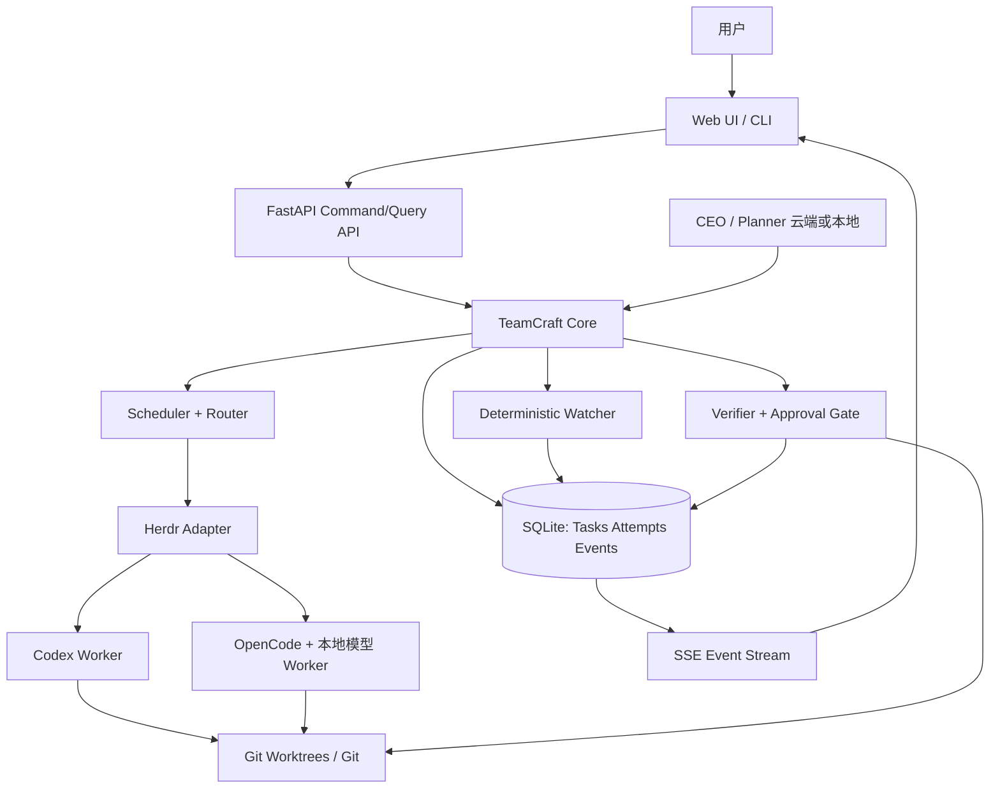

# TeamCraft 2.0 — 个人多 Agent 开发编排系统

> **文档性质**：产品需求文档（PRD）＋里程碑目标＋AI 开发代理执行契约；实施设计以已原则接受的 [M0 Review / ADR-001](TEAMCRAFT_2_0_M0_REVIEW.md) 为基线，详细任务、依赖和逐项验收以该报告第 9 节为唯一权威来源
>
> **版本**：v1.1（M1-02 实施修订）
> **日期**：2026-10-23
> **目标仓库**：https://github.com/DiQiTech-AI/teamcraft  
> **目标读者**：产品维护者、Codex/OpenCode 等编码 Agent、后续贡献者  
> **状态**：M0 Review / ADR-001 已获原则接受，M1-01 已通过评审；M1-02 已获开工授权并形成待验收实现。M1-03 及以后未获授权，目标能力不得理解为已实现。决策与证据见 [M0 Review 第 12 节](TEAMCRAFT_2_0_M0_REVIEW.md)。

---

## 0. 给 AI 编码 Agent 的最高优先级执行说明

如果你是接手本文件的编码 Agent，请依次遵守：

1. **先审计现状，后编写代码。** 阅读 `README.md`、`README.zh-CN.md`、`PROGRESS.md`、`.agents/skills/teamcraft/`、`scripts/`、`tests/` 和现有配置。本文的文件路径、命令和接口是**目标设计**，不得假设已在代码中存在。
2. **禁止推倒重写。** 必须保持现有 Skill 的 Herdr 会话交互、CEO/CTO/Developer/Designer/Tester 角色、Ownership 校验、read-only 成员、状态查询、文件锁和保守恢复语义。M1-02 已按已接受设计把未对外部署的 Skill 技术名从 `herdr-team` 直接改为 `teamcraft`，不保留旧目录入口；该目录变化不改变 CLI 或 `.herdr-team/` 运行状态语义。其他不兼容变更须先审查。
3. **优先交付最小纵向闭环。** 一次实现一个可测的端到端切片，不得同时铺开所有后端、Web UI、模型路由、GitHub 自动化。
4. **确定性编排。** 状态转换、租约、任务依赖、去重、审批、Worktree 生命周期、校验门禁由代码控制；LLM 只负责规划、生成、诊断和建议。
5. **安全默认。** 未知任务结果不得自动重复派发；没有人工批准不得合并主分支、部署、删除含未提交修改的 Worktree、触发高风险外部副作用。
6. **交付每阶段必须提供**：变更摘要、受影响文件、数据库迁移说明、测试及运行结果、失败场景验证、回滚方案、尚未完成事项。
7. **遵守许可。** 参考 Gas Town、Firstmate、Overstory、LangGraph 等的思想；复制源码前单独确认实际文件许可证及归属要求。
8. **不要虚报。** 任何成功率、Token 节省率、兼容性、性能指标都需实测；未验证的内容标注为假设或目标。

### 0.1 项目一句话定位

TeamCraft 2.0 是一个 **local-first、single-user、failure-resilient、cost-aware** 的个人 AI 软件开发编排系统，使用云端或本地主控 Agent 组织 Codex、OpenCode 等执行型 Agent，通过持久化任务、事件驱动监督、Git Worktree 隔离、自动验证和 Web 控制台，完成从需求到审查/PR 的开发闭环。

### 0.2 成功定义

用户能在 Web UI 或 CLI 提交开发需求，查看任务 DAG 和实时执行状态；系统能将可并行任务分配给不同 Worker，安全恢复中断，验证结果，产出 PR 或本地变更，并在关键节点请求用户审批。**关闭浏览器不影响任务运行，关闭 CEO 会话不丢失任务，常规状态巡检不耗 LLM Token。**

---

## 1. 背景与现状

### 1.1 已有公开能力（待开发时再次逐项核对）

M0 在 2026-10-21 查阅 README 时记录的 Skill 技术名是 `herdr-team`；M1-02 待验收实现只把该入口改名为 `teamcraft`，下列既有能力与运行语义未变。按当前工作树：

- 通过 `teamcraft` Skill 管理团队，默认仅启动 CEO，按需启动 CTO、Developer、Designer、Tester 或自定义专家。
- 角色责任和 Agent Harness 分离：可通过 Herdr 支持的 Codex、OpenCode 等 Harness 运行。
- 修改代码成员声明项目内相对路径 Ownership；活动成员的重叠范围被拒绝；只读成员可不占用编辑范围。
- `.herdr-team/state.json` 保存成员、Pane、任务、Ownership、执行阶段等信息。
- `resume` 验证终端与原生会话；不确定提交结果时采用 **inspect first**，不自动重发。
- `status` 具有 `blocked/working/idle/done/unknown/missing` 等实时信号；生命周期写操作使用文件锁。
- 公开仓库已有 `scripts/`、`tests/`、示例和进度记录。

以上是既有能力，不代表新方案的 SQLite、Watcher、Worktree、Web UI、GitHub PR 自动化已经上线。

### 1.2 当前问题与目标改进

| 问题 | 目标行为 | 验证方式 |
|---|---|---|
| CEO 需要主动轮询成员 | Watcher 检查，必要时事件唤醒 CEO | 空闲期无 LLM 监督调用 |
| Task 与成员/会话关联过紧 | Task / Attempt / Agent / Session 分离 | 会话重启后 Task ID 不变 |
| JSON 状态逐渐不适合复杂历史和并发 | SQLite 事务和可迁移 Schema | 并发/崩溃测试、迁移回滚 |
| 同一工作树编辑存在误改风险 | Ownership + 独立 Git Worktree + Diff 边界审查 | 两 Worker 不共享未提交代码 |
| 缺少统一可观测界面 | 本地 Web 控制台，实时事件与安全操作 | 浏览器查看真实数据并可审批 |
| 缺少严格交付证据 | 固定 Verifier、测试/Commit 绑定、PR 门禁 | 任务不能仅凭 Agent 自称 done 完成 |
| 本地/云端模型分流不统一 | 规则路由 + 人工覆盖 + 故障升级 | 任务记录实际 Harness/Model 和升级原因 |

### 1.3 明确非目标（至少 v2.0 阶段）

- 不开发新的大模型推理引擎、完整 IDE 或新的终端模拟器。
- 不复制 Gas Town 的多层驻留 AI 监督体系，也不引入 Dolt、Redis、Kafka、Kubernetes。
- 不支持 SaaS、多租户、团队级 RBAC、跨组织计费。
- 不要求 24/7 自主智能体常驻；系统可以有轻量本地 Watcher，但不需要常驻 LLM。
- 不做可任意执行脚本的图形化拖拽工作流编辑器；先做**只读可视化 DAG**。
- 不将 Web UI 作为编排状态真源，也不默认通过公网暴露。

---

## 2. 核心用户场景与功能范围

### 2.1 目标用户

单个开发者，在一台 Apple Silicon Mac 或个人工作站上管理 1–3 个活跃 Worker，偶尔并发更高；使用 Codex 云端模型处理规划/复杂决策，OpenCode + 本地模型处理较简单的代码编写与测试；日常从浏览器/CLI 管理任务。

### 2.2 关键使用场景

**UC-01 需求到 PR**：提交“给 API Key 项目增加异常 IP 检测和单元测试”；CEO 制定任务与验收标准；Scheduler 根据依赖并行启动开发任务；Verifier 测试；生成 PR 等待人工审批。

**UC-02 任务可视化管理**：用户在 Web UI 查看待办、进行中、待验收、阻塞、待审批任务；查看 Agent、日志、耗时、关联 Git commit 与测试证据。

**UC-03 人工介入**：Worker 卡住时用户查看现场，选择“继续等待 / 暂停派工 / 请求诊断 / 确认新尝试 / 取消”；操作有审计日志。

**UC-04 故障恢复**：Herdr Pane 或模型进程异常退出，系统保留 Task 和 Attempt 历史；先核对活动状态、文件与副作用，才能决定是否续接或创建新的 Attempt。

**UC-05 混合模型**：默认本地 Worker；高风险、复杂任务或多次失败时升级云端 Worker；记录变更原因和用量，不能凭模型名宣称节省金额。

**UC-06 非编程任务**：可以分配 research/audit 只读任务，交付报告而不是 Git PR。

### 2.3 优先级含义

- **P0 / MVP 必须**：没有就不能形成可靠使用闭环。
- **P1 / v2.0 增强**：核心闭环稳定后逐步增加。
- **P2 / 后续**：有价值但不应阻碍 MVP。

### 2.4 功能需求清单

| ID | 功能 | 优先级 | 验收要点 |
|---|---|---|---|
| FR-001 | 项目注册与工作目录管理 | P0 | 登记现有 Git 仓库、验证根路径及权限 |
| FR-002 | Task 创建/编辑/查询 | P0 | 描述、目标、验收标准、优先级、状态与审计 |
| FR-003 | Task DAG 依赖 | P0 | 禁止循环；仅上游满足要求才变为 READY |
| FR-004 | Attempt 与 Session 独立 | P0 | 失败重试产生新 Attempt，历史不可覆盖 |
| FR-005 | SQLite 事务和事件流 | P0 | 状态变更+事件同事务；迁移可恢复 |
| FR-006 | Herdr Adapter | P0 | 启动、状态、日志、发送、停止、能力检查 |
| FR-007 | Watcher 与异常恢复 | P0 | 异常检测、去重、租约、未知状态安全暂停 |
| FR-008 | Ownership 保护 | P0 | 保留既有重叠检测和只读语义 |
| FR-009 | 基本 Web UI | P0 | 真实任务、Agent、事件、详情和审批 |
| FR-010 | CLI/Web 共用命令服务 | P0 | 相同输入得到一致状态转换 |
| FR-011 | 自动 Verifier | P0 | 校验退出码、Git Diff、测试结果与 commit |
| FR-012 | 用户审批 | P0 | 待审批持久化、拒绝、批准、审计、权限门禁 |
| FR-013 | Git Worktree 执行隔离 | P1 | 各写入任务单独分支/工作树；安全清理 |
| FR-014 | SSE 实时推送 | P1（可随 UI 提前） | 可断线重连/事件序号补拉 |
| FR-015 | Model Router | P1 | 根据策略/风险/预算选择 Harness 与 Model |
| FR-016 | GitHub PR 交付 | P1 | gh 认证检查、PR 创建、状态获取、人审合并 |
| FR-017 | Workflow DAG 图 | P1 | 可视化节点依赖、状态与阻塞原因 |
| FR-018 | Token 与成本分析 | P1 | 区分真实用量、估算用量、缺失值 |
| FR-019 | 验证/重试策略与失败升级 | P1 | 有界重试、失败分类、无重复副作用 |
| FR-020 | 项目级配置与策略 | P1 | 并发、模型、审批、验证命令可分别配置 |
| FR-021 | Review 专家/交叉审查 | P2 | 仅在有价值时启动额外 Agent |
| FR-022 | 远程访问 | P2 | 优先 SSH/VPN，需验证授权与 CSRF |
| FR-023 | 多机 Worker | P2 | 单机稳定后独立设计，不纳入 v2.0 |

---

## 3. 架构与边界

### 3.1 逻辑分层



原则：Web UI 无业务真相；SQLite 是编排状态真源；Herdr 是**运行状态观测源**；Git 是**代码事实源**；模型日志是**辅助证据**。三者须交叉检查，不能把 `idle` 直接等同 `done`。

### 3.2 技术栈与决策

| 层 | 首选 | 说明 |
|---|---|---|
| Core | Python 3.10+ 标准库优先 | 与现有 CLI 支持范围一致；最低版本由 `pyproject.toml` 固定，Linux CI 证据仍待补齐 |
| Storage | SQLite（WAL） | 单机 ACID、外键、迁移、事务事件 |
| HTTP API | FastAPI + Uvicorn | 单服务即可提供 API/SSE/静态页 |
| Web | React + TypeScript + Vite | 桌面优先、响应式、无独立生产 Node 服务 |
| UI 组件 | 可选 shadcn/ui | 严格控制依赖和 bundle 体积 |
| DAG | React Flow（P1） | 可视化即可，编辑功能延期 |
| Event Streaming | SSE + REST | 单向实时状态，命令通过 REST |
| Process / Agent | Herdr adapter | 不绕过现有恢复逻辑 |
| Git | Git CLI + 可选 gh | v2.0 初期拒绝破坏性自动操作 |
| Model | Codex/OpenCode 各自 Provider | Core 不直接承担模型推理 |

**进程布局**：推荐单一 `teamcraft serve` 本地进程，包含 API、轻量 scheduler/watcher（可通过单独子进程模式扩展），浏览器是纯客户端。为避免两进程同时抢任务，必须使用 SQLite 条件更新/单独 Scheduler Leader Lease。空闲时无需 LLM 活动。

### 3.3 Core 模块职责

- `tasks`: Task CRUD、DAG、状态转换、验收标准。
- `attempts`: 执行尝试、结果、绑定 Session、幂等控制。
- `storage`: schema/migration/transaction，禁止上层直接随意写库。
- `events`: append-only 事件、Outbox、客户端游标。
- `scheduler`: READY 检测、并发配额、公平派工、租约。
- `watcher`: 观察会话/心跳/日志/Git/事件，不直接做高风险决策。
- `router`: 本地/云端模型与 Harness 的可解释规则。
- `workspace`: 路径规范化、Ownership、Worktree 生命周期。
- `verifier`: 程序化检查及证据绑定。
- `approval`: 审批请求、状态、授权及审计。
- `adapters/herdr`: CLI/协议封装、错误归一化、能力探测。
- `api`: 只读 Query 与受控 Command，不直接修改数据库内部表。

### 3.4 非功能要求

- 单机 1–3 个活跃 Worker 的核心功能可用；更高并发不做早期 SLA。
- Web UI 关闭或浏览器断线时任务继续；后端重启可根据 DB/Herdr/Git 重建运行态。
- 任何读操作不得触发派工；任何写操作可审计、去重、有错误反馈。
- 安装和运行无需 Redis/外部数据库/公网账号（GitHub 发布 PR 除外）。
- 配置与状态留本地；不得把 API key、原始敏感日志默认写入事件 payload。

---

## 4. 数据模型与 SQLite Schema（建议 v1）

> 下列 DDL 是初始设计，实施前通过代码审计确认历史字段和迁移适配。所有时间字段采用 UTC ISO-8601。ID 使用 UUID/ULID 或稳定的带前缀 ID，具体选择保持一致。

```sql
PRAGMA foreign_keys = ON;
PRAGMA journal_mode = WAL;

CREATE TABLE schema_migrations (
  version INTEGER PRIMARY KEY,
  applied_at TEXT NOT NULL
);
CREATE TABLE projects (
  id TEXT PRIMARY KEY,
  name TEXT NOT NULL,
  repo_path TEXT NOT NULL UNIQUE,
  config_json TEXT NOT NULL DEFAULT '{}',
  created_at TEXT NOT NULL
);
CREATE TABLE tasks (
  id TEXT PRIMARY KEY,
  project_id TEXT NOT NULL REFERENCES projects(id),
  title TEXT NOT NULL,
  description TEXT NOT NULL DEFAULT '',
  acceptance_json TEXT NOT NULL DEFAULT '[]',
  kind TEXT NOT NULL DEFAULT 'ship', -- ship | scout
  priority INTEGER NOT NULL DEFAULT 50,
  status TEXT NOT NULL,
  risk TEXT NOT NULL DEFAULT 'normal',
  ownership_json TEXT NOT NULL DEFAULT '[]',
  version INTEGER NOT NULL DEFAULT 0,
  created_at TEXT NOT NULL,
  updated_at TEXT NOT NULL
);
CREATE TABLE task_dependencies (
  task_id TEXT NOT NULL REFERENCES tasks(id) ON DELETE CASCADE,
  depends_on_id TEXT NOT NULL REFERENCES tasks(id) ON DELETE CASCADE,
  PRIMARY KEY(task_id, depends_on_id),
  CHECK(task_id <> depends_on_id)
);
CREATE TABLE agents (
  id TEXT PRIMARY KEY,
  role TEXT NOT NULL,
  harness TEXT NOT NULL,
  model TEXT,
  provider TEXT,
  config_json TEXT NOT NULL DEFAULT '{}'
);
CREATE TABLE attempts (
  id TEXT PRIMARY KEY,
  task_id TEXT NOT NULL REFERENCES tasks(id),
  agent_id TEXT REFERENCES agents(id),
  attempt_no INTEGER NOT NULL,
  status TEXT NOT NULL,
  worktree_path TEXT,
  branch TEXT,
  lease_owner TEXT,
  lease_expires_at TEXT,
  started_at TEXT,
  finished_at TEXT,
  result_json TEXT,
  UNIQUE(task_id, attempt_no)
);
CREATE TABLE sessions (
  id TEXT PRIMARY KEY,
  attempt_id TEXT REFERENCES attempts(id),
  backend TEXT NOT NULL,
  native_session_id TEXT,
  pane_id TEXT,
  state TEXT NOT NULL,
  last_observed_at TEXT,
  created_at TEXT NOT NULL
);
CREATE TABLE events (
  seq INTEGER PRIMARY KEY AUTOINCREMENT,
  event_id TEXT NOT NULL UNIQUE,
  kind TEXT NOT NULL,
  project_id TEXT REFERENCES projects(id),
  task_id TEXT REFERENCES tasks(id),
  attempt_id TEXT REFERENCES attempts(id),
  payload_json TEXT NOT NULL DEFAULT '{}',
  occurred_at TEXT NOT NULL
);
CREATE TABLE commands (
  id TEXT PRIMARY KEY,
  idempotency_key TEXT NOT NULL UNIQUE,
  kind TEXT NOT NULL,
  payload_json TEXT NOT NULL,
  state TEXT NOT NULL,
  requested_at TEXT NOT NULL,
  result_json TEXT
);
CREATE TABLE approvals (
  id TEXT PRIMARY KEY,
  task_id TEXT NOT NULL REFERENCES tasks(id),
  kind TEXT NOT NULL,
  status TEXT NOT NULL,
  proposed_json TEXT NOT NULL,
  decided_at TEXT,
  decision_note TEXT,
  created_at TEXT NOT NULL
);
CREATE TABLE verifications (
  id TEXT PRIMARY KEY,
  attempt_id TEXT NOT NULL REFERENCES attempts(id),
  commit_sha TEXT NOT NULL,
  command TEXT NOT NULL,
  exit_code INTEGER,
  output_path TEXT,
  status TEXT NOT NULL,
  created_at TEXT NOT NULL
);
CREATE INDEX idx_tasks_project_status ON tasks(project_id, status);
CREATE INDEX idx_events_task_seq ON events(task_id, seq);
CREATE INDEX idx_attempts_task ON attempts(task_id, attempt_no);
```

**额外约束**：

- `task_dependencies` 的无环检测在事务内由 Core 验证（SQLite CHECK 无法保证全图无环）。
- `tasks.version` 用乐观锁避免过期客户端覆盖。
- 状态与事件必须同事务提交；事件可以兼任本地 Outbox，但外部副作用采用 `commands` 的 pending/running/confirmed/unknown 流程，不能依赖恰好一次投递。
- SQLite `lease_expires_at` 不是证明进程已死的充分证据；租约到期后必须先核对 Herdr/Git/副作用再接管。
- 日志大文本存本地受控文件路径和摘要，DB 仅存元数据；文件引用需严格限制在已批准根目录内。
- 未来用量统计可增 `usage_samples` 表，字段需包含 `source`、`exact_or_estimated`、`input_tokens`、`output_tokens`、`cached_tokens`、`currency`、`price_version` 等，不允许空缺被写为零。

---

## 5. 状态机、调度与故障恢复

### 5.1 Task 状态

`PENDING → READY → RUNNING → VERIFYING → READY_TO_MERGE → DONE`

异常/控制状态：`BLOCKED`, `NEEDS_HUMAN`, `FAILED`, `CANCELLED`。

建议转换规则：

| 当前 | 触发 | 下一步 | 条件 |
|---|---|---|---|
| PENDING | dependencies_satisfied | READY | 所有硬依赖按定义完成 |
| READY | dispatch_reserved | RUNNING | 事务抢占成功、Ownership 可用、并发配额可用 |
| RUNNING | worker_reported_done | VERIFYING | 仅启动验证，不代表验收通过 |
| RUNNING | runtime_unknown | NEEDS_HUMAN 或 BLOCKED | 先执行 Reconcile，禁止盲目重派 |
| VERIFYING | verification_passed | READY_TO_MERGE | commit 和全部必需门禁匹配 |
| VERIFYING | verification_failed | BLOCKED / READY | 根据预算和副作用风险决定修复尝试 |
| READY_TO_MERGE | approved_and_delivered | DONE | 本地交付或 PR/合并目标条件满足 |
| 任意非终态 | user_cancel | CANCELLED | 尽力停止 Agent，并保留现场与审计 |

`ship` 与 `scout` 类型有不同完成条件：`scout` 需要报告经审核即可 DONE；`ship` 必须满足选定的交付策略。PR 已创建但未经审批/合并时不得谎称“已合并完成”。

### 5.2 Attempt 状态与不变量

Attempt 可以是 `CREATED → STARTING → ACTIVE → FINISHED | FAILED | UNKNOWN | CANCELLED`。`UNKNOWN` 必须人工或确定性证据处理后才能产生新尝试。**同一 Task 同时至多有一个活跃 Attempt**；数据库层使用事务条件与适当唯一活动约束实现，不能仅依赖内存状态。

### 5.3 DAG 调度

- 每个 Task 有硬依赖列表；必须检查无环并报告具体循环路径。
- Scheduler 选择 READY 且未被租约占用的任务；先按优先级/创建顺序，再考虑 Ownership 与资源配额。
- 初始默认 `max_concurrent_workers = 2`，全局与项目级均可覆盖。
- 任务 Brief 必须包括：目标、非目标、限定路径、依赖、验收标准、可用命令、禁止操作、输出报告格式、时间/预算上限。
- 明确读操作与写操作：read-only Worker 不能通过任务授权路径申请写入。

### 5.4 Hook 式任务归属（借鉴思想，不照搬实现）

持久化 `task_id ↔ attempt_id ↔ session_id` 关系。Worker 恢复时重新装载任务 Brief、上次确认的 Commit、日志摘要与未完成验收步骤。**不依赖原对话上下文恢复全部事实**。

### 5.5 Watcher 与事件处理

Watcher 以可配置周期（例如 5–15 秒，仅为初始调试建议）执行确定性检查：

1. 读取执行中的 Attempt 与租约。
2. 查询 Herdr Session 存活与活动状态。
3. 读取最近心跳/进度、Git 变更和阶段超时信息。
4. 产生变化事件；相同状态不重复发布。
5. 正常长任务继续观察；阻塞、失败、需要审批时产生可操作的告警。
6. 不自动调用 LLM；仅策略确认有决策需求时通知 CEO 或用户。

### 5.6 可靠恢复原则

必须处理以下至少 8 种故障：

- 启动请求发出，但 Herdr 回应丢失。
- Agent 运行中进程退出。
- Agent 会话存活但没有推进。
- Worktree 存在未提交变更，任务却显示失败。
- Agent 已提交 Commit，但 `done` 回报丢失。
- Verifier 结束后服务崩溃，结果尚未处理。
- 重复收到 `completed` 事件。
- 浏览器断线、后端重启、数据库恢复后 UI 状态不一致。

每种故障必须定义：可观察证据、自动安全动作、人工升级条件、幂等性边界、测试场景。系统只承诺 **at-least-once 检查 + 幂等状态处理**，不宣称对外部副作用 exactly-once。

---

## 6. Workspace、Ownership、Git 与验收

### 6.1 双重隔离

1. **Ownership**：调度层声明并验证可修改路径（现有功能）；保存到 Task/Attempt。
2. **Worktree**：每个写入 Attempt 使用独立 Git Worktree 和专属分支（P1）；只读任务可使用只读执行策略，但必须明确定义访问权限。
3. **Diff Gate**：提交前计算 `git diff --name-only`，核对真实变更是否处于许可路径；禁止通过软链接、`../`、绝对路径或大小写变体绕过检查。
4. **Shared resource**：数据库、端口、容器、缓存目录、临时文件和凭证独立配置。Worktree 不是沙箱，不能替代系统级权限限制。

### 6.2 Worktree 生命周期

`ALLOCATED → ACTIVE → SEALED → VERIFIED → DELIVERED → CLEANABLE`。

- 分支命名可采用 `tc/<task-id>/<attempt-no>`。
- 创建前确保主仓库干净性与分支基础 SHA 可记录。
- 不得自动删除未提交修改、未合并提交或调查现场；清理须通过 Git 事实验证，必要时由用户确认。
- 并行任务合并冲突时标记 `BLOCKED` 或进入集成任务，绝不强制覆盖主分支。

### 6.3 程序化 Verifier

输入：Task 验收标准、Attempt ID、Commit SHA、Worktree、项目校验配置。

输出：`PASS | FAIL | ERROR | SKIPPED`，以及 lint/test/typecheck/secret scanning 的退出码、日志路径和执行时间。

强制规则：

- Agent 文本声称“测试通过”不是证据；Verifier 应独立运行配置命令。
- 结果绑定具体 Commit SHA，代码改变后已有通过结果失效。
- 高风险项目必须配置足够门禁；没有校验命令时不能默认 PASS。
- 执行的命令仅能来自项目已批准配置，不接受未经审批的任意 UI 参数作为 Shell。

### 6.4 交付策略

- `local-only`：用户接收本地 Commit/分支/报告；无远程 PR 要求。
- `direct-PR`：使用 `gh` 创建/更新 PR，等待用户批准合并。
- `report-only`：审计、研究、探索结果，不涉及代码发布。

v2.0 默认 `direct-PR` 只在 GitHub CLI 可用且用户开启后启用；默认**禁止自动 merge、push 到受保护主分支、部署**。

---

## 7. Model Router 与 Token/成本治理

### 7.1 设计目标

允许云端 CEO（Codex 等）进行少量高价值决策，本地 OpenCode/oMLX Worker 承担低到中复杂度的编码、测试、审计；重要任务或重复失败时自动建议升级，执行升级操作要遵守预算与权限策略。

### 7.2 初期规则策略

| 情况 | 首选 | 备注 |
|---|---|---|
| 文档、测试、低风险局部修改 | 本地 Worker | 本地服务健康可用时 |
| 中等复杂度独立功能 | 本地 Worker | 验收失败后可能升级 |
| 跨模块复杂架构 | 云端规划 + 可拆分本地子任务 | 不强行全部本地 |
| 认证、密钥、权限、支付、部署 | 云端强模型 + 人审 | 高风险不按省钱优先 |
| 本地服务不可用、失败超阈值 | 云端 Worker 或 NEEDS_HUMAN | 有预算时才允许升级 |

策略配置建议：

```yaml
routing:
  default_harness: opencode
  max_attempts_per_task: 2
  local_first: true
  cloud_escalation_requires_approval: true
limits:
  max_concurrent_workers: 2
  max_cloud_input_tokens_per_task: null
  max_cloud_output_tokens_per_task: null
safety:
  auto_merge: false
  deploy_requires_approval: true
```

### 7.3 成本观测

记录每个 Attempt 的 `provider/model/harness`、已知输入输出 Token、缓存 Token、模型响应次数、耗时、试错次数和任务验收状态。模型接口没有提供用量时显示“不可得”而非 `0`。价格必须有来源和有效期，订阅制额度与 API 账单分开呈现。

建议核心指标：

- 云端 Token / 每个验收通过 Task；
- 实际完成率（分离任务难度）；
- 从 READY 到 VERIFIED 的中位时长；
- 需要人工介入比例与失联恢复成功率；
- 纯云端与混合模式在**相同任务集**上的成本/质量/时间对照。

首期可把“云端主控 Token 降低 50%+”设成**实验目标**，不是官方或产品保证。

---

## 8. Web 控制台功能规格

### 8.1 设计原则

- Web UI = **观察 + 安全控制**，不是 Agent Runtime，也不持有编排状态真源。
- 默认绑定 `127.0.0.1`；浏览器关闭不影响 Core/Worker。
- 首期桌面优先，但手机尺寸可查看任务与审批。
- **状态表达必须可信**：`Agent idle` 与 `Task done` 明确区分；日志截断时展示提示；成本估算标明精度。
- 所有高风险操作使用确认框、操作原因、审计记录和明确的异步结果状态。

### 8.2 信息架构

| 页面 | P0 展示 | P1/P2 扩展 |
|---|---|---|
| Overview | 活跃任务、异常、在线 Agent、待审批、最近事件 | 用量趋势、健康趋势、项目摘要 |
| Tasks | 搜索过滤、状态列表、详情、Attempt/Session 历史、取消/重试申请 | Kanban、批量操作、GitHub Issue 同步 |
| Task Detail | 目标、验收标准、依赖、Ownership、日志、证据、审批 | Diff 内嵌预览、耗时与成本对比 |
| Agents | 角色、Harness、Model、关联会话、实时状态、最近活动 | 能力配置、会话回放 |
| Workflow | P0 为只读依赖列表 | P1 React Flow DAG 节点状态/错误定位 |
| Events | 时间线、筛选、详情、来源 | 导出诊断包 |
| Approvals | 待批准操作、风险说明、批准/拒绝 | 多级规则、审批模板 |
| Settings | 项目路径、并发、Verifier、后端健康 | 路由、Token 预算、备份管理 |

### 8.3 UI 交互细则

**Overview**：首次加载显示真实的 `active_tasks/blocked_tasks/pending_approvals/active_sessions`。核心进程离线时显示离线，不冒充健康；没有 Token 数据显示 `--`。

**Tasks**：点击任务进入 Detail；创建需要最少 `title/description/project`，验收标准推荐填写；编辑运行中任务的 Ownership 或关键约束需暂停/新版本而非静默覆盖。

**Agent Detail**：显示执行中的 Attempt、原生 Session/Panes、最近命令摘要、结构化事件、尾部日志；任何“停止”明确区分优雅停止与强制终止，不能把终止进程等同任务完成。

**Approvals**：显示 proposed action、目标 Task、Commit SHA、受影响文件、Verifier 结果、后果和撤回路径；批准后发 Command，前端通过事件订阅得知最终状态，不能立刻宣称成功。

**DAG**：节点包括 Task 状态、角色、依赖、阻塞原因；MVP 只读，不支持通过拖动改变依赖。若实现编辑，需要后端重新校验无环与状态约束。

**Events**：事件必须有单调 `seq`、时刻、来源、Task/Attempt 关联；安全脱敏与可检索性兼顾。

### 8.4 实时更新

首选 SSE `GET /api/v1/events/stream?after=<seq>`，支持 `Last-Event-ID` 与断线后补拉；客户端启动先请求快照再订阅，检查序号连续，丢事件时重新拉取状态。事件仅是提醒更新的信号，重要列表仍以 REST 查询为准。

### 8.5 API 草案

```text
GET    /api/v1/health
GET    /api/v1/projects
POST   /api/v1/projects
GET    /api/v1/tasks?project_id=&status=&q=
POST   /api/v1/tasks
GET    /api/v1/tasks/{task_id}
PATCH  /api/v1/tasks/{task_id}
POST   /api/v1/tasks/{task_id}/commands     # pause, resume, retry, cancel
GET    /api/v1/tasks/{task_id}/attempts
GET    /api/v1/tasks/{task_id}/verifications
GET    /api/v1/agents
GET    /api/v1/agents/{agent_id}
GET    /api/v1/events?after=&limit=
GET    /api/v1/events/stream
GET    /api/v1/approvals?status=pending
POST   /api/v1/approvals/{approval_id}/decision
GET    /api/v1/usage?project_id=&range=
```

写接口要求：

- `Idempotency-Key` 必填（同键同请求必须返回同一操作结果，不同请求复用同键返回冲突）。
- 使用稳定的 JSON 错误响应：`code/message/details/request_id`。
- 有版本冲突时返回 `409`；未授权 `403`；外部操作异步执行时返回 `202` + command ID。
- SSE 为只读；跨站请求防护、Origin 检查和本地鉴权由安全章节定义。

### 8.6 API 请求示例

```json
{
  "project_id": "proj_api",
  "title": "增加异常 IP 检测",
  "description": "检测高风险来源并记录审计事件",
  "acceptance": [
    "异常 IP 命中规则时返回预定结果",
    "新增单元测试通过",
    "修改不越过 src/security/** 的授权范围"
  ],
  "dependencies": [],
  "ownership": ["src/security/**", "tests/security/**"],
  "priority": 50,
  "risk": "normal"
}
```

**示例状态**：任务被接受并不等于 Worker 已启动；前端要能显示 `PENDING/READY/RUNNING` 差异。

### 8.7 Web UI 不应包含的功能（首版）

- 远程 arbitrary shell、网页终端写入、直接浏览/修改全部本地文件。
- 任意 SQL 查询与数据库管理员控制台。
- 一键强制合并、自动部署、没有确认的目录清理。
- 多用户注册、组织设置与云端托管。

---

## 9. 安全与权限

### 9.1 威胁模型

主要风险包括：本地 HTTP 管理接口被其他网站诱导请求、恶意项目内容通过日志/XSS 攻击 UI、提示词注入诱导 Agent 越权修改、路径穿越、Worktree 误删、API 凭证泄露、重复外部操作。

### 9.2 基线策略

1. 本地服务器默认只绑定 `127.0.0.1`；外网绑定需显式配置、认证、TLS/可信反向代理。
2. 所有修改操作使用本地 Session Token 或等效随机令牌，并验证 Origin、CSRF；不允许只凭本机地址视为完全可信。
3. API 不接受任意 Shell 字符串。验证命令须列在受信任的项目配置白名单，执行时使用 argv 数组、限制路径/环境/超时。
4. 文件/日志访问只允许关联 Task 的受控路径，不接受路径穿越和任意 symlink 跳转。
5. Web UI 对日志/Markdown 安全转义与净化；不执行日志中的 HTML/JS。
6. 对密钥、令牌和敏感 env 做日志脱敏；数据库不存明文凭证。
7. 任务 Brief/仓库内容都是不可信文本，不能越过系统指令和审批策略。
8. `merge/deploy/delete worktree/rotate secrets` 默认为人工批准；拒绝审批时不得偷偷重试。
9. 访问和控制命令均记审计日志，状态修改可追责。

---

## 10. 项目代码组织建议

> 不要求立即按下列结构重排；现阶段保留 `teamctl` 外部 CLI 与 `.agents/skills/teamcraft/` Skill 入口，采用渐进式迁移。M1-02 只建立最小 Python 包边界并迁移 Skill 技术名，未提前实现存储、调度、Web 或模型路由。
>
> Skill 技术名 `herdr-team` → `teamcraft`（2026-10-23 决策）已在 M1-02 待验收实现中落地：仓库与安装器只提供 `.agents/skills/teamcraft/`，frontmatter `name` 为 `teamcraft`，不保留旧目录、兼容窗口或别名。`.herdr-team/` 运行状态目录保持原名；JSON→SQLite cutover 仍归 M1-06/M1-07，且未在 M1-02 执行。

```text
teamcraft/
├── README.md
├── README.zh-CN.md
├── PROGRESS.md
├── doc/                      # 沿用当前已跟踪文档目录；下列其他文件仅是建议
│   ├── TEAMCRAFT_2_0_PLAN.md
│   ├── architecture.md
│   ├── api.md
│   └── migration.md
├── .agents/skills/teamcraft/    # 当前 Skill 入口（M1-02 待验收实现）
├── scripts/                    # 兼容现有脚本
├── teamcraft/                  # Python 代码包（区别于上面的 Skill 目录）
│   ├── core/
│   │   ├── tasks.py
│   │   ├── attempts.py
│   │   ├── scheduler.py
│   │   ├── watcher.py
│   │   ├── events.py
│   │   ├── storage.py
│   │   ├── approvals.py
│   │   ├── ownership.py
│   │   ├── worktree.py
│   │   ├── router.py
│   │   └── verifier.py
│   ├── adapters/
│   │   └── herdr.py
│   ├── api/
│   │   ├── app.py
│   │   └── routes/
│   └── cli.py
├── web/
│   ├── src/
│   │   ├── pages/
│   │   ├── components/
│   │   ├── api/
│   │   └── features/
│   └── package.json
├── tests/
│   ├── unit/
│   ├── integration/
│   ├── contracts/
│   └── e2e/
└── pyproject.toml
```

建议运行目录：`.herdr-team/` 中保留既有状态与缓存；新数据库可用 `.herdr-team/teamcraft.db`，日志和工件放受控子目录。数据库路径和目录迁移需要兼容旧安装。`.herdr-team/` 运行状态目录名不因 Skill 改名而变动；JSON→SQLite cutover 与状态目录改名是独立问题，归 M1-06/M1-07 决策。

---

## 11. 渐进迁移与兼容策略

### 11.1 迁移原则

- 现有 JSON 数据不得被原地覆盖；迁移前备份并计算校验摘要。
- 初期 **读取旧 JSON → 建库 → 校验 → 切换单一写入源**。不建议长期 JSON/SQLite 双主写入；必要的兼容导出应为只读派生。
- 切换前停止新派工或持有全局迁移锁；如果有活动会话，先记录 Session 映射并对恢复状态做显式 Reconcile。
- 每个版本的 Schema 都要有版本记录、上行迁移、可行时的回滚策略；无法无损回滚时提供快照恢复。
- 兼容命令执行行为、状态字段语义和错误码。任何弃用 CLI 命令至少在一个可见版本给出警告。M1-02 的 Skill 目录技术名变更是已批准例外：旧入口从未对外部署，因此直接改名且不保留旧目录；CLI 命令、参数和运行状态目录不适用此例外。

### 11.2 迁移测试

- 空项目、只读成员、多个活动成员、缺失 Pane、`unknown` 状态、路径范围重叠、损坏 JSON、重复迁移、迁移中断。
- 比较迁移前后：成员数、任务与角色、Ownership、会话映射和当前活动状态。
- 迁移后应用重启再次检查，避免只在第一次成功。

---

## 12. 里程碑目标与退出原则

本节只规定产品阶段目标与退出原则，不再维护任务 ID、前后依赖或逐项验收清单。[M0 Review](TEAMCRAFT_2_0_M0_REVIEW.md) 第 9 节是 M1–M6 的唯一详细任务来源，第 12 节记录开工、验收与迁移审批；发生差异时按已原则接受的 ADR-001 和该报告执行。阶段可由小范围、共同验收的变更交付，不要求一任务一 PR。完成上游任务或满足技术门禁不等于自动获得下一任务开工授权。

### M0 — Baseline & RFC（审计门禁）

**目标**：摸清现有代码、运行语义和测试基准，为变更划出兼容边界。M0-01 架构审计与 M1-01 兼容契约测试是不同任务；M0-01 的证据和状态见 M0 Review 第 2–3、12 节。

**退出原则**：现状、差距、基线测试、未知风险与 ADR-001 已记录；用户原则接受设计并单独授权首个实施任务。原则接受不代表正式数据迁移获批。

### M1 — Durable Core（P0）

**目标**：在保留旧 CLI、Herdr、Ownership 和保守恢复语义的前提下，使持久化 Task、Attempt、Session、Event 和 Command 可在无 Web 时使用。

**退出原则**：一致性备份、Schema 前向版本保护、事务与幂等通过；旧入口 Guard、冻结、代际和双进程故障矩阵通过后，才允许受控 JSON→SQLite 单真源切换。旧 writer 无法可靠阻断时保持 JSON 单写，不能宣称 M1 退出。实际切换仍须单独审批。

### M2 — Watcher & Safe Recovery（P0）

**目标**：用单一 Leader 的确定性调度、观察和恢复减少 CEO 持续轮询，并使 report-only/scout 具备验证与人工接受闭环。

**退出原则**：所有外部副作用经持久 Command 和 fenced Leader；失联、失租、回执丢失及无进展能安全 Reconcile；未知 Token 不当作零。普通编码任务、local-only 和 direct-PR 在 M4 证据链完成前不标记 DONE。

### M3 — Web UI 最小控制台（P0）

**目标**：以真实 Core 数据提供任务创建、编辑、查询、依赖、优先级、执行策略、观察与审批。

**退出原则**：CLI 与 Web 共用 Command Service；SSE 以 SQLite 持久事件序号为准，支持补拉与去重；关闭浏览器不影响任务。Web 对 report-only/scout 的验收与 CLI 一致，普通编码任务仍等待 M4。

### M4 — Workspace & Verification（P1）

**目标**：隔离并行编码，形成 Worktree、完整 Diff、Commit、Verifier 和交付审批证据链。

**退出原则**：越权变更和失败验证不能交付；local-only 只在指定 Commit/分支获接受后 DONE；direct-PR 创建不等于完成，只有有效批准后合并到预期 base 才 DONE；不自动清理脏 Worktree 或合并 PR。

### M5 — Model Routing & Cost（P1）

**目标**：稳定使用本地优先模型路径，记录实际用量、估算与未知，并评估成本和质量。

**退出原则**：本地服务失效时有界阻塞或获批升级；预算不把未知用量视为零；对照实验可复现且不虚报收益。

### M6 — UX Polish / Optional（P2）

**目标**：按实际需求改善 DAG、证据、诊断和模板体验。

**退出原则**：可选项逐项验收，界面只展示真实 Core 数据；远程或多机只进行单独 RFC，不在当前单机本地优先架构中直接实现。

---

## 13. 测试策略与验收标准

### 13.1 测试矩阵

| 测试层 | 内容 | 具体要求 |
|---|---|---|
| Unit | 状态转换、DAG、Ownership、路由、事件去重 | 不需要 Herdr/模型服务 |
| Integration | SQLite 并发、事务、迁移、Watcher、Git Worktree | 使用临时仓库和模拟 Adapter |
| Contract | Herdr 的命令、参数、错误、会话生命周期 | 有可离线 Fake，实机再验收 |
| API | 权限、Idempotency-Key、冲突、字段验证、SSE | 测试 401/403/409/202/断线续传 |
| Browser E2E | 任务创建、详情、等待审批、恢复确认 | 测试空/错误/离线/长日志场景 |
| Failure Injection | 异常退出、响应丢失、重启、重复完成、脏工作树 | 外部调用结果不明时先 Reconcile，不盲重发；Leader fencing 不保证外部接口 exactly-once |
| Benchmark | 耗时、成功率、Token/成本 | 真实任务集，不宣称单次结果代表整体 |

### 13.2 验收用完整场景

**AT-01 Basic ship**：创建 Task → Scheduler 派工 → Developer 修改独立分支 → Verifier 运行 → 创建 PR → 待人工批准；所有状态/事件/UI 更新一致。

**AT-02 Parallel**：两个互不重叠任务同时运行；不同 Worktree；任何权限越界都能被检测。

**AT-03 Crash & resume**：在运行、提交、验证三个关键点分别杀掉 Core/Worker 进程；重启后不重复提交，不丢数据，可续接或标记人工处理。

**AT-04 Browser lifecycle**：关闭页面并重新进入，后端持续工作；事件从中断点恢复或全量重拉。

**AT-05 Local worker failover**：关闭 oMLX 服务；系统识别不可用，依据预算/审批选择云端或阻塞，不无限重试。

**AT-06 Read-only audit**：Scout/Tester 不声明写入 Ownership，能生成报告，不得写入仓库。

**AT-07 Security**：模拟 CSRF、越权文件路径、恶意日志 HTML、重复写请求、非法测试命令，全部被拒绝或安全转义。

### 13.3 Definition of Done（任何阶段统一要求）

- [ ] 需求/测试用例与功能 ID（FR-xxx）有对应关系。
- [ ] 新功能的合法与非法状态路径都有测试。
- [ ] 没有破坏现有 CLI/Skill 行为；如果变更了，有明确迁移与说明。
- [ ] 错误处理、日志、权限与资源清理经过检查。
- [ ] README 与文档/截图按实际实现更新。
- [ ] 关键操作有审计，未知状态不会静默自动重试。
- [ ] 提供运行证据：测试命令、退出码、必要截图或日志摘要。
- [ ] PR 小而可评审；没有把计划外功能混进去。

---

## 14. 风险、取舍与开放问题

| 风险 | 影响 | 处理 |
|---|---|---|
| Herdr 协议/版本变化 | 会话恢复不稳定 | Adapter + 契约测试 + 能力探测 |
| 本地模型工具调用能力不足 | 任务失败/返工 | 真实 benchmark；有界尝试；云端升级 |
| SQLite 多进程抢占 | 重复派工 | 条件 UPDATE/唯一约束/leader lease |
| Worktree 非沙箱 | 共享资源误操作 | 限制命令、资源命名空间、审批 |
| Web UI 被恶意网页访问 | 任务被越权控制 | localhost + token + Origin + CSRF |
| 状态库与 Git/Herdr 不一致 | 虚假完成、丢失任务 | 启动 Reconcile、证据优先 |
| 测试覆盖不足 | 错误代码被合并 | 必需 Verifier 门禁 + 人审 |
| 成本数据不完整 | 节省率误导 | 区分真实/估计/缺失数据 |
| 持续扩张架构 | 项目变得难以维护 | 严格 P0/P1/P2、ADR、阶段门禁 |

待 M0 决定：

1. 兼容目标平台仅 macOS 还是 macOS/Linux？
2. Core/Wachter 采用同进程后台循环还是独立子进程？（推荐 MVP 同进程，保证单 Leader。）
3. CLI 是否已有稳定 `teamctl.py` 路径？以实际源码为准。
4. 第一版是否直接启用 Worktree？如时间有限可以先以现有 Ownership 保证旧功能，Worktree 延后到 M4；但不能宣称已实现强隔离。
5. `DONE` 的精确定义对 local-only/PR/report-only 是否需要项目可配置？建议先按交付策略定义。
6. 现有模型用量是否可从 Harness 稳定获取？不能获取时只显示缺失。

---

## 15. AI 编码 Agent 工作拆解与交付协议

### 15.1 每次任务开始前

1. 先列出当前仓库已经存在的文件、测试、可执行命令以及和本阶段相关的实际代码。
2. 明确本次只完成一个 Epic/子 Issue（例如 `M1-02`），不擅自推进后续里程碑。
3. 提出最小实现路径：需修改的文件、数据迁移、测试、回滚、兼容风险。
4. 若遇到设计冲突，写出 ADR 候选项并说明权衡；避免“为更优雅而重构全部项目”。
5. 如需要人工批准（数据库有损迁移、云端模型费用、远程发布、主分支合并等），停在审批门禁，不自行执行。

### 15.2 每次任务完成时，按固定模板回报

```markdown
## 实施结果
- 功能 ID / Issue：
- 本次实现：
- 未实现/延期：
- 修改文件：
- 数据迁移：
- 测试命令与结果：
- 与既有 CLI/Skill 的兼容性：
- 故障/回滚验证：
- 安全风险及未解决事项：
- Git commit / PR：
- 下一任务建议：
```

### 15.3 后续任务开工提示词模板

> 先阅读 `doc/TEAMCRAFT_2_0_PLAN.md` 的产品需求和 [M0 Review](TEAMCRAFT_2_0_M0_REVIEW.md) 的 ADR-001、第 9 节任务依赖及第 12 节授权记录。仅在用户对具体任务另行授权后，执行该任务的实施步骤与验收；先核对真实代码和测试，不把设计写成已实现功能。保持现有 Herdr、Skill 语义、Ownership 和保守恢复；本任务之外的里程碑、正式数据库 cutover、远程发布及高风险外部操作分别遵守对应门禁。交付须说明证据路径、测试命令与退出码、风险和未完成事项。

---

## 16. 参考项目与阅读入口

> 这些是架构参考，不是必须引入的依赖。采纳方案前核对对应仓库版本和许可证。

- TeamCraft：https://github.com/DiQiTech-AI/teamcraft — 现有 Skill、Herdr、Ownership 与保守恢复。
- Firstmate：https://github.com/kunchenguid/firstmate — Agent Distro、事件式监督、PR 交付、多 Harness 后端。
- Gas Town：https://github.com/gastownhall/gastown — Beads 任务持久化、Hook、Agent 生命周期、分层监督。
- Overstory：https://github.com/Nokodoko/overstory — Worktree、Agent 消息与健康检查；需核对维护分支。
- LangGraph：https://github.com/langchain-ai/langgraph — 状态机、Checkpoint、人审等工程思想。
- CrewAI：https://github.com/crewAIInc/crewAI — 角色协作、Flows 与流程划分。
- Oh My OpenAgent：https://github.com/code-yeongyu/oh-my-openagent — Agent specialization 与多模型路由思路。

---

## 17. 最小可发布版本（MVP）验收清单

满足以下条件即可发布 TeamCraft 2.0 的第一个可用预览版；不必等待全部 P1/P2：

- [ ] 旧版 TeamCraft 的常用 CLI/Skill 使用方式可继续运行。
- [ ] 新任务有持久化 Task、Attempt、Session、Event 和合法状态转换。
- [ ] Scheduler 能调度至少两个互不冲突任务，未知状态不盲目重发。
- [ ] Watcher 在无事件时不请求云端 LLM，故障可以安全恢复/升级。
- [ ] Web UI 展示**真实**任务、Agent、事件、审批；支持受控取消/恢复/审批。
- [ ] 自动 Verifier 至少检查配置的测试命令与交付证据，不信任模型自述。
- [ ] 所有写操作有幂等键与审计记录；无用户批准不执行高风险发布动作。
- [ ] 通过至少一条真实端到端任务，以及崩溃、重启、重复事件安全测试。
- [ ] 部署文档说明本地启动、备份/恢复、升级/回滚、许可证与已知限制。

**产品北极星指标**：每个被用户实际验收的开发任务，所需的人工监督次数、云端 Token 开销、失败恢复时间和交付质量。优化这些真实指标优先于最大 Agent 数量和界面复杂度。

---

**文档结束。**
